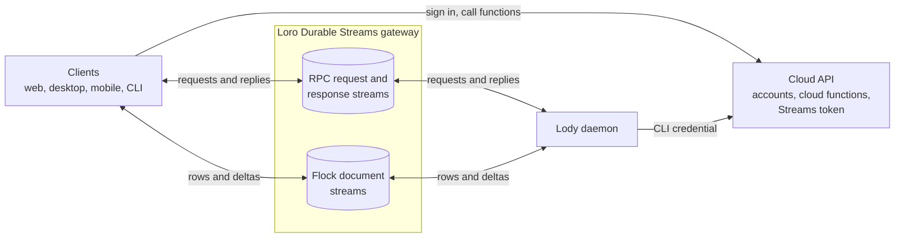

# lody-docs

Independent documentation of the protocols behind [Lody][lody], a local-first
workspace for coding agents. It describes what the public source does, cites
the source for each claim, and says plainly where the evidence stops.

There are three document sets. Each stands alone, and each opens with its own
overview.

| Document set | Subject | Start here |
| ------------ | ------- | ---------- |
| Flock protocol | How the daemon replicates machine state and accepts durable commands through Flock, the Loro team's last-writer-wins key-value store; checked by models written in TLA+, the Temporal Logic of Actions specification language | [Overview](docs/flock-protocol/README.md) |
| Streams RPC | The remote procedure call (RPC) protocol the daemon serves over Loro Durable Streams, for ordinary and end-to-end encrypted workspaces | [Overview](docs/lody-streams-rpc/README.md) |
| Cloud API | The optional cloud services: HTTP routes, cloud functions, credentials, attachments, and shares, with an OpenAPI 3.1.1 description | [Guide](docs/cloud-api/README.md) |

_Table 1: The three document sets and their entry points._

The [documentation contents](docs/contents.md) list every document, with a
line on why you would open it.

## Choose a starting point

| If you want to… | Read |
| --------------- | ---- |
| Implement a compatible client or daemon | [RPC protocol](docs/lody-streams-rpc/protocol.md), then the [method reference](docs/lody-streams-rpc/methods.md) and [conformance cases](docs/lody-streams-rpc/conformance.md); then the Flock [data model](docs/flock-protocol/data-model.md) and [durable commands](docs/flock-protocol/durable-commands.md) |
| Call the cloud services | [Cloud API guide](docs/cloud-api/README.md), the [route index](docs/cloud-api/routes.md), and the [OpenAPI description](docs/cloud-api/openapi.yaml) |
| Understand how machine state synchronizes, and why it converges | Flock [overview](docs/flock-protocol/README.md), [replication](docs/flock-protocol/replication.md), and the [formal model](docs/flock-protocol/formal-model.md) |
| Sign a CLI or daemon in to the cloud | [CLI authentication](docs/cloud-api/cli-authentication.md) |
| Support end-to-end encrypted workspaces | [Encrypted RPC](docs/lody-streams-rpc/encrypted-rpc.md) and the cloud guide's [encrypted control-plane semantics](docs/cloud-api/README.md#encrypted-control-plane-semantics) |
| Review the risks, gaps, and open questions | Flock [observations](docs/flock-protocol/observations.md), RPC [implementation notes](docs/lody-streams-rpc/implementation-notes.md), and cloud [coverage and limits](docs/cloud-api/coverage.md) |
| Check a claim against the source | The evidence indexes for [Flock](docs/flock-protocol/evidence.md) and [RPC](docs/lody-streams-rpc/evidence.md), and the cloud [source manifest](docs/cloud-api/sources.json) |
| Consume the machine-readable artefacts | [`openapi.yaml`](docs/cloud-api/openapi.yaml), the TLA+ modules in [`tla/`](tla/), and the probe results in [`probes/`](docs/lody-streams-rpc/probes/) |
| Run the checks or regenerate anything | [Developer's guide](docs/developers-guide.md) |

_Table 2: Entry points by task._

## How the three subjects fit together

A Lody client reaches a machine's daemon through a hosted Loro Durable Streams
gateway. The cloud API issues the token that admits a client or daemon to that
gateway. Two different protocols then share it:

- **Streams RPC** appends a request to a machine's request stream and reads
  the reply from the caller's response stream. Nothing is durable or
  deduplicated beyond what each method arranges for itself.
- **Flock** replicates each machine's key-value document through its own
  stream. A client asks for durable work by writing a row, which survives a
  restart and converges across devices.

For screen readers: the following flowchart shows clients and the daemon each
obtaining a Streams token from the cloud API, then exchanging RPC requests and
replies, and Flock document updates, through streams on the gateway.



_Figure 1: Where the three documented protocols sit between clients, the
cloud, and the daemon._

The sets keep to their own side of each boundary. The cloud guide documents
the Streams token exchange but not what travels on a stream. The RPC set
covers Flock only where a method hands work to a durable row. The Flock set
does not describe RPC methods.

## Baseline

All three sets describe Lody at commit
[`61bd9701a5ed6899a9f42787df682acfc3fd7d4b`][lody-commit], inspected on
14 November 2026. They are a reading of the public source and of published
upstream packages, not a statement by the Lody authors. Nothing here was
verified against the hosted service.

Each set states its own evidence rules:

- The Flock and RPC sets cite numbered rows in an evidence index, each with a
  permalink at the pinned commit.
- The cloud set records provenance per operation in the OpenAPI document and
  in a source manifest.

## Checking the documentation

```sh
make all            # every lint, plus the safety and ablation models
make tlc-liveness   # the slower liveness models
make help           # list every target
```

The [developer's guide](docs/developers-guide.md) covers prerequisites, what
each gate proves, and how to regenerate the cloud API reference. The
[repository layout](docs/repository-layout.md) explains where everything
lives.

[lody]: https://github.com/LodyAI/Lody
[lody-commit]: https://github.com/LodyAI/Lody/tree/61bd9701a5ed6899a9f42787df682acfc3fd7d4b
