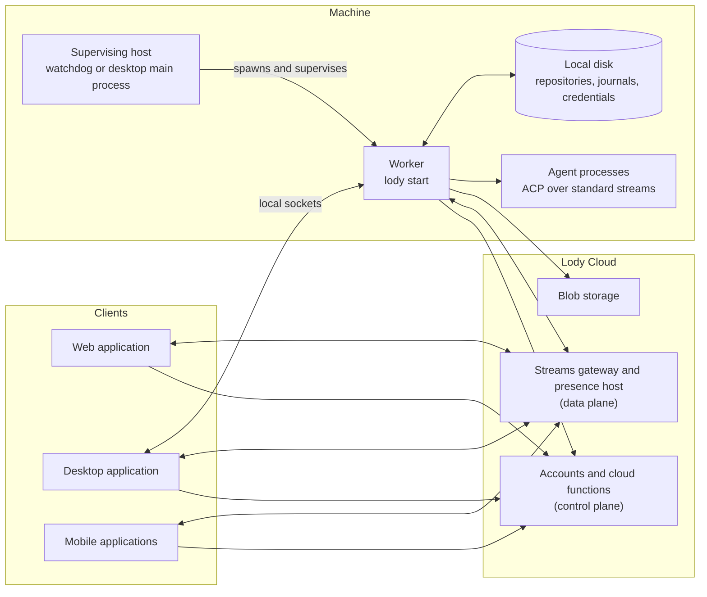
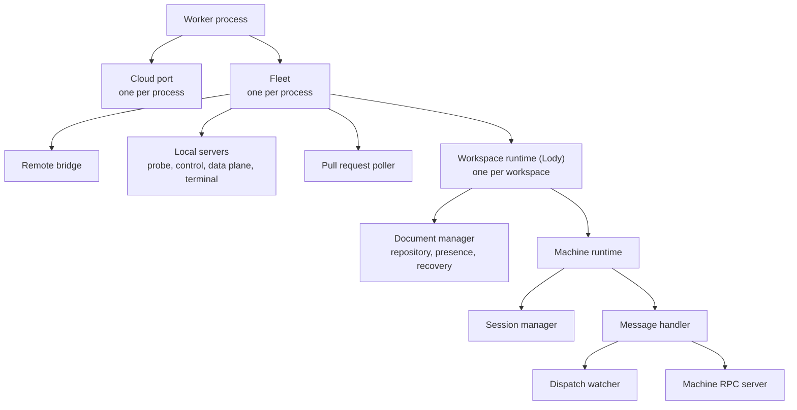
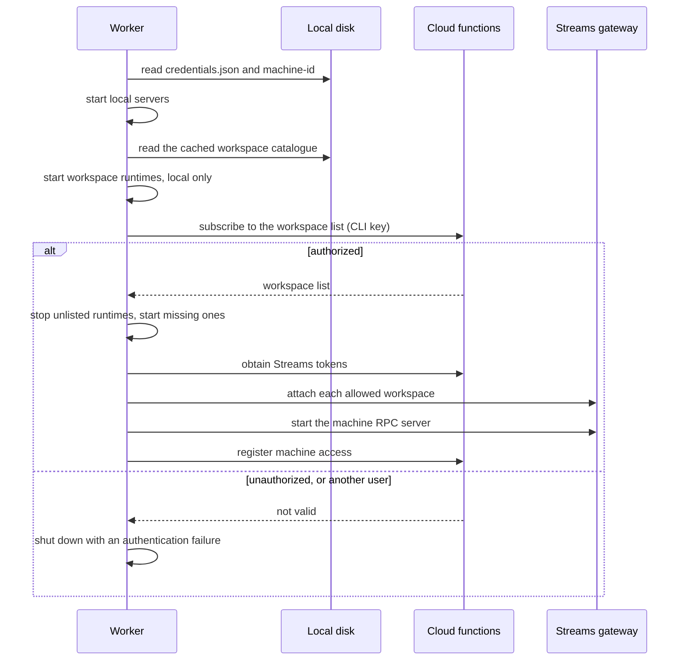
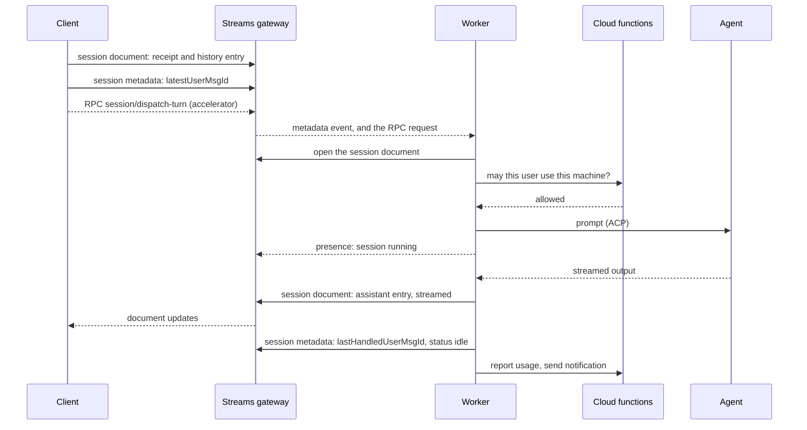

# Architecture overview

This document describes, at a high level, how the Lody daemon is built and
how it interacts with Lody Cloud. It is the map for the four detailed
document sets in this repository, and it links into them instead of
repeating them. A companion page gives the [data model](data-model.md).

It describes Lody at commit
[`61bd9701a`](https://github.com/LodyAI/Lody/tree/61bd9701a5ed6899a9f42787df682acfc3fd7d4b)
(14 November 2026), from the public source. The cloud backend is private. Every
statement here about what the cloud stores or enforces is an inference from what
the clients send and expect, and is marked **Infer**. Citations such as `E-O12`
point into the [evidence index](evidence.md).

## The system in one picture

For screen readers: the following flowchart shows three groups. Clients are
the web application, the desktop application, and the mobile applications.
Lody Cloud contains the account and cloud function services, the Streams
gateway with its presence host, and blob storage. A machine contains a
supervising host, a worker process, agent processes, and local disk state.
Clients and the worker both call the cloud services for accounts,
authorization, and tokens. Clients and the worker both exchange documents,
Flock rows, RPC messages, and presence through the Streams gateway. The
desktop application also talks to the worker directly over local sockets.
The host supervises the worker; the worker runs agents over standard
streams and reads and writes local disk state.

_Figure 1: Clients, Lody Cloud, and one machine._

## Three planes

The daemon's interactions fall into three planes, and most questions about
it become easier once the plane is named.

| Plane | Carries | Transport | Authority | Documented in |
| ----- | ------- | --------- | --------- | ------------- |
| Control | Accounts, workspace membership, machine access, billing, proofs, tokens | HTTPS to cloud functions and routes | The cloud decides | [Cloud API](../cloud-api/README.md), [CLI authentication](../cloud-api/cli-authentication.md) |
| Data | Session documents, metadata, Flock rows, RPC requests and replies, presence | Loro Durable Streams | Replicas converge; the cloud relays | [Loro documents](../loro-documents/README.md), [Flock protocol](../flock-protocol/README.md), [Streams RPC](../lody-streams-rpc/README.md) |
| Local | Control, RPC, document synchronization, and terminals between processes on one machine | Unix sockets or named pipes | The worker, by a per-process token | [The local plane](#the-local-plane) below |

_Table 1: The three planes of the daemon's interactions._

The control plane says who may do what. The data plane carries the work and
its results. The control plane gates the data plane: the daemon attaches a
workspace to the Streams gateway only after the cloud's workspace list
authorizes it, and detaches when the list stops doing so; see
[start-up](#start-up).

## Processes

| Process | Started by | Role | Evidence |
| ------- | ---------- | ---- | -------- |
| `lody daemon start` | The user | Checks authentication in the foreground, spawns the watchdog detached, and waits for its readiness report | [E-O6](evidence.md#e-o6) |
| Watchdog, `daemon-runner` | `lody daemon start` | Supervises the worker: restarts, retries, or stops according to its exit code | [E-O4](evidence.md#e-o4) |
| Worker, `lody start` | The watchdog, the desktop application, or the user | The daemon proper: everything in [inside the worker](#inside-the-worker) | [E-O3](evidence.md#e-o3) |
| Agent process | The worker | One coding agent, speaking the Agent Client Protocol (ACP) over its standard streams | [E-O1](evidence.md#e-o1) |
| MCP HTTP host | The worker, one per daemon | Serves Lody's Model Context Protocol (MCP) tools to agents over loopback HTTP | [E-O59](evidence.md#e-o59) |
| MCP standard-stream server | An agent, as declared by the worker | The same tools for one session, as a fallback | [E-O2](evidence.md#e-o2) |
| Desktop main process | The user | An alternative supervising host, with the bundled CLI as its worker | [E-O65](evidence.md#e-o65) |

_Table 2: Processes on a machine._

MCP helper processes are started with a first argument of `__internal`,
which makes the CLI skip its normal command registry, so that a helper does
not load the daemon's code ([E-O7](evidence.md#e-o7)).

### Supervision

Exactly one host supervises a worker. A worker learns which from its
environment: `daemon` under the watchdog, `electron` under the desktop
application, and unsupervised when started by hand
([E-O29](evidence.md#e-o29)). A
host lease, held on a loopback port or a named pipe, ensures one host per
installation; an unsupervised worker takes it in `foreground` mode
([E-O75](evidence.md#e-o75)).

Host and worker agree on a contract version, currently `'3'`. A worker that
is handed another version exits at once
([E-O76](evidence.md#e-o76)).

The worker's exit code tells the host what to do next
([E-O77](evidence.md#e-o77),
[E-O5](evidence.md#e-o5)).

| Code | Meaning | Watchdog's response |
| ---- | ------- | ------------------- |
| 0 | Clean exit | Stop |
| 2 | A start-up dependency is temporarily unavailable | Retry, without counting a failure |
| 42 | A remote restart was acknowledged | Restart at once |
| 43 | A remote upgrade was acknowledged | Switch to the prepared release and restart |
| 44 | Credentials or identity recovery were rejected | Fatal: stop, do not loop |
| 45 | The worker rejected the supervisor contract | Fatal: stop |
| Other | Crash | Retry with backoff; fatal after 10 counted failures in 5 minutes |

_Table 3: Worker exit codes and the watchdog's response._

The limits in the last row are the supervisor's defaults
([E-O66](evidence.md#e-o66)). Codes 42 and 43 are produced by the
`machine/restart` and `machine/upgrade` methods of the
[RPC protocol](../lody-streams-rpc/methods.md#restart-and-upgrade). A machine
under the desktop application advertises neither capability
([E-O44](evidence.md#e-o44)).

## Inside the worker

One worker serves every workspace that its credential can reach. Its
objects nest by scope.

For screen readers: the following flowchart shows the worker's composition.
One cloud port and one fleet exist per process. The fleet owns the remote
bridge, the local servers, the pull request poller, and one runtime per
workspace. Each workspace runtime owns a document manager and a machine
runtime. The machine runtime owns a session manager and a message handler,
and the message handler owns the dispatch watcher and the machine RPC
server.

_Figure 2: Composition of the worker, by scope._

| Object | Scope | Responsibility | Evidence |
| ------ | ----- | -------------- | -------- |
| Cloud port | Process | Every call to the cloud; `null` members on the local platform | [E-O67](evidence.md#e-o67) |
| Fleet | Process | Follows the workspace list; starts and stops workspace runtimes; owns local servers | [E-O31](evidence.md#e-o31) |
| Remote bridge | Process | Attaches allowed workspaces to the cloud and detaches revoked ones | [E-O53](evidence.md#e-o53) |
| Workspace runtime | Workspace | Owns one repository and one machine runtime | [E-O38](evidence.md#e-o38) |
| Document manager | Workspace | The Loro repository, session documents, presence, and recovery | [E-O40](evidence.md#e-o40) |
| Machine runtime | Workspace | Registers the machine; starts the handler and the watcher | [E-O46](evidence.md#e-o46) |
| Message handler | Workspace | Hosts sessions and agents; serves RPC methods | [E-O50](evidence.md#e-o50) |
| Dispatch watcher | Workspace | Finds pending turns in metadata and starts them | [E-O61](evidence.md#e-o61) |
| Machine RPC server | Workspace | Reads the request stream and dispatches methods | [E-O51](evidence.md#e-o51) |

_Table 4: The worker's main objects, their scope, and what each is for._

The fleet refuses to start if the cloud port's identity differs from its own
([E-O31](evidence.md#e-o31)).

## Start-up

The worker starts local-first: it serves the machine from local state
before it has heard from the cloud, and attaches the cloud when authorized.

For screen readers: the following sequence diagram shows the worker
starting. It resolves its identity from the stored credential, starts its
local servers, and starts workspace runtimes from the cached workspace
catalogue. It then subscribes to the cloud's workspace list. When the list
arrives, the fleet reconciles its runtimes against it and the remote bridge
attaches each allowed workspace to the Streams gateway, which starts the
machine RPC server and registers machine access. If the list reports the
credential as unauthorized, the worker shuts down with an authentication
failure.

_Figure 3: Worker start-up, from local state to cloud attachment._

- **Identity first.** The worker restores its identity from the stored
  credential without validating it; see
  [how `lody start` resolves its identity](../cloud-api/cli-authentication.md#how-lody-start-resolves-its-identity).
- **Local before cloud.** The fleet starts the local servers, then starts
  runtimes from the cached catalogue, and only then subscribes
  ([E-O32](evidence.md#e-o32)). The cached
  catalogue is used only if it belongs to the same user
  ([E-O33](evidence.md#e-o33)).
- **The list drives everything.** Each delivery stops runtimes that are no
  longer listed, starts missing ones, and attaches the allowed ones
  ([E-O35](evidence.md#e-o35)). It is the single remote check of the credential
  ([rejection at run time](../cloud-api/cli-authentication.md#rejection-at-run-time)).
- **Attachment starts the remote services.** Attaching a workspace starts
  its machine RPC server, registers machine access, attaches the Streams
  transport, and rechecks pending access
  ([E-O47](evidence.md#e-o47)). Built-in
  provider registration also waits for it, because provider configurations
  live in the Machine Flock ([E-O39](evidence.md#e-o39)).
- **Outage and revocation.** These are described under
  [attaching the cloud](../loro-documents/persistence-and-sync.md#attaching-the-cloud).

## What the daemon asks of the cloud

All cloud calls go through one object, the cloud port, composed in one file
([E-O15](evidence.md#e-o15)). The workspace list is
its only live subscription; everything else is a single request.

| Capability | Purpose | Cloud function or route | Evidence |
| ---------- | ------- | ----------------------- | -------- |
| Workspace access | The workspaces this key may use | `deviceAuth:listMyWorkspacesForCliToken`, subscribed | [E-O17](evidence.md#e-o17) |
| Machine access | Whether a user may use this machine | `machines:canUseMachineFromCliToken` | [E-O58](evidence.md#e-o58) |
| Machine registration | Register this machine for a workspace | `machines:upsertMachineRegistrationFromCliToken` | [E-O56](evidence.md#e-o56) |
| Streams tokens | Short-lived gateway tokens per workspace | `POST /api/loro-streams/token` | [E-O71](evidence.md#e-o71) |
| History proofs | Verify a proof presented by another user | `POST /api/session-history/verify`, `/verify-edit` | [E-O16](evidence.md#e-o16) |
| Lifecycle proofs | Verify a restart or upgrade request | `POST /api/machine-lifecycle/verify` | [E-O45](evidence.md#e-o45) |
| Billing | The workspace's plan tier | `deviceAuth:getWorkspaceBillingEntitlementForCliToken` | [E-O55](evidence.md#e-o55) |
| Notifications | Push notifications and live activity | `notifications:*` actions | [E-O18](evidence.md#e-o18) |
| Usage | Report token usage per session | `usage:upsertSessionUsageFromCli` | [E-O20](evidence.md#e-o20) |
| GitHub tokens | Brokered repository tokens | `github:*ForCli` actions | [E-O21](evidence.md#e-o21) |
| Session sharing | Propose a share and read its result | `sessionSharing:requestFromCli` | [E-O13](evidence.md#e-o13) |
| Preview and automation | Verify control proofs; obtain relay credentials | `POST /api/session-preview/verify`, `/api/session-automation/verify`, `/api/ios-simulator/ice-servers` | [E-O23](evidence.md#e-o23) |
| Attachments | The blob service's address; no call | Configuration | [E-O22](evidence.md#e-o22) |

_Table 5: What the daemon asks of the cloud, by capability._

The routes and schemas are in the [cloud API](../cloud-api/README.md) set.
A workspace paired through `--paired-workspace` uses a different port that
never borrows an account key (**Intent**; [E-O8](evidence.md#e-o8)).

## The local plane

Processes on one machine talk to the worker over sockets in the data
directory's `run` folder, which is readable only by its owner
([E-O79](evidence.md#e-o79)).

| Interface | Protocol | Clients | Authentication | Evidence |
| --------- | -------- | ------- | -------------- | -------- |
| Probe | HTTP: health and runtime state | The supervising host, CLI commands | A per-process token in a header | [E-O25](evidence.md#e-o25) |
| Control | HTTP `POST`; streamed or buffered JSON | The desktop application, one-shot CLI commands, the MCP server | The token, and a control header | [E-O28](evidence.md#e-o28) |
| Loro data plane | Newline-delimited JSON, protocol version 7 | The desktop application, relaying for its windows | A first `authenticate` message within 5 seconds | [E-O27](evidence.md#e-o27) |
| Terminal | Newline-delimited JSON | The desktop application | None beyond file permissions | [E-O30](evidence.md#e-o30) |

_Table 6: The worker's local interfaces._

The token is random per process. The worker publishes it, with the socket
addresses, in a run file written with owner-only permissions; clients read
the run file to find both ([E-O26](evidence.md#e-o26)).
A client never sends the token to a socket path that differs from the run
file's ([E-O81](evidence.md#e-o81)). That
the terminal socket has no token handshake is an inference from the absence
of one in its server (**Infer**).

The control socket carries several routes, including `/session-control`,
`/project-control`, and `/machine-rpc`
([E-O24](evidence.md#e-o24)). The last is
the _local machine RPC_: the same family of methods as the Streams RPC,
routed by workspace to the same handlers, without a stream
([E-O36](evidence.md#e-o36)).

The data plane socket is what lets a desktop renderer and the worker
converge directly; see
[the local data plane](../flock-protocol/replication.md#the-local-data-plane).

## Platform kinds

The same code builds two products, selected by `LODY_PLATFORM`. An unset
value means `local` ([E-O84](evidence.md#e-o84)).

| | `cloud` | `local` |
| - | ------- | ------- |
| Data directory | `~/.lody` | `~/.lody-oss` |
| Account | A Lody account and a CLI key | None; a synthetic identity `local:<id>` with an empty token |
| Workspaces | From the cloud's list | One implicit workspace, `lw_<id>` |
| Cloud port | Every capability | Every optional capability is `null` |
| Streams transport | Attached when authorized | Never attached |

_Table 7: Differences between the two platform kinds._

Sources: [E-O73](evidence.md#e-o73),
[E-O9](evidence.md#e-o9),
[E-O10](evidence.md#e-o10),
[E-O69](evidence.md#e-o69).

On the local platform the worker deletes the cloud endpoints from its
environment before it loads anything, and the fleet returns from start-up
before any cloud input or output ([E-O32](evidence.md#e-o32)).
Everything in the data plane still works on one machine, because writes are
local-first and the local plane needs no cloud.

## One turn, end to end

The sequence below ties the planes together. Each step links to the
document that describes it.

For screen readers: the following sequence diagram shows a user sending a
turn from a client. The client writes the turn to the session document and
its pointer to session metadata, both through the Streams gateway, and may
also send an RPC to speed delivery. The worker finds the pointer, opens the
document, and asks the cloud whether the user may use the machine. It then
prompts the agent, publishes presence while the agent works, and streams the
agent's output into the session document, which the client receives through
the gateway. At the end the worker updates metadata and reports usage and a
notification to the cloud.

_Figure 4: One user turn across the control, data, and local planes._

| Step | Plane | Described in |
| ---- | ----- | ------------ |
| The client's three writes | Data | [Turn dispatch](../loro-documents/turn-dispatch.md#making-a-turn-durable) |
| The accelerating RPC | Data | [Method reference](../lody-streams-rpc/methods.md#turn-dispatch) |
| Finding the turn in metadata | Data | [Turn dispatch](../loro-documents/turn-dispatch.md#finding-work-without-opening-documents) |
| The access check | Control | [Turn dispatch](../loro-documents/turn-dispatch.md#from-pending-turn-to-prompt) |
| Presence while working | Data | [Presence](../loro-documents/presence.md#turn-leases) |
| The agent's output | Data | [Writers and merge behaviour](../loro-documents/writers-and-merge.md) |
| A setup or removal command, instead of a turn | Data | [Durable commands](../flock-protocol/durable-commands.md) |

_Table 8: Where each step of a turn is documented._

## Credentials and trust boundaries

| Credential | Held by | Presented to | Grants |
| ---------- | ------- | ------------ | ------ |
| CLI API key | The worker, in `credentials.json` | Cloud functions and routes | Everything the daemon asks of the cloud |
| Streams token | The worker, in memory | The Streams gateway | Read and append on a workspace's streams |
| Purpose-bound proof | A client, briefly | The worker, which has the cloud verify it | One operation, such as a history read or a restart |
| Local token | The worker; published in the run file | The worker's local sockets | Local control of the daemon |
| Supervisor token | The host and the worker | Each other, over the process channel | Shutdown and upgrade control |
| MCP bearer token | The worker and its MCP host | The MCP host, by agents | Lody's tools for a session |

_Table 9: Credentials in the daemon's architecture._

Sources: [CLI authentication](../cloud-api/cli-authentication.md),
[E-O26](evidence.md#e-o26),
[E-O78](evidence.md#e-o78),
[E-O59](evidence.md#e-o59).

Three boundaries follow from the table.

- **The cloud is the authority on membership and access, and only that.**
  The daemon asks the cloud whether a user may use a machine. It does not
  ask the cloud what a session contains; that is replicated state.
- **A Streams token is the write boundary of the data plane.** Any replica
  with a token for a workspace can append to its streams. Within that
  boundary, who writes which row or field is a convention, as the
  [Flock](../flock-protocol/observations.md#o6-ownership-is-a-convention) and
  [Loro](../loro-documents/writers-and-merge.md#who-writes-what) sets each
  record. The RPC envelope likewise
  [carries no sender](../lody-streams-rpc/README.md#material-findings).
- **The machine boundary is the file system.** Local sockets, the run file,
  the credential file, and the repositories are protected by owner-only
  permissions on the data directory.

## Not established

- What the cloud backend stores, enforces, or retains. Only the client's
  calls are visible.
- The scope of a Streams token, and what the gateway enforces with it.
- The desktop application's internals beyond its role as a host and a
  client of the local sockets, and the mobile applications.
- The host lease's wire protocol.
- Encrypted workspaces as a whole. This overview names them where they
  change the picture; the [encrypted RPC](../lody-streams-rpc/encrypted-rpc.md)
  document covers their message channel.
