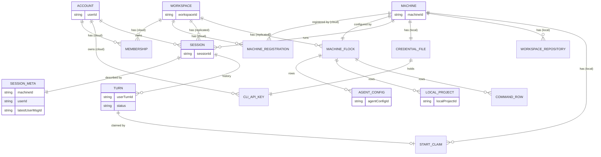

# Data model overview

This document says what state Lody keeps, where the authoritative copy of
each piece lives, who may write it, and how identifiers join the stores. It
is the companion to the [architecture overview](README.md) and, like it,
links into the detailed sets instead of repeating their schemas.

It describes Lody at commit
[`61bd9701a`](https://github.com/LodyAI/Lody/tree/61bd9701a5ed6899a9f42787df682acfc3fd7d4b),
from the public source.

The cloud backend is private. Where this page says that the cloud holds
something, that is an inference from the calls the clients make, and it is
marked **Infer**.

## Three kinds of store

| Store | What it is | Who can read it | Consistency |
| ----- | ---------- | --------------- | ----------- |
| Cloud database | The private backend behind the cloud functions | Whoever the cloud authorizes, one call at a time | Decided by the cloud; **Infer** |
| Replicated documents | Loro documents, their metadata, and Flock documents, carried by Loro Durable Streams | Each replica reads its local copy. Remote reads use a Streams token, but the token's granted scope and the gateway's enforcement are not established (**Infer**) | Eventual; replicas converge |
| Local disk | Files and SQLite databases in the machine's data directory | Processes of the installing user on that machine | Local, immediate |

_Table 1: The three kinds of store._

A fourth thing, presence, is deliberately not a store: it is ephemeral and
is never persisted ([presence](../loro-documents/presence.md)).

The rule of thumb that the rest of this page fills in: **the cloud database
holds who is allowed; replicated documents hold what was said and done;
local disk holds what this machine needs in order to act.**

## Who owns what

| State | Authoritative copy | Written by | Evidence |
| ----- | ------------------ | ---------- | -------- |
| Account, CLI key validity, workspace membership and role | Cloud database (**Infer**) | The cloud; the daemon only reads | [E-O17](evidence.md#e-o17) |
| Workspace list | Cloud database (**Infer**); a local catalogue file is a start-up cache | The cloud; the daemon writes only the cache | [E-O34](evidence.md#e-o34) |
| Whether a user may use a machine | Cloud database (**Infer**) | The daemon registers the machine; only the cloud gives verdicts | [E-O57](evidence.md#e-o57) |
| Billing entitlement, usage, notifications, GitHub tokens | Cloud database (**Infer**) | The cloud; the daemon reads entitlement and reports usage and events | [E-O19](evidence.md#e-o19) |
| Machine descriptor: name, owner, version, capabilities | Replicated metadata of the machine document | The daemon at registration; a rename by a client is not overwritten | [E-O49](evidence.md#e-o49) |
| Machine configuration: providers, local projects, capability caches | Machine Flock | The owning daemon, and clients for commands and their own edits | [Flock data model](../flock-protocol/data-model.md#machine-flock-key-schema) |
| Workspace catalogue: roles, servers, projects | Workspace Flock | Clients and daemons | [The workspace catalogue](../loro-documents/persistence-and-sync.md#the-workspace-catalogue) |
| Session metadata: owner, machine, status, turn pointers, pull requests | Replicated metadata of the session document | Clients for user fields; the owning daemon for execution fields | [Session metadata](../loro-documents/session-document.md#metadata-record) |
| Session content: history, queue, control state | The session's Loro document | Clients for user turns; the owning daemon for agent output | [Who writes what](../loro-documents/writers-and-merge.md#who-writes-what) |
| Presence: machine heartbeat, session activity, viewing | Nowhere; ephemeral | Each origin, for its own records | [Presence](../loro-documents/presence.md#records) |
| RPC requests and replies | The request and response streams, until they expire | Callers append requests; the daemon appends replies | [RPC protocol](../lody-streams-rpc/protocol.md#stream-names) |
| Attachments | The machine's local blob store, then cloud blob storage once uploaded | The daemon | [E-O54](evidence.md#e-o54) |
| CLI credential and machine identifier | Local disk | The CLI's sign-in; first run | [CLI authentication](../cloud-api/cli-authentication.md#what-is-stored) |
| Start claims and Inbox | Local disk | The owning daemon | [What stops a turn starting twice](../loro-documents/turn-dispatch.md#what-stops-a-turn-starting-twice) |
| Working trees | Local disk | The daemon and its agents | [E-O62](evidence.md#e-o62) |

_Table 2: Where the authoritative copy of each kind of state lives._

Two consequences are worth stating plainly.

- **A session's content travels in the replicated documents, not through
  the cloud API.** The cloud relays the streams that carry it, and clients and
  the daemon obtain a token for them from a cloud route
  ([E-O71](evidence.md#e-o71)). What that token grants, and what the gateway
  enforces with it, are not established (**Infer**; see the
  [architecture overview](README.md#credentials-and-trust-boundaries)). This
  is why the cloud API's operations cover control, and
  why the conversation model is in the [Loro](../loro-documents/README.md)
  set. That the cloud database does not also store the content is an
  inference from the client calls; whether the private backend keeps a copy
  of what it relays is not established (**Infer**).
- **A machine's execution state is not replicated.** The record that a turn
  was started is a local journal entry. Other replicas see only its effects
  in the session document and metadata.

## Entities across the stores

For screen readers: the following entity-relationship diagram shows
entities grouped by store. In the cloud database, an account has
memberships in workspaces, owns CLI API keys, and registers machines for
workspaces. In replicated documents, a workspace has session documents and
one Machine Flock per machine; a session has one metadata record and many
turns; a Machine Flock has provider configurations, local projects, and
command rows. On local disk, a machine has one credential file that holds
one CLI API key, one repository per workspace, and local claim journals. A
session is owned by one account and runs on one machine.

_Figure 1: Entities and the store each lives in._

The cloud-side entities and their relationships are inferred from the
arguments and results of the client's calls (**Infer**). The replicated and
local entities are read from the source, in the sets linked above.

## Identifiers

| Identifier | Form | Minted by | Evidence |
| ---------- | ---- | --------- | -------- |
| User | Opaque string | The cloud; the daemon only receives it (**Infer**) | [E-O17](evidence.md#e-o17) |
| User, local platform | `local:<32 hex>` | The worker, once per installation | [E-O10](evidence.md#e-o10) |
| Workspace | Opaque string | The cloud (**Intent**) | [E-O68](evidence.md#e-o68) |
| Workspace, local platform | `lw_<32 hex>` | The worker | [E-O11](evidence.md#e-o11) |
| Machine | UUID | The first CLI process on the installation | [E-O63](evidence.md#e-o63) |
| Session | UUID | Whoever creates the session: a client, the CLI, or the daemon | [E-O41](evidence.md#e-o41) |
| User turn | String; also the history entry's identifier | The client that sends the turn | [E-O85](evidence.md#e-o85) |
| Agent configuration | UUID | The daemon | [E-O42](evidence.md#e-o42) |
| Local project | `local-project-` and 24 hex characters of a hash of the folder's path | Any process, deterministically | [E-O82](evidence.md#e-o82) |
| RPC request | UUID | The caller | [Request envelope](../lody-streams-rpc/protocol.md#request-envelope) |

_Table 3: The main identifiers and where each is minted._

Three properties of this table matter in practice.

- **Only users and workspaces are minted by the cloud.** Everything else is
  minted at the edge, which is what lets a client or a daemon create a
  session, a turn, or a row while offline.
- **A local project identifier is derived, not random.** Two processes that
  register the same folder compute the same identifier, so registration is
  idempotent without coordination.
- **A machine identifier belongs to the installation, not the account.**
  Signing in as another user keeps it.

### How identifiers join the stores

The workspace identifier prefixes every stream. The machine and session
identifiers appear in stream names, document names, metadata, and cloud
calls, and that is how the stores are joined.

| Thing | Document identifier | Stream identifier |
| ----- | ------------------- | ----------------- |
| Workspace metadata | None | `<workspaceId>:meta` |
| Session | `session-<sessionId>` | `<workspaceId>:s:<sessionId>` |
| Machine descriptor | `machine-<machineId>` | Metadata only |
| Machine Flock | `<workspaceId>:mf:<machineId>` | The same |
| Workspace catalogue | `<workspaceId>:wf:workspace` | The same |
| RPC requests to a machine | None | `<workspaceId>:rpc:req:<machineId>` |
| RPC responses to a caller | None | `<workspaceId>:rpc:res:<uuid>` |
| Presence | None | The metadata stream, with `ephemeral=presence` |

_Table 4: How documents and streams are named from identifiers._

Sources: [E-O70](evidence.md#e-o70),
[E-O72](evidence.md#e-o72), [E-O86](evidence.md#e-o86), and
the [RPC stream names](../lody-streams-rpc/protocol.md#stream-names). A
stream's address at the gateway is
`<gateway>/ds/<bucket>/<stream identifier>`
([E-O14](evidence.md#e-o14)).

The same identifiers appear as arguments in the control plane: machine
registration and access checks carry the workspace and machine identifiers,
and history proofs, usage, and notifications carry the session identifier
([E-O57](evidence.md#e-o57)).

## State on a machine's disk

The data directory is `~/.lody` on the cloud platform and `~/.lody-oss` on
the local platform, unless `LODY_DATA_DIR` overrides it, and is created
readable only by its owner ([E-O74](evidence.md#e-o74)).
The table lists the parts that matter to the protocols; the directory also
holds logs, download caches, and feature-specific state.

| Path | Holds | Role | Evidence |
| ---- | ----- | ---- | -------- |
| `credentials.json` | The CLI API key, the user, and the machine | Authoritative local copy of the credential | [E-O64](evidence.md#e-o64) |
| `machine-id` | The installation's machine identifier | Authoritative | [E-O63](evidence.md#e-o63) |
| `workspace-catalog.json` | The last reconciled workspace list | Start-up cache; authoritative on the local platform | [E-O83](evidence.md#e-o83) |
| `loro-repo/<workspaceId>/repo.sqlite3` | The workspace's documents, metadata, Flocks, and cursors | This machine's replica | [E-O43](evidence.md#e-o43) |
| `session-history-rpc-rejections.sqlite3` | History RPC refusals and write claims | Local journal | [E-O48](evidence.md#e-o48) |
| `orchestration/<hash>/operations.sqlite3` | The operation store, which includes the Inbox | Local journal | [E-O60](evidence.md#e-o60) |
| `e2ee/…/execution.sqlite`, `rpc-originals.sqlite`, `rpc-receipts.sqlite` | Start claims and encrypted RPC journals, for encrypted workspaces | Local journals | [E-O37](evidence.md#e-o37) |
| `session-files/` | Attachment blobs | Authoritative until uploaded, then a cache | [E-O54](evidence.md#e-o54) |
| `repos/`, `chats/<sessionId>` | Working trees and chat working directories | Authoritative | [E-O62](evidence.md#e-o62) |
| `run/daemon.json` and sockets | The local token and socket addresses | Runtime state, rewritten at each start | [E-O80](evidence.md#e-o80) |
| `pr-poller-state.sqlite3` | Scheduling state of the pull request poller | Cache; never pull request status | [E-O52](evidence.md#e-o52) |

_Table 5: Protocol-relevant state on a machine's disk._

That the Inbox lives in the operation store is an inference from the Inbox's
tables being created by the orchestration store (**Infer**).

The daemon's runtime state, the phase, start-up stage, and issues that the
probe socket reports, is held in memory and is not written to disk
([E-O12](evidence.md#e-o12)).

Lody's internal overview says the poller's state is a JSON file. At the
documented commit the code uses the SQLite file and treats the JSON file as
a legacy import.

## Durability of each kind of write

The stores differ in what "written" means, and each set documents its own
boundary.

| Write | Accepted when | Reaches others when | Described in |
| ----- | ------------- | ------------------- | ------------ |
| Document or metadata change | It is a local commit | The replica's transport uploads it upstream; other replicas receive it when they next synchronize | [Persistence and synchronization](../loro-documents/persistence-and-sync.md#storage) |
| Flock row by the daemon | It is flushed locally | The sync coordinator uploads it upstream, retrying until confirmed; other replicas receive it when they next synchronize | [Sync coordinator](../flock-protocol/sync-coordinator.md#the-write-path) |
| RPC request | It is appended to the request stream | The daemon reads the stream | [Request lifecycle](../lody-streams-rpc/protocol.md#request-lifecycle-and-acknowledgements) |
| Cloud function call | The cloud answers | Immediately, for callers of the cloud | [Errors, retries and pagination](../cloud-api/README.md#errors-retries-and-pagination) |
| Local claim | The SQLite transaction commits | Never; it is local | [Turn dispatch](../loro-documents/turn-dispatch.md#what-stops-a-turn-starting-twice) |

_Table 6: What acceptance means for each kind of write._

## Not established

- The cloud backend's tables, retention, and enforcement.
- Where the web and mobile clients mint session and turn identifiers, and
  the exact form of a turn identifier.
- Whether metadata records physically travel on the `<workspaceId>:meta`
  stream. The stream mapping and the metadata interface imply it; the
  repository library was not read.
- Other clients' write rights on a machine's descriptor.
- Which process owns the operation store at run time.
