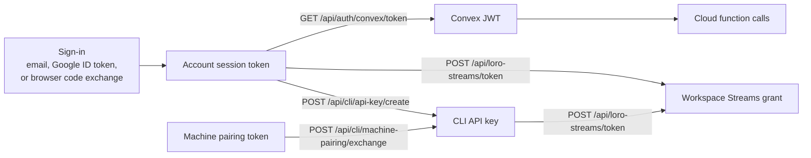
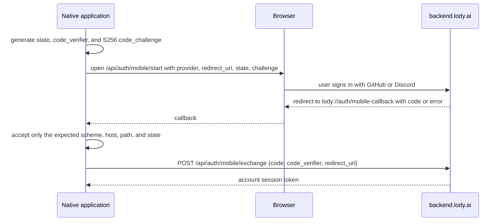
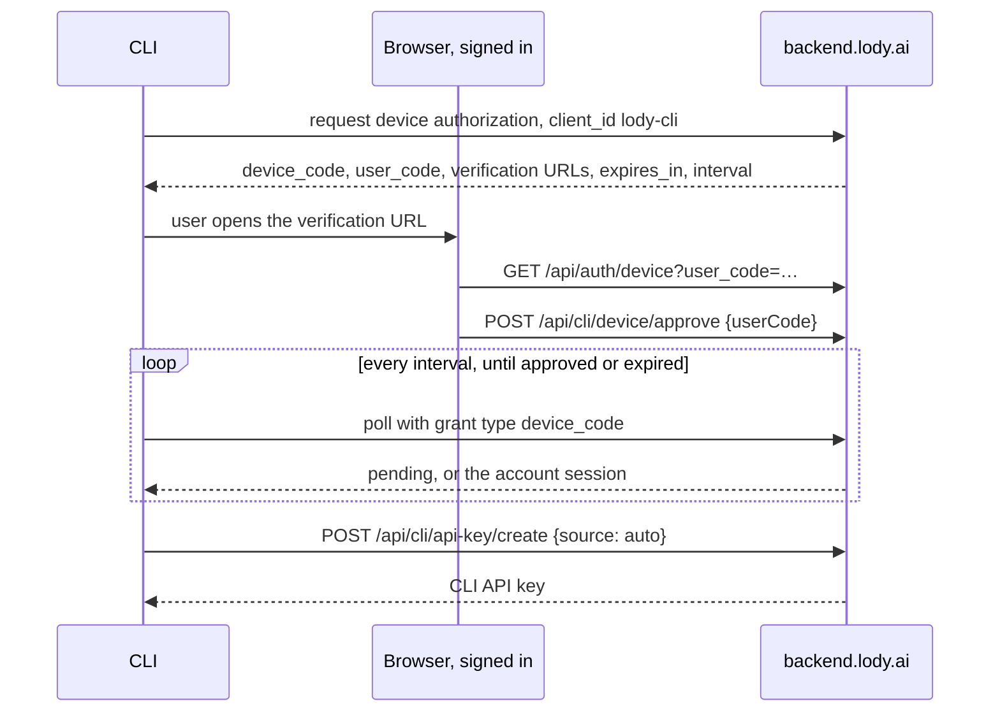
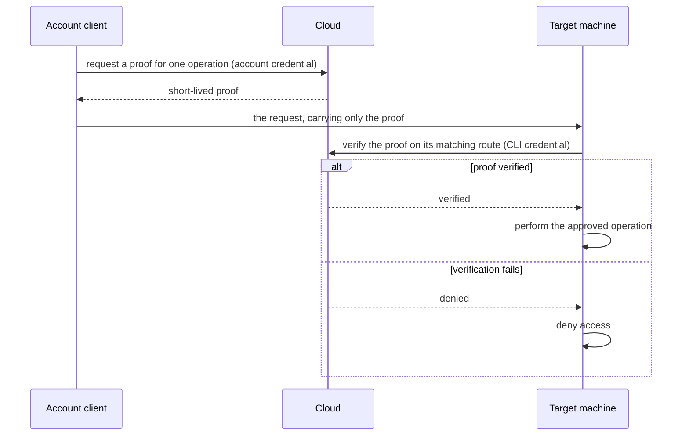
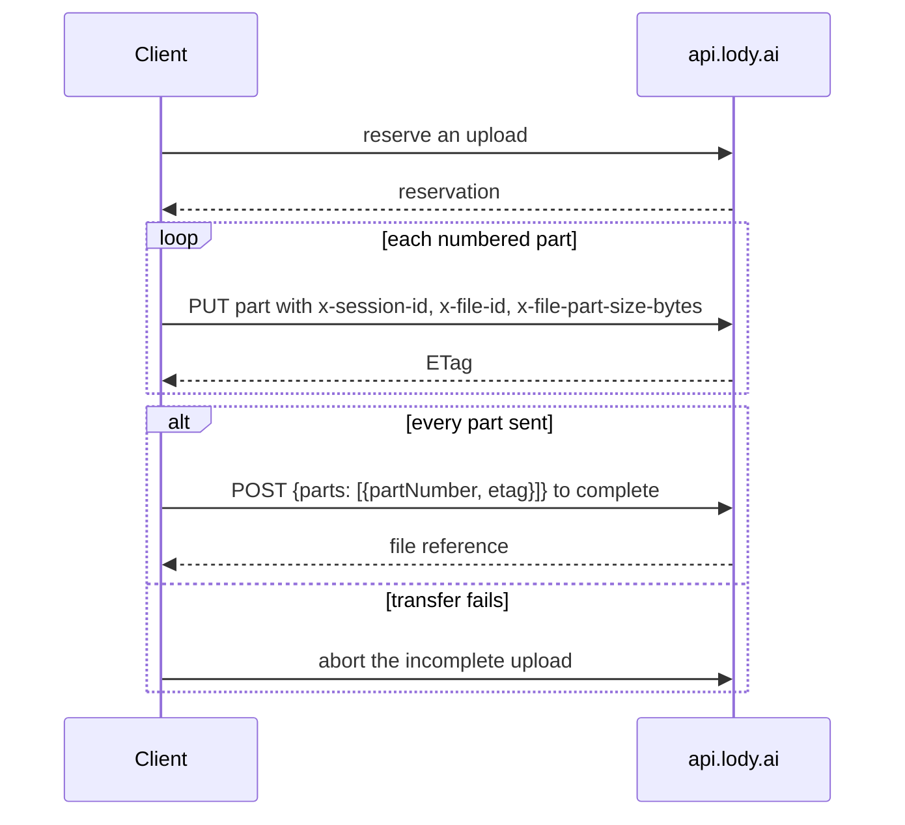
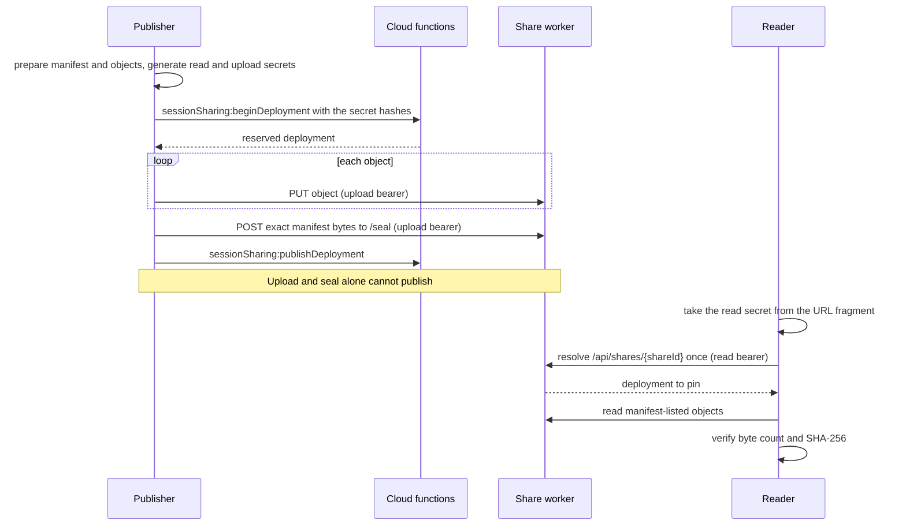

# Lody Cloud HTTP API

This reference describes the optional cloud interface visible in the public Lody
source at revision `61bd9701a5ed6899a9f42787df682acfc3fd7d4b`, inspected on
14 November 2026. It covers HTTP routes, cloud function arguments and results,
credential exchanges, attachment transfers, and static share publication.

Start with the [HTTP route index](routes.md), use the
[OpenAPI 3.1.1 document](openapi.yaml) for request and response schemas, and use
the [operation reference](operations.md) for individual cloud functions. The
[coverage and limitations](coverage.md) identify the contracts that cannot be
established from this checkout.

Two neighbouring subjects have their own document sets:
[remote procedure calls (RPC) over Loro Streams](../lody-streams-rpc/README.md)
and the [Flock protocol](../flock-protocol/README.md). This reference covers
only the cloud credential exchange that admits a client to the Streams gateway.
The [documentation contents](../contents.md) list every document in the
repository.

## Scope and evidence

The public repository deliberately excludes hosted backend handlers and
generated backend declarations. `packages/cloud-api` exports ordinary typed
Convex `FunctionReference` values backed by `anyApi`. Consequently, much of what
callers experience as the cloud API is HTTP RPC through Convex, alongside
conventional HTTP resource routes. There is no evidence for resource URLs such
as `GET /workspaces` or `POST /billing/checkout`; the corresponding published
contracts are named functions such as `billing:createCheckoutSession`.

The reference includes all **167 operations in `CloudApi`**, five additional
operations observed in command-line interface (CLI) and native clients, and the
HTTP routes indexed in [routes.md](routes.md). Source provenance is recorded in
[sources.json](sources.json). Each OpenAPI operation carries `x-source`; typed
data transfer object (DTO) schemas carry source locations where available.
`x-source-revision` pins the complete document. Named schemas starting with
`Dto_` expand public TypeScript DTOs; `<module>_<function>_Args` and
`<module>_<function>_Result` identify each function's payloads.

Evidence levels matter:

| Evidence | What it establishes | What it does not establish |
| --- | --- | --- |
| Public `CloudApi` type | Function name, query/mutation/action kind, arguments, result type, comments | Server admission rules, route deployment, rate limits |
| Client HTTP request and response parser | Observed method, path, headers, payload, accepted response fields | Complete server schema or every possible error |
| Shared path helper or constant | A published path or policy constant | Whether a handler is deployed or a request succeeds |
| Upstream Convex HTTP documentation | Generic HTTP function envelope | Lody-specific business rules or handler behaviour |

_Table 1: Kinds of evidence, and what each does and does not establish._

Response schemas generally describe the fields consumed by a client. They leave
unknown response properties permitted unless the source has a strict parser.
An optional field can be omitted; it is not implicitly nullable. A TypeScript
`number` stays a JSON number unless a runtime schema establishes an integer.
Serialized IDs stay opaque strings. No timestamp unit, monetary denomination,
maximum length, or server validation rule is inferred merely from a field name.

`x-unresolved: true` means a type or payload remains unconstrained.
`x-partial: true` means structural fields are described but some semantic rules
require the linked validator. For example, share manifests require
cross-reference and aggregate-size checks beyond JSON Schema. These markers are
evidence limits, not permissions for the service to accept arbitrary data.

## Service origins

| Origin | Role | Typical credential |
| --- | --- | --- |
| `https://backend.lody.ai` | Account authentication, native login handoff, CLI key issuance, signed-purpose proof ingress | Raw account session token or CLI key, according to the operation |
| `https://convex.lody.ai` | Public Convex query, mutation and action transport | Account Convex JSON Web Token (JWT), or explicit CLI/device credential fields in arguments |
| `https://api.lody.ai` | Attachment and avatar storage, static shares, public runtime artefacts, time | Session/CLI bearer, narrow share capability, or public access |

_Table 2: Service origins, their roles, and the credential each typically
takes._

These are client-observed production defaults, not discovery endpoints. Native
build configuration and platform composition can choose different origins. CLI
configuration distinguishes the Convex deployment URL from its auth/site URL.
Do not rewrite a custom deployment URL by blindly replacing its hostname.

Two CLI callers explicitly target the backend origin for `/api/query` or
`/api/action`: `deviceAuth:validateCliToken` and
`github:associatePullRequestForCli`. This does not establish that every cloud
function is available through both origins. OpenAPI lists both servers on the
generic transport so these observed exceptions remain visible.

The open-source software (OSS) desktop composition is local-only and forbids
authenticated product-cloud requests. Public managed-runtime downloads are an
explicit exception. Shared code obtains cloud access through platform
capabilities; the existence of a route in this reference does not enable that
capability in a local build.

## Credentials and authentication

| Credential | Acquisition | Where it belongs |
| --- | --- | --- |
| Better Auth session token | Email, native Google ID-token sign-in, or native browser code exchange | `Authorization: Bearer <session>` at supported account/worker routes |
| Convex JWT | `GET /api/auth/convex/token`, authenticated with the account session | Bearer header for account-authenticated Convex calls |
| CLI API key | `/api/cli/api-key/create` or `/api/cli/machine-pairing/exchange` | Bearer at CLI ingress routes, or explicit `token`/`cliToken` function arguments |
| End-to-end encryption (E2EE) device credential | Verified device admission/pairing | Explicit `credential` field in device-scoped control-plane arguments |
| Purpose-bound request proof | A matching `/request-token` route | Only its corresponding target verification request |
| Share read secret | Share URL fragment `#access=v1.<64 lowercase hex characters>` | Share read bearer header, with cookies omitted |
| Share upload secret | Client-generated deployment capability; only its hash enters `beginDeployment` | Draft deployment upload/seal bearer header |

_Table 3: Credentials, how each is acquired, and where it belongs._

For screen readers: the following flowchart shows how one credential is
exchanged for another. Sign-in by email, by Google ID token, or by the native
browser code exchange yields an account session token. The session token is
exchanged for a Convex JWT, which authenticates cloud function calls. The
session token also creates a CLI API key; a machine pairing token can be
exchanged for a CLI API key as well. Either the session token or the CLI API key
obtains a workspace Streams grant.



_Figure 1: How the main credentials are obtained from one another._

The raw account token returned in JSON is distinct from Better Auth's signed
`set-auth-token` cookie value. Native clients deliberately use the raw token for
subsequent grants. Do not substitute an account session, CLI key, Convex JWT,
device credential, or share capability for another simply because each travels
as a string.

On the generic Convex paths, OpenAPI permits a JWT header or no header. The
latter represents functions whose credential travels in their arguments; it does
not mean that all functions permit anonymous calls. The private handler remains
the authority for admission. There are no deployment-admin tokens in this
contract.

### Native sign-in

Email sign-in posts `email`, `password`, and `callbackURL` to
`/api/auth/sign-in/email`. Registration additionally supplies `name` to
`/api/auth/sign-up/email`; successful registration can still require email
verification. Native clients use
`https://backend.lody.ai/api/auth/mobile/email-verified` as the verification
callback. Google sign-in posts `provider: "google"` and an `idToken` object
containing `token` and `nonce` to `/api/auth/sign-in/social`.

GitHub and Discord native browser sign-in use a Proof Key for Code Exchange
(PKCE) handoff:

1. Generate attempt-local random `state` and `code_verifier`; derive the S256
   `code_challenge` using SHA-256 and unpadded base64url.
2. Open `/api/auth/mobile/start` with `provider`,
   `redirect_uri=lody://auth/mobile-callback`, `state`, `code_challenge`, and
   `code_challenge_method=S256`.
3. Accept only the expected callback scheme, host and path, with matching state.
   iOS rejects duplicate/unexpected query keys, userinfo, port and fragments.
   The callback carries a code or an error, not the session credential.
4. POST `code`, `code_verifier`, and the exact `redirect_uri` to
   `/api/auth/mobile/exchange`. Keep the verifier out of the browser URL.

For screen readers: the following sequence diagram shows the native browser
sign-in. The application generates a state value, a code verifier, and its
challenge, then opens the start route in the browser with the provider, redirect
address, state, and challenge. The user signs in with GitHub or Discord, and the
backend redirects the browser to the application's callback with a code or an
error. The application checks the callback and its state, then posts the code,
the verifier, and the redirect address to the exchange route, which returns the
account session token.



_Figure 2: Native browser sign-in for GitHub and Discord, using a PKCE handoff._

Session lookup, organization listing, member pagination, organization updates,
password-reset requests, email-verification requests, sign-out, and the Convex
JWT exchange are in OpenAPI. Other Better Auth software development kit (SDK)
operations are inventoried in [coverage.md](coverage.md); their complete server
configuration is unavailable.

### CLI sign-in and connection tokens

The CLI device authorization flow uses the Better Auth device plugin with
`client_id: "lody-cli"`. It receives `device_code`, `user_code`, verification
URLs, `expires_in`, and `interval`, then polls the plugin with grant type
`urn:ietf:params:oauth:grant-type:device_code`. The browser checks the user code
through `GET /api/auth/device?user_code=…` and approves it with
`POST /api/cli/device/approve`, body `{ "userCode": "…" }`.

For screen readers: the following sequence diagram shows command-line sign-in.
The CLI asks the backend for a device authorization and receives a device code,
a user code, verification addresses, an expiry, and a polling interval. The user
opens the verification address in a browser, which checks the user code and then
approves it. Meanwhile the CLI polls with the device code until the backend
returns an account session. The CLI then creates an automatic API key, as the
next paragraph describes.



_Figure 3: CLI sign-in by device authorization, followed by automatic key
creation._

After obtaining the account session, the CLI creates an automatic key by posting
`{ "source": "auto" }` to `/api/cli/api-key/create`. The management UI instead
uses `source: "manual"` and an optional `note`. List and revoke use POST
requests with `{}` and `{ "keyId": "…" }`, respectively. The list returns
metadata, not the complete key secret.

Ordinary machine connection uses a different flow: create a pairing token for a
workspace, then exchange it with `{ token, machineId, machineName }`. Tokens
start with `lody_pair_`; the shared time to live (TTL) is 30 minutes. The
exchange returns `apiKey`, which the CLI validates using
`deviceAuth:validateCliToken`. This flow does not establish encrypted device
custody or authorize E2EE admission.

## Calling cloud functions over HTTP

The [Convex HTTP API](https://docs.convex.dev/http-api/) defines POST
`/api/query`, `/api/mutation`, and `/api/action`. Use the function's declared
kind; all three use POST even when the operation reads data.

```sh
curl --fail-with-body 'https://convex.lody.ai/api/query' \
  -H "Authorization: Bearer $LODY_CONVEX_JWT" \
  -H 'Content-Type: application/json' \
  --data '{"path":"billing:getWorkspaceBillingEntitlement","args":{"workspaceId":"workspace_example"},"format":"json"}'
```

This example assumes an existing account JWT; `workspace_example` is synthetic.
The response envelope is:

```json
{
  "status": "success",
  "value": {
    "planTier": "plus",
    "effectivePlanTier": "plus",
    "entitlementSource": "stripe",
    "promotionalEntitlementEndsAt": null,
    "checkoutPending": false
  },
  "logLines": []
}
```

A result can also be `null`, an array, a primitive or a discriminated union.
Select its schema by the request's `path`. A transport success alone is not
proof of application success: inspect the Convex envelope and any
operation-specific status. Error envelopes contain `status: "error"` and
`errorMessage`, with optional `errorData` and `logLines`. Exact HTTP status
selection is not established by these Lody clients. Authentication and ingress
failures can return other bodies.

Native Swift/Kotlin clients also send an SDK-style envelope:

```json
{
  "path": "e2eeWorkspaces:describe",
  "format": "convex_encoded_json",
  "args": [{ "workspaceId": "workspace_example" }]
}
```

This is an observed client encoding, distinct from the public `format: "json"`
HTTP envelope described in OpenAPI. Do not mix its one-element argument array
with the named-argument object in the preceding example. SDK-specific value
encoding and the Convex WebSocket protocol are not specified here.

The generic OpenAPI request uses `oneOf` branches fixing the function path and
its arguments together. Its response uses the possible result schemas under
`value`; OpenAPI cannot correlate a response union with an earlier request's
path. The `x-convex-operations` catalogue retains that mapping for tooling.
Tools that ignore extensions still see valid HTTP request and response schemas.

## Function families

The complete per-operation signatures are in [operations.md](operations.md).

| Families | Responsibility and boundaries |
| --- | --- |
| `auth`, `workspaceMembers` | Workspace ownership, directory lookup and account-facing metadata |
| `billing`, `referrals` | Checkout, entitlement and seat state, invoices, subscription changes, referral offers and ledger pagination |
| `github`, `githubPersonalAuthorization` | Repository discovery and settings, installation state and scoped repository token brokering |
| `machines`, `localProjects`, `machineCredentials`, `machinePairing`, `deviceAuth` | Account/machine access, ordinary team-sharing policy, registration and ordinary CLI credentials |
| `usage`, `activity`, `agentFeedback`, `notifications` | Usage accounting and time buckets, activity, feedback and notification control |
| `promptShortcuts` | Document staging, activation and access-token issuance; document content is outside this reference |
| `sessionSharing` | Share requests, management, deployment reservation/publication, revocation and credential rotation |
| `e2eeWorkspaces`, `e2eeMembers`, `e2eeJoinMailbox` | Encrypted workspace control, ledger history, invitations and joining |
| `e2eeAutomaticPairing`, `e2eeAccountPairing`, `e2eeMachinePairing` | Account/device pairing relays and admission control |
| `e2eeContent`, `e2eeMailbox`, `e2eeMachineSharing` | Device-bound grants, encrypted envelope delivery and machine policy storage |
| `e2eeRecoveryVault`, `e2eeEpochStaging`, `accountSecurityEvents` | Opaque recovery storage, rotation staging and limited account security notices |
| Additional observed operations | CLI key validation, PR association and native push registration outside `CloudApi` |

_Table 4: Function families and their responsibilities._

Checkout and billing schemas expose nullable prices, plan/entitlement
distinctions, pending checkout states and payment-recovery hints. Seat quotes
inform the UI; only backend admission and billing checks authorize membership or
charges. GitHub read/write token results carry explicit success/error unions.
GitHub's own REST endpoints are an external service and are not Lody routes.

Some function names in the table are best understood as control operations for
another subsystem. This document covers their cloud arguments, results and
credential boundaries, without specifying Flock, Loro data structures, or
Streams RPC messages.

## Purpose-bound authorization proofs

The account requests a short-lived proof for a specific operation. The target
machine verifies the proof through its corresponding cloud route using its own
CLI credential. Keep the account credential on HTTPS; forward only the proof to
the target. Request identity, session scope, runtime nonce and intent digest
must remain bound to the operation that was approved.

For screen readers: the following sequence diagram shows a purpose-bound proof.
The account client asks the cloud for a proof for one specific operation, using
its account credential, and receives a short-lived proof. It forwards only the
proof to the target machine, with the request. The machine verifies the proof
through the matching cloud route, using its own CLI credential, and acts only if
the cloud confirms it.



_Figure 4: A purpose-bound proof, from minting by the account to verification by
the target machine._

History has separate read/edit minting and verification routes, plus CLI minting
variants. An edit proof includes `requestId` and `intentDigest`. The target
derives the root session, owner and local project from its metadata. Failed
verification denies access; edit verification additionally requires an expiry.

Preview and automation minting removes the caller-provided `requesterUserId`
from the HTTP intent, then checks the server-returned user against the current
account. Preview actions include create, revoke, status and device-emulator
commands. Remote automation is restricted to one session and
list/settings/configure/cancel operations. The RPC command protocols remain in
the separate RPC documentation.

Machine lifecycle proofs bind restart/upgrade requests, with optional target
version, upgrade options and restoration identity. Simulator Interactive
Connectivity Establishment (ICE) configuration returns short-lived relay
credentials. Bug-report requester proofs prevent a machine from treating a
caller-supplied reporter ID as authenticated identity.

`POST /api/loro-streams/token` is included only as a cloud credential exchange.
It takes a workspace ID and optional rejected grant, returning a token,
`expiresIn` in seconds, and optional gateway/shard hints. It does not define a
Streams channel or RPC exchange.

## Attachments and avatars

Encode every path segment independently. Shared image/file IDs are constrained
to `[A-Za-z0-9_-]{1,128}`. For ordinary plaintext attachment uploads, native
clients first require a positively established plaintext workspace mode.

| Resource | Observed client policy |
| --- | --- |
| Session image | PNG/JPEG/WebP/GIF, at most 5 MiB, at most 8 per input |
| Session file | At most 100 MiB, at most 8 per input; shared retention policy 90 days |
| Single file upload | At most 16 MiB; larger files use multipart |
| Multipart file part | At most 16 MiB; preserve returned ETags for completion |
| Avatar | Supported image formats, nonempty and at most 1 MiB |

_Table 5: Client-side limits observed for attachments and avatars._

Images use multipart form fields `sessionId` and `file`. Ordinary file upload
uses raw bytes plus `x-session-id`, percent-encoded `x-file-name`,
`x-file-mime-type`, `x-file-sha256`, decimal `x-file-size-bytes`, and
`x-file-text-preview`.

Multipart transfer reserves an upload, PUTs numbered parts with `x-session-id`,
`x-file-id`, and `x-file-part-size-bytes`, then POSTs
`{ "parts": [{ "partNumber": 1, "etag": "…" }] }` to complete. Abort incomplete
uploads when transfer fails. The TypeScript helper and iOS disagree about the
abort path; see [coverage.md](coverage.md). Do not try both against production
as an automatic fallback without establishing server behaviour.

For screen readers: the following sequence diagram shows a multipart file
transfer. The client reserves an upload with the worker. For each part it sends
a PUT request carrying the session, file, and part-size headers, and keeps the
ETag that the worker returns. When every part has been sent, it posts the list
of part numbers and ETags to complete the upload and receives a file reference.
If the transfer fails, it aborts the incomplete upload instead.



_Figure 5: A multipart file upload, from reservation to completion or abort._

Upload results contain an `image` or `file` reference rather than embedding
bytes in the session. The TypeScript file client also accepts a file reference
at the top level. Native download checks include permissions, nonempty content,
byte bounds and the expected size when known. A 404/410 is treated as
unavailable.

Thumbnail query dimensions are rounded and clamped to 16–4096; width defaults to
512. Omitted height preserves aspect ratio. Quality is clamped to 1–100 and
     defaults to 85. Fit defaults to `scale-down`; `cover` and `contain` are
     also valid. The source's image cache policy is
     `private, max-age=31536000, immutable`.

Avatar uploads use form fields `kind` (`user` or `workspace`) and `file`,
returning `{ "avatar": { "avatarId": "…" } }`. The client builds a public avatar
URL and separately updates the account image or organization logo. Public avatar
cache policy is `public, max-age=31536000, immutable`.

## Static shares

Authenticated `sessionSharing` operations control publication; narrow worker
capabilities transfer the prepared data. These are different credential domains.

1. Prepare a manifest and objects. Generate separate read/upload secrets and
   submit their hashes through `sessionSharing:beginDeployment` as applicable.
2. PUT each verified object to the reserved deployment with its upload bearer.
3. POST the exact prepared manifest bytes to `/seal` with that upload bearer.
4. Call authenticated `sessionSharing:publishDeployment` to publish. Upload and
   seal alone cannot publish.
5. Readers extract the read secret from the share URL fragment and resolve
   `/api/shares/{shareId}` once. Pin subsequent requests to that deployment.
6. Read only manifest-listed objects; verify byte count and SHA-256. Bound every
   response, including compressed history and attachments.

For screen readers: the following sequence diagram shows the publication and
reading of a static share. The publisher prepares a manifest and objects and
generates separate read and upload secrets. It begins a deployment through an
authenticated cloud function, uploads each object to the share worker with the
upload bearer, seals the deployment by posting the exact manifest bytes, and
then publishes it through a second authenticated cloud function. A reader takes
the read secret from the share address fragment, resolves the share once to a
deployment, reads only the objects that the manifest lists, and verifies the
size and hash of each.



_Figure 6: Publication of a static share and its later reading._

Share worker requests omit workspace cookies and credentials, disable redirects,
use `no-store` and suppress referrers. Secrets do not belong in the path or
query. An optional per-conversation agent-link request returns a short-lived
same-origin URL; its agent content format is not established by the read client.

Current shared limits include 32 conversations, 64 publishable attachments, 1
MiB manifest, 32 MiB decoded history, 100 MiB object and 256 MiB deployment.
Share image policy is 20,000,000 bytes. Shared reading retains compatibility
with older manifests; publication additionally applies the current policy
validator. **Publishing file attachments in static shares is disabled in this
revision.**

Revocation and credential reset use explicit expected revisions. Request retries
reuse their original `requestId`; a server record identity such as
`shareRequestId` is not a replacement idempotency key.

## Encrypted control-plane semantics

E2EE control DTOs are included because they are public cloud operations. They do
not establish that the product content runtime is generally enabled: workspace
descriptors can explicitly advertise `activation: "control-only"`. Unknown or
partial workspace descriptors must not be silently treated as plaintext.

Account authentication does not establish ledger membership, custody, decryption
or content-write authority. Device access uses explicit credentials. Server
directory labels, ledger heads and returned history pages are untrusted hints
until verified against independently pinned ledger material.

For ledger history, retain the first page's checkpoint across subsequent pages.
`cursor` and `after` are mutually exclusive. `nextCursor: null` means the
supplied checkpoint is exhausted, not that the server has no newer ledger
history. Preserve original signed records and the exact durable request on
uncertain create/append results; do not re-sign merely because a request timed
out.

Machine-sharing commits use full-head compare-and-swap (CAS), including scope,
status, revision and digest. A conflict does not authorize automatic rebasing.
Removed generations are terminal; re-admission creates a new resource
generation. Storage acknowledgements do not substitute for verifying the
returned encrypted original.

Recovery-vault operations store opaque ciphertext and CAS the index. The backend
does not decrypt it or establish an active Recovery device. Epoch staging
likewise stores encrypted originals without creating a new ledger commit point.
These boundaries explain the cloud contract; cryptographic formats and document
usage belong in their owning documentation.

## Errors, retries and pagination

There is no uniform published Lody error body, rate limit, retry header or
service versioning policy. OpenAPI uses a `2XX` range where clients accept any
successful status, and a `default` response where the exact failure contract is
unknown. Specific statuses appear only when a client or the upstream transport
establishes them. Error strings in a client are not a complete server error-code
catalogue.

Read retries can be appropriate after transient failures, but replaying a write
can duplicate effects. An action can call an external service; its label alone
does not make it idempotent. Billing operations, publication, key rotation and
admission require their own request/quote/revision semantics. A timeout means
the result may be unknown, rather than proving that no mutation committed.

CLI credential validation distinguishes invalid credentials from network/service
unavailability. Streams grant 401/403 rejects the long-lived credential. History
verification fails closed. Native push-registration timeouts leave remote commit
order unknown; local cancellation fencing is not a server-side ordering
guarantee.

Convex paginated functions that declare `paginationOpts` take `numItems` and a
nullable `cursor`, returning `page`, `isDone`, and `continueCursor`. E2EE
history, mailbox pages and account security events have their own
cursor/checkpoint fields; do not interchange them. Organization member listing
uses `limit=100` and an offset in the observed native callers.

## Runtime downloads and utilities

The public artefact origin serves distribution/version/platform/file paths and
floating daemon channel manifests. Supported daemon manifest platforms are
Darwin, Linux and Windows on arm64/x64. Source manifests bind product,
distribution, version, channel, platform, protocol/data-format versions and
artefact hashes/sizes. Clients validate these bindings and artefacts before
activation. The manifest read is bounded to 131072 bytes.

`/api/cli/latest-version` is a distinct package-version lookup on the backend
origin; it is not a daemon manifest. `/api/time` returns `serverTime` in
milliseconds for clock calibration. The retained community QR endpoint uses
`public, max-age=300`; current settings render a bundled QR offline.

## Why there is no AsyncAPI document

The in-scope public cloud interface establishes HTTP operations, not a separate
application event contract with verified channels and message bindings. Convex
reactive queries use its SDK transport; native push registration does not
specify Apple Push Notification service (APNs) or OneSignal message delivery
here. Flock, Loro usage and Streams RPC are explicitly separate efforts.
Describing guessed channels in AsyncAPI would imply a contract that this source
does not publish.

## Maintenance and validation

Authored route/schema observations live in [http.json](http.json). The five
client-only function observations live in
[supplemental.json](supplemental.json). The
[generator](../../scripts/generate-cloud-api.mjs) reads those files and the
public source without executing Lody or contacting a service. It emits OpenAPI,
route and function references, and a revision/file-hash manifest.

```sh
npm ci
LODY_SOURCE=../../Lody npm run generate
LODY_SOURCE=../../Lody npm run check
npm run lint:docs
npm run validate:openapi
```

Use a modern Node.js runtime (validation used Node 26.13.0); `uvx` is only
needed for the independent OpenAPI validator. The generator uses pinned
TypeScript/YAML dependencies in the root lockfile. `npm run check` detects
differences in generated content and source provenance. It does not discover
newly added HTTP callers or prove backend behaviour: review literal routes, path
builders, SDK calls, DTO changes and the coverage register when refreshing the
source.

The converter handles the concrete public DTO syntax, selected Zod schemas and
Effect host wire schemas used here. Unsupported expressions remain visible in
the provenance manifest and schema extensions. It is a documentation extractor,
not a replacement for the source validators or a general TypeScript compiler.

When updating, inspect `sources.json` and all generated diffs, refresh this
guide's source pin and known discrepancies, and validate the OpenAPI document.
Source hashes include locally modified bytes, so compare the source checkout
with its commit before calling a refreshed snapshot an upstream release
contract. No live authenticated service calls were made to validate this
snapshot.

Format references: [OpenAPI 3.1.1](https://spec.openapis.org/oas/v3.1.1.html)
and [Convex HTTP API](https://docs.convex.dev/http-api/).
