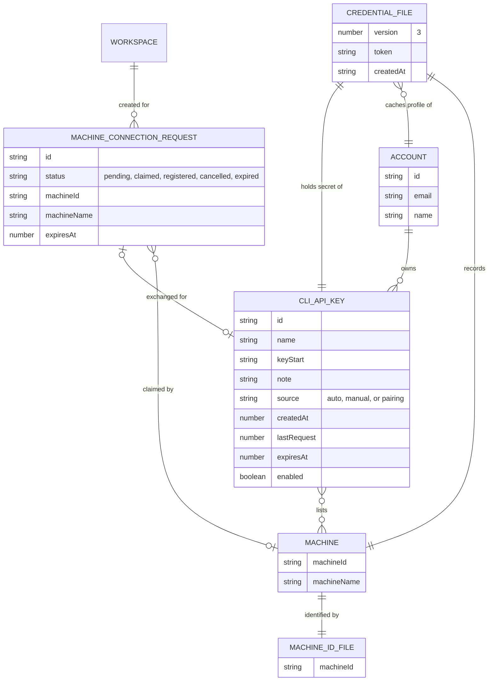
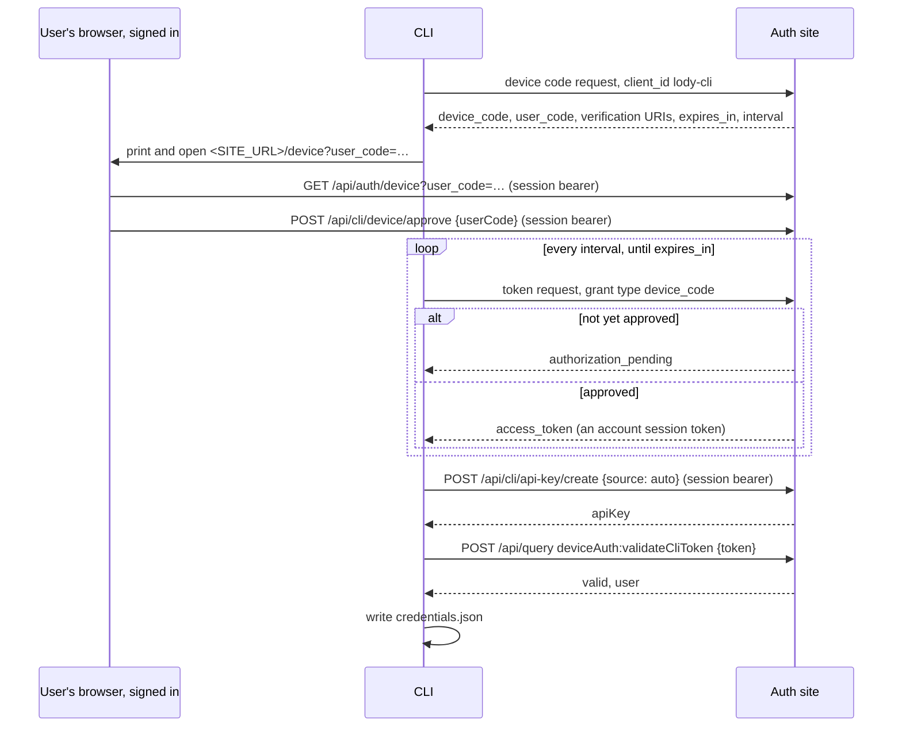
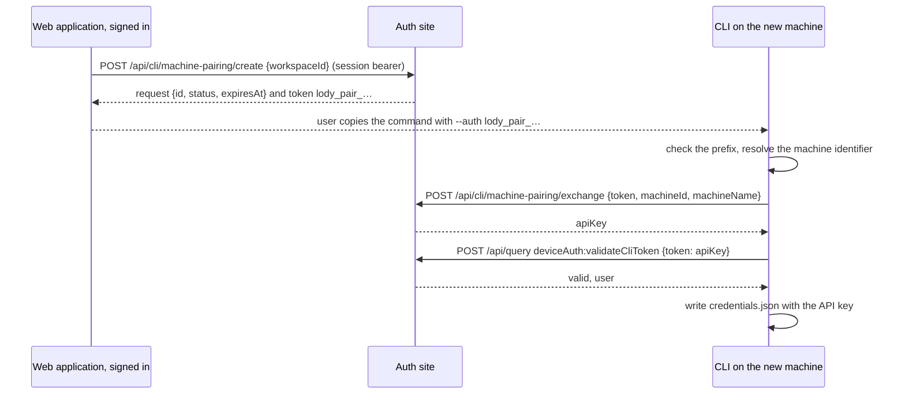
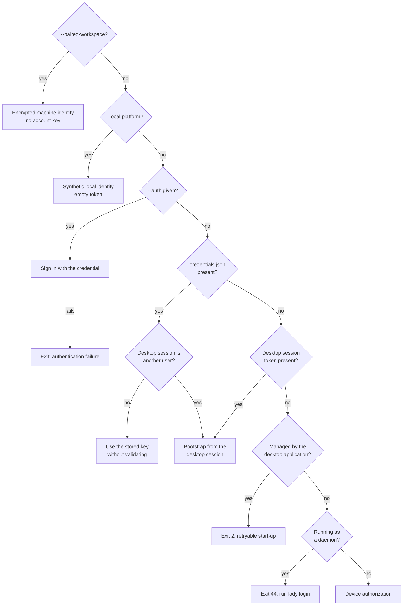
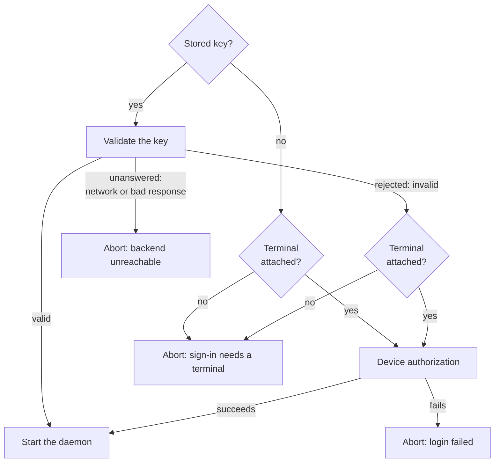
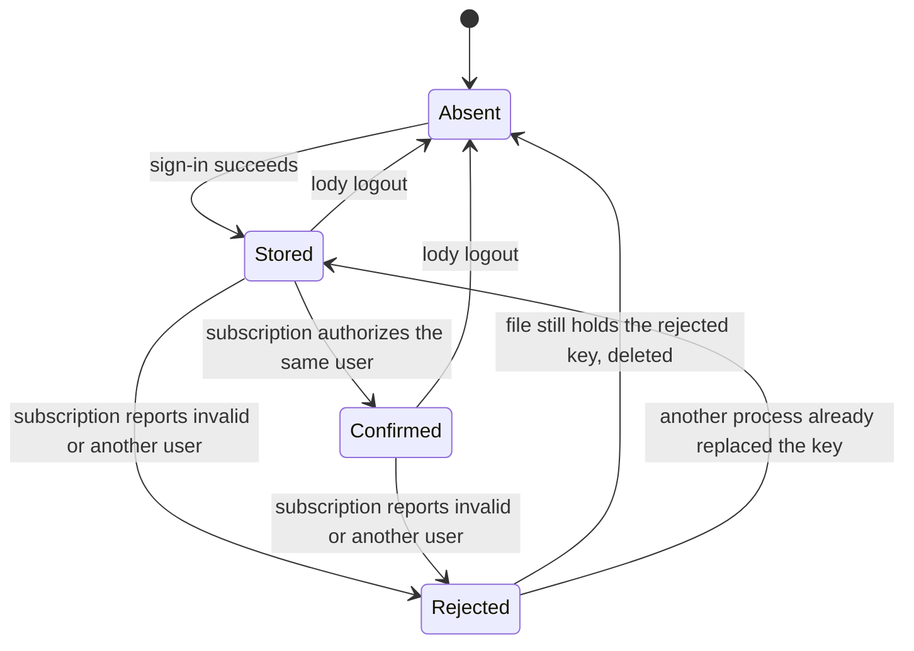

# CLI authentication against Lody Cloud

This document describes how the Lody command-line interface (CLI), including
the daemon it runs as, obtains, stores, presents, and loses its credential
for Lody Cloud. It describes Lody at commit
`61bd9701a5ed6899a9f42787df682acfc3fd7d4b`. The routes and their schemas are
in the [cloud API guide](README.md) and the
[OpenAPI description](openapi.yaml); this document adds the client behaviour
around them.

Citations such as [E-A14](#e-a14) point to the [evidence](#evidence) table at
the end, which links each claim to the source. A statement marked **Infer**
is an inference from the cited code, not something the code states.

## Scope

The subject is ordinary account authentication on the cloud platform: one
long-lived CLI API key per installation, stored in a file.

Out of scope:

- **Encrypted workspace pairing.** `lody machine pair` and
  `lody start --paired-workspace` use device credentials and no account API
  key ([E-A29](#e-a29)). The cloud guide covers their
  [control-plane semantics](README.md#encrypted-control-plane-semantics).
- **The local platform.** It has no account. The CLI runs under a synthetic
  local identity with an empty token, and `--auth` is refused
  ([E-A29](#e-a29)).
- **Agent and provider sign-in**, such as an agent's own login, and GitHub
  token brokering.

Nothing here was verified against the hosted service. What the server
enforces is listed under
[what the source does not establish](#what-the-source-does-not-establish).

## The credential in one page

The CLI authenticates with a **CLI API key**: an opaque string that the
backend issues and the CLI stores. Every way of signing in ends by storing
one.

| Way in | Trigger | Human needed | What the CLI sends | Evidence |
| ------ | ------- | ------------ | ------------------ | -------- |
| Device authorization | `lody login`, or `lody start` with nothing stored | Yes, in a browser | A device code, polled until approved; then the session token to create a key | [E-A11](#e-a11), [E-A12](#e-a12), [E-A14](#e-a14) |
| API key | `--auth <key>` | No | The key itself, for validation | [E-A16](#e-a16) |
| Machine connection token | `--auth lody_pair_…` | No, after the token is created | The one-time token, exchanged for a key | [E-A17](#e-a17) |
| Desktop bootstrap | The desktop application starts the CLI | No | The desktop's session token, to create a key | [E-A24](#e-a24), [E-A30](#e-a30) |

_Table 1: The four ways the CLI obtains its API key._

`--auth` is accepted by `lody login`, `lody start`, `lody daemon start`, and
`lody daemon install`. One dispatcher decides which path a credential takes:
a value that starts with `lody_pair_` is a machine connection token, and
anything else is treated as an API key ([E-A15](#e-a15),
[E-A18](#e-a18)).

## Endpoints and configuration

The CLI talks to two base addresses ([E-A1](#e-a1), [E-A2](#e-a2),
[E-A3](#e-a3)):

- **The auth site** serves every route in this document. It is
  `LODY_AUTH_SITE_URL` when set. Otherwise it is derived from `LODY_AUTH_URL`
  by replacing a `.convex.cloud` host suffix with `.convex.site` and dropping
  the path. The CLI refuses to start authentication when `LODY_AUTH_URL` is
  undefined.
- **The web application**, `SITE_URL` (default `https://lody.ai`), serves the
  page where a person approves a device code.

| Route on the auth site | Used for | Credential sent |
| ---------------------- | -------- | --------------- |
| Better Auth device plugin: request a code | Start device authorization | None; `client_id` is `lody-cli` |
| Better Auth device plugin: request a token | Poll for approval | None; the device code |
| `GET /api/auth/device?user_code=…` | Browser checks the user code | Account session, as a bearer |
| `POST /api/cli/device/approve` | Browser approves the user code | Account session, as a bearer |
| `POST /api/cli/api-key/create` | Create a CLI API key | Account session, as a bearer |
| `POST /api/cli/machine-pairing/create` | Browser creates a machine connection token | Account session, as a bearer |
| `POST /api/cli/machine-pairing/exchange` | Exchange a machine connection token for a key | None; the token is in the body |
| `POST /api/query`, path `deviceAuth:validateCliToken` | Validate a key | None; the key is in the arguments |
| `GET /api/auth/get-session` | Resolve the user behind a session token | Account session, as a bearer |

_Table 2: Routes involved in CLI authentication._

Sources: [E-A10](#e-a10), [E-A13](#e-a13), [E-A14](#e-a14),
[E-A17](#e-a17), [E-A19](#e-a19), [E-A25](#e-a25), [E-A26](#e-a26). The
device plugin's own paths are chosen by the Better Auth client library and
are not spelled out in the Lody source.

## What is stored

### The credential file

The key lives in `credentials.json` in the Lody data directory
([E-A5](#e-a5)). The file is JSON with this shape ([E-A4](#e-a4),
[E-A6](#e-a6)):

```json
{
  "version": 3,
  "token": "<CLI API key>",
  "user": { "id": "<user id>", "email": "<email>", "name": "<name or null>" },
  "machine": { "machineName": "<host name>", "machineId": "<machine id>" },
  "createdAt": "<ISO 8601 timestamp>"
}
```

- **Reading.** A file that is missing, is not JSON, or does not match the
  schema, including any `version` other than 3, counts as no credential. The
  CLI does not migrate older versions ([E-A7](#e-a7)).
- **Writing.** On POSIX systems the file is written to a new temporary file
  created exclusively with mode `0600`, then renamed over the target. A
  reader therefore never sees a partial file, and an existing symbolic link
  or looser permission is not reused. On Windows the file is written in
  place ([E-A8](#e-a8)).
- **Machine name.** It defaults to the host name, and `--machine-name`
  overrides it ([E-A31](#e-a31)).

### The machine identifier

A machine identifier names the installation, not the account. It is resolved
in this order ([E-A9](#e-a9)):

1. If the credential file holds a machine identifier that differs from the
   `machine-id` file, the credential's value wins and is written back.
2. Otherwise the `machine-id` file's value is used.
3. Otherwise a random UUID is created with an exclusive write. If another
   process wins that race, its value is read back and used.

The identifier is fixed before any exchange, so retrying a machine
connection token presents the same machine each time ([E-A17](#e-a17)).

### Entities

The server's storage is private. The model below is what the clients can
see: the fields of the credential file, of the key records that the web
application lists, and of a machine connection request.

For screen readers: the following entity-relationship diagram shows an
account that owns many CLI API keys. A workspace has many machine connection
requests, and each request may be exchanged for one key. A key lists the
machines it is associated with. On disk, one credential file holds the secret
of one key, caches the profile of one account, and records one machine, and a
machine is identified by one machine identifier file.



_Figure 1: Client-visible entities in CLI authentication._

Sources: [E-A4](#e-a4), [E-A18](#e-a18), [E-A20](#e-a20). The link from a
connection request to a key is an inference from the exchange response and
from the `pairing` value of a key's `source` (**Infer**).

## Device authorization

`lody login` first looks for a stored key. If one exists and validates, the
command reports that the user is already signed in and stops. If validation
could not be completed, it stops with an error and leaves the key alone. Only
a key that the backend calls invalid leads to a new sign-in
([E-A31](#e-a31)).

For screen readers: the following sequence diagram shows device
authorization. The CLI asks the auth site for a device code and receives a
device code, a user code, verification addresses, an expiry, and an interval.
It prints and opens a verification address. The signed-in user's browser
checks the user code and approves it. Meanwhile the CLI polls for a token at
the given interval; a pending answer means wait, and an approved answer
carries a session token. The CLI posts that token to create an API key,
validates the new key, and writes the credential file.



_Figure 2: Device authorization, from the code request to the stored key._

Details ([E-A11](#e-a11), [E-A12](#e-a12), [E-A13](#e-a13)):

- **Verification address.** The CLI prefers its own web address,
  `<SITE_URL><base path>/device?user_code=…`, and falls back to the server's
  `verification_uri_complete` only if that address cannot be built. It then
  tries to open the browser; failure to do so is a warning.
- **Polling.** The CLI sleeps for `interval` seconds before each poll, and
  stops when `expires_in` seconds have passed since the code was issued.
- **Secrets in logs.** Debug output records only the hosts of the
  verification addresses and whether codes were present (**Test** "keeps the
  user code in the console login URL while redacting debug response codes";
  [E-A47](#e-a47)).

| Poll result | CLI behaviour |
| ----------- | ------------- |
| Success with `access_token` | Stop polling; create the API key |
| `authorization_pending` | Poll again after the interval |
| `slow_down` | Wait one extra interval, then continue |
| `access_denied` | Fail: "Authorization denied" |
| `expired_token` | Fail: "Authorization code expired" |
| Any other device error | Fail with the server's description |
| HTTP error, or a thrown network error | Fail; a 404 adds a hint about the auth site address |
| Deadline reached | Fail: "Authorization timed out" |

_Table 3: Outcomes of a device authorization poll._

### From session token to API key

The session token is used once, to create the key, and is not stored. The
CLI posts `{ "source": "auto" }` with the session token as a bearer, reads
`apiKey` from the response, and then validates the key before saving it. The
validated user is the source of truth for the stored profile
([E-A14](#e-a14)).

A failure at this step is classified. A network error, or an HTTP status of
408, 429, or 500 and above, is _retryable_; anything else is not. Callers use
that distinction to decide whether to retry start-up or to stop
([E-A14](#e-a14), [E-A27](#e-a27)).

## Non-interactive sign-in with `--auth`

### An API key

A key created elsewhere, for example by the web application's key
management page, is validated and stored. No key is created. An invalid key
writes nothing (**Test** "rejects invalid API keys without writing
credentials"; [E-A16](#e-a16), [E-A47](#e-a47)).

The web application creates such keys with `{ note, source: "manual" }`, and
lists and revokes them through sibling routes ([E-A21](#e-a21)).

### A machine connection token

A machine connection token lets a signed-in person connect a machine that
has no browser. The token starts with `lody_pair_`, and the shared lifetime
constant is 30 minutes ([E-A18](#e-a18)).

For screen readers: the following sequence diagram shows a machine being
connected with a token. The signed-in web application asks the auth site to
create a connection request for a workspace and receives the request and a
token, which the user copies to the machine. The CLI checks the token's
prefix, fixes its machine identifier, and posts the token, the machine
identifier, and the machine name to the exchange route. The auth site returns
an API key. The CLI validates the key and writes the credential file, storing
the key and never the token.



_Figure 3: Connecting a machine with a one-time machine connection token._

| Exchange result | CLI behaviour | Retryable |
| --------------- | ------------- | --------- |
| Token lacks the prefix | Fail without a request: invalid or expired | No |
| Network error | Fail: retry the same command | Yes |
| HTTP 400, 401, 404, or 410 | Fail: the token is invalid or expired | No |
| HTTP 408, 429, or 500 and above | Fail: retry, or create a new token | Yes |
| Any other failure status | Fail: retry, or create a new token | No |
| Response without `apiKey` | Fail: invalid response | No |
| Key fails validation | Fail: retry the same command | As the validation reports |

_Table 4: Outcomes of a machine connection token exchange._

Sources: [E-A17](#e-a17), [E-A19](#e-a19). The tests assert that only the
issued key is persisted, and that an expired token persists nothing
(**Test** "exchanges the one-time token and persists only the issued API
key", "does not persist an expired pairing token"; [E-A47](#e-a47)).

A connection request has a status of `pending`, `claimed`, `registered`,
`cancelled`, or `expired` ([E-A18](#e-a18)). The transitions between them
happen on the server and are not visible in the public source.

## Desktop bootstrap

The desktop application signs the user in itself, then starts the CLI with
the account session token in the environment variable
`LODY_ELECTRON_SESSION_TOKEN`, and optionally the user identifier in
`LODY_ELECTRON_SESSION_USER_ID` ([E-A22](#e-a22), [E-A23](#e-a23)).

- The CLI reads both variables once and deletes them from its environment,
  so child processes do not inherit them ([E-A22](#e-a22)).
- With no stored key, the CLI creates one from the session token, exactly as
  device authorization does after approval ([E-A24](#e-a24),
  [E-A30](#e-a30)).
- With a stored key, the CLI compares the key's user with the desktop
  session's user. If the user identifier was not supplied, it asks
  `GET /api/auth/get-session`. A mismatch replaces the stored key by
  bootstrapping again ([E-A25](#e-a25), [E-A29](#e-a29)).
- If bootstrap fails under the desktop application, the CLI exits with the
  retryable start-up code, so that the desktop application retries with a
  fresh session ([E-A30](#e-a30), [E-A41](#e-a41)).

## Validating a key

Validation is one request: `POST <auth site>/api/query` with the body
`{ "path": "deviceAuth:validateCliToken", "args": { "token": "<key>" } }`
and no authorization header ([E-A26](#e-a26)).

| Observation | `valid` | `reason` | Retryable |
| ----------- | ------- | -------- | --------- |
| `valid: true` with a user | Yes | | |
| `valid: false` | No | `invalid` | No |
| HTTP 408, 429, or 500 and above | No | `request_failed` | Yes |
| Any other failure status | No | `request_failed` | No |
| Body that does not match the schema, or `valid: true` without a user | No | `invalid_response` | No |
| Thrown network error | No | `network_error` | Yes |

_Table 5: How a validation response is classified._

Only `invalid` means that the backend rejected the key. The other reasons
mean that the question went unanswered, and the callers treat them
differently: an outage must not cause a working key to be replaced
([E-A27](#e-a27), [E-A32](#e-a32)). The tests cover each row (**Test** "marks
fetch failures as retryable instead of invalid credentials", "treats
explicit valid:false responses as invalid credentials", "does not treat
invalid response payloads as invalid credentials"; [E-A47](#e-a47)).

When the key being validated is the stored one, the CLI keeps the cached
user profile and takes only validity from the server ([E-A28](#e-a28)).

## How `lody start` resolves its identity

`lody start` does not validate a stored key before using it. It restores the
cached identity and starts; the workspace subscription described under
[rejection at run time](#rejection-at-run-time) is the single remote check
([E-A29](#e-a29)).

For screen readers: the following flowchart shows the order in which
`lody start` chooses an identity. A paired encrypted workspace, and then the
local platform, are handled first and use no account key. Otherwise, if
`--auth` was given, the CLI signs in with it and exits on failure. Otherwise,
if a credential file exists, it is used, unless the desktop session belongs
to another user, in which case the CLI bootstraps again from the desktop
session. Otherwise, if a desktop session token is present, the CLI
bootstraps from it. Otherwise, a CLI managed by the desktop application exits
with the retryable code, a CLI running as a daemon exits with the
authentication failure code, and any other CLI starts device authorization.



_Figure 4: The order in which `lody start` resolves its identity._

Source: [E-A29](#e-a29), [E-A30](#e-a30), [E-A48](#e-a48).

## The daemon's foreground check

The daemon runs detached, where nobody would see a sign-in prompt.
`lody daemon start` therefore settles authentication in the foreground
before it spawns the daemon ([E-A34](#e-a34)).

- With `--auth`, it signs in with that credential and stops on failure.
- With `--skip-auth-check`, it does nothing. `lody daemon install` uses this
  flag after running the same check itself ([E-A35](#e-a35)).
- Otherwise it validates the stored key and follows the plan below.

For screen readers: the following flowchart shows the daemon's foreground
check. With no stored key, the CLI signs in if a terminal is attached, and
aborts otherwise. With a stored key it asks the backend. A valid key lets the
daemon start. An unanswered question aborts, because the backend could not be
reached. A rejected key leads to sign-in if a terminal is attached, and to an
abort otherwise.



_Figure 5: The decision `lody daemon start` makes before spawning the
daemon._

Source: [E-A32](#e-a32), [E-A33](#e-a33). "Terminal attached" means that
standard output is a terminal.

## Rejection at run time

Once started, the daemon subscribes to the cloud function
`deviceAuth:listMyWorkspacesForCliToken`, passing the key as an argument. The
subscription is both the list of workspaces to serve and the continuing
check that the key is still good ([E-A36](#e-a36)).

The key is treated as rejected when an update reports that it is not valid,
or when the update's user differs from the cached user. Rejection is
reported once, marks the runtime state as `auth_token_invalid`, and begins a
shutdown ([E-A37](#e-a37), [E-A38](#e-a38)).

Before exiting, the CLI deletes the credential file, but only if the file
still holds the rejected key. Another process may have signed in again in
the meantime, and the check is meant to let its key survive (**Test** "does
not delete credentials that were rotated after this process started";
[E-A39](#e-a39), [E-A47](#e-a47)). The check is not atomic: the file is read
and then unlinked in a separate step, so a sign-in that replaces the file
between the two deletes the new key.

| Clean-up result | Managed by the desktop application | Exit code | Meaning |
| --------------- | ---------------------------------- | --------- | ------- |
| The file holds a different key | Either | 2 | Another process rotated the key; restart and use it |
| The file could not be deleted | Either | 44 under a supervisor, otherwise 1 | Automatic recovery is unsafe |
| The file was deleted | Yes | 2 | Restart so the desktop application can bootstrap a new key |
| The file was deleted | No | 44 under a supervisor, otherwise 1 | Run `lody login` |

_Table 6: Recovery after the backend rejects the stored key._

Source: [E-A40](#e-a40), [E-A41](#e-a41). The daemon's supervisor treats
exit code 44 as fatal and does not restart the worker
([E-A43](#e-a43)).

For screen readers: the following state diagram shows the life of the stored
credential. It starts absent. A successful sign-in by any of the four ways
stores it. The first authorized update from the workspace subscription
confirms it. A stored or confirmed credential becomes rejected when the
subscription reports it invalid or reports another user. A rejected
credential becomes absent when the file still holds the rejected key and is
deleted, and returns to stored when another process has already replaced the
key. Logging out makes a stored or confirmed credential absent.



_Figure 6: States of the stored CLI credential._

## How the key is presented

After sign-in the key is presented in three ways, depending on the route.

| Form | Where | Examples |
| ---- | ----- | -------- |
| A `token` argument | Cloud functions for the CLI | `deviceAuth:validateCliToken`, `deviceAuth:listMyWorkspacesForCliToken` |
| A `cliToken` argument | Other cloud functions in the CLI's cloud port | `sessionSharing:requestFromCli` |
| `Authorization: Bearer <key>` | HTTP routes on the auth site | Session history proof requests and verification, automation and preview verification, and the Streams token |

_Table 7: The three ways the CLI presents its key._

Sources: [E-A36](#e-a36), [E-A44](#e-a44), [E-A45](#e-a45). The cloud guide's
[credential table](README.md#credentials-and-authentication) gives the
general rule.

The Streams token route matters for liveness. The CLI exchanges its key for
a short-lived Streams grant, and a 401 or 403 from that route is raised as a
distinct error that callers are told to treat as fatal: the key was revoked,
or was never valid for the workspace, and retrying cannot help
([E-A45](#e-a45)). The Streams side is described in the
[RPC protocol](../lody-streams-rpc/protocol.md#addressing-and-credentials).

## Signing out

`lody logout` deletes the credential file and nothing else. It makes no
request, so the key remains valid on the server until it is revoked from the
web application's key management page ([E-A46](#e-a46), [E-A21](#e-a21)).
Logging out when no credential is stored succeeds and says so.

## Exit codes

| Code | Name in the source | Meaning for authentication |
| ---- | ------------------ | -------------------------- |
| 1 | None | Sign-in failed in a CLI that has no supervisor |
| 2 | `CLI_EXIT_CODE_RETRYABLE_STARTUP` | Start again: a fresh desktop session or a rotated key is expected |
| 44 | `CLI_EXIT_CODE_AUTH_FAILURE` | Credentials were rejected; stop instead of restarting in a loop |

_Table 8: Exit codes with a meaning for authentication._

Source: [E-A42](#e-a42), [E-A48](#e-a48).

## What the source does not establish

- The format, lifetime, and storage of a CLI API key on the server, and
  whether an `auto` key ever expires.
- How long a device code lasts and how often it may be polled. The CLI obeys
  whatever `expires_in` and `interval` the server returns.
- Whether the server enforces single use of a machine connection token. The
  source and its tests call the token one-time, and the client never stores
  it.
- How quickly a revoked key is reported through the workspace subscription.
- What the device plugin's request paths are. They belong to the Better Auth
  client library.

## Evidence

Lody sources are linked at commit `61bd9701a5ed6899a9f42787df682acfc3fd7d4b`.
Every row was read directly for this document.

| Id | Location | Shows |
| -- | -------- | ----- |
| <a id="e-a1"></a>E-A1 | `apps/cli/src/lib/auth.ts` [296–303](https://github.com/LodyAI/Lody/blob/61bd9701a5ed6899a9f42787df682acfc3fd7d4b/apps/cli/src/lib/auth.ts#L296-L303) | The auth client's two base addresses; it throws when `LODY_AUTH_URL` is undefined. |
| <a id="e-a2"></a>E-A2 | `packages/shared/src/convex-site-url.ts` [1–18](https://github.com/LodyAI/Lody/blob/61bd9701a5ed6899a9f42787df682acfc3fd7d4b/packages/shared/src/convex-site-url.ts#L1-L18) | Derivation of the auth site address from a `.convex.cloud` address. |
| <a id="e-a3"></a>E-A3 | `apps/cli/src/utils/const.ts` [8–19](https://github.com/LodyAI/Lody/blob/61bd9701a5ed6899a9f42787df682acfc3fd7d4b/apps/cli/src/utils/const.ts#L8-L19) | `LODY_AUTH_URL`, `LODY_AUTH_SITE_URL`, and `SITE_URL` with its default. |
| <a id="e-a4"></a>E-A4 | `apps/cli/src/lib/auth.ts` [85–93](https://github.com/LodyAI/Lody/blob/61bd9701a5ed6899a9f42787df682acfc3fd7d4b/apps/cli/src/lib/auth.ts#L85-L93) | Schema of the credential file, version 3. |
| <a id="e-a5"></a>E-A5 | `apps/cli/src/utils/index.ts` [19–21](https://github.com/LodyAI/Lody/blob/61bd9701a5ed6899a9f42787df682acfc3fd7d4b/apps/cli/src/utils/index.ts#L19-L21) | The credential file is `credentials.json` in the data directory. |
| <a id="e-a6"></a>E-A6 | `apps/cli/src/lib/auth.ts` [760–778](https://github.com/LodyAI/Lody/blob/61bd9701a5ed6899a9f42787df682acfc3fd7d4b/apps/cli/src/lib/auth.ts#L760-L778) | Writing the credential file. |
| <a id="e-a7"></a>E-A7 | `apps/cli/src/lib/auth.ts` [783–797](https://github.com/LodyAI/Lody/blob/61bd9701a5ed6899a9f42787df682acfc3fd7d4b/apps/cli/src/lib/auth.ts#L783-L797) | Reading the credential file; a file that fails the schema is no credential. |
| <a id="e-a8"></a>E-A8 | `apps/cli/src/lib/private-credential-file.ts` [5–23](https://github.com/LodyAI/Lody/blob/61bd9701a5ed6899a9f42787df682acfc3fd7d4b/apps/cli/src/lib/private-credential-file.ts#L5-L23) | Owner-only, exclusive, rename-based write; plain write on Windows. |
| <a id="e-a9"></a>E-A9 | `apps/cli/src/utils/const.ts` [92–144](https://github.com/LodyAI/Lody/blob/61bd9701a5ed6899a9f42787df682acfc3fd7d4b/apps/cli/src/utils/const.ts#L92-L144) | Machine identifier resolution and first creation. |
| <a id="e-a10"></a>E-A10 | `apps/cli/src/lib/auth.ts` [95–103](https://github.com/LodyAI/Lody/blob/61bd9701a5ed6899a9f42787df682acfc3fd7d4b/apps/cli/src/lib/auth.ts#L95-L103) | Device client identifier, grant type, and the Better Auth client plugins. |
| <a id="e-a11"></a>E-A11 | `apps/cli/src/lib/auth.ts` [492–561](https://github.com/LodyAI/Lody/blob/61bd9701a5ed6899a9f42787df682acfc3fd7d4b/apps/cli/src/lib/auth.ts#L492-L561) | Device code request, its errors, the preferred verification address, and opening the browser. |
| <a id="e-a12"></a>E-A12 | `apps/cli/src/lib/auth.ts` [563–669](https://github.com/LodyAI/Lody/blob/61bd9701a5ed6899a9f42787df682acfc3fd7d4b/apps/cli/src/lib/auth.ts#L563-L669) | Polling loop, error handling, deadline, and the hand-off to key creation. |
| <a id="e-a13"></a>E-A13 | `packages/components/src/routes/device.lazy.tsx` [142–169](https://github.com/LodyAI/Lody/blob/61bd9701a5ed6899a9f42787df682acfc3fd7d4b/packages/components/src/routes/device.lazy.tsx#L142-L169) | The browser checks and approves a user code with the session token. |
| <a id="e-a14"></a>E-A14 | `apps/cli/src/lib/auth.ts` [309–386](https://github.com/LodyAI/Lody/blob/61bd9701a5ed6899a9f42787df682acfc3fd7d4b/apps/cli/src/lib/auth.ts#L309-L386) | Key creation from a session token, validation, and saving. |
| <a id="e-a15"></a>E-A15 | `apps/cli/src/lib/auth.ts` [971–997](https://github.com/LodyAI/Lody/blob/61bd9701a5ed6899a9f42787df682acfc3fd7d4b/apps/cli/src/lib/auth.ts#L971-L997) | The `--auth` dispatcher and the prefix test. |
| <a id="e-a16"></a>E-A16 | `apps/cli/src/lib/auth.ts` [397–427](https://github.com/LodyAI/Lody/blob/61bd9701a5ed6899a9f42787df682acfc3fd7d4b/apps/cli/src/lib/auth.ts#L397-L427) | Sign-in with an existing API key. |
| <a id="e-a17"></a>E-A17 | `apps/cli/src/lib/auth.ts` [429–490](https://github.com/LodyAI/Lody/blob/61bd9701a5ed6899a9f42787df682acfc3fd7d4b/apps/cli/src/lib/auth.ts#L429-L490) | Machine connection token exchange and its error mapping. |
| <a id="e-a18"></a>E-A18 | `packages/shared/src/machine-pairing.ts` [1–21](https://github.com/LodyAI/Lody/blob/61bd9701a5ed6899a9f42787df682acfc3fd7d4b/packages/shared/src/machine-pairing.ts#L1-L21) | Token prefix, 30-minute lifetime constant, request statuses, and response shapes. |
| <a id="e-a19"></a>E-A19 | `packages/components/src/lib/cli-api-key.ts` [131–166](https://github.com/LodyAI/Lody/blob/61bd9701a5ed6899a9f42787df682acfc3fd7d4b/packages/components/src/lib/cli-api-key.ts#L131-L166) | The web application creates a machine connection request. |
| <a id="e-a20"></a>E-A20 | `packages/components/src/lib/cli-api-key.ts` [9–23](https://github.com/LodyAI/Lody/blob/61bd9701a5ed6899a9f42787df682acfc3fd7d4b/packages/components/src/lib/cli-api-key.ts#L9-L23) | Fields of a key record as listed to the web application. |
| <a id="e-a21"></a>E-A21 | `packages/components/src/lib/cli-api-key.ts` [168–275](https://github.com/LodyAI/Lody/blob/61bd9701a5ed6899a9f42787df682acfc3fd7d4b/packages/components/src/lib/cli-api-key.ts#L168-L275) | The web application creates manual keys, and lists and revokes keys. |
| <a id="e-a22"></a>E-A22 | `apps/cli/src/electron-bootstrap-env.ts` [1–17](https://github.com/LodyAI/Lody/blob/61bd9701a5ed6899a9f42787df682acfc3fd7d4b/apps/cli/src/electron-bootstrap-env.ts#L1-L17) | Bootstrap environment variables, read once and deleted. |
| <a id="e-a23"></a>E-A23 | `apps/electron/src/main/services/cli-service.ts` [683](https://github.com/LodyAI/Lody/blob/61bd9701a5ed6899a9f42787df682acfc3fd7d4b/apps/electron/src/main/services/cli-service.ts#L683) | The desktop application sets the session token variable for the CLI. |
| <a id="e-a24"></a>E-A24 | `apps/cli/src/lib/auth.ts` [388–395](https://github.com/LodyAI/Lody/blob/61bd9701a5ed6899a9f42787df682acfc3fd7d4b/apps/cli/src/lib/auth.ts#L388-L395) | Bootstrap from a session token. |
| <a id="e-a25"></a>E-A25 | `apps/cli/src/commands/start.ts` [298–308](https://github.com/LodyAI/Lody/blob/61bd9701a5ed6899a9f42787df682acfc3fd7d4b/apps/cli/src/commands/start.ts#L298-L308); `apps/cli/src/lib/auth.ts` [705–735](https://github.com/LodyAI/Lody/blob/61bd9701a5ed6899a9f42787df682acfc3fd7d4b/apps/cli/src/lib/auth.ts#L705-L735) | Resolving the desktop session's user through `get-session`. |
| <a id="e-a26"></a>E-A26 | `apps/cli/src/lib/auth.ts` [802–880](https://github.com/LodyAI/Lody/blob/61bd9701a5ed6899a9f42787df682acfc3fd7d4b/apps/cli/src/lib/auth.ts#L802-L880) | The validation request and the classification of its result. |
| <a id="e-a27"></a>E-A27 | `apps/cli/src/lib/auth.ts` [245–255](https://github.com/LodyAI/Lody/blob/61bd9701a5ed6899a9f42787df682acfc3fd7d4b/apps/cli/src/lib/auth.ts#L245-L255); `apps/cli/src/lib/auth.ts` [287–289](https://github.com/LodyAI/Lody/blob/61bd9701a5ed6899a9f42787df682acfc3fd7d4b/apps/cli/src/lib/auth.ts#L287-L289) | Retryable and unavailable predicates; retryable HTTP statuses. |
| <a id="e-a28"></a>E-A28 | `apps/cli/src/lib/auth.ts` [737–754](https://github.com/LodyAI/Lody/blob/61bd9701a5ed6899a9f42787df682acfc3fd7d4b/apps/cli/src/lib/auth.ts#L737-L754) | Validation reuses the cached profile for the stored key. |
| <a id="e-a29"></a>E-A29 | `apps/cli/src/commands/start.ts` [372–492](https://github.com/LodyAI/Lody/blob/61bd9701a5ed6899a9f42787df682acfc3fd7d4b/apps/cli/src/commands/start.ts#L372-L492) | Identity resolution in `lody start`, in order. |
| <a id="e-a30"></a>E-A30 | `apps/cli/src/commands/start.ts` [331–370](https://github.com/LodyAI/Lody/blob/61bd9701a5ed6899a9f42787df682acfc3fd7d4b/apps/cli/src/commands/start.ts#L331-L370) | Bootstrap login in `lody start` and its failure exits. |
| <a id="e-a31"></a>E-A31 | `apps/cli/src/commands/login.ts` [28–136](https://github.com/LodyAI/Lody/blob/61bd9701a5ed6899a9f42787df682acfc3fd7d4b/apps/cli/src/commands/login.ts#L28-L136) | `lody login`: options, the existing-key check, and the three sign-in methods. |
| <a id="e-a32"></a>E-A32 | `apps/cli/src/commands/daemon-auth-preflight.ts` [30–73](https://github.com/LodyAI/Lody/blob/61bd9701a5ed6899a9f42787df682acfc3fd7d4b/apps/cli/src/commands/daemon-auth-preflight.ts#L30-L73) | The pure plan for the daemon's foreground check. |
| <a id="e-a33"></a>E-A33 | `apps/cli/src/commands/daemon-auth-preflight.ts` [88–140](https://github.com/LodyAI/Lody/blob/61bd9701a5ed6899a9f42787df682acfc3fd7d4b/apps/cli/src/commands/daemon-auth-preflight.ts#L88-L140) | Executing the plan; `interactive` defaults to standard output being a terminal. |
| <a id="e-a34"></a>E-A34 | `apps/cli/src/commands/daemon.ts` [216–249](https://github.com/LodyAI/Lody/blob/61bd9701a5ed6899a9f42787df682acfc3fd7d4b/apps/cli/src/commands/daemon.ts#L216-L249) | `lody daemon start` resolves authentication before spawning. |
| <a id="e-a35"></a>E-A35 | `apps/cli/src/commands/daemon-install.ts` [52–74](https://github.com/LodyAI/Lody/blob/61bd9701a5ed6899a9f42787df682acfc3fd7d4b/apps/cli/src/commands/daemon-install.ts#L52-L74) | `lody daemon install` checks, then starts with `--skip-auth-check`. |
| <a id="e-a36"></a>E-A36 | `apps/cli/src/lib/cloud-cli-port.ts` [696–711](https://github.com/LodyAI/Lody/blob/61bd9701a5ed6899a9f42787df682acfc3fd7d4b/apps/cli/src/lib/cloud-cli-port.ts#L696-L711) | The workspace access subscription, keyed by the CLI key. |
| <a id="e-a37"></a>E-A37 | `apps/cli/src/lib/lody-fleet.ts` [569–608](https://github.com/LodyAI/Lody/blob/61bd9701a5ed6899a9f42787df682acfc3fd7d4b/apps/cli/src/lib/lody-fleet.ts#L569-L608) | Rejection on an unauthorized update or a user mismatch. |
| <a id="e-a38"></a>E-A38 | `apps/cli/src/commands/start.ts` [797–821](https://github.com/LodyAI/Lody/blob/61bd9701a5ed6899a9f42787df682acfc3fd7d4b/apps/cli/src/commands/start.ts#L797-L821) | Fatal authentication shutdown, reported once. |
| <a id="e-a39"></a>E-A39 | `apps/cli/src/lib/auth.ts` [690–703](https://github.com/LodyAI/Lody/blob/61bd9701a5ed6899a9f42787df682acfc3fd7d4b/apps/cli/src/lib/auth.ts#L690-L703) | The rejected key is cleared only if the file still holds it. |
| <a id="e-a40"></a>E-A40 | `apps/cli/src/commands/start.ts` [501–526](https://github.com/LodyAI/Lody/blob/61bd9701a5ed6899a9f42787df682acfc3fd7d4b/apps/cli/src/commands/start.ts#L501-L526) | Recovery after a rejected key. |
| <a id="e-a41"></a>E-A41 | `apps/cli/src/commands/start-auth-recovery.ts` [10–57](https://github.com/LodyAI/Lody/blob/61bd9701a5ed6899a9f42787df682acfc3fd7d4b/apps/cli/src/commands/start-auth-recovery.ts#L10-L57) | Exit codes chosen for bootstrap failure and for rejected-key recovery. |
| <a id="e-a42"></a>E-A42 | `packages/shared/src/node/local-cli-supervisor.ts` [15–22](https://github.com/LodyAI/Lody/blob/61bd9701a5ed6899a9f42787df682acfc3fd7d4b/packages/shared/src/node/local-cli-supervisor.ts#L15-L22) | Exit code constants 2 and 44. |
| <a id="e-a43"></a>E-A43 | `apps/cli/src/commands/daemon-runner.ts` [1015–1021](https://github.com/LodyAI/Lody/blob/61bd9701a5ed6899a9f42787df682acfc3fd7d4b/apps/cli/src/commands/daemon-runner.ts#L1015-L1021) | The supervisor treats exit code 44 as fatal. |
| <a id="e-a44"></a>E-A44 | `apps/cli/src/lib/cloud-cli-port.ts` [96–105](https://github.com/LodyAI/Lody/blob/61bd9701a5ed6899a9f42787df682acfc3fd7d4b/apps/cli/src/lib/cloud-cli-port.ts#L96-L105); `apps/cli/src/lib/cloud-cli-port.ts` [143–157](https://github.com/LodyAI/Lody/blob/61bd9701a5ed6899a9f42787df682acfc3fd7d4b/apps/cli/src/lib/cloud-cli-port.ts#L143-L157); `apps/cli/src/lib/cloud-cli-port.ts` [616–681](https://github.com/LodyAI/Lody/blob/61bd9701a5ed6899a9f42787df682acfc3fd7d4b/apps/cli/src/lib/cloud-cli-port.ts#L616-L681); `apps/cli/src/lib/cloud-cli-port.ts` [797–845](https://github.com/LodyAI/Lody/blob/61bd9701a5ed6899a9f42787df682acfc3fd7d4b/apps/cli/src/lib/cloud-cli-port.ts#L797-L845) | The key as a `cliToken` argument and as a bearer on auth site routes. |
| <a id="e-a45"></a>E-A45 | `packages/shared/src/loro-streams-auth.ts` [251–272](https://github.com/LodyAI/Lody/blob/61bd9701a5ed6899a9f42787df682acfc3fd7d4b/packages/shared/src/loro-streams-auth.ts#L251-L272); `packages/shared/src/loro-streams-auth.ts` [337–346](https://github.com/LodyAI/Lody/blob/61bd9701a5ed6899a9f42787df682acfc3fd7d4b/packages/shared/src/loro-streams-auth.ts#L337-L346) | The Streams token route, its bearer, and the fatal error for 401 and 403. |
| <a id="e-a46"></a>E-A46 | `apps/cli/src/lib/auth.ts` [671–688](https://github.com/LodyAI/Lody/blob/61bd9701a5ed6899a9f42787df682acfc3fd7d4b/apps/cli/src/lib/auth.ts#L671-L688); `apps/cli/src/commands/logout.ts` [16–47](https://github.com/LodyAI/Lody/blob/61bd9701a5ed6899a9f42787df682acfc3fd7d4b/apps/cli/src/commands/logout.ts#L16-L47) | Logout deletes the file and makes no request. |
| <a id="e-a47"></a>E-A47 | `apps/cli/src/lib/auth.test.ts` [107–423](https://github.com/LodyAI/Lody/blob/61bd9701a5ed6899a9f42787df682acfc3fd7d4b/apps/cli/src/lib/auth.test.ts#L107-L423) | Tests named in this document; they were read, not run. |
| <a id="e-a48"></a>E-A48 | `apps/cli/src/commands/start.ts` [255–273](https://github.com/LodyAI/Lody/blob/61bd9701a5ed6899a9f42787df682acfc3fd7d4b/apps/cli/src/commands/start.ts#L255-L273) | The cloud auth client, the authentication failure exit code, and bootstrap credentials. |

_Table 9: Source locations cited in this document._
