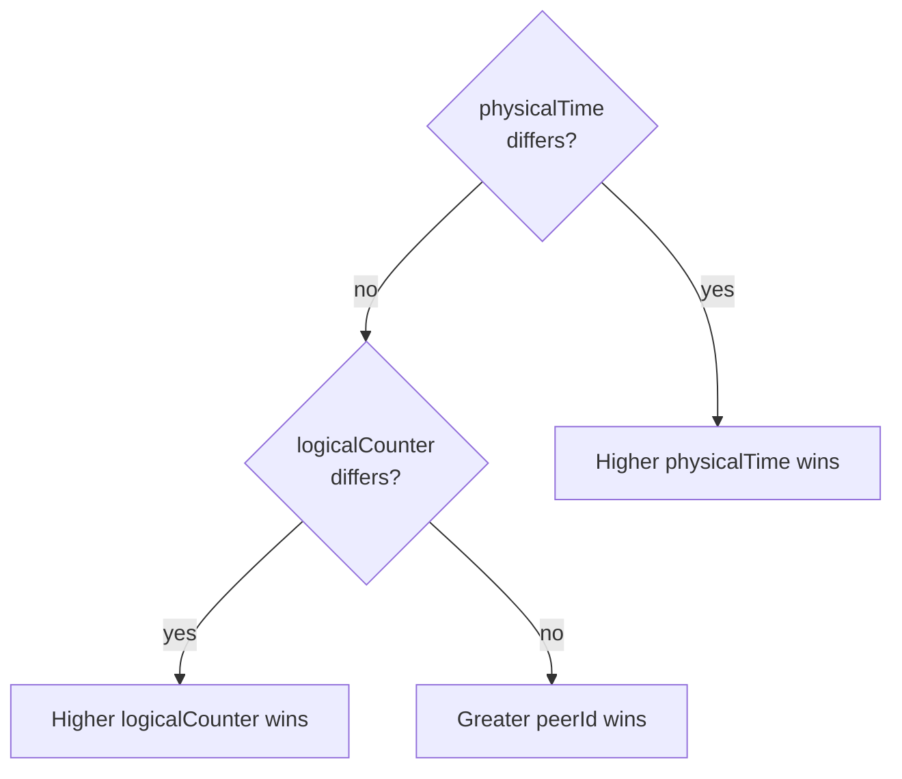

# Data model

This page describes what a Flock is, how Lody names its Flock documents, and
the key schema of the Machine Flock.

## Flock semantics

Flock is a last-writer-wins (LWW) key-value map: the map-of-registers
construction that Shapiro et al. catalogue as the LWW-register and
LWW-element-set [[1]](references.md#ref-1) [[2]](references.md#ref-2). The
facts below come from the `@loro-dev/flock-wasm` 0.5.0 package.

**Keys and values.** A key is an array of JSON-serializable parts, encoded so
that keys sort and can be scanned by prefix. A value is any JSON value
([E-U1](evidence.md#e-u1)).

**Clocks and conflict resolution.** Every entry carries a clock
`(physicalTime, logicalCounter, peerId)`. When two replicas hold different
entries for one key, the entry with the higher `physicalTime` wins; on a tie
the higher `logicalCounter` wins; on a further tie the lexicographically
greater `peerId` wins ([E-U1](evidence.md#e-u1)). This is a total order, so
merge is commutative, associative and idempotent, which is the condition for a
state-based CRDT to converge [[1]](references.md#ref-1). The tie-break by
process identifier follows Lamport's construction of a total order from
logical clocks [[3]](references.md#ref-3).

For screen readers: the following flowchart shows how two different entries for
one key are ordered. If their physical times differ, the entry with the higher
physical time wins. Otherwise, if their logical counters differ, the entry with
the higher counter wins. Otherwise the entry with the lexicographically greater
peer identifier wins.

_Figure 1: The order in which the parts of a clock decide between two entries
for one key._

**Deletes.** A delete writes a _tombstone_: an entry with a clock and no data.
A tombstone competes exactly like a value. A delete with a lower clock than an
existing write is ignored during merge, and one with a higher clock wins.
Deleting a key that was never written, or is already deleted, is a no-op
([E-U2](evidence.md#e-u2), [E-U4](evidence.md#e-u4)). Tombstones are the
"death certificates" of Demers et al. [[6]](references.md#ref-6).

**Local writes.** `put` and `delete` accept an optional explicit timestamp,
which defaults to `Date.now()`. The package states that a local `put`
"always overwrites because the local clock is guaranteed to advance", and,
three lines earlier, that an existing key is overwritten "only if its clock
is higher than the existing entry's clock" ([E-U3](evidence.md#e-u3)). The
two statements agree only if the library raises a local write's clock above
the entry it replaces. How it derives that clock from the wall clock, the
caller's timestamp and the superseded entry is not documented and could not
be read from source. The model takes the first statement at face value as
assumption **A1**: _a local write
receives a clock greater than the entry it supersedes on that replica._
Hybrid logical clocks [[4]](references.md#ref-4) are the standard way to
obtain this property while staying close to physical time.

**Versions.** `version()` returns a per-peer vector of the highest clock among
_visible_ entries; `inclusiveVersion()` also counts overwritten peers.
`exportJson(from)` returns only entries newer than a given vector
([E-U5](evidence.md#e-u5)). A version vector [[5]](references.md#ref-5)
[[29]](references.md#ref-29) records a maximum per peer, not a set of
entries, which matters in
[replication](replication.md#the-version-vector-hole).

**Events.** A subscription delivers batches synchronously after each change.
A batch has a `source` (`"local"`, or the peer for an import) and one event per
key; a delete arrives with `value: undefined` ([E-U6](evidence.md#e-u6)).

### Consequences Lody relies on

- **No coordination is needed to write.** Any replica can write any key while
  offline. This is the local-first property [[7]](references.md#ref-7).
- **One row is one register.** Two concurrent edits to _different fields_ of
  one row do not merge: one whole row wins. Lody therefore keeps independent
  facts in separate keys (a setup task, its cancellation and the published
  configuration are three rows) and serializes daemon read-modify-write cycles
  on one row ([E-D9](evidence.md#e-d9)).
- **A delete is not final.** A write with a later clock, made by a replica
  that has not seen the delete, brings the row back. Where that would be
  wrong, Lody writes a permanent marker row instead of relying on the delete
  ([durable commands](durable-commands.md#cancellation)).
- **Physical time matters.** Because `physicalTime` is compared first, a
  replica whose clock runs ahead wins conflicts it "should" lose. This is the
  well-known hazard of wall-clock LWW [[8]](references.md#ref-8)
  [[9]](references.md#ref-9). The daemon passes server-synchronized time as
  the explicit timestamp of its writes ([E-S15](evidence.md#e-s15),
  [E-K14](evidence.md#e-k14)). Clients pass none, so their entries carry the
  device clock ([E-T9](evidence.md#e-t9), [E-T10](evidence.md#e-t10)). See
  [observations](observations.md#o5-client-clocks).

## Flock documents in a workspace

A Lody workspace holds several named Flock documents next to its Loro
documents. Each is hosted by `loro-repo`, which opens it by id and returns a
handle with the Flock itself, `syncOnce()` and `joinRoom()`
([E-U11](evidence.md#e-u11)).

| Document | Id | Cardinality | Carries commands |
| -------- | -- | ----------- | ---------------- |
| Machine Flock | `<workspaceId>:mf:<machineId>` | One per machine | Yes |
| Workspace Flock | `<workspaceId>:wf:workspace` | One per workspace | No |
| Code collaboration file index | Per owner session | Transient, with a time-to-live | No |

_Table 1: Flock documents in a Lody workspace._

Sources: [E-K1](evidence.md#e-k1), [E-K13](evidence.md#e-k13),
[E-T1](evidence.md#e-t1). The Machine Flock's stream id in the cloud transport
is the document id itself ([E-T1](evidence.md#e-t1)).

## Machine Flock key schema

All keys are built by `machineFlockKeys` and recognized by
`parseMachineFlockKey`; a key that does not parse is ignored
([E-K3](evidence.md#e-k3), [E-K4](evidence.md#e-k4)).

| Key | Value | Written by | Purpose |
| --- | ----- | ---------- | ------- |
| `['dotlodyPath']` | string | Daemon | The daemon's data directory |
| `['localProject', id]` | `LocalProjectMeta` | Daemon and clients | A registered local folder |
| `['cmd', 'deleteLocalProject', id]` | `MachineDeleteLocalProjectCommand` | Clients request; daemon completes or deletes; client acknowledges | [Command](durable-commands.md#delete-local-project) |
| `['providerSetup', id]` | `ProviderSetupTask` | Clients create and retry; daemon advances and deletes | [Command](durable-commands.md#provider-setup) |
| `['providerSetupCancellation', id]` | `ProviderSetupCancellation` | Clients; never deleted | Cancellation marker |
| `['agentConfig', id]` | `AgentConfigMeta` | Daemon, for verified built-in providers; clients for other edits | A usable provider |
| `['builtinAgentOptOut', type]` | `{ v, removedAt }` | Whoever removes a built-in provider | Stops auto-registration re-adding it |
| `['acpCapability', id]` and the `acpModel…` families | Capability caches | Daemon | Probed agent capabilities |
| `['rateLimit', id, cliType, limitId]` | `RateLimit` | Daemon | Provider quota state |
| `['memory', providerId, memoryId]` | `MemoryAssociation` | Not traced | Memory links |
| `['agentConfigIndex', id]` | Summary | Not traced | Listing index |
| `['cmd', 'archiveSession', id]`, `['cmd', 'deleteSession', id]` | Legacy commands | Old clients; daemon discards | [Retired](durable-commands.md#retired-session-commands) |
| `['sessionLaunchConfig', id]` | Legacy | Clean-up only | Deprecated |

_Table 2: Machine Flock keys, their values, writers, and purpose._

Sources: key types [E-K2](evidence.md#e-k2); daemon writers
[E-S15](evidence.md#e-s15), [E-D7](evidence.md#e-d7),
[E-K15](evidence.md#e-k15); client writers [E-D1](evidence.md#e-d1),
[E-D8](evidence.md#e-d8), [E-P13](evidence.md#e-p13),
[E-P14](evidence.md#e-p14). "Not traced" means this study did not establish
the writer.

### Reading

Readers scan by family prefix and parse each row
([E-K5](evidence.md#e-k5)). `parseMachineFlockRow` validates the value against
the key: for example, a `providerSetup` row whose embedded `id` differs from
its key is dropped ([E-K9](evidence.md#e-k9)). A reader therefore never acts on
a malformed or mismatched row; to the protocol it is as if the row were
absent.

Live readers fold event batches into a row map with
`applyMachineFlockRowEvents`: an event with no value, or with a value that
fails validation, removes the row ([E-K8](evidence.md#e-k8)).

### Writing

`writeMachineFlockRowToFlock` normalizes the row, compares it with the stored
row, and writes and commits only if it differs; `deleteMachineFlockRowFromFlock`
deletes only an existing row ([E-K6](evidence.md#e-k6),
[E-K7](evidence.md#e-k7)). Both return whether anything changed, and the
daemon uses that result to decide whether to flush and schedule an upload
([sync coordinator](sync-coordinator.md#the-write-path)). Suppressing no-op
writes keeps idempotent re-processing of a command from producing new clocks.

Multi-row changes that must appear together are staged with several `set` and
`delete` calls and one `commit()`: publishing a provider writes the
configuration and deletes the setup task in one commit
([E-P11](evidence.md#e-p11)). A commit groups the _event batch_ and the
persistence record; it is not a transaction across replicas. After a merge,
each key is still resolved independently.

### Ownership

Flock does not enforce who may write a key; any replica with write access to
the stream can write any row. Ownership is a convention that readers uphold:

- Only the target daemon publishes a built-in provider, by writing
  `agentConfig` and deleting `providerSetup` in one commit
  ([E-P12](evidence.md#e-p12)).
- A daemon launching a process accepts a configuration only from a published
  `agentConfig` row or an uncancelled `providerSetup` row for its own machine,
  never from caller-supplied fields ([E-P16](evidence.md#e-p16)).
- Setup rows must never contain authorization URLs, codes or tokens, because a
  row reaches every member's client ([E-P12](evidence.md#e-p12)).
