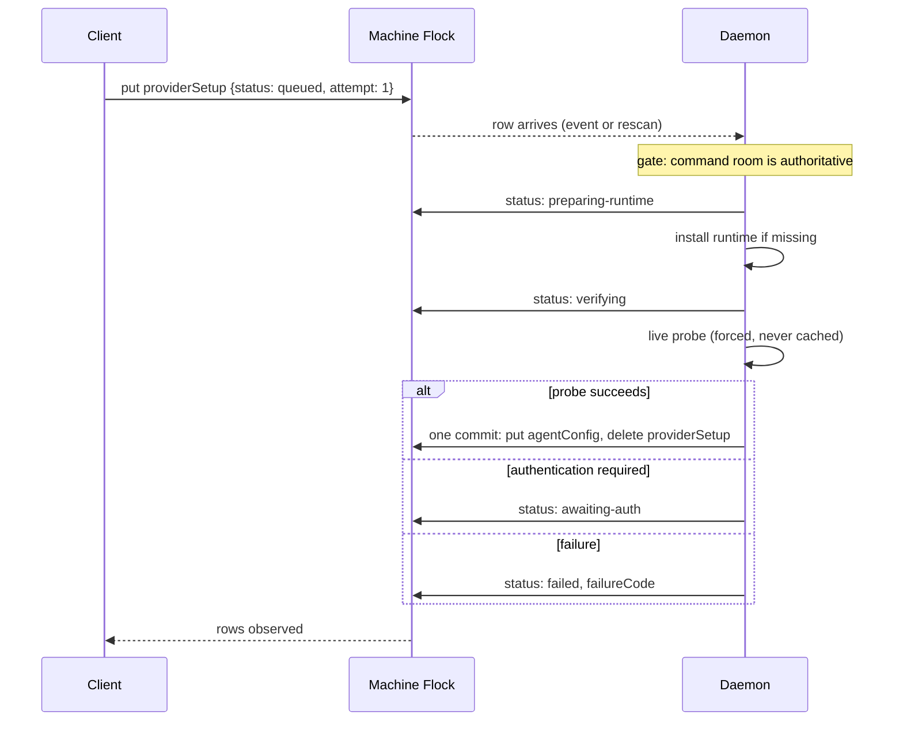
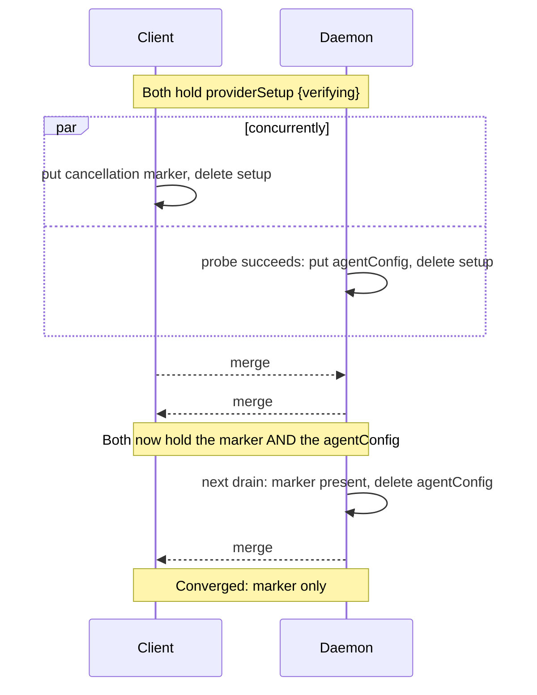
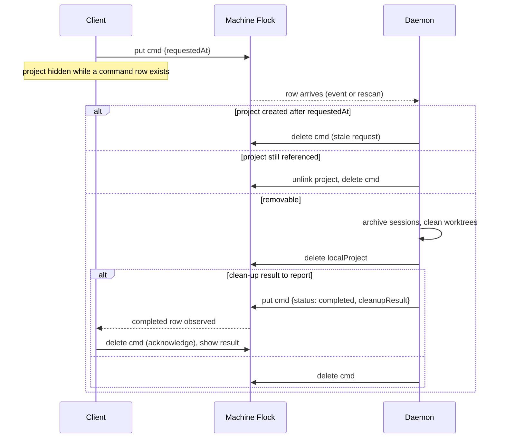

# Durable commands

A client asks a daemon to act by writing a row into that daemon's Machine
Flock. The row is the request, the queue entry and, often, the progress
report. This page describes how the daemon notices such rows, and the two
command families in use: provider setup and local project removal.

## Rows as a queue

A command row has three properties that an RPC lacks:

- **It survives.** The row is durable on the writer and, once uploaded, on
  the stream. A daemon that is offline or restarting finds it later.
- **It converges.** Two devices that write the same command key produce one
  row, by last-writer-wins.
- **It is visible.** Every client sees the same row, so progress and
  completion need no separate channel.

The price is that processing must be **idempotent** and
**at-least-once**: the daemon may see a row, start work, crash, and see the
row again [[13]](references.md#ref-13) [[14]](references.md#ref-14).

## The command watcher

`MachineFlockCommandWatcher` owns the daemon's long-lived subscription to its
own Machine Flock for the purpose of commands. It is separate from the
[sync coordinator](sync-coordinator.md)'s room ([E-C1](evidence.md#e-c1)).

### Scanned, not evented

The watcher's rule is that reconnect correctness is scan-based:

> Flock rows are durable, so reconnect correctness is scan-based rather than
> event-based: every successful authoritative join calls `onReady`, whose
> consumers rescan their queues. Events only provide low-latency wakeups
> while the room is healthy. ([E-C1](evidence.md#e-c1))

This is level-triggered reconciliation: act on the state you observe, not on
the transitions you happened to witness. A missed or duplicated event then
costs latency, never correctness [[15]](references.md#ref-15)
[[28]](references.md#ref-28).

Both paths call one method, `rescanMachineCommands`
([E-C6](evidence.md#e-c6)):

- **On an event batch**, the watcher passes the families the batch touched,
  and only those queues drain ([E-C7](evidence.md#e-c7)).
- **On `onReady`**, it passes nothing, and every queue drains. This is the
  only retry path for a queue whose earlier drain threw.

A command family wired to only one of the two paths fails silently: its queue
stops draining ([E-C8](evidence.md#e-c8)).

### Remote authority

When the daemon has a cloud transport, it must not act on a setup row that a
remote cancellation has already superseded. The watcher therefore
distinguishes rooms that have established **remote authority**
([E-C2](evidence.md#e-c2), [E-C3](evidence.md#e-c3)):

- With `waitForRemoteAuthority`, the watcher becomes `ready` only when the
  room's first sync with the remote resolves. Releasing the room clears
  `ready`.
- Every event batch is delivered with `authoritative: ready`.
- A room that joins as, or becomes, `disconnected` or `error` is released and
  rejoined with bounded backoff ([E-C4](evidence.md#e-c4)).

`waitForRemoteAuthority` is true unless the daemon runs on the local-only
platform, where the opened SQLite-backed Flock is itself authoritative and
there is no remote to wait for ([E-C5](evidence.md#e-c5),
[E-P12](evidence.md#e-p12)).

`rescanMachineCommands` applies the gate per family
([E-C6](evidence.md#e-c6)):

| Family | Drains when |
| ------ | ----------- |
| Delete local project | Always |
| Provider setup | Only if `authoritative` |

The model checks what the gate buys as **P3**. Without it, a daemon that
restarts holding a stale setup row publishes a provider whose cancellation was
already in the stream ([ablation](formal-model.md#ablations)). With or without
it, the cancellation still wins in the end; the gate prevents the wasted
install and the transient publication.

## Provider setup

Creating a built-in provider needs work on the target machine: downloading a
runtime, starting the agent, probing it, perhaps waiting for the user to
authenticate. `ProviderSetupManager` runs that work from a durable row, so a
restart resumes it and any device can cancel it ([E-P12](evidence.md#e-p12)).

### Rows

| Row | Meaning |
| --- | ------- |
| `['providerSetup', id]` | The task: the configuration to create, a `status`, and an `attempt` number |
| `['providerSetupCancellation', id]` | A permanent marker that this id is cancelled |
| `['agentConfig', id]` | The published, usable provider |

`status` is one of `queued`, `preparing-runtime`, `verifying`,
`awaiting-auth` or `failed` ([E-K10](evidence.md#e-k10)). The first three are
*resumable*: the daemon picks them up on its own. The last two are dormant
until something external requeues the task ([E-P1](evidence.md#e-p1)).

### Sequence

### The drain

`kick()` starts a drain unless one is running, and remembers that another was
requested ([E-P2](evidence.md#e-p2)). A drain ([E-P4](evidence.md#e-p4)):

1. Reconciles cancellations.
2. Reads the setup rows, keeps those with a resumable status, and processes
   them oldest first.
3. Repeats if a kick arrived meanwhile.

Runtime preparation and verification are the two long steps
([E-P6](evidence.md#e-p6), [E-P7](evidence.md#e-p7)). `processOne` re-reads
the row before acting and returns if the row is gone,
its `attempt` has changed, or its status is no longer resumable. If an
`agentConfig` already exists for the id, it only deletes the setup row
([E-P5](evidence.md#e-p5)).

Every later step is **fenced by `attempt`**: `updateStatus` and `fail`
re-read the row and write only if it is still present, uncancelled and on the
same attempt ([E-P10](evidence.md#e-p10)). A retry by a client, which
increments `attempt`, thereby invalidates an in-flight pass without any
message to it.

`readSetup` reads the task and its cancellation marker together and returns
nothing when the marker exists ([E-P9](evidence.md#e-p9)). To the manager, a
cancelled setup does not exist.

### Publication

`publishVerifiedConfig` re-reads the setup, the cancellation and the
configuration in one scan, then takes exactly one branch
([E-P11](evidence.md#e-p11)):

| Condition | Action |
| --------- | ------ |
| Cancellation present | Apply the cancellation; do not publish |
| Setup missing, attempt changed, or status not `verifying` | Do nothing |
| Configuration already present | Delete the setup row |
| Otherwise | One commit: put `agentConfig`, delete `providerSetup` |

### Dormant states and resumption

`awaiting-auth` and `failed` rows stay put. A client retries by rewriting the
row as `queued` with `attempt + 1` ([E-P14](evidence.md#e-p14)); after the
user authenticates, the daemon's `resumeAfterAuthentication` does the same
([E-P3](evidence.md#e-p3)). A restart resumes only resumable states
([E-P12](evidence.md#e-p12)).

### Cancellation

A client cancels in two steps ([E-P13](evidence.md#e-p13)):

1. **Put the cancellation marker and await it.** The code calls this "the
   cancellation accept boundary".
2. Best-effort: delete the setup row and any published configuration.
   Failures are ignored.

The marker is never deleted. That is the point: a delete of the setup row
alone would lose to a concurrent daemon write with a later clock, and a
delete of a configuration that the client has not yet seen cannot be issued
at all. The marker is a fact every replica eventually holds, and the daemon
acts on it.

`applyProviderSetupCancellationToFlock` is the daemon's reaction: given a
marker, it deletes the setup row, the configuration and its rate-limit rows
if present, in one commit, using a timestamp no earlier than `cancelledAt`
([E-K12](evidence.md#e-k12), [E-P8](evidence.md#e-p8)). It runs at the start
of every drain and inside publication.

The daemon's own test drives exactly this interleaving on two Flock replicas
and asserts the final state ([E-P15](evidence.md#e-p15)). The model checks it
for every interleaving as liveness property **L1** (*cancellation wins*), and
checks that the daemon never publishes while it can see the marker (**P4**).

## Delete local project

Removing a local project needs the owning machine: it must check whether
anything still refers to the project, archive its sessions, and optionally
clean up worktrees on disk.

### Rows

| Row | Meaning |
| --- | ------- |
| `['localProject', id]` | The registration, including `createdAtMs` |
| `['cmd', 'deleteLocalProject', id]` | The command, including `requestedAt` and, once finished, `status: 'completed'` with a `cleanupResult` |

The value types are in [E-K11](evidence.md#e-k11). Both timestamps are
server-synchronized on the desktop ([E-K14](evidence.md#e-k14)).

### Sequence

**Request.** The client writes the command row with `requestedAt` and returns;
it starts a background resync and does not wait
([E-D1](evidence.md#e-d1)). While any command row exists for a project, the
client hides the project ([E-D10](evidence.md#e-d10)).

**Processing.** `processDeleteLocalProjectRequests` reads the command rows,
skips completed ones and those already in flight in this process, and handles
each ([E-D3](evidence.md#e-d3)). `deleteLocalProjectResources` decides
([E-D4](evidence.md#e-d4)):

- **Stale request.** If the project exists and was created after the request
  (`createdAtMs > requestedAt`), the command is dropped. A project removed and
  registered again is not removed by the earlier request
  ([E-D5](evidence.md#e-d5)). The model checks this as **D1**.
- **Still referenced.** If the workspace catalogue or a live session refers to
  the project, the daemon only hides it as a standalone project. It requires
  the catalogue to be ready first; if it is not, the pass throws and a later
  rescan retries.
- **Removable.** The daemon archives the project's sessions, optionally
  cleans up worktrees, and deletes the `localProject` row
  ([E-D6](evidence.md#e-d6)).

**Completion.** With a clean-up result to report, the daemon rewrites the
command as `completed`; otherwise it deletes the command row
([E-D3](evidence.md#e-d3)). A pass that throws leaves the row in place for the
next rescan.

**Acknowledgement.** A client that sees a completed row deletes it and shows
the result. A failed delete is retried the next time the row is observed
([E-D2](evidence.md#e-d2)).

This family is not gated on remote authority ([E-C6](evidence.md#e-c6)). No
client can cancel a delete, so a local command row cannot be superseded by a
remote one in the way a setup row can.

## Retired session commands

`['cmd', 'archiveSession', id]` and `['cmd', 'deleteSession', id]` were
command queues. Archiving and deleting a session are now **observed, not
commanded**: the daemon watches session metadata, releases a session's
runtime when `isArchived` becomes true or the document is deleted, and a
worktree reconciler cleans up disk without needing any event
([E-D11](evidence.md#e-d11)).

Older clients still write the rows. The iOS runtime writes
`['cmd', 'archiveSession', id]` after it has saved the archived state, and
ignores a failure to do so ([E-D12](evidence.md#e-d12)). A current daemon
discards both families at start-up so that they do not accumulate
([E-D11](evidence.md#e-d11)).

This is the same shift the rest of the protocol makes, taken to its end: the
desired state *is* the request, so there is no queue to drain and no
acknowledgement to lose.
