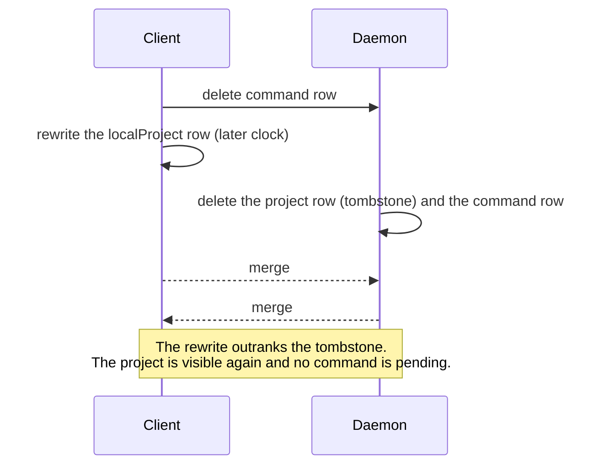

# Observations and limits

This page records behaviours that the analysis exposed, the assumptions it
rests on, and the questions it leaves open. None of the observations was
reproduced against a running Lody; each says how it was established.

| Id | Observation | Established by | Severity |
| -- | ----------- | -------------- | -------- |
| O1 | A removed local project can come back | Model counterexample and code reading | Low |
| O2 | Re-adding a project while its removal is pending does not cancel the removal | Code reading | Low |
| O3 | The local data plane cannot repair a same-version hole | Lody's own design note | Known, accepted |
| O4 | A dirty document depends on a narrow ordering around a zero-transport sync | Model assumption and code reading | Very low |
| O5 | Client writes carry the device clock | Code reading | Low |
| O6 | Row ownership is a convention | Code reading | By design |
| O7 | Upstream behaviour could only partly be verified | Research | Limits confidence |
| O8 | Minor documentation drift in the Lody source | Code reading | Cosmetic |

_Table 1: Observations, how each was established, and its severity._

## O1. A removed project can come back

**What the model shows.** `LocalProjectDelete_Resurrection.cfg` checks
`NoResurrection` against the shipped behaviour and TLC finds a
counterexample in ten steps
([formal model](formal-model.md#an-observation-about-the-shipped-protocol)):

1. A client requests removal; the command reaches the daemon.
2. Before the daemon acts, or before the daemon's result reaches the client,
   the client rewrites the `localProject` row.
3. The daemon deletes the project row and the command row.
4. After all replicas exchange state, the client's rewrite carries the later
   clock, so it outranks the tombstone. The project is visible again and no
   command is pending.

For screen readers: the following sequence diagram shows the resurrection. A
client writes a delete command, which reaches the daemon. The client then
rewrites the project row, giving it a later clock. The daemon, which has not
seen the rewrite, deletes the project row and the command row. When the two
exchange state, the rewrite outranks the daemon's tombstone, so both hold a
visible project row and no pending command.

_Figure 1: A client's row rewrite resurrecting a project that the daemon
removed._

With client rewrites disabled (`LocalProjectDelete_NoRowUpdates.cfg`) the
property holds, which isolates the cause.

**Why the code allows it.** Clients rewrite the whole project row in at least
two places: recording an imported history session
([E-D13](evidence.md#e-d13)) and changing standalone visibility or the
observed GitHub remote ([E-D8](evidence.md#e-d8)). Each is a `put` of the full
row. A Flock delete is a tombstone that a later-clocked `put` overrides
([E-U4](evidence.md#e-u4)). This is the classic resurrection anomaly of
last-writer-wins stores [[8]](references.md#ref-8).

**How likely.** The window is the time between a client's rewrite and that
client learning of the removal: sync latency, or longer if the client is
offline. The user must also cause a rewrite of a project that their own
interface is hiding, which is possible for background history import but not
for most direct actions.

**Why it matters little.** Nothing is lost: the result is a project
registration that the user asked to remove and that is still listed. They can
remove it again.

**A possible remedy.** The provider-setup protocol already solves the same
problem with a permanent marker row that the daemon reconciles against
([durable commands](durable-commands.md#cancellation)). A removal marker for
local projects, or a daemon-side rule that a project row older than a
recorded removal is deleted again, would restore `NoResurrection`. Whether
that is worth the extra row is a product decision.

**A related daemon-side window.** The daemon's own history rewrite re-reads
the row under a per-machine write lock and returns if the project is gone
([E-D9](evidence.md#e-d9)). Removal does not take that lock
([E-D6](evidence.md#e-d6)), so a removal that lands between the rewrite's
read and its write could be overwritten inside the daemon. This is inferred
from reading the code and was not modelled or reproduced.

## O2. Re-adding during a pending removal

While a command row exists, clients hide the project
([E-D10](evidence.md#e-d10)), but the `localProject` row is still present. If
the user registers the same folder again in that window:

- the client's `put-if-absent` finds the row and writes nothing, so
  `createdAtMs` keeps its old value ([E-D8](evidence.md#e-d8));
- the daemon's `local-project/add` handler likewise keeps the existing
  `createdAtMs` ([E-D7](evidence.md#e-d7)).

The staleness guard compares `createdAtMs` with `requestedAt`
([E-D5](evidence.md#e-d5)), so the pending command still applies and the
project is removed after the user re-added it. Property D1 holds, because the
project was not _created_ after the request; the guard protects a
registration that follows a completed removal, not one that overlaps a
pending one.

Whether the user would call this a bug depends on what they expect a pending
removal to mean. It is recorded here because the guard's name suggests a
wider protection than it gives.

The guard's comparison is also strict. A registration whose `createdAtMs` equals
the request's `requestedAt` is treated as older, even if it happened after the
request in the same millisecond. The model finds this edge in six steps
([formal model](formal-model.md#an-observation-about-the-shipped-protocol)). It
needs two writes in one millisecond of server time, so it is theoretical.

## O3. The local data plane and the version vector hole

The local data plane exchanges Flock deltas by version vector
([replication](replication.md#the-local-data-plane)). A version vector cannot
describe a replica that is missing an entry _below_ its own frontier
([replication](replication.md#the-version-vector-hole)). Lody's migration
note says so directly: the local plane "relies on the same 'equal version
vector means complete' assumption, so it cannot repair a same-version hole
between the renderer and CLI replicas. It needs its own decision"
([E-T4](evidence.md#e-t4)).

The cloud path, with journalled persistence and replica-bound checkpoints,
no longer creates such holes. The local plane inherits one only if something
else has already damaged a replica. The model does not cover this
(abstraction A2).

## O4. The zero-transport window

The model treats a sync that finds no transport as resolving in the same
step that starts it (assumption A4). That hides one ordering:

1. `syncOnce` observes zero transports.
2. Connectivity returns; `retryDirtyNow` calls `syncNow`, which returns the
   sync already in flight ([E-S3](evidence.md#e-s3)).
3. The in-flight sync resolves as "not attempted" and arms no timer
   ([E-S5](evidence.md#e-s5)).

The document would then be dirty, online and idle, which is what S3 forbids.

In the code, step 1 is a synchronous check at the top of `sync()`
([E-U10](evidence.md#e-u10)), and step 3 follows it after only a few promise
turns. For step 2 to fall between them, a transport would have to be attached
_and_ reported healthy within those turns. Attaching a transport involves
network I/O before health can rise, so this ordering appears unreachable in
practice. It is an assumption, not a verified fact. If it ever mattered, the
cheap hardening is to re-check for a transport when a sync resolves as "not
attempted", or to have `retryDirtyNow` request a fresh sync after the active
one settles.

If it occurred, the next local write, the next connectivity edge, or the
next process start (through the initial join sync) would upload the update.
Until one of those events happens, the update stays unsent, indefinitely if
none occurs.

## O5. Client clocks

Three kinds of timestamp are in play, and they do not all come from the same
clock.

| Timestamp | Daemon | Desktop client | iOS client |
| --------- | ------ | -------------- | ---------- |
| Flock entry clock (`physicalTime`) | Server-synchronized, passed explicitly | Device clock (Flock's default) | Device clock (Flock's default) |
| Payload fields (`requestedAt`, `cancelledAt`, `createdAtMs`) | Server-synchronized | Server-synchronized | Device clock (`cancelledAt` and the legacy `requestedAt`; others not traced) |

_Table 2: Sources of each kind of timestamp, by replica._

Sources: [E-S15](evidence.md#e-s15), [E-K14](evidence.md#e-k14),
[E-T9](evidence.md#e-t9), [E-T10](evidence.md#e-t10),
[E-D12](evidence.md#e-d12), [E-U3](evidence.md#e-u3).

Flock compares `physicalTime` first ([E-U1](evidence.md#e-u1)), so a device
whose clock is ahead wins conflicts over genuinely later writes from other
replicas, and one whose clock is behind loses them
[[9]](references.md#ref-9). For the command protocol the exposure is small:

- Cancellation does not depend on the client's deletes winning. The marker
  is a new key with no competitor, and the daemon applies it with a timestamp
  no earlier than `cancelledAt` ([E-P8](evidence.md#e-p8)).
- The daemon's own writes rely on assumption A1 to supersede a row that a
  fast device clock wrote. If A1 did not hold for explicit timestamps, a
  daemon status update could lose to an older client write that carried a
  later device time (open question 1).
- The staleness guard compares two payload fields. On the desktop both are
  server-synchronized; a request written with a device clock would be
  compared against a server-time `createdAtMs`.

A device clock far in the future could also make a client's later edits to an
ordinary row lose to its own earlier write from another device. The model
bounds skew (abstraction A8) and does not explore this.

## O6. Ownership is a convention

Flock has no per-key access control. Any replica that can append to a
machine's stream can write any row in that Machine Flock, including an
`agentConfig`. Property P1 holds in the model because the model's client
never writes that row for a setup id, not because anything prevents it.

The daemon defends the boundary that matters at read time: a process is
launched only from a configuration that passes `isValidDaemonLaunchConfig`
for this machine, read from the daemon's own replica, and never from fields
supplied in the request ([E-P16](evidence.md#e-p16)). Setup rows are also
forbidden from carrying secrets ([E-P12](evidence.md#e-p12)). The trust
boundary is therefore _workspace membership with write access to the
stream_, which is enforced by the Streams gateway and is outside this study.

## O7. Limits of upstream verification

- The `loro-dev/flock` and `loro-dev/loro-repo` repositories were not
  publicly readable. Statements about them come from the published npm
  packages (READMEs, type declarations and bundled JavaScript)
  ([E-U0](evidence.md#e-u0)).
- `loro-repo`'s design record `docs/flock-persistence.md` and its pull
  request #132 could not be read. Their content is known here only through
  Lody's migration note ([E-T4](evidence.md#e-t4)).
- How Flock derives a local write's clock is undocumented (assumption A1).
- The Streams server's ordering, de-duplication and retention guarantees are
  not specified in the client package.
- No formal model or proof of Flock's convergence has been published by its
  authors, as far as this study could find. Its convergence claim is the
  informal one in the package README ([E-U1](evidence.md#e-u1)).

## O8. Documentation drift in the source

- A comment in the renderer says that "in local-first mode the CLI is the
  sole author" of an `agentConfig` write. The workspace writer's header
  describes the current design as dual-author: the renderer writes its own
  replica directly ([E-T9](evidence.md#e-t9)).
- Several comments cite `specs/local-first-two-plane.md`. No file of that
  name exists in `specs/` at the documented commit.

## Open questions

1. Does Flock guarantee assumption A1 when a caller passes an explicit
   timestamp lower than the stored entry's `physicalTime`? The daemon passes
   explicit timestamps on most writes.
2. What does the Streams server guarantee about the order in which
   concurrent appends become visible to readers, and about retention of
   updates that predate a snapshot?
3. Who writes the `memory` and `agentConfigIndex` families, and do they have
   any ordering dependency on the rows described here?
4. Should a local project removal be made robust against concurrent row
   rewrites (O1), given that provider-setup cancellation already is?
5. Two clients were not modelled racing each other (abstraction A7). In
   particular, one client retrying a failed setup while another cancels it
   converges in the single-client model; the two-client case is expected to
   converge for the same reason (the marker is permanent) but was not
   checked.
