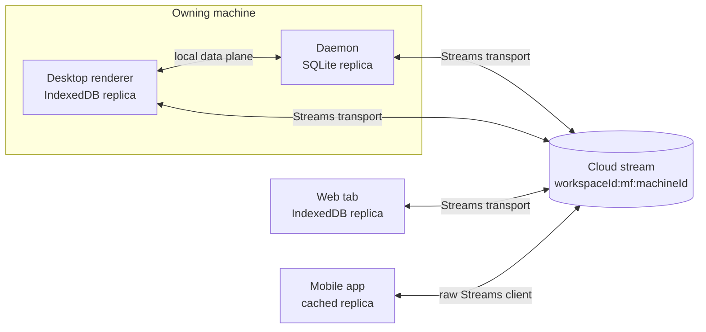
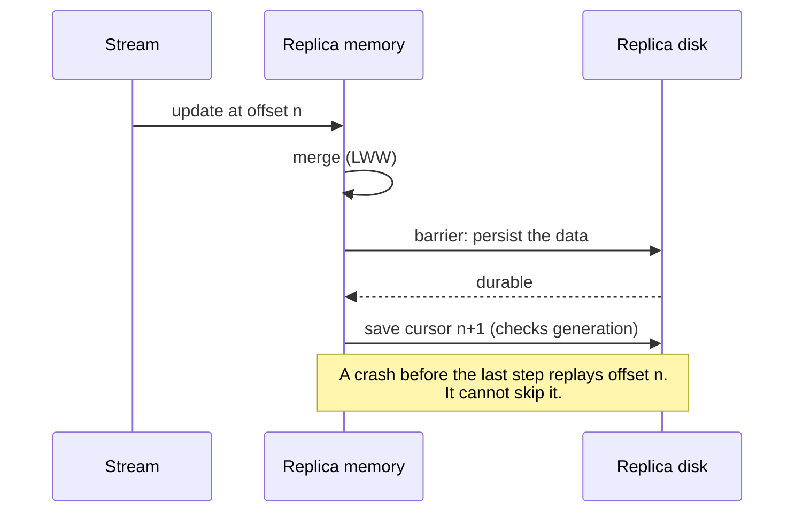

# Replication and persistence

Every replica of a Machine Flock holds the whole document and can write to it
offline. This page describes how replicas exchange changes, and the rule that
keeps a replica from silently skipping data after a crash.

## Topology

There are three ways changes travel:

| Path | Participants | State kept between sessions |
| ---- | ------------ | --------------------------- |
| Cloud Streams transport | Daemon, renderer, web | A durable cursor per replica |
| Local data plane | Renderer and the daemon on the same machine | None; a version vector is exchanged at each join |
| Raw Streams client | Mobile | An optional cached replica |

A desktop renderer whose machine is on the local plane joins a Machine Flock
room over both `local` and `cloud`; rooms for other machines use `cloud` only
([E-T7](evidence.md#e-t7)).

## The cloud stream

The server keeps one append-only stream per document. The Loro team describe
a stream as "like an append-only file": every appended update can be
broadcast, and a client can take an offset and fetch everything after it
([[20]](references.md#ref-20)). This is the log abstraction of Kreps
[[18]](references.md#ref-18), and the client side is the anti-entropy session
of Bayou [[19]](references.md#ref-19): pull what the log has that you lack,
push what you have that the log lacks.

### What is appended

For a Flock room, `streams-crdt` uses these payloads
([E-U14](evidence.md#e-u14)):

- **Snapshot:** the full binary file from `flock.exportFile()`.
- **Update:** the JSON bundle from `flock.exportJson(fromVersion)`, a delta in
  the sense of delta-state CRDTs [[10]](references.md#ref-10).
- **Live update:** on a local event batch, the bundle of the replica's own
  entries newer than the last export.

### The cursor

Each replica keeps a cursor per stream: the next offset to read, and a version
vector that is a lower bound on what the server holds
([E-U16](evidence.md#e-u16)).

- **Bootstrap.** A replica with no stored cursor fetches the snapshot, if any,
  and the retained tail of updates, then follows the live feed
  ([E-U17](evidence.md#e-u17)).
- **Resume.** A replica with a cursor reads from its offset. A replica's
  cursor only moves forward, which gives that replica monotonic reads of the
  stream [[32]](references.md#ref-32).
- **Initial join sync.** In both cases, joining then exports whatever the
  local replica holds beyond the server's lower bound and appends it
  ([E-U13](evidence.md#e-u13)). A daemon that crashed after a local write but
  before uploading it therefore uploads it at its next join, without any
  record of having been "dirty".

### Delivery

A replica advances its cursor only after three things have happened, in
order: the remote data was applied locally, the durability hook succeeded, and
the cursor store write succeeded ([E-U12](evidence.md#e-u12)). A crash at any
point before the last step leaves the cursor behind the data, so the replica
re-reads and re-applies some updates. Re-applying is harmless because LWW
merge is idempotent. This is at-least-once delivery to an idempotent receiver
[[14]](references.md#ref-14), and it is the same ordering rule as "process and
persist, then commit the offset" in log consumers
[[17]](references.md#ref-17).

Server-side ordering, de-duplication and retention were not examined; no
server specification ships with the client packages. The protocol described
here needs only that an appended update is eventually readable by every
replica that keeps reading.

### `syncOnce`

`handle.syncOnce()` runs one round against every registered transport and
returns a report listing the transports it attempted. With **no** transport
registered it returns at once with `ok: true`, outcome `no-route` and an empty
transport list ([E-U10](evidence.md#e-u10)). Both the daemon and the renderer
therefore treat "resolved with zero transports" as *not confirmed*
([E-S5](evidence.md#e-s5), [E-T8](evidence.md#e-t8)).

### Room status

A room subscription reports `connecting`, `joined`, `reconnecting`,
`disconnected`, `error` or `detached`. `detached` means the transport is not
attached to the room at all, which reconnecting cannot change. The daemon
treats only `disconnected` and `error` as worth rejoining
([E-S13](evidence.md#e-s13)).

## Replica-bound checkpoints

### The hazard

A cursor says "I have everything before this offset". If the cursor becomes
durable while the data it covers is still only in memory, a crash leaves a
replica that resumes *past* data it never stored. Nothing later repairs the
gap, because the replica never asks for those offsets again.

Lody had three forms of this mismatch ([E-T4](evidence.md#e-t4)):

1. The daemon saved the cursor while the matching SQLite write was only
   scheduled behind a debounce.
2. One-shot CLI commands opened the daemon's database and resumed from the
   daemon's cursor rows, although each had loaded its own, possibly older,
   copy of the data.
3. Web tabs shared one data store and one cursor store.

`FlockReplication_CursorFirst.cfg` and
`FlockReplication_CursorFirstDiverges.cfg` reproduce form 1 in the
[model](formal-model.md#ablations): the durable cursor runs ahead, and after a
crash two replicas that have "exchanged everything" hold different state.

### The rule

> A checkpoint that is behind the data is always safe. A checkpoint must never
> be ahead of the data. ([E-T4](evidence.md#e-t4))

This is the write-ahead rule of database recovery
[[16]](references.md#ref-16) applied to a consumer offset. Lody now gets it
from `loro-repo`'s replica-bound persistence
([E-T1](evidence.md#e-t1), [E-S14](evidence.md#e-s14)):

- **Barrier before cursor.** Every cursor save first awaits a per-resource
  durability barrier (`persistFlockDocNow` for a named Flock), which resolves
  only once storage has the state ([E-U15](evidence.md#e-u15)).
- **Cursor bound to the replica.** A process serves only the cursor it read
  together with its own copy of the data, plus its own later commits. It
  never adopts progress written by another process
  ([E-U8](evidence.md#e-u8)).
- **SQLite.** Cursors live in a `replica_checkpoints` table in the same
  database as the data. A cursor save is a transaction that checks the
  replica's generation after the data barrier has committed. Delete triggers
  drop a checkpoint whenever the data it covers is removed; the stated worst
  case is "one extra bootstrap, never a skipped range"
  ([E-U8](evidence.md#e-u8), [E-U9](evidence.md#e-u9)). The ordering relies
  on SQLite's write-ahead log keeping commits in order across a power loss
  [[30]](references.md#ref-30).
- **IndexedDB.** The renderer keeps checkpoints in the repository database
  with strict durability [[31]](references.md#ref-31), and a lineage marker
  discards a checkpoint whose data was rewritten by an older release ([E-U8](evidence.md#e-u8)).

The daemon is the only process with durable cursors for Loro documents;
one-shot commands keep theirs in memory, and Meta and Flock checkpoints are
replica-bound in every process ([E-T2](evidence.md#e-t2),
[E-S14](evidence.md#e-s14)).

`apps/cli/tests/cli-streams-replica-checkpoints.test.ts` asserts the three
behaviours that matter: a process that loaded its data before another process
advanced the file bootstraps instead of resuming at that process's tail; a
failed write followed by a crash leaves the checkpoint unadvanced; and a
normal restart resumes from its own checkpoint ([E-T3](evidence.md#e-t3)).

### The persistence journal

`loro-repo` persists a named Flock through a journal rather than by comparing
version vectors. Local changes are recorded as exact entries; payloads
received from the stream are appended verbatim; a payload leaves the queue
only once storage reports it durable ([E-U15](evidence.md#e-u15)). The reason
is the next section.

## The version vector hole

A version vector holds, per peer, the highest clock seen. It does not say
*which* entries below that clock a replica holds. Suppose a replica has peer
P's entry at clock 20 for one key but lost P's entry at clock 10 for another
key. Its vector says `P: 20`. Any exchange of the form "send me what is newer
than my vector" will never resend the clock-10 entry.

`loro-repo` 0.20.0 used the vector as proof that everything below it had been
saved, which is what the journal replaced ([E-T4](evidence.md#e-t4)). Delta
exchange by version vector is sound only when each replica's state is
*causally closed* below its vector, the condition delta-CRDT anti-entropy
makes explicit [[10]](references.md#ref-10).

The cloud path no longer depends on this assumption for persistence. The
[local data plane](#the-local-data-plane) still does, by design
([E-T4](evidence.md#e-t4)); see [observations](observations.md).

## The local data plane

On a desktop, the renderer and the daemon exchange Flock changes directly
over an authenticated local socket carrying newline-delimited JSON
([E-T12](evidence.md#e-t12)). There is no log, no offset and no cursor.

1. **Join.** The client sends `join` with `haveVersion`, its Flock version
   vector ([E-T5](evidence.md#e-t5)).
2. **Catch-up.** The server exports what is newer than that vector, and
   reports its own true frontier as `serverVersion`
   ([E-T6](evidence.md#e-t6)).
3. **Up-sync.** The client imports the bundle, then exports what the server
   lacks relative to `serverVersion` and sends it, whether or not it believes
   it has unsent changes. This is what uploads writes made offline by an
   earlier process ([E-T5](evidence.md#e-t5)).
4. **Live.** Local event batches are exported and sent as `update` frames. The
   client advances its view of the server's frontier optimistically; there is
   no per-update acknowledgement, so a lost frame is repaired at the next
   join ([E-T5](evidence.md#e-t5)).

The daemon bridges a renderer-opened Flock room to its own repository, so a
row written by the renderer reaches the daemon's replica locally and then the
cloud through the daemon ([E-T12](evidence.md#e-t12)).

## Clients

**Desktop renderer and web.** A reader scans the local Flock, subscribes to
its events, joins the room, waits for the first remote sync and rescans
([E-T8](evidence.md#e-t8)). A write through the workspace writer is a local
`set` or `delete` plus `commit`; it does not flush, call `syncOnce` or wait
for an acknowledgement ([E-T9](evidence.md#e-t9)). The accept boundary of a
client write is the local CRDT write.

**Mobile.** The iOS runtime has no `loro-repo`. It records `flock.version()`,
mutates, commits, and appends `exportJson(version)` to the stream as one
frame ([E-T11](evidence.md#e-t11)). It does not wait for the daemon to act on
anything it writes ([E-T10](evidence.md#e-t10)).

## What the model keeps

`FlockReplication.tla` models the cloud path: the stream as a sequence of
deltas, an in-memory and a durable copy per replica, a cursor, crash and
restart, connectivity loss, and the initial join upload. It idealizes delta
export as exact set difference against the stream, so it does not model the
version vector hole. See [formal model](formal-model.md#flockreplication).
