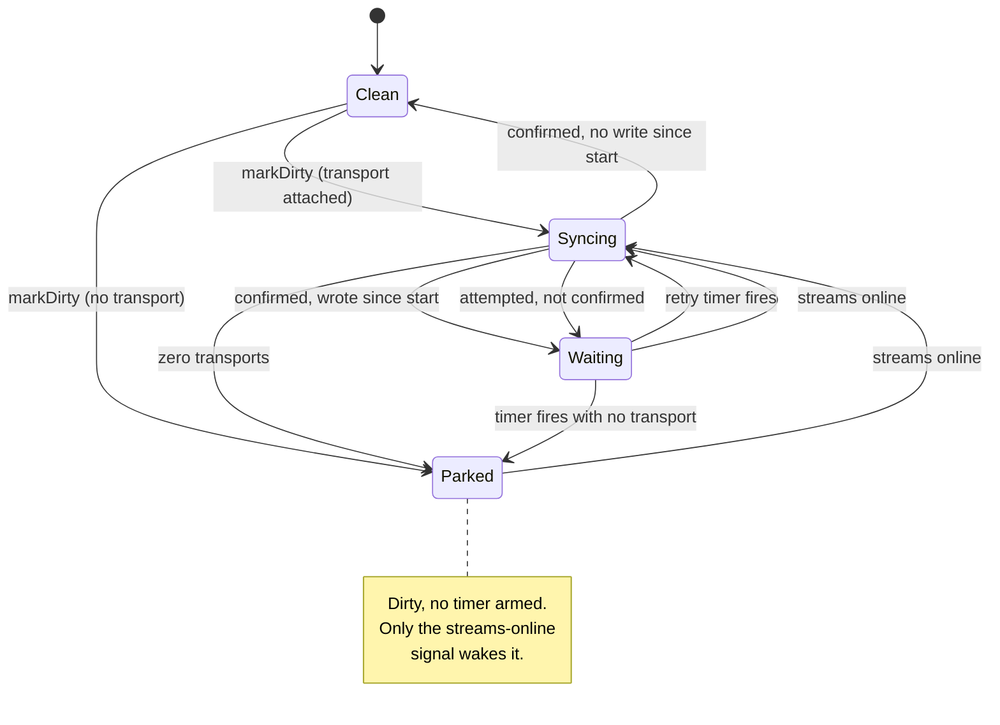

# The sync coordinator

The daemon writes its own Machine Flock **locally first** and uploads in the
background. `MachineFlockSyncCoordinator` owns the upload: one live room per
machine document, a dirty flag, and a retry schedule. This page describes its
state machine.

## The write path

Every daemon write to a Machine Flock row follows the same three steps
([E-S15](evidence.md#e-s15)):

1. **Write** the row with `writeMachineFlockRowToFlock` or
   `deleteMachineFlockRowFromFlock`. If nothing changed, stop.
2. **Flush** with `await repo.flush()`, which makes the change durable in the
   daemon's SQLite store.
3. **Mark dirty** with `markMachineFlockDocDirty(machineId, { reason })`,
   which returns immediately.

The rule is stated in the daemon's own guidance: after the flush, mark the
document dirty and "never await `handle.syncOnce()` in user/RPC paths";
request-scoped sync failures must not fail a flow whose local write is already
durable ([E-S14](evidence.md#e-s14)). The accept boundary of a daemon write is
therefore **local durability**, not upload. A caller that has no coordinator
available falls back to one best-effort `syncOnce()` whose failure is ignored
([E-S16](evidence.md#e-s16)).

## State

The coordinator keeps one record per machine document
([E-S1](evidence.md#e-s1)):

| Field | Meaning |
| ----- | ------- |
| `dirty` | A local write has not been confirmed as uploaded |
| `dirtyVersion` | A counter incremented by every `markDirty` |
| `activeSync` | The in-flight sync, if any; callers share it |
| `retryTimer`, `retryAttempt` | The armed retry and its backoff exponent |
| `roomSub`, `roomBinding` | The live room and its detached-aware status view |

All of it is in memory. A crash discards it; the
[initial join sync](replication.md#the-cursor) is what uploads writes that
were durable but unsent when the process died.

## Transitions

**`markDirty`** sets `dirty`, increments `dirtyVersion`, ensures the room is
joined, and calls `syncNow` ([E-S2](evidence.md#e-s2)).

**`syncNow`** is single-flight: if a sync is in flight, the caller receives
that same promise; otherwise a new sync starts
([E-S3](evidence.md#e-s3)).

**A sync** clears the retry timer, joins the room if needed, records
`syncVersion = dirtyVersion`, and awaits `handle.syncOnce()` under a timeout
of 30 seconds by default ([E-S5](evidence.md#e-s5),
[E-S12](evidence.md#e-s12)). Its outcome is one of four cases:

| Outcome | Test | Effect |
| ------- | ---- | ------ |
| Confirmed, no new writes | `transports > 0 && ok`, and `dirtyVersion === syncVersion` | `dirty = false`, backoff reset |
| Confirmed, new writes | as above, but `dirtyVersion` moved | Stay dirty; schedule a retry with backoff reset |
| Not attempted | `transports === 0` | Stay dirty; **arm no timer** |
| Attempted, not confirmed | `ok` false, timeout, or thrown error | Stay dirty; schedule a retry |

Sources: [E-S5](evidence.md#e-s5), [E-S6](evidence.md#e-s6).

Two details carry the correctness of this table.

*`dirtyVersion`.* A write that lands while a sync is in flight shares that
sync's promise, but the sync may have exported before the write. Comparing
`dirtyVersion` with the value captured at the start is what stops the
coordinator from declaring such a write uploaded. Remove the comparison and
the model finds a clean document with an unsent row in four steps
([ablation](formal-model.md#ablations)).

*Zero transports.* `syncOnce` with no transport resolves successfully and
vacuously ([E-U10](evidence.md#e-u10)). The coordinator treats that as
unconfirmed but refuses to arm a timer for it: a daemon that is deliberately
offline would otherwise re-attempt every dirty document forever
([E-S5](evidence.md#e-s5)). That choice creates an obligation, discharged
next.

## Wake-ups

A dirty document must always have something that will try again. There are
three sources.

**The retry timer.** `scheduleRetry` arms a single timer with exponential
backoff from 1 second to 60 seconds, with jitter, and does nothing if a timer
is already armed ([E-S9](evidence.md#e-s9), [E-S10](evidence.md#e-s10)).
Jittered exponential backoff is the standard defence against synchronized
retries [[21]](references.md#ref-21). When the timer fires and the document is
still dirty, it calls `syncNow`.

**Room status.** When the room becomes `disconnected` or `error`, the
coordinator releases the subscription so that the next sync rejoins, and arms
a retry if the document is dirty ([E-S8](evidence.md#e-s8)). `detached` is
ignored: the transport is absent, and rejoining cannot help
([E-S13](evidence.md#e-s13)).

**Streams online.** The connection recovery layer raises `onStreamsOnline` on
every rising edge of transport health. The document manager wires it to
`retryDirtyNow`, which, for each dirty document, clears the timer, resets the
backoff and calls `syncNow` ([E-S4](evidence.md#e-s4),
[E-S11](evidence.md#e-s11)). The wiring's own comment states the obligation:
a dirty document "arms no retry timer of its own when there is no transport,
so this signal is its ONLY wake-up" ([E-S11](evidence.md#e-s11)).

The model states the resulting invariant as **S3**: a dirty document on a
connected daemon always has a sync in flight or a timer armed. Without the
streams-online kick, a document written while offline stays dirty and idle
after connectivity returns ([ablation](formal-model.md#ablations)).

The daemon keeps this signal separate from the expensive "meta room synced"
signal, which is rate-limited to one fan-out per 30 seconds. Combining them
once turned a single stuck room into thousands of session reconciles per
minute ([E-S17](evidence.md#e-s17)). The coordinator needs the cheap,
unthrottled edge.

## Joining

`ensureStateJoined` opens the document, joins the room and captures the
`streams` binding of the subscription. If the room is already held and its
status is not recoverable, it returns; if the status is recoverable, it
releases the subscription and rejoins. Concurrent callers share one join
promise ([E-S7](evidence.md#e-s7)). A join failure is logged and the sync
proceeds anyway; the sync's own outcome decides what happens next
([E-S5](evidence.md#e-s5)).

## What the coordinator does not do

- It does not confirm that any *other* replica has received the write, only
  that a transport accepted the round.
- It does not persist the dirty flag. Correctness after a crash rests on the
  initial join sync, not on the flag.
- It does not gate command processing. That is the
  [command watcher](durable-commands.md#the-command-watcher), which holds its
  own room subscription for the same document.
