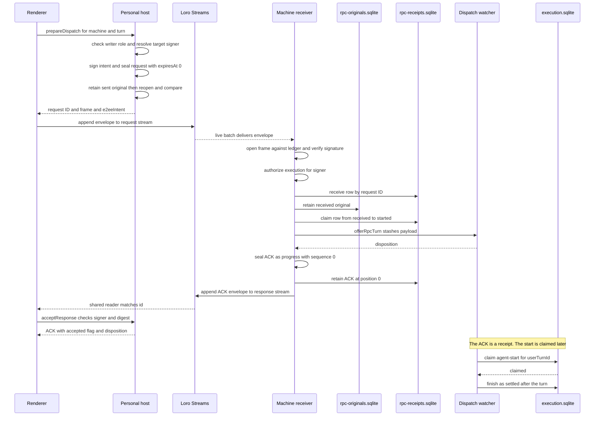
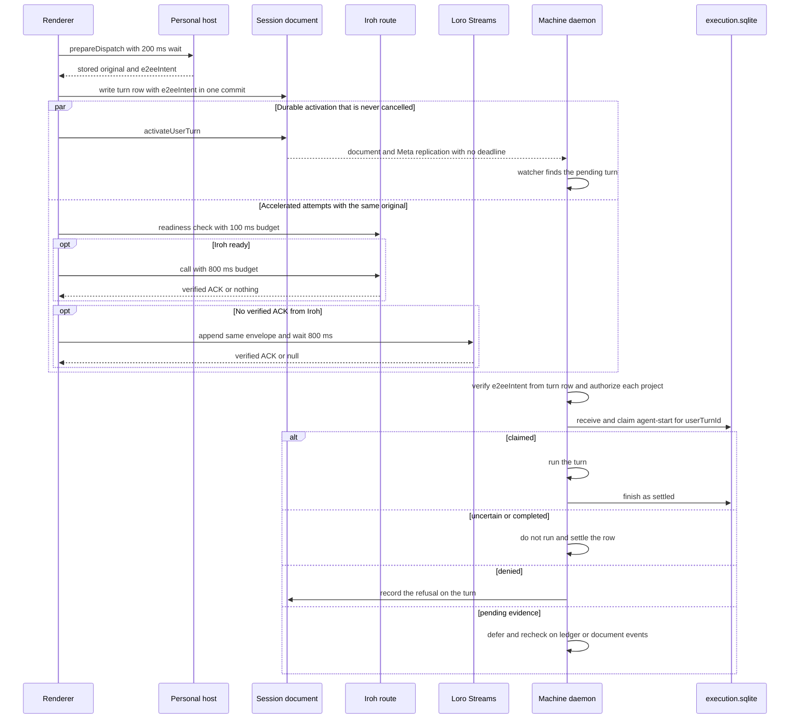
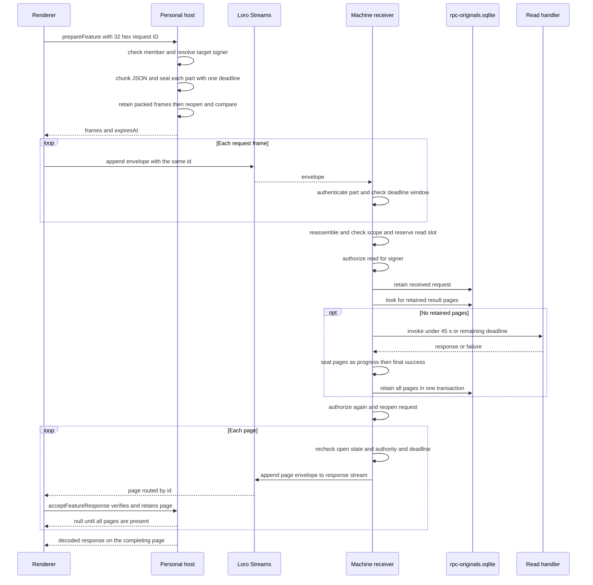

# Encrypted RPC and alternative delivery routes

This file describes the encrypted remote procedure call (RPC) channel that the
Lody daemon runs over Loro Streams in end-to-end encrypted (E2EE) workspaces,
and how that channel interacts with the two other routes by which a user turn
can reach a machine: Iroh and durable dispatch through the session document. It
records what Lody does at commit `61bd9701a5ed6899a9f42787df682acfc3fd7d4b`.
Ordinary Streams RPC is described in [protocol.md](protocol.md); per-method
detail is in [methods.md](methods.md).

Significant claims carry one of these tags: **Impl** (the code path was read),
**Test** (a test with the quoted title asserts it), **Intent** (prose,
specification or comment only), **Infer** (an inference from the code that no
test was found to assert) and **Unknown**. No test was executed for this file:
**Test** means that the named test exists and asserts the behaviour, not that it
was seen to pass. Links such as [E-X1](evidence.md#e-x1) resolve to source lines
in [evidence.md](evidence.md).

## Layers and scope

| Layer | What it contributes here | Grants authority? |
| --- | --- | --- |
| Loro Durable Streams (transport) | Named append-only JSON streams that carry `{id, frame}` envelopes | No; stream names route only [E-X2](evidence.md#e-x2) |
| Lody ordinary RPC | Plaintext JSON requests and replies on `<workspace>:rpc:req:<machine>`; see [protocol.md](protocol.md#transport) | Not used in encrypted workspaces |
| Lody encrypted RPC | Signed, sealed frames; ledger, role and policy checks; retained originals and journals | Yes, together with the ledger and the authorizer |
| Loro and Flock document synchronization, durable command dispatch | The session document turn row with its signed execution intent, and the Meta activation the machine observes | Carries the signed intent; no deadline |
| Agent Client Protocol (ACP) | The daemon's conversation with the agent process | Never carried by any RPC frame; the daemon is the only ACP client |

These five layers are kept distinct throughout. Iroh appears only as an
alternative carrier for the same encrypted envelope: this file covers its route
selection, shared receivers and journals, fallback and deduplication, and
nothing else.

Scope and boundary of encrypted RPC:

| Question | Answer | Basis |
| --- | --- | --- |
| Which workspaces use it? | Encrypted workspaces only. The machine starts the listener from the encrypted workspace runtime and refuses when the Streams bucket is empty or equals `lody`, or no gateway URL is known (`e2ee_content_configuration`) | **Impl** [E-X3](evidence.md#e-x3) |
| Is the ordinary request stream opened? | No. The daemon keeps its ordinary RPC server object only as an in-process query server for the encrypted read route; the client-side machine client does not start its ordinary response reader, and `sendRequest` throws `e2ee_rpc_unavailable` for every method that is not an encrypted read query | **Impl** [E-X85](evidence.md#e-x85) [E-X83](evidence.md#e-x83) |
| Which channels exist? | *Dispatch*: exactly one method, `session/dispatch-turn`, answered by a receipt acknowledgement (ACK). *Feature RPC*: a closed allowlist of reads and writes, answered by a paged result. Both share the carrier, key domain and stream names; the receiver tells them apart by the method inside the decrypted frame | **Impl** [E-X42](evidence.md#e-x42) [E-X53](evidence.md#e-x53) |
| Do the nested error and presence codecs enable anything? | No. No production path emits a response of kind `error` or an encrypted presence body; the dispatch sender accepts only `progress` and the page decoder only `progress` and `success`. Method failures travel as an ordinary `{ok: false, ...}` result inside `success`-terminated pages | **Impl** [E-X15](evidence.md#e-x15) [E-X36](evidence.md#e-x36) [E-X17](evidence.md#e-x17); **Intent** [E-X82](evidence.md#e-x82) |

## Addressing and correlation

### Stream names and the resource string

| Item | Value | Basis |
| --- | --- | --- |
| Resource | `rpc:` followed by unpadded base64url of the machine ID's UTF-8 bytes | **Impl** [E-X1](evidence.md#e-x1) |
| Request stream | `<workspaceId>:e2ee-rpc:req:<base64url(machineId)>` | **Impl** [E-X2](evidence.md#e-x2) |
| Response stream | `<workspaceId>:e2ee-rpc:res:<requesterDevice>`, where `requesterDevice` is 64 lowercase hexadecimal characters (the requester's signing public key) | **Impl** [E-X2](evidence.md#e-x2) |

The machine ID must be a string of 1 to 256 UTF-8 bytes that survives a strict
decode unchanged; anything else fails with `e2ee_rpc_machine_id`, and no
normalization is applied. **Impl** [E-X1](evidence.md#e-x1) The response stream
name is refused with `e2ee_rpc_signer` unless the device is 64 lowercase
hexadecimal characters. **Impl** [E-X2](evidence.md#e-x2) The code only encodes
the resource. No decoder for it was found, so the specification's rules about
rejecting padding and alternative alphabets have no enforcement site in this
package. **Infer**

The resource string is never placed on Streams. It is bound into the key
derivation, the associated data and the signed bytes of every frame, and request
and response for one machine use the same resource. **Impl**
[E-X13](evidence.md#e-x13) [E-X21](evidence.md#e-x21) [E-X38](evidence.md#e-x38)

There is one response stream per workspace signing device, shared by every call
that device makes, and one request stream per machine. **Impl**
[E-X2](evidence.md#e-x2) Streams are created on demand with a retention argument
of 86,400 seconds by whichever side needs them: the machine ensures its request
stream and each requester's response stream, and the client ensures its own
response stream. **Impl** [E-X8](evidence.md#e-x8) [E-X56](evidence.md#e-x56)
How the service applies that retention is **Unknown**.

### Bucket and token scope

The bucket must not be `lody`. **Impl** [E-X3](evidence.md#e-x3) A note records
that the token is an RPC-only content token that may read, create and append
only under the `<workspace>:e2ee-rpc:` prefix. **Intent**
[E-X89](evidence.md#e-x89) Enforcement is in the backend, outside this
repository. **Unknown**

### Correlation identifier and what Streams can see

Every envelope carries `id`, the 16-byte request identifier as 32 lowercase
hexadecimal characters. The same identifier is inside the signed, encrypted
body, and both receivers fail with `e2ee_rpc_request_binding` when the two
differ. **Impl** [E-X4](evidence.md#e-x4) [E-X11](evidence.md#e-x11)
[E-X12](evidence.md#e-x12)

- Dispatch: the host draws 16 random bytes while sealing. **Impl**
  [E-X9](evidence.md#e-x9)
- Feature: the renderer supplies the identifier, by default a version 4
  universally unique identifier (UUID) with hyphens removed, so 122 random bits
  rather than 128. **Impl** [E-X10](evidence.md#e-x10) The specification says
  request identifiers are host-generated. **Intent** [E-X91](evidence.md#e-x91)
- A multi-frame feature request appends one envelope per frame, all with the
  same `id`; result pages do the same. **Impl** [E-X6](evidence.md#e-x6)
  [E-X73](evidence.md#e-x73)

Visible in plaintext to the Streams service: the stream names (workspace ID,
base64url machine ID, requester device public key), the request ID, the frame
length and timing, and the clear header of the frame (version, epoch, signer
device key). Everything else is ciphertext. **Impl** [E-X4](evidence.md#e-x4)
[E-X13](evidence.md#e-x13) The test "routes ciphertext-only Streams ACKs, falls
back on timeout, then replays the exact original safely" asserts that the
written envelopes do not contain the prompt. **Test** [E-X99](evidence.md#e-x99)

### Shared bounded readers

| Reader | Owner | Bounds | Behaviour at the bound | Basis |
| --- | --- | --- | --- | --- |
| Response reader | Client channel, one per workspace and requester device | 128 pending calls; reply queue of 128; 4 verification workers | `send` returns `null` at once when closed, when the prepared signer differs, when 128 calls are pending, or when the same request ID is already pending; replies beyond the queue are dropped | **Impl** [E-X6](evidence.md#e-x6) |
| Request reader | Machine listener, one per workspace and machine | Queue of 128; 4 handlers | Envelopes beyond the queue are dropped | **Impl** [E-X7](evidence.md#e-x7) |
| Iroh listener | Machine, when relays and the native module are present | 4 handlers | The native queue applies backpressure | **Impl** [E-X75](evidence.md#e-x75) |

A failed read marks the stream for re-ensure, sleeps one second and loops; the
machine also retries the whole listener scope one second after it fails, for
example on a token or configuration failure. **Impl** [E-X8](evidence.md#e-x8)
[E-X7](evidence.md#e-x7) [E-X53](evidence.md#e-x53) When the dropping queue is
full the stream offset still advances, so a dropped request is not re-read until
the reader is rebuilt; a dropped dispatch then depends on the durable route and
a dropped feature request times out. **Infer**

### Initial offset

Both readers begin at the literal offset `'0'`, held only in memory, and nothing
persists it. **Impl** [E-X5](evidence.md#e-x5) The ordinary readers start at
`'-1'` instead (see [protocol.md](protocol.md#transport)). Consequently every
construction of the machine listener, including each one-second retry and each
daemon start, re-reads every request the stream still retains, and deduplication
rests on the stores and journals described below. **Infer** Whether the
production Streams service accepts a bare `0` as the first position is
**Unknown**.

## Frames

### Carrier envelope

The object appended to a stream is defined by `envelopeSchema` and its exported
parser `e2eeRpcEnvelope` in `packages/loro-streams-rpc/src/e2ee-streams.ts`: an
`id` of 32 lowercase hexadecimal characters and a `frame` of 286 to 2,097,152
lowercase hexadecimal characters holding one complete sealed frame. **Impl**
[E-X4](evidence.md#e-x4) The Iroh route carries the same JSON object. **Impl**
[E-X75](evidence.md#e-x75)

### Sealed frame: authoritative definitions

This file does not restate a byte layout; take it from these definitions.

| Concern | Authoritative definition (file, symbol) | Basis |
| --- | --- | --- |
| Header and frame parsing, size constants, purposes | `packages/e2ee-core/src/internal/foundation/content-format.ts`: `encodeContentHeader`, `parseContentFrame`, `encodeDocumentContext`, `PURPOSES`, `CONTENT_OVERHEAD_BYTES` | **Impl** [E-X13](evidence.md#e-x13) |
| Seal and open | `packages/e2ee-core/src/internal/content/realtime.ts`: `seal`, `open` and the purpose-specific exports | **Impl** [E-X14](evidence.md#e-x14) |
| Ledger-bound sealing for RPC | `packages/e2ee-core/src/adapters/loro-streams/realtime-binding.ts`: `makeRealtimeContentBinding` (`sealRequest`, `sealResponse`, `openRequest`, `openResponse`) | **Impl** [E-X33](evidence.md#e-x33) |
| Request and response bodies | `packages/loro-streams-rpc/src/e2ee-wire.ts`: `encodeE2eeRpcRequestBody`, `decodeE2eeRpcRequestBody`, `encodeE2eeRpcResponseBody`, `decodeE2eeRpcResponseBody` | **Impl** [E-X16](evidence.md#e-x16) |
| Feature result page | `packages/loro-streams-rpc/src/e2ee-feature-parts.ts`: `encodeFeatureResponsePage`, `decodeFeatureResponsePage` | **Impl** [E-X17](evidence.md#e-x17) |
| Multi-frame request packing | `packages/loro-streams-rpc/src/e2ee-feature-client.ts`: `packFrames`, `unpackFrames` | **Impl** [E-X18](evidence.md#e-x18) |

What the code and specification state about the sealed frame:

- Each message is one "content v0" frame whose fixed overhead is 143 bytes: a
  39-byte prefix, a 24-byte nonce, a 16-byte tag and a 64-byte signature.
  **Impl** [E-X13](evidence.md#e-x13) The specification writes the order as
  `header39 || nonce24 || ciphertext || tag16 || signature64`. **Intent**
  [E-X26](evidence.md#e-x26)
- The purposes used are the seventh, eighth and ninth entries of the purpose
  list: `presence`, `rpc-request` and `rpc-response`. The frame carries no
  purpose tag; the caller selects the purpose, and it is authenticated through
  the bound context. **Impl** [E-X13](evidence.md#e-x13)
- The bound context is the workspace genesis, the organization epoch, a document
  epoch and the resource. **Impl** [E-X13](evidence.md#e-x13)
- Sealing signs the frame bytes that precede the signature with the device
  signer; opening verifies that signature before the content key is derived or
  anything is decrypted. **Impl** [E-X14](evidence.md#e-x14)
- The profile uses no extra associated data. **Intent**
  [E-X26](evidence.md#e-x26)

Frame kinds in use:

| Frame | Purpose | Response kind and sequence | Produced in production? |
| --- | --- | --- | --- |
| Dispatch request | `rpc-request` | Not applicable | Yes [E-X9](evidence.md#e-x9) |
| Feature request part | `rpc-request` | Not applicable | Yes [E-X21](evidence.md#e-x21) |
| Dispatch receipt ACK | `rpc-response` | `progress`, sequence 0 | Yes [E-X38](evidence.md#e-x38) |
| Feature result page | `rpc-response` | `progress` for pages before the last, `success` for the last; sequence is the page index | Yes [E-X23](evidence.md#e-x23) |
| Error response, encrypted presence | `rpc-response`, `presence` | `error` | No; codec only [E-X15](evidence.md#e-x15) |

### What is signed and bound

| Field | Where it is bound | Basis |
| --- | --- | --- |
| Signer (device signing key) | Clear in the frame header; the signature is verified against it; the binding requires a current, non-recovery ledger device whose member exists | **Impl** [E-X33](evidence.md#e-x33) |
| Genesis, epoch, resource `rpc:<machine>`, purpose | The context that enters key derivation, associated data and signed bytes | **Impl** [E-X13](evidence.md#e-x13); **Intent** [E-X26](evidence.md#e-x26) |
| Request ID, deadline `expiresAt`, method, parameters | Inside the encrypted request body, so covered by the cipher and, through the ciphertext, by the signature | **Impl** [E-X16](evidence.md#e-x16) |
| Reply-to-request binding | `requestId` and `requestDigest` inside the encrypted response body; the digest is SHA-256 of the entire original sealed request | **Impl** [E-X16](evidence.md#e-x16) [E-X36](evidence.md#e-x36) |
| Execution intent (dispatch only) | A separate device signature carried as `e2eeIntent` inside the dispatch parameters and repeated in the document turn row | **Impl** [E-X37](evidence.md#e-x37) [E-X43](evidence.md#e-x43) |

There is no separate signature over the deadline or the request ID. A "signed
deadline" in this file means a deadline inside the signed, encrypted body. For a
multi-frame feature request the digest is taken over the packed aggregate of all
request frames, not over one frame. **Impl** [E-X18](evidence.md#e-x18)
[E-X22](evidence.md#e-x22)

### Request body

The request body holds a version, the 16-byte request ID, `expiresAt`, the
method and opaque parameter bytes; the encoder and decoder named above are
authoritative, and the specification gives the same field order. **Impl**
[E-X16](evidence.md#e-x16); **Intent** [E-X27](evidence.md#e-x27) The method is
1 to 128 printable ASCII characters. The body codec is not a method allowlist.
**Impl** [E-X15](evidence.md#e-x15)

The parameter bytes differ by channel:

- **Dispatch.** UTF-8 JSON of `sessionId`, `userTurnId`, `userId`, `timestamp`,
  `inputConfig` and `e2eeIntent`. The intent record is a 98-byte value stored as
  131 base64url characters. **Impl** [E-X37](evidence.md#e-x37)
  [E-X43](evidence.md#e-x43)
- **Feature.** An 8-byte part header (part index and part count) followed by at
  most 256 KiB of the UTF-8 JSON `{requestId, request}`, where `request` is a
  local machine RPC request. The receiver requires 9 to 262,152 parameter bytes,
  a count of 1 to 128 and an index below the count. **Impl**
  [E-X21](evidence.md#e-x21) [E-X18](evidence.md#e-x18)

### Response body

The response body holds a version, the request ID, the request digest, a kind
(`progress`, `success` or `error`), a sequence number and a payload. **Impl**
[E-X16](evidence.md#e-x16)

- **Dispatch receipt ACK.** Kind `progress`, sequence 0, payload JSON with
  `type: 'session/dispatch-turn_response'`, `sessionId`, `userTurnId`,
  `accepted` and a `disposition` of `accepted`, `duplicate`, `already-terminal`,
  `not-owned` or `error`. **Impl** [E-X38](evidence.md#e-x38)
  [E-X37](evidence.md#e-x37)
- **Feature result page.** The payload starts with the total page count and the
  total JSON byte count, followed by the chunk. The sequence is the page index;
  the last page has kind `success` and earlier pages `progress`. The decoder
  checks the byte total (1 byte to 16 MiB), that the page count matches the
  total, the sequence range, that `success` appears exactly on the last page,
  and the exact chunk length. The assembled content is one local machine RPC
  response, including failures. **Impl** [E-X17](evidence.md#e-x17)
  [E-X23](evidence.md#e-x23)

### Size limits

| Limit | Value | Basis |
| --- | --- | --- |
| Complete sealed frame | 1 MiB (1,048,576 bytes), including 143 bytes of overhead | **Impl** [E-X15](evidence.md#e-x15); **Test** "bounds the complete RPC frame before copying or expanding advertised lengths" [E-X30](evidence.md#e-x30) |
| Request or response body | 1,048,433 bytes | **Impl** [E-X15](evidence.md#e-x15); **Intent** [E-X27](evidence.md#e-x27) |
| Envelope `frame` field | 286 to 2,097,152 hexadecimal characters | **Impl** [E-X4](evidence.md#e-x4) [E-X28](evidence.md#e-x28) |
| Feature chunk | 256 KiB of JSON per frame or page | **Impl** [E-X17](evidence.md#e-x17) |
| Feature request | 32 MiB of JSON, at most 128 frames | **Impl** [E-X17](evidence.md#e-x17) [E-X18](evidence.md#e-x18) |
| Feature result | 16 MiB of JSON (64 pages) | **Impl** [E-X17](evidence.md#e-x17) |

The frame limit is enforced when encoding, when decoding, when the sender
reopens its own original, when hexadecimal is decoded and per packed frame.
**Impl** [E-X15](evidence.md#e-x15) [E-X35](evidence.md#e-x35)
[E-X28](evidence.md#e-x28) [E-X18](evidence.md#e-x18) A dispatch has no
chunking: parameters that do not fit one frame cannot be prepared, and an input
without a signed intent is not sent. **Infer** from [E-X9](evidence.md#e-x9)
[E-X50](evidence.md#e-x50)

### Part and page assembly, atomic commit

Request parts. All parts must share the request ID, method, signer, deadline and
epoch, or assembly fails with `e2ee_feature_part_binding`; the reassembled JSON
must name this workspace, this machine, the signed method and the signed request
ID, or it fails with `e2ee_feature_scope`. **Impl** [E-X18](evidence.md#e-x18)
The machine buffers incomplete sets in memory only, keyed by machine, requester
device and request ID, with at most 32 incomplete requests and 32 MiB in total;
a conflicting duplicate part fails with `e2ee_feature_part_conflict`, exhaustion
with `e2ee_feature_busy`, and sets whose deadline has passed are purged on the
next arrival. **Impl** [E-X19](evidence.md#e-x19)

Result pages on the machine. The machine seals every page and then retains all
of them in one store transaction before it publishes the first; a result above
16 MiB is replaced by a small `e2ee_query_too_large` failure that reports the
size. **Impl** [E-X23](evidence.md#e-x23) [E-X78](evidence.md#e-x78) For feature
writes the pages are additionally retained in the receipt journal, followed by a
finish record holding the page count. **Impl** [E-X72](evidence.md#e-x72)

Result pages on the sender. Each arriving page is verified and retained
individually; the result is decoded only when page 0 and every later page are
present and agree on the totals, and until then acceptance returns `null`.
**Impl** [E-X22](evidence.md#e-x22); **Test** "waits for every signed page,
including across reopen, and returns an explicit error above 16 MiB"
[E-X103](evidence.md#e-x103)

### Fixtures and test vectors in the repository

| File | What it covers | What it does not cover |
| --- | --- | --- |
| `packages/loro-streams-rpc/tests/fixtures/e2ee-wire-v0.json`, generated by `generate-e2ee-wire.py` beside it | Plaintext **body** vectors: `request`, `progress`, `success`, `error`, `errorPayload`, `presence`, `digest`; asserted by "matches independent Python struct vectors without reserializing method bytes" [E-X29](evidence.md#e-x29) [E-X30](evidence.md#e-x30) | No ciphertext, no signature, no resource |
| `packages/e2ee-core/test/realtime-content-vector.json`, generated by `generate-realtime-content-vector.py` | Complete sealed frames for the presence, request and response purposes under fixed inputs; iterated by "matches independent Python HMAC + libsodium full-frame vector" [E-X31](evidence.md#e-x31) [E-X32](evidence.md#e-x32) | Uses the synthetic resource `realtime-target-a`, not an `rpc:` resource, and a synthetic plaintext, not an RPC body |
| `packages/loro-streams-rpc/tests/fixtures/e2ee-native-fixture.ts` | A test harness (ledger, hosts, stores) | Not a vector |
| `packages/e2ee-core/test/content-vector.json`, `crypto-vector.json` | Document content and primitives | Not RPC |

No end-to-end vector exists in the repository that combines an `rpc:` resource,
an RPC request or response body and a sealed frame. A compatible implementation
can check the body codec and the generic sealed frame separately against these
files, but not the composition. **Infer** from the directory listings.

## Keys and identities

| Topic | What Lody does | Basis |
| --- | --- | --- |
| Signing key | Frames are signed by the workspace ledger *device* key of the sealing host: the requester's personal device for requests, the machine's device for responses. Membership and role are looked up from that device's membership in the verified ledger; no separate member key exists in this path | **Impl** [E-X39](evidence.md#e-x39) [E-X40](evidence.md#e-x40) [E-X33](evidence.md#e-x33) |
| Encryption key | Derived from the workspace epoch key for the frame's epoch. Any current member device that holds the epoch key can decrypt; authenticity rests on the device signature | **Impl** [E-X39](evidence.md#e-x39) [E-X14](evidence.md#e-x14); **Intent** [E-X44](evidence.md#e-x44) |
| Target key selection | The sender finds the ledger devices of kind `machine` with the requested machine ID. Exactly one must exist and, unless the call may cross membership, its membership must equal the requester's, else `e2ee_machine_not_owned`. The chosen signer key is stored with the original and compared on every reuse (`e2ee_rpc_target_changed`) | **Impl** [E-X34](evidence.md#e-x34) [E-X9](evidence.md#e-x9); **Intent** [E-X44](evidence.md#e-x44) |
| Sender checks before signing | A revoked device or removed member fails with `e2ee_device_revoked` or `e2ee_member_removed`. Dispatch and feature writes need a non-recovery device of a member whose role is not Guest (`e2ee_rpc_denied`); read queries need a non-recovery device of a current member, Guests included | **Impl** [E-X34](evidence.md#e-x34) |
| Sharing preflight | For a dispatch or `session/fork` to another member's machine the host consults a sharing policy reader. Only a verified denial withholds the request (`e2ee_machine_not_shared`); a failed or absent reader signs and leaves the decision to the machine | **Impl** [E-X9](evidence.md#e-x9) [E-X21](evidence.md#e-x21); **Test** "withholds another member's dispatch only on a verified sharing denial" [E-X102](evidence.md#e-x102) |
| Admission by the binding | Opening a frame, in either direction, requires ledger continuity under the pinned genesis and a signer that is a current non-recovery device whose member exists. Role is not checked at this level | **Impl** [E-X33](evidence.md#e-x33) |
| Execution intent | For dispatch the same device also signs an intent over workspace, target machine, session, message ID and content digest; the opener requires the intent's signer to equal the frame signer | **Impl** [E-X9](evidence.md#e-x9) [E-X35](evidence.md#e-x35) |

Epoch and rotation behaviour:

| Case | Behaviour | Basis |
| --- | --- | --- |
| Sealing a request | At the sender's current verified epoch; sealing fails if the epoch changes while it runs | **Impl** [E-X33](evidence.md#e-x33) |
| Opening a request | The frame's epoch must be the current one, checked before and after decryption | **Impl** [E-X33](evidence.md#e-x33) |
| Sealing a response | At the epoch of the original request, and only while that epoch is still current | **Impl** [E-X33](evidence.md#e-x33) |
| Opening a response | Against the stored target signer and the request's epoch; both senders first reopen their saved request, which requires the current epoch | **Impl** [E-X33](evidence.md#e-x33) [E-X36](evidence.md#e-x36) [E-X22](evidence.md#e-x22) |
| Rotation during an exchange | The exchange does not survive on either side: the receiver rejects an old-epoch request, the sender cannot reopen an old-epoch original to verify a late reply, and a repeated dispatch preparation for the same session, turn and content finds the old-epoch original, fails to open it and fails instead of sealing again (no re-seal branch exists). The durable route is unaffected because the execution intent does not depend on an epoch | **Infer**; no test was found |
| Machine behind the ledger | When opening fails as `unauthorized` or for a missing key, and the frame names a newer epoch and verifies for a current ledger device, the machine joins one bounded ledger and key refresh (30-second timeout, 60-second cooldown) and reopens once | **Impl** [E-X41](evidence.md#e-x41); **Test** "does not refresh current-epoch missing-key requests with unauthenticated signatures" and two sibling titles [E-X109](evidence.md#e-x109) |

What a browser may hold:

- In the desktop composition the renderer calls only host preparation and
  acceptance functions and optional Iroh functions, and receives public
  ciphertext and identifiers. The client module documents that it exposes no
  renderer-supplied signer or deadline and no arbitrary signing. **Impl**
  [E-X45](evidence.md#e-x45) [E-X42](evidence.md#e-x42); **Intent**
  [E-X37](evidence.md#e-x37)
- The optional portable personal host runs the same client in a browser or
  WebView with a custody-held device signer and an IndexedDB originals store,
  and the specification records that the mobile WebView host hands the device
  seed once per session to a native Iroh plugin. **Impl**
  [E-X40](evidence.md#e-x40); **Intent** [E-X44](evidence.md#e-x44)
  [E-X88](evidence.md#e-x88) So "the browser never receives signing keys" holds
  for the desktop renderer and main-process split, not for every browser-hosted
  composition.

## Sender flow

### Dispatch sender

| Step | Actor | Action | Basis |
| --- | --- | --- | --- |
| 1 | Renderer | Ask the host to prepare a dispatch for `(machineId, sessionId, userTurnId, userId, timestamp, inputConfig)`; wait at most 200 ms (a later answer is still awaited for up to 10 s on the queued path) | **Impl** [E-X49](evidence.md#e-x49) [E-X50](evidence.md#e-x50) |
| 2 | Host | Require a writer; normalize the input to its JSON wire form; resolve the target signer (cross-member allowed); run the sharing preflight for another member's machine; read the stored original under `[sessionId, userTurnId, contentDigest]` | **Impl** [E-X9](evidence.md#e-x9) [E-X37](evidence.md#e-x37) |
| 3 | Host | If none is stored, in one uninterruptible section: sign the execution intent, build the body with a fresh random ID, `expiresAt = 0` and method `session/dispatch-turn`, seal at the current epoch, retain `{target, signer, frame}` | **Impl** [E-X9](evidence.md#e-x9) |
| 4 | Host | Always: check that target and signer still match the ledger, reopen the stored frame and require the same requester and JSON-equal input (`e2ee_rpc_intent_conflict`); return request ID, frame, requester device, `expiresAt` and intent | **Impl** [E-X9](evidence.md#e-x9) |
| 5 | Renderer | Write the turn row or queue item with `e2eeIntent` in the same write as the content | **Impl** [E-X50](evidence.md#e-x50) |
| 6 | Renderer | Prepare again (returns the stored original), start the send without awaiting it and write the durable activation; an activation failure is logged, not reported, when the RPC was accepted | **Impl** [E-X51](evidence.md#e-x51) |
| 7 | Renderer | Try Iroh (ready within 100 ms, call within 800 ms), then Streams (800 ms by default); `null` means no verified ACK within the budgets | **Impl** [E-X46](evidence.md#e-x46) [E-X47](evidence.md#e-x47) [E-X6](evidence.md#e-x6) |
| 8 | Host | Accept the ACK: reopen the original, open the reply against the stored target signer and request epoch, require request ID, digest of the stored frame, kind `progress`, sequence 0 and the same session and turn (`e2ee_rpc_response_binding`), retain the frame at sequence 0 | **Impl** [E-X36](evidence.md#e-x36) |

The original is retained before preparation returns, hence before any append.
**Impl** [E-X9](evidence.md#e-x9); **Test** "persists an original before
returning it and reopens exact ID/ciphertext without re-signing"
[E-X105](evidence.md#e-x105) The stored-original key includes the content
digest, so an edit that keeps its message ID is signed again under a new
original and a new request ID, while a retry of the same content reuses the
stored bytes. **Impl** [E-X37](evidence.md#e-x37) When two preparations race,
the store adopts the first original and the loser's freshly sealed frame is
discarded. **Impl** [E-X78](evidence.md#e-x78)

### Feature sender

| Step | Actor | Action | Basis |
| --- | --- | --- | --- |
| 1 | Renderer | Build `{requestId, request}` and ask the host to prepare it | **Impl** [E-X10](evidence.md#e-x10) |
| 2 | Host | Canonicalize through the allowlist schema; authorize the requester (writer for writes, member for reads); check the workspace; resolve the target signer (cross-member only for `session/history-read` and `session/fork`); run the sharing preflight for a fork; read the stored original under `feature:<requestId>` | **Impl** [E-X21](evidence.md#e-x21) |
| 3 | Host | If none is stored, in one uninterruptible section: split the JSON into 256 KiB chunks, seal each with the same ID, method and a deadline of `now` plus the method's time to live (TTL), retain the packed frames | **Impl** [E-X21](evidence.md#e-x21) [E-X20](evidence.md#e-x20) |
| 4 | Host | Unpack and reopen every stored frame, compare with the input, authorize again, return the frames and the deadline | **Impl** [E-X21](evidence.md#e-x21) |
| 5 | Renderer | Try Iroh only for a single-frame original, with the request timeout or 30 s; then Streams with the same timeout; otherwise return `{ok: false, error: 'Encrypted machine request timed out.'}` | **Impl** [E-X46](evidence.md#e-x46) [E-X48](evidence.md#e-x48) |
| 6 | Host | Accept each reply frame under the assembly rules above | **Impl** [E-X22](evidence.md#e-x22) |

The read adapter that lets ordinary method helpers use this channel refuses
non-read methods with `e2ee_query_method` and caps the request timeout at 60 s.
**Impl** [E-X52](evidence.md#e-x52)

## Receiver flow

### Wiring

For each transport the machine builds a dispatch receiver and a feature receiver
over the *same* native client (wrapped with ledger catch-up), the *same* receipt
journal and the *same* authorization object. The listener gives each envelope to
the feature receiver first; a `false` return means that the frame is a dispatch
and hands it to the dispatch receiver. **Impl** [E-X53](evidence.md#e-x53) A
failed receive logs once and never stops sibling intake. **Impl**
[E-X7](evidence.md#e-x7) [E-X53](evidence.md#e-x53)

### Dispatch receiver

| Step | Action | Basis |
| --- | --- | --- |
| 1 | Return if the workspace is closed | **Impl** [E-X11](evidence.md#e-x11) |
| 2 | Open the frame: size and hexadecimal checks; the binding's ledger, epoch, signer and signature checks; decryption; body decode; method equal to `session/dispatch-turn` (`e2ee_rpc_method`); parameters as strict UTF-8 JSON matching the schema; intent signer equal to frame signer (`e2ee_rpc_invalid`); a parseable timestamp and `expiresAt` equal to 0 (`e2ee_rpc_expiry`) | **Impl** [E-X35](evidence.md#e-x35) |
| 3 | Fail with `e2ee_rpc_request_binding` when the signed ID differs from the envelope `id` | **Impl** [E-X11](evidence.md#e-x11) |
| 4 | Authorize execution for the signer at machine level; if not `Authorized`, closed, or the grant is no longer current, return silently with nothing stored and nothing sent | **Impl** [E-X11](evidence.md#e-x11) |
| 5 | Record the request in the receipt journal under `(genesis, workspaceId, machineId, requestId)` with requester, `expiresAt` and the exact frame | **Impl** [E-X11](evidence.md#e-x11) |
| 6 | Use the ACK retained at position 0 if there is one; else persist and use a sealed ACK that is pending in memory | **Impl** [E-X11](evidence.md#e-x11) |
| 7 | Else: return if 32 ACKs are pending; retain the received original; claim the receipt row and return silently unless claimed; offer the turn to the dispatch watcher; seal the ACK; retain it at position 0; never finish the claim | **Impl** [E-X56](evidence.md#e-x56) |
| 8 | Deliver the ACK through the Iroh sink, or ensure and append to the requester's response stream | **Impl** [E-X56](evidence.md#e-x56) |

The offer only validates, stashes the payload for 10 minutes in memory and
enqueues an ordinary dispatch check. **Impl** [E-X57](evidence.md#e-x57)

### Feature receiver

| Step | Action | Basis |
| --- | --- | --- |
| 1 | Return if closed. Open the frame as a feature part: authenticate; hand a dispatch frame back; apply the allowlist and part header; purge expired part sets; apply the deadline window (`e2ee_feature_expiry`); open a single frame, or buffer the part and wait | **Impl** [E-X12](evidence.md#e-x12) [E-X18](evidence.md#e-x18) [E-X19](evidence.md#e-x19) |
| 2 | Fail when the signed ID differs from the envelope `id`; classify as read or write; drop when the ID is already active in this receiver or 32 requests of that class are active | **Impl** [E-X12](evidence.md#e-x12) |
| 3 | Select the authorizer for the method and fork the rest into the workspace scope, releasing the listener worker | **Impl** [E-X12](evidence.md#e-x12) [E-X73](evidence.md#e-x73) |
| 4 | Authorize. A fork refused by the sharing policy gets a sealed definite refusal; any other denial, a missing revocable authority for `session/history-read` or `machine/acp-interaction`, a closed scope or a passed deadline ends silently; a fork whose signer has no ledger identity ends silently | **Impl** [E-X71](evidence.md#e-x71) |
| 5 | Retain the received request under `['feature', requesterDevice, requestId]` | **Impl** [E-X25](evidence.md#e-x25) |
| 6 | Read: replay retained result pages if any; else run the handler under `min(45 s, expiresAt - now)`, map failure or timeout to an `e2ee_query_failed` result, seal and retain the pages; no journal | **Impl** [E-X70](evidence.md#e-x70) [E-X23](evidence.md#e-x23) |
| 7 | Write: admit through the receipt journal (see [Receipt versus actual start](#receipt-versus-actual-start)); the handler runs without a timeout | **Impl** [E-X72](evidence.md#e-x72) |
| 8 | Authorize again; reopen the request, which re-validates signer and epoch; publish each page, re-checking open state, authority and deadline before every append; for `session/history-read` run the full authorizer before each page | **Impl** [E-X73](evidence.md#e-x73) |
| 9 | Finally drop the active ID and end the Iroh sink; all failures in the task are swallowed | **Impl** [E-X73](evidence.md#e-x73) |

The handler checks that the request names this workspace and machine
(`e2ee_feature_scope`), that a fork names the verified signer's account and that
any other `requestedByUserId` equals the machine owner's
(`e2ee_feature_requester`), then routes read queries to the in-process query
server, `machine/acp-interaction` to its dedicated owner and everything else to
the local machine dispatcher. **Impl** [E-X74](evidence.md#e-x74)

## Sequence diagrams

### Encrypted dispatch over Streams with receipt ACK

### Parallel durable route and Iroh attempt

### Feature read with a paged response

## Deadlines and replay constraints

| Channel | Signed `expiresAt` | Admission rule at the receiver | Work bound | Replay constraint | Basis |
| --- | --- | --- | --- | --- | --- |
| Dispatch | `0`, meaning no deadline | Only `0` is accepted; any other value fails `e2ee_rpc_expiry` | None | Request-ID receipt row, then the `agent-start` claim; no time window | **Impl** [E-X9](evidence.md#e-x9) [E-X35](evidence.md#e-x35) |
| Feature read | Sender `now` + 11 min (60 s + 10 min skew) | `now < expiresAt <= now + 21 min` | `min(45 s, expiresAt - now)` | Retained request and result pages; no claim | **Impl** [E-X20](evidence.md#e-x20) [E-X19](evidence.md#e-x19) [E-X70](evidence.md#e-x70) |
| Feature write | Sender `now` + 25 min (900 s + 10 min skew) | `now < expiresAt <= now + 35 min` | None on the handler | Request-ID row claimed and finished in the receipt journal | **Impl** [E-X20](evidence.md#e-x20) [E-X19](evidence.md#e-x19) [E-X72](evidence.md#e-x72) |

Further constraints:

| Point | Detail | Basis |
| --- | --- | --- |
| Skew allowance | The admission upper bound adds a second 10 minutes to the signed TTL, so relative clock offsets of up to ±10 minutes keep the nominal lifetime | **Impl** [E-X20](evidence.md#e-x20) [E-X19](evidence.md#e-x19); **Intent** [E-X82](evidence.md#e-x82); **Test** "round-trips encrypted file/history reads and writes with sender clock offset %i ms", "rejects feature deadlines beyond the clock skew budget", "rejects expired feature requests before admitting even a single chunk" [E-X104](evidence.md#e-x104) |
| One deadline throughout | The receiver uses the same signed deadline before admission, before retention, and before and during publication; a result that completes after it is retained but not published | **Impl** [E-X71](evidence.md#e-x71) [E-X73](evidence.md#e-x73) |
| Late dispatch | A dispatch delivered days late is still admitted | **Impl** [E-X35](evidence.md#e-x35); **Test** "rejects revoked/bad requests, admits a late delivery and the next legitimate call without a workspace fence" [E-X99](evidence.md#e-x99) |
| Retry after expiry | A stored feature original keeps its deadline, and preparing again with the same request ID returns the stored, possibly expired, frames. A retry after expiry therefore needs a new request ID; for a write that is a new claim identity, and the channel has no business-level key that links the two attempts | **Infer** from [E-X21](evidence.md#e-x21) [E-X72](evidence.md#e-x72) |
| Journal expiry clock (wired) | The receipt journal applies its expiry clock only to rows whose `expiresAt` is not 0: to feature writes, never to dispatch or `agent-start` rows. A claim returns `expired` once the local clock reaches the deadline | **Impl** [E-X62](evidence.md#e-x62) |
| Journal trusted-clock skew check (not wired) | The journal class can compare the local clock with a caller-supplied trusted reference and reject a claim when the local clock or the retained floor is more than 600,000 ms ahead (`clock_skew`). Both production constructions pass only `Date.now` and no reference, so the check exists in the class and is tested in isolation but is inactive in the shipped wiring | **Impl** [E-X62](evidence.md#e-x62) [E-X54](evidence.md#e-x54) [E-X55](evidence.md#e-x55); **Test** "rejects a local clock over ten minutes ahead of trusted time without advancing the floor" [E-X107](evidence.md#e-x107); the specification describes both branches, **Intent** [E-X93](evidence.md#e-x93) |

Ordinary RPC deadlines are a different mechanism; see
[protocol.md](protocol.md#deadlines-and-cancellation).

## Authorization

| When | Check | Inputs | Basis |
| --- | --- | --- | --- |
| Sender, before signing | Requester not revoked or removed; writer role for dispatch and writes, member for reads; single target device; same membership unless the method may cross; sharing preflight | The sender's verified ledger view; optional policy reader | **Impl** [E-X34](evidence.md#e-x34) [E-X9](evidence.md#e-x9) |
| Receiver, at open | Ledger continuity, current epoch, signer is a current non-recovery member device, signature | The machine's verified ledger view | **Impl** [E-X33](evidence.md#e-x33) |
| Receiver, before retaining anything | Method-specific authorizer (below) | The machine's own authenticated latest-ledger read, cached for 15 minutes; sharing policies | **Impl** [E-X11](evidence.md#e-x11) [E-X71](evidence.md#e-x71) [E-X68](evidence.md#e-x68) |
| Receiver, before publication | Authorizer again; request reopened; for `session/history-read` the authorizer again before each page | As above | **Impl** [E-X73](evidence.md#e-x73) |
| Machine, immediately before a turn starts | Signed intent verified against the content that will run; signer a current non-recovery member device; execution authorized for every local project the turn reaches | Document turn row or retained original; ledger; per-project policy | **Impl** [E-X66](evidence.md#e-x66) [E-X59](evidence.md#e-x59) |

The machine's authorizer needs the machine's own device to be a member. Read
access requires the signer to be a current non-recovery member device; every
other access requires document write permission, which Guests and recovery
devices lack. The signer is the `owner` principal when its membership equals the
machine's, otherwise `member`. A `member` principal is allowed only `execute`
(through the owner-signed sharing policy) and `session-read` (through the
session-sharing policy); any other access is denied with
`e2ee_machine_not_owned`. That denial is the same-member machine restriction.
**Impl** [E-X68](evidence.md#e-x68)

| Request | Authorizer on the machine | May target another member's machine? | Basis |
| --- | --- | --- | --- |
| `session/dispatch-turn` receipt | Execution, machine level | Yes, under the sharing policy | **Impl** [E-X53](evidence.md#e-x53) [E-X9](evidence.md#e-x9) |
| Actual start of a turn | Execution, per reached local project | Yes, per project | **Impl** [E-X59](evidence.md#e-x59) |
| Read query other than history | Read | No | **Impl** [E-X12](evidence.md#e-x12) [E-X68](evidence.md#e-x68) |
| `session/history-read` | Resolve the actual session, then execution for its project, else session read | Yes, Guests included | **Impl** [E-X69](evidence.md#e-x69); **Test** "reads shared history across machine memberships with retained originals (%s)" [E-X106](evidence.md#e-x106) |
| `session/fork` | Execution for every project the source session reaches | Yes at prepare and at the machine; see the defect below | **Impl** [E-X69](evidence.md#e-x69) [E-X21](evidence.md#e-x21) |
| Every other feature write | Owned execution | No | **Impl** [E-X69](evidence.md#e-x69) [E-X68](evidence.md#e-x68) |

### The README contradiction and the fork reply

The package README says that `session/history-read` "also permits requests to
another member's machine" and that "other feature methods retain the same-member
machine restriction". **Intent** [E-X87](evidence.md#e-x87) The code differs in
two ways:

- Dispatch resolves its target with the shared flag set, and feature preparation
  sets it for `session/fork` as well as `session/history-read`. A later note
  records that fork joined the channel on 2026-11-13 with shared-member access.
  **Impl** [E-X9](evidence.md#e-x9) [E-X21](evidence.md#e-x21); **Intent**
  [E-X96](evidence.md#e-x96)
- Feature *response acceptance* resolves the target signer with the shared flag
  set only when the method is `session/history-read`. **Impl**
  [E-X24](evidence.md#e-x24)

The second point is a probable defect. With the flag unset, `targetSigner` fails
with `e2ee_machine_not_owned` whenever the requester's membership differs from
the machine's. **Impl** [E-X34](evidence.md#e-x34) So for a `session/fork` sent
to another member's machine: preparation succeeds, the machine authorizes, runs
and answers, and every reply page then fails acceptance on the sender. A failed
acceptance neither resolves nor rejects the waiting call, so the sender observes
a timeout on both Iroh and Streams. **Impl** for each step
[E-X22](evidence.md#e-x22) [E-X6](evidence.md#e-x6) [E-X47](evidence.md#e-x47);
**Infer** for the end-to-end outcome, which no test exercises. The same applies
to the definite `e2ee_machine_not_shared` refusal, which is produced only for a
`member` principal, that is, only in the cross-member case. **Infer**

The tests found do not cover this. "forks for a shared member under
session-scoped authority and the verified signer identity" prepares and accepts
with one sender fixture and simulates the member through the injected
authorizer, and "signs another member's fork under the sharing preflight, while
other features stay same-member" stops after the receiver opens the request.
**Test** [E-X100](evidence.md#e-x100) [E-X102](evidence.md#e-x102)

Interoperability consequences. A client that copies the README under-states
which methods cross membership. A client that copies the code's acceptance rule
cannot complete a cross-member fork, although the machine will have created the
fork; a client that verifies fork replies against the stored target signer (as
acceptance does for history reads) would interoperate with the machine as it
behaves today. Which behaviour is intended is **Unknown**.

## Persistent stores

Three SQLite files exist on the machine, all under a directory scoped by genesis
and the device's signing key, plus an originals store on each requesting host.
**Impl** [E-X54](evidence.md#e-x54) [E-X55](evidence.md#e-x55)

| Store | File and class | Contents | Shared by |
| --- | --- | --- | --- |
| Originals | `rpc-originals.sqlite`, `E2eeRpcOriginals` | Exact request ciphertext, sent and received; response frames and result pages | Streams and Iroh receivers; read by the start path as an accelerator |
| Receipt journal | `rpc-receipts.sqlite`, `RealtimeJournal` | One row per request ID: dispatch receipt rows and their ACK; feature-write rows, pages and outcome | Streams and Iroh receivers |
| Execution journal | `execution.sqlite`, `RealtimeJournal` | `agent-start:<userTurnId>` rows | Every route, including the durable one |

### Originals store

The port is `E2eeRpcStore`: `read`, `retain`, `readResponse`, `retainResponse`,
`retainResponsePages`, `close`, over records of `{target, signer, frame}` that
hold ciphertext and public routing only. **Impl** [E-X77](evidence.md#e-x77) The
SQLite adapter has two tables, `originals` with primary key `(direction, key)`
and `responses` with primary key `(key, sequence)`, each row carrying a digest
that is verified on read; schema version 1, no migration
(`e2ee_rpc_store_format`), directory mode 0700 and file mode 0600, and a marker
file so that a missing database after first use is an error
(`e2ee_rpc_original_missing`) and not a fresh store. **Impl**
[E-X78](evidence.md#e-x78)

| Direction or table | Key | Writer | Changed bytes under an existing key | Basis |
| --- | --- | --- | --- | --- |
| `sent` | `[sessionId, userTurnId, digest]` as JSON | Dispatch sender | Each `retain` is one `BEGIN IMMEDIATE` transaction that inserts or ignores and reads the row back. First row is kept and returned; the caller must reopen and compare it; a different `target` is `e2ee_rpc_original_conflict` | **Impl** [E-X37](evidence.md#e-x37) [E-X78](evidence.md#e-x78) |
| `sent` | `feature:<requestId>` | Feature sender | As above | **Impl** [E-X21](evidence.md#e-x21) [E-X78](evidence.md#e-x78) |
| `received` | `[sessionId, userTurnId, digest]` as JSON | Dispatch receiver | `e2ee_rpc_original_conflict` when target, signer or frame differ | **Impl** [E-X38](evidence.md#e-x38) [E-X78](evidence.md#e-x78) |
| `received` | `['feature', requesterDevice, requestId]` as JSON | Feature receiver | As above | **Impl** [E-X25](evidence.md#e-x25) [E-X78](evidence.md#e-x78) |
| `responses` | Dispatch key, sequence 0 | Sender's retained ACK | `e2ee_rpc_response_conflict` | **Impl** [E-X36](evidence.md#e-x36) [E-X78](evidence.md#e-x78) |
| `responses` | `feature:<requestId>`, page | Sender's retained pages | As above | **Impl** [E-X22](evidence.md#e-x22) |
| `responses` | `feature-response:<hex SHA-256 of packed request>`, page | Machine's sealed result pages, all in one transaction | As above; the whole batch rolls back | **Impl** [E-X23](evidence.md#e-x23) [E-X78](evidence.md#e-x78) |

### Receipt and execution journals

Both files use the `RealtimeJournal` class with schema version 3 and no
migration. **Impl** [E-X63](evidence.md#e-x63)

| Element | Behaviour | Basis |
| --- | --- | --- |
| `realtime_requests` | Primary key `(genesis, workspace_id, target_machine_id, request_id)`; columns for requester, `expires_at`, the frame, a digest, a state of `received`, `started` or `completed`, a claim and an outcome, with a constraint tying claim and outcome to the state. `realtime_responses` adds `position` to that key | **Impl** [E-X63](evidence.md#e-x63) |
| `receive` | Refuses an identity that an earlier reset retired (`archived_request`); inserts or ignores; then requires the stored requester, `expires_at` and frame bytes to equal the input, else `identity_conflict` | **Impl** [E-X64](evidence.md#e-x64) |
| `claim` | One immediate transaction that moves a `received` row to `started` and returns an in-memory permit; any other state returns `existing`, and a `started` row is reported as uncertain and "is never made runnable again, including after crash/reopen" | **Impl** [E-X61](evidence.md#e-x61) |
| `finish`, `retainResponse` | The first outcome is kept (`outcome_conflict` for a different one); retained responses must be contiguous from position 0 (`response_gap`) and are immutable (`response_conflict`) | **Impl** [E-X65](evidence.md#e-x65) |
| Reset | A separate control file records retired identities. An explicit reset (`lody e2ee journal reset --file <journal>`) retires every current identity into it and archives the journal file by renaming it; nothing is deleted | **Impl** [E-X65](evidence.md#e-x65) |
| Provisioning | The execution journal is created lazily, and only when neither it nor its control file exists; a missing main file after use is treated as a fault | **Impl** [E-X60](evidence.md#e-x60) |

### Client originals store

The portable host uses `ClientRpcOriginalStore`, whose port states "First
ciphertext wins, batch response pages commit atomically" and that it is "neither
execution permission nor a receipt of network delivery". **Impl**
[E-X79](evidence.md#e-x79) The IndexedDB adapter keys rows by an owner derived
from the binding, the tags `rpc-original` or `rpc-response`, and the direction
and key or the key and sequence. Unlike the SQLite adapter it bounds each
response frame to 1 MiB and each original to 32 MiB, and allows sequence numbers
0 to 127 only. **Impl** [E-X80](evidence.md#e-x80) The desktop host uses the
SQLite adapter. **Intent** [E-X88](evidence.md#e-x88)

### Retention and disk growth

No deletion or eviction path exists in the SQLite originals store, the journal
(apart from reset bookkeeping) or the IndexedDB adapter. **Impl**
[E-X78](evidence.md#e-x78) [E-X65](evidence.md#e-x65); **Intent**
[E-X77](evidence.md#e-x77) [E-X81](evidence.md#e-x81) [E-X82](evidence.md#e-x82)
No size or row limit exists in the SQLite stores. Disk use therefore grows
without bound: one original and one ACK per dispatched turn content on both
hosts; for each feature request up to 32 MiB of request ciphertext and up to
about 16 MiB of result pages on both hosts; for feature writes the machine
stores result pages twice (originals store and receipt journal). Read results
such as file previews, download chunks and history reads are retained as
ciphertext indefinitely. **Infer**; no quota was found.

Only in-memory structures are bounded: 128 pending calls and 128-slot queues, 32
incomplete multi-part requests within 32 MiB, 32 active reads, 32 active writes,
32 pending sealed results, 32 pending ACKs. **Impl** [E-X6](evidence.md#e-x6)
[E-X7](evidence.md#e-x7) [E-X19](evidence.md#e-x19) [E-X12](evidence.md#e-x12)
[E-X23](evidence.md#e-x23) [E-X56](evidence.md#e-x56)

### State ownership

| State | Medium | Identity key | Transaction boundary | Survives restart | Retention | Cleanup owner |
| --- | --- | --- | --- | --- | --- | --- |
| Sent dispatch original | Sender originals store (SQLite or IndexedDB) | `sent`, `[sessionId, userTurnId, digest]` | One store transaction per retain | Yes | Unbounded | None |
| Sent feature original | Sender originals store | `sent`, `feature:<requestId>` | One store transaction | Yes | Unbounded | None |
| ACK and result pages held by the sender | Sender originals store, `responses` | Key, sequence | One transaction per page | Yes | Unbounded | None |
| Received dispatch original | Machine `rpc-originals.sqlite` | `received`, `[sessionId, userTurnId, digest]` | One store transaction | Yes | Unbounded | None |
| Received feature original | Machine `rpc-originals.sqlite` | `received`, `['feature', device, requestId]` | One store transaction | Yes | Unbounded | None |
| Sealed result pages | Machine `rpc-originals.sqlite`, `responses` | `feature-response:<digest>`, page | One transaction for all pages | Yes | Unbounded | None |
| Dispatch receipt row and ACK | Machine `rpc-receipts.sqlite` | Genesis, workspace, machine, request ID | `receive`, `claim` and `retainResponse` are separate transactions | Yes; the row stays `started` | Until explicit reset, which archives | Operator, by explicit reset |
| Feature-write row, pages, outcome | Machine `rpc-receipts.sqlite` | Genesis, workspace, machine, request ID | `receive` and `claim` in one synchronous section; pages and `finish` are separate transactions | Yes | Until explicit reset | Operator, by explicit reset |
| Actual-start claim | Machine `execution.sqlite` | Genesis, workspace, machine, `agent-start:<userTurnId>` | `receive` and `claim` in one synchronous section with no await | Yes | Until explicit reset; retired identities persist in the control file | Operator, by explicit reset |
| Signed execution intent | Session document turn row | Message ID, with the content | Same write as the turn | Yes | Life of the document | Not applicable |
| Stream offsets | Memory | Per reader | None | No; readers restart at `'0'` | Not applicable | Not applicable |
| Pending calls, part sets, pending ACKs and results, live write owners | Memory | Request ID based | None | No | Bounded as above | Scope close |
| RPC turn stash | Memory | Turn | None | No | 10 minutes | Dispatch watcher |
| Authorization grant | Memory | Requester device | None | No | 15 minutes | Authorizer |

Basis for the table: **Impl** [E-X78](evidence.md#e-x78)
[E-X63](evidence.md#e-x63) [E-X61](evidence.md#e-x61) [E-X59](evidence.md#e-x59)
[E-X50](evidence.md#e-x50) [E-X5](evidence.md#e-x5) [E-X57](evidence.md#e-x57)
[E-X68](evidence.md#e-x68); the retention column is **Infer** from the absence
of deletion code.

## Receipt versus actual start

A receipt, a claim and a start are three different facts, and their guarantees
differ by method. Nothing in this section applies to ordinary workspaces; for
those see [protocol.md](protocol.md#request-lifecycle-and-acknowledgements) and
[protocol.md](protocol.md#duplicates-and-deduplication).

### What a dispatch receipt ACK proves

A verified ACK proves that the target machine's device opened the exact
original, that the requester passed machine-level execution authorization at
that moment, that the request was recorded in the receipt journal, and that the
turn was offered to the dispatch watcher, which returned the stated disposition.
It does not prove that the agent started, that per-project authorization will
pass, or that the intent will verify against the content. The ACK type is
documented as "Delivery receipt only". **Impl** [E-X56](evidence.md#e-x56)
[E-X42](evidence.md#e-x42); **Test** "retains exact request/ACK originals, while
the ACK starts no agent and completes no execution" [E-X99](evidence.md#e-x99)
Because the ACK is sealed after the offer, a dispatch whose intent later fails
verification can still be acknowledged. **Infer** from
[E-X56](evidence.md#e-x56) [E-X66](evidence.md#e-x66)

### The dispatch receipt row

The dispatch receiver claims the receipt row (`received` to `started`) before it
offers the turn, and never finishes it. **Impl** [E-X56](evidence.md#e-x56) What
is replayed on a repeated delivery is the retained ACK frame at position 0, not
a journal completion; the offer is not repeated. **Impl**
[E-X11](evidence.md#e-x11); **Test** the same title as above. If retaining the
ACK fails after the offer, the sealed frame is kept in memory and persisted on
the next delivery of the same request without a second offer. **Test** "retains
an uncommitted ACK original through a local write fault without offering or
sealing again" [E-X99](evidence.md#e-x99)

One corner yields no ACK at all: if the process dies after the claim and before
the ACK is retained, a redelivery finds no stored ACK and no in-memory one, the
claim returns `existing`, and the receiver returns silently for that request ID
from then on. The turn still arrives by the durable route. **Infer** from
[E-X11](evidence.md#e-x11) [E-X56](evidence.md#e-x56)

### The actual-start claim

| Aspect | What Lody does | Basis |
| --- | --- | --- |
| Key | `(genesis, workspaceId, targetMachineId, 'agent-start:' + userTurnId)` in `execution.sqlite` | **Impl** [E-X58](evidence.md#e-x58) [E-X55](evidence.md#e-x55) |
| Stored evidence | A small JSON value holding a version, the session ID, the turn ID and the content digest; the requester is the verified signer device and `expiresAt` is 0. No prompt, response or transport request ID | **Impl** [E-X58](evidence.md#e-x58) [E-X59](evidence.md#e-x59) |
| Who claims | The session execution service, immediately before a turn runs, whichever route delivered it | **Impl** [E-X58](evidence.md#e-x58) [E-X67](evidence.md#e-x67) |
| Order | Read the row and return at once unless it is absent or `received`; verify the signed intent; authorize every reached project; read again; fail with `identity_conflict` if a `received` row has another requester or digest; then, with no await in between, check the lifecycle fences, `receive` and `claim` | **Impl** [E-X58](evidence.md#e-x58) [E-X59](evidence.md#e-x59) |
| Atomicity | One immediate SQLite transaction; competing connections obtain at most one permit | **Impl** [E-X61](evidence.md#e-x61); **Test** "gives competing native SQLite connections at most one start permit on the current schema" [E-X108](evidence.md#e-x108) |
| Outcomes | `claimed` runs the turn and then finishes the row as settled (a failed finish only warns; execution is never repeated to repair it). `uncertain` and `completed` do not run. `denied` records a refusal on the turn. `pending-evidence` defers. An input cancelled before it started is retired so that it never starts later | **Impl** [E-X59](evidence.md#e-x59) [E-X60](evidence.md#e-x60) [E-X67](evidence.md#e-x67) |
| Source of the intent | The document turn row when it exists; otherwise the retained received original, which the code calls "Only an accelerator". An unknown signer is refused only after an authenticated latest-ledger read; without one the input waits | **Impl** [E-X66](evidence.md#e-x66) |

This is at-most-once admission of a *start* per message ID on one machine
identity. `uncertain` may mean that the agent never ran. **Impl**
[E-X61](evidence.md#e-x61) [E-X58](evidence.md#e-x58); **Test** "starts a
message once whatever the clock says, and never a retired one", "refuses other
content under a message ID that already started" [E-X108](evidence.md#e-x108)

### Feature-write claims

Feature writes use the *receipt* journal as their only claim, keyed by request
ID, and the row is both claimed and finished. **Impl**
[E-X72](evidence.md#e-x72)

1. `receive` validates the exact retry bytes. If a live owner for the same key
   exists in this process, the caller joins it and waits until the deadline.
2. A `completed` row replays the journal's pages.
3. A `started` row with no live owner and no pending frames answers with a
   sealed `e2ee_outcome_uncertain` failure; the handler is not run again.
4. With 32 active or 32 pending writes the request ends without a reply.
5. Otherwise `claim`; the owner runs the handler, seals the result, retains each
   page in the journal and finishes with the page count.

The in-process state (live owners and sealed-but-unpersisted frames) is shared
by the Streams and Iroh receivers because both borrow the same journal object.
**Impl** [E-X72](evidence.md#e-x72); **Test** "joins a live encrypted write
across Iroh and Streams receivers without sealing uncertainty", "returns an
encrypted uncertain error for a write claimed before restart without replay"
[E-X101](evidence.md#e-x101) A write handler that throws leaves the row
`started` with no reply, and a redelivery then yields the uncertain failure.
**Infer** from [E-X72](evidence.md#e-x72)

### Differences by method

| Method class | Durable claim | Identity | Finished? | Replay of same bytes | Fallback route |
| --- | --- | --- | --- | --- | --- |
| `session/dispatch-turn` | Receipt row, then `agent-start` row | Request ID, then message ID | Receipt row never; `agent-start` row after the turn | Retained ACK | Durable history and Meta dispatch |
| Feature read | None | Retained request and result pages by request digest | Not applicable | Retained pages; the handler is not rerun once pages exist | None |
| Feature write | Receipt row | Request ID | Yes, with the page count | Journal pages, or `e2ee_outcome_uncertain` | None |

Do not carry the dispatch guarantees over to feature writes: a feature write has
no message-level identity, no durable fallback and a deadline. Do not carry the
feature-write guarantees over to reads: reads have no claim. **Impl**
[E-X42](evidence.md#e-x42) [E-X70](evidence.md#e-x70) [E-X72](evidence.md#e-x72)

## Multi-route delivery

The specification gives the route order Iroh, then encrypted Streams RPC, then
durable history and Meta dispatch as the final fallback, and says that all
routes reach the same actual-start claim. **Intent** [E-X92](evidence.md#e-x92)
In the code the first two are bounded attempts made by the sender, and the third
is a document write made regardless of them. **Impl** [E-X46](evidence.md#e-x46)
[E-X51](evidence.md#e-x51)

Route selection on the sender:

| Rule | Basis |
| --- | --- |
| Iroh is attempted only if the host exposes it, the original is a single frame, and the readiness question is answered `true` within 100 ms; asking never waits for a dial | **Impl** [E-X46](evidence.md#e-x46) [E-X47](evidence.md#e-x47) [E-X76](evidence.md#e-x76) |
| The Iroh call races its own deadline: 800 ms for dispatch, the request timeout for features. Every reply frame is verified with the same acceptance functions as Streams. The outcomes `not-ready`, `call-failed` and `unverified` continue on Streams with the same original | **Impl** [E-X47](evidence.md#e-x47) [E-X46](evidence.md#e-x46) |
| Streams then waits 800 ms for a dispatch ACK, or the request timeout for a feature | **Impl** [E-X6](evidence.md#e-x6) [E-X48](evidence.md#e-x48) |
| For dispatch the durable activation is written without waiting for the send and is never cancelled by its outcome; a preparation that answers late still sends if the turn is still pending | **Impl** [E-X51](evidence.md#e-x51) |
| A feature request has no durable fallback: after Iroh and Streams it ends as a timeout result | **Impl** [E-X48](evidence.md#e-x48) |

The worst case for a dispatch send is therefore about 100 ms + 800 ms + 800 ms
before it reports `null`, while the durable route proceeds on its own schedule.
**Infer** from [E-X46](evidence.md#e-x46) [E-X6](evidence.md#e-x6)

On the machine, Iroh is independent of the Streams listener: either may fail or
restart without the other, the Iroh endpoint key is the machine's ledger device
key, and the listener comment states that "Transport identity is never
authority". A malformed or failed Iroh request simply finishes its stream.
**Impl** [E-X53](evidence.md#e-x53) [E-X75](evidence.md#e-x75)

### What the routes share

| Item | Iroh | Encrypted Streams RPC | Durable history and Meta |
| --- | --- | --- | --- |
| Carrier | Same `{id, frame}` JSON on a request stream of its own | `{id, frame}` appended to the request stream | The document turn row; no envelope |
| Exact request bytes | The retained original | The same retained original | Not carried |
| Request ID | Same | Same | Not used |
| Signed execution intent | Inside the request parameters | Inside the request parameters | `e2eeIntent` in the turn row |
| Receiver code | Dispatch and feature receivers with a reply sink | The same receivers with a Streams reply | Dispatch watcher and execution service |
| Receipt journal row | `rpc-receipts.sqlite` | The same journal object | Not used |
| Received-original store | `rpc-originals.sqlite` | The same store object | Read only as an accelerator |
| Actual-start claim | `agent-start:<userTurnId>` | Same | Same |
| Reply path | The request's own stream | The requester's response stream | None |
| Deadline | None for dispatch; signed for features | Same | None |

Basis: **Impl** [E-X53](evidence.md#e-x53) [E-X75](evidence.md#e-x75)
[E-X56](evidence.md#e-x56) [E-X66](evidence.md#e-x66) [E-X58](evidence.md#e-x58)
[E-X50](evidence.md#e-x50)

### What prevents duplicate side effects

| Situation | What happens | Basis |
| --- | --- | --- |
| Same dispatch, same bytes, on a second transport | The journal `receive` is idempotent, the retained ACK is replayed and the offer is not repeated | **Impl** [E-X11](evidence.md#e-x11); **Test** "serves one original over iroh and Streams with a single offer and the same verified ACK" (skipped when the Iroh native module is absent) [E-X99](evidence.md#e-x99) |
| Same dispatch concurrently on both transports | Both receivers may pass the retained-ACK check before either stores one; the journal claim admits one and the loser returns silently, so that route yields no ACK; at most one offer | **Infer** from [E-X11](evidence.md#e-x11) [E-X56](evidence.md#e-x56) |
| Feature write on both transports | The second joins the live owner and publishes the same journal pages | **Impl** [E-X72](evidence.md#e-x72); **Test** [E-X101](evidence.md#e-x101) |
| Feature read on both transports | Active-ID sets are per receiver, so each may find no retained pages and run the handler; sealing is serialized and keyed by request digest, so the second caller receives the first retained pages. Work is duplicated, stored results are not; reads are declared to make no machine writes | **Infer** from [E-X12](evidence.md#e-x12) [E-X70](evidence.md#e-x70) [E-X23](evidence.md#e-x23) |
| RPC and durable routes for one turn | The offer only stashes and enqueues the same per-session dispatch check as the document path; the `agent-start` claim is the hard gate | **Impl** [E-X57](evidence.md#e-x57) [E-X58](evidence.md#e-x58); **Test** "lets simultaneous durable/realtime execution paths claim the same business turn once, including after restart" [E-X99](evidence.md#e-x99) |

### What does not prevent them

- An empty execution journal does not know earlier message IDs, for example
  after reinstalling. A still-pending durable row could then start again.
  **Intent** [E-X94](evidence.md#e-x94); **Infer** for the consequence.
- The journals live in a directory scoped by the device's signing key, so a
  machine paired again under a new key begins with empty journals. **Impl**
  [E-X54](evidence.md#e-x54); **Infer** for the consequence.
- The dispatch receipt row and the `agent-start` row are in different files with
  no common transaction. Only the latter gates the start. **Impl**
  [E-X54](evidence.md#e-x54) [E-X55](evidence.md#e-x55)
- The 10-minute RPC stash is memory only. **Impl** [E-X57](evidence.md#e-x57)
- A feature write retried under a new request ID after its deadline is a new
  claim identity. **Infer** (see [Deadlines and replay
  constraints](#deadlines-and-replay-constraints)).

### Different bytes under the same identity across routes

| Situation | Result | Basis |
| --- | --- | --- |
| Same request ID with a different frame, requester or deadline, by any transport | `identity_conflict` from the journal; the receive fails, a log line is written once, no reply; the first original and its ACK are untouched | **Impl** [E-X64](evidence.md#e-x64) [E-X53](evidence.md#e-x53); **Test** "matches the complete original request and isolates response scope, ID and permit ownership" [E-X108](evidence.md#e-x108) |
| Same feature request ID, same signer, different bytes | `e2ee_rpc_original_conflict` when retaining the request; for writes also the journal conflict | **Impl** [E-X25](evidence.md#e-x25) [E-X78](evidence.md#e-x78) |
| Same feature request ID, different signer | A distinct originals key, so a read is processed independently; a write meets `identity_conflict` because the journal key omits the requester | **Infer** from [E-X25](evidence.md#e-x25) [E-X64](evidence.md#e-x64) |
| Same `userTurnId`, different content (an edit signed again) | A new original with a new request ID, so the receipt layer may acknowledge it; at the start, a row that already started, finished or was retired returns `uncertain` or `completed` and nothing runs; a `received` row with another digest or signer fails with `identity_conflict` | **Impl** [E-X37](evidence.md#e-x37) [E-X58](evidence.md#e-x58) [E-X59](evidence.md#e-x59); **Test** "refuses other content under a message ID that already started" [E-X108](evidence.md#e-x108) |
| Different response bytes for one key and sequence on the sender | `e2ee_rpc_response_conflict` (SQLite) or `conflict` (IndexedDB); the first page stands | **Impl** [E-X78](evidence.md#e-x78) [E-X80](evidence.md#e-x80) |

## Method coverage

The encrypted set is closed. It is one hard-coded dispatch method plus two
predicates over the local machine RPC request schema: `isE2eeFeatureMethod` and
the `E2EE_READ_QUERY_METHODS` list. A name outside them fails at the sender when
the input is canonicalized (`e2ee_feature_invalid`) and at the receiver with
`e2ee_feature_method`; neither produces a reply. **Impl**
[E-X42](evidence.md#e-x42) [E-X21](evidence.md#e-x21) [E-X18](evidence.md#e-x18)
A method in both predicates is treated as a read, because the receiver tests the
read list first. **Impl** [E-X12](evidence.md#e-x12) [E-X74](evidence.md#e-x74)

| Methods | Channel and class | Signed deadline | Authority on the machine | Claim | Reply on denial |
| --- | --- | --- | --- | --- | --- |
| `session/dispatch-turn` | Dispatch | None (`0`) | Execution at receipt; per-project execution and signed intent at start | Receipt row (never finished), then `agent-start` | None |
| `machine/status`, `machine/ping`, `machine/acp-binary-status`, `session/live-status`, `file/preview`, `file/download-chunk`, `code-collab/open-text`, `code-collab/refresh-text`, `code-collab/lsp-definition`, `code-collab/lsp-references` | Feature read | 11 min | Read; Guests allowed; same member only | None | None |
| `session/history-read` | Feature read | 11 min | Actual-session check; revocable authority; rechecked per page; other members and Guests allowed | None | None |
| `session/fork` | Feature write | 25 min | Execution for every reached project; requester identity from the ledger; other members allowed | Receipt row, claimed and finished | Definite `e2ee_machine_not_shared` only |
| `session/edit-and-resend` | Feature write | 25 min | Owned execution | As fork | None |
| `machine/acp-interaction` | Feature write | 25 min | Owned execution with revocable authority | As fork | None |
| `code-collab/*` not listed as reads (saves, diffs, blobs, directory initialization, file index), `session/preview-create`, `session/preview-revoke`, `session/preview-status`, `sorbet/credentials-list`, `sorbet/credentials-logout`, `sorbet/providers-list`, `sorbet/providers-create`, `sorbet/providers-delete` | Feature write | 25 min | Owned execution | As fork | None |

Basis: **Impl** [E-X42](evidence.md#e-x42) [E-X20](evidence.md#e-x20)
[E-X12](evidence.md#e-x12) [E-X69](evidence.md#e-x69) [E-X71](evidence.md#e-x71)
[E-X72](evidence.md#e-x72). The `code-collab/` prefix admits exactly the names
that the local machine RPC schema declares; the per-name list is in
[methods.md](methods.md). Note that several methods classed here as writes, such
as `session/preview-status` and the diff openers, are writes only in the sense
of this channel: they use write authority and a journal claim because they are
not in the read list.

Ordinary methods with no encrypted route. Every Streams method outside the table
has no route in an encrypted workspace: the cancel, steer, goal, terminate and
withdraw-input session methods, `session/history-write`, `session/prepare` and
its cancel, the restart and upgrade machine methods, automation and preview
control, simulator and emulator control, the ACP refresh, authenticate and
install methods (their function is carried by `machine/acp-interaction`),
memory, extensions, bug report, `file/list-dir`, and the project and
local-project methods. `session/history-watch` is not a wire name on this
channel; a watch is sent as `session/history-read`. The client refuses these
before touching a transport with `e2ee_rpc_unavailable`, and history write with
`e2ee_history_write_unavailable`. **Impl** [E-X83](evidence.md#e-x83)
[E-X84](evidence.md#e-x84); the enumeration is derived from the closed allowlist
and the inventory in [methods.md](methods.md). How cancel, steer and terminate
reach a remote encrypted machine, if at all, is **Unknown**.

Methods reachable remotely only over the encrypted channel:
`machine/acp-interaction`, the five `sorbet/*` methods and
`code-collab/get-file-index` pass the encrypted allowlist, and a search of the
ordinary Streams client source finds none of these names. **Impl**
[E-X42](evidence.md#e-x42); see [methods.md](methods.md).

Where `unsupported_protocol` is answered (partial trace):

- `file/list-dir`: the encrypted handler omits the folder-listing dependency,
  and the server then answers an in-band `unsupported_protocol` result. Since
  `file/list-dir` is in neither encrypted list, it is refused earlier on the
  encrypted channel; which plane reaches this branch in an encrypted workspace
  is **Unknown**. **Impl** [E-X85](evidence.md#e-x85) [E-X86](evidence.md#e-x86)
- `file/download-chunk` for an owner-local attachment answers `{status: 'error',
  code: 'unsupported_protocol'}` when attachments are encrypted. **Impl**
  [E-X85](evidence.md#e-x85)
- `machine/acp-interaction` through the ordinary local dispatcher throws
  `e2ee_feature_unavailable`, which is a thrown error and not
  `unsupported_protocol`. **Impl** [E-X85](evidence.md#e-x85)

Other error codes that can appear inside an encrypted result:
`e2ee_query_failed`, `e2ee_query_too_large`, `e2ee_query_expired`,
`e2ee_outcome_uncertain` and `e2ee_machine_not_shared`. **Impl**
[E-X70](evidence.md#e-x70) [E-X23](evidence.md#e-x23) [E-X86](evidence.md#e-x86)
[E-X72](evidence.md#e-x72) [E-X71](evidence.md#e-x71)

## Failure matrix

"Response" means an encrypted frame published to the requester. Where no
response is sent the sender observes only a timeout: a dispatch send returns
`null` and the durable route continues; a feature request returns the timeout
result.

| Case | Receiver or sender behaviour | Response sent? | Retry decision | Retained state | Observable outcome | Basis |
| --- | --- | --- | --- | --- | --- | --- |
| Bad signature or tampered ciphertext | Open fails in the binding; the receive fails and the failure hook logs once | No | Sender does not resend on its own; the same original may be sent again by a caller | None on the machine | Timeout | **Impl** [E-X14](evidence.md#e-x14) [E-X7](evidence.md#e-x7) |
| Unknown signer (not a ledger device, or a recovery device) | Open fails as `unauthorized`; one bounded ledger catch-up only if the frame names a newer epoch and verifies for a current device, then one reopen | No | As above | None | Timeout. At the start of a turn an unknown intent signer leads to a ledger refresh, then refusal `e2ee_sender_not_authorized` or a deferred start | **Impl** [E-X33](evidence.md#e-x33) [E-X41](evidence.md#e-x41) [E-X66](evidence.md#e-x66); **Test** [E-X109](evidence.md#e-x109) |
| Revoked device or removed member | Sender: preparation fails before signing with `e2ee_device_revoked` or `e2ee_member_removed`. Receiver: as unknown signer | No | None | None | Error at the sender, or timeout | **Impl** [E-X34](evidence.md#e-x34) [E-X33](evidence.md#e-x33); **Test** "rejects revoked/bad requests, admits a late delivery and the next legitimate call without a workspace fence" [E-X99](evidence.md#e-x99) |
| Valid signer without the required role or membership | Authorizer denies; silent return before anything is retained | No, except the definite refusal for a fork denied by the sharing policy | None | None (the fork refusal retains the request and the refusal pages) | Timeout, or `e2ee_machine_not_shared` | **Impl** [E-X11](evidence.md#e-x11) [E-X71](evidence.md#e-x71); **Test** "rejects a valid old Guest-signed Pi query at the receiving host before retaining or executing it" [E-X106](evidence.md#e-x106) |
| Expired feature deadline, or deadline too far ahead | `e2ee_feature_expiry` before any part is admitted | No | A new request with a new ID is needed, because the stored original keeps its deadline | None | Timeout | **Impl** [E-X19](evidence.md#e-x19); **Test** [E-X104](evidence.md#e-x104) |
| Deadline passes during work | Result is sealed and retained but not published; a read handler is aborted at its bound | No | New request ID | Request and result pages; for a write a completed row | Timeout | **Impl** [E-X73](evidence.md#e-x73) [E-X70](evidence.md#e-x70) |
| Dispatch with a non-zero `expiresAt` | `e2ee_rpc_expiry` | No | None | None | Timeout; durable route unaffected | **Impl** [E-X35](evidence.md#e-x35) |
| Clock skew | Feature admission tolerates ±10 min by construction. The journal's trusted-reference check is not wired; a feature-write claim returns `expired` when the local clock has passed the deadline, which ends without a reply | No | New request ID | Journal row stays `received` | Timeout | **Impl** [E-X19](evidence.md#e-x19) [E-X62](evidence.md#e-x62) [E-X72](evidence.md#e-x72); **Test** [E-X104](evidence.md#e-x104) |
| Oversized frame | Envelope schema, hexadecimal bounds and the frame limit reject it; the encoder refuses to build one | No | None | None | Streams: the envelope is skipped. Sender: preparation fails; a dispatch input is then not sent | **Impl** [E-X4](evidence.md#e-x4) [E-X28](evidence.md#e-x28) [E-X15](evidence.md#e-x15); **Test** [E-X30](evidence.md#e-x30) |
| Truncated or inconsistent request part set | Incomplete sets wait in memory until their deadline and are then purged; mismatches fail with `e2ee_feature_part`, `e2ee_feature_part_binding` or `e2ee_feature_part_conflict` | No | Resend of the same frames completes the set while it is unexpired | Memory only | Timeout | **Impl** [E-X19](evidence.md#e-x19) [E-X18](evidence.md#e-x18) |
| Truncated response page set at the sender | Acceptance returns `null`; the call stays pending until its timeout | Not applicable | Sending the same request again can complete from retained pages plus the missing ones | Retained pages persist | Timeout, later completion possible | **Impl** [E-X22](evidence.md#e-x22); **Test** [E-X103](evidence.md#e-x103) |
| Store failure on the machine before the claim (dispatch) | Retaining the incoming original fails before claim and offer | No | Redelivery repeats from the start | Receipt row `received` | Timeout; durable route | **Impl** [E-X56](evidence.md#e-x56) |
| Store failure after the offer (dispatch) | The sealed ACK is kept in memory and persisted on the next delivery; no second offer | On the next delivery | Sender resends the same original | Row `started`; ACK in memory | ACK later | **Test** "retains an uncommitted ACK original through a local write fault without offering or sealing again" [E-X99](evidence.md#e-x99) |
| Result outbox failure (feature) | Sealed pages are kept in memory (at most 32 results) and retried; a partial committed outbox fails closed | On retry | Same request | Pages in memory, then store | Delayed result | **Impl** [E-X23](evidence.md#e-x23); **Test** "reuses every sealed feature response byte after an uncertain atomic outbox write" [E-X103](evidence.md#e-x103) |
| Store failure at the sender | Preparation fails and nothing is sent; there is no plaintext fallback | Not applicable | Caller may prepare again | None | Dispatch: input not sent. Feature: error | **Impl** [E-X9](evidence.md#e-x9) [E-X77](evidence.md#e-x77) [E-X50](evidence.md#e-x50) |
| Duplicate request, same bytes | Dispatch: retained ACK replayed. Read: retained pages replayed. Write: journal pages replayed, or the live owner joined | Yes, the same bytes | Safe to resend | Unchanged | Same response | **Impl** [E-X11](evidence.md#e-x11) [E-X70](evidence.md#e-x70) [E-X72](evidence.md#e-x72); **Test** [E-X99](evidence.md#e-x99) [E-X101](evidence.md#e-x101) |
| Duplicate request ID, different bytes | Conflict errors as listed under multi-route delivery | No | None; a new ID is required | First original stands | Timeout | **Impl** [E-X64](evidence.md#e-x64) [E-X78](evidence.md#e-x78); **Test** [E-X108](evidence.md#e-x108) |
| Write claimed, then the process died | Redelivery yields a sealed `e2ee_outcome_uncertain` failure; the handler is not run again | Yes | Caller must decide; an automatic replay is refused | Row `started` | Definite uncertain error | **Impl** [E-X72](evidence.md#e-x72); **Test** "returns an encrypted uncertain error for a write claimed before restart without replay" [E-X101](evidence.md#e-x101) |
| Response verification failure at the sender (wrong signer, epoch, digest, kind, sequence or page) | The reply worker treats it as no result; the waiter is neither resolved nor rejected. On Iroh the outcome is `unverified` and the same original goes to Streams | Not applicable | Next route, then timeout | Sender originals unchanged | Timeout | **Impl** [E-X6](evidence.md#e-x6) [E-X47](evidence.md#e-x47); **Test** "rejects validly signed replies bound to another request/digest/kind/sequence" [E-X105](evidence.md#e-x105) |
| Key rotation mid-exchange | Receiver rejects an old-epoch request (after one catch-up attempt when it is the one behind); the machine cannot seal a response for an epoch that is no longer current; the sender cannot reopen an old-epoch original | No | A stored dispatch original is not sealed again; a feature needs a new request ID | Old-epoch originals remain | Dispatch: timeout, durable route delivers. Feature: timeout | **Infer** from [E-X33](evidence.md#e-x33) [E-X41](evidence.md#e-x41) [E-X9](evidence.md#e-x9) |
| Capacity exhausted (queues, 32-slot limits, 128 pending calls) | Dropped or refused silently | No | Caller may retry | None | Timeout, or immediate `null` from `send` | **Impl** [E-X6](evidence.md#e-x6) [E-X12](evidence.md#e-x12) [E-X7](evidence.md#e-x7) |
| Scope close | Client: pending waiters are interrupted, the reader fiber is interrupted, raw reads are aborted and awaited, and only then is the token client closed. Machine: listener fibers are interrupted, raw handler promises are aborted and awaited | No | None | Stores are closed, not cleared | Pending calls end | **Impl** [E-X8](evidence.md#e-x8) [E-X49](evidence.md#e-x49) [E-X70](evidence.md#e-x70); **Test** "routes ciphertext-only Streams ACKs, falls back on timeout, then replays the exact original safely" asserts that no raw read remains after the scope closes [E-X99](evidence.md#e-x99) |

## Contradictions and validation limits

### Contradictions between code, tests, specification, READMEs and notes

| Topic | Sources that disagree | What the code does | Interoperability consequence |
| --- | --- | --- | --- |
| Same-member restriction | README: only `session/history-read` crosses membership [E-X87](evidence.md#e-x87) | Dispatch and fork preparation also cross; fork response acceptance does not [E-X9](evidence.md#e-x9) [E-X21](evidence.md#e-x21) [E-X24](evidence.md#e-x24) | A client built from the README refuses cross-member forks and dispatches that the machine would accept; a client built from the code cannot verify a cross-member fork reply |
| Read-query list and read TTL | Read-query note: "ten method names", history unavailable, reads expire after 60 seconds [E-X89](evidence.md#e-x89) | Eleven names including `session/history-read`; the signed read deadline is 11 minutes [E-X42](evidence.md#e-x42) [E-X20](evidence.md#e-x20); the README agrees with the code [E-X82](evidence.md#e-x82) | A sender that signs 60 s still passes admission, but a receiver that enforces 60 s as the maximum would reject Lody's requests |
| Originals in the session document | Dispatch note: the browser "persists that original in the encrypted session document" [E-X90](evidence.md#e-x90) | Only the 131-character intent is written beside the turn [E-X50](evidence.md#e-x50); the specification and the intent note say the document stores no request originals [E-X91](evidence.md#e-x91) [E-X98](evidence.md#e-x98) | A machine must not expect a request frame in the document; the durable route carries content plus intent only |
| "800 ms then fallback" | README: one 800 ms acceleration deadline falls back to history and Meta [E-X82](evidence.md#e-x82) | Up to 100 ms readiness and 800 ms on Iroh, then 800 ms on Streams, with the durable write made in parallel [E-X46](evidence.md#e-x46) [E-X51](evidence.md#e-x51) | The durable route is not triggered by a timeout; a compatible sender must write it regardless |
| Request ID origin | Specification: host-generated 16 random bytes [E-X91](evidence.md#e-x91) | True for dispatch; feature IDs come from the renderer as a UUID in hexadecimal [E-X9](evidence.md#e-x9) [E-X10](evidence.md#e-x10) | Receivers must accept any 32 lowercase hexadecimal characters and must not assume 128 random bits |
| Journal clock check | Specification describes rejection when the local clock is more than 10 minutes ahead of an authenticated reference [E-X93](evidence.md#e-x93) | The class implements it; production passes no reference [E-X62](evidence.md#e-x62) [E-X54](evidence.md#e-x54) | Lody's daemon does not reject on clock skew at claim time; only the feature admission window applies |
| Status of the byte layout | Specification calls the body layout "evidence of candidate bytes" in the same section that records owner approval of the frame limit and resource encoding [E-X92](evidence.md#e-x92) | The codec comment also says "Candidate M5 profile" [E-X15](evidence.md#e-x15) | Treat the layout as recorded but pre-production; the specification states that the format has no compatibility path [E-X94](evidence.md#e-x94) |

All rows are **Impl** for the code column and **Intent** for the documents.

### Validation limits recorded in the repository

- The dispatch note records that local behavioural checks pass and a loopback
  comparison is measured, "while packaged two-device acceptance remains
  unverified", that the benchmark is "a component comparison, not the one-second
  product acceptance", and that hosted continuous integration had not been
  awaited. **Intent** [E-X90](evidence.md#e-x90)
- The specification sets a target of send-to-actual-execution-start within one
  second, states that no latency result is claimed, and states that approval of
  the specification neither enables product channels nor establishes runtime
  acceptance. **Intent** [E-X95](evidence.md#e-x95)
- The Iroh note records a desktop scripted median of 112.5 ms over Iroh against
  733 ms on the Streams fallback, and lists as not yet verified any client
  against a deployed Lody relay, direct against relay-only latency, the
  hole-punching rate and physical mobile devices. **Intent**
  [E-X97](evidence.md#e-x97) The combined Iroh and Streams test is skipped when
  the native module is absent. **Test** [E-X99](evidence.md#e-x99)
- The intent note records that "No real backend, device or mobile run was made".
  **Intent** [E-X98](evidence.md#e-x98)
- Limits of this document: the Rust Iroh core, the Electron main-process host,
  the backend token service and the machine-sharing package were not read;
  nothing was run; fixtures were inspected for structure only; the Mermaid
  diagrams were not rendered.

## Unknowns

| No. | Unknown | Smallest experiment that would resolve it |
| --- | --- | --- |
| 1 | Does the production Streams service accept offset `0`? | Read a fresh JSON stream with `offset=0` against the production gateway and compare with `-1` |
| 2 | Is the cross-member fork reply failure real, and which side is intended? | Extend the teammate fixture of "signs another member's fork under the sharing preflight, while other features stay same-member" to seal a result on the receiver and call response acceptance on the teammate host |
| 3 | How does the service apply the 86,400-second retention argument? | Create a stream with a short retention, read it after expiry and record whether the stream or only its entries disappear |
| 4 | Is the RPC-only token confined to the `e2ee-rpc:` prefix? | With such a token, attempt an append to a stream outside the prefix |
| 5 | Are envelopes lost when the 128-slot queue is full? | Feed 200 envelopes to a listener whose four handlers are blocked and count the receives after they unblock |
| 6 | What happens to an exchange across a key rotation? | In the native fixture: prepare, rotate the epoch, deliver and accept; then prepare the same turn again |
| 7 | Does a crash between the receipt claim and ACK retention suppress the ACK for good? | Inject a fault in the journal's response retention, replace the receiver object and redeliver |
| 8 | Can one dispatch on both transports at once yield one ACK and one silent route? | Run two receivers over one journal concurrently with a slow offer |
| 9 | Does a feature read delivered on both transports run its handler twice? | Deliver one request to two receivers concurrently with a counting handler |
| 10 | Does a throwing write handler leave an uncertain row? | Make the handler throw, redeliver and inspect the reply |
| 11 | Which plane reaches the `file/list-dir` `unsupported_protocol` branch in an encrypted workspace? | Trace the callers of the folder-listing helper for protected content |
| 12 | How do cancel, steer and terminate reach a remote encrypted machine? | Trace the facade for protected content beyond the same-machine bridge |
| 13 | What framing limits does the native Iroh transport enforce? | Read the native transport crate, or send an oversized request through it |
| 14 | Does the Electron main-process host add checks beyond the shared client? | Read the main-process E2EE services |
| 15 | Does the composition of an `rpc:` resource, a request body and a sealed frame match an independent implementation? | Seal one request with Lody's fixture keys and open it with an independent implementation; no such vector exists today |
