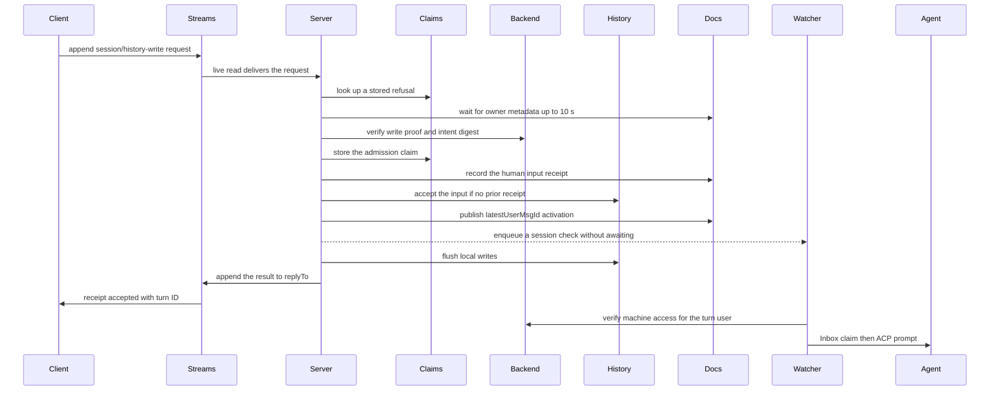
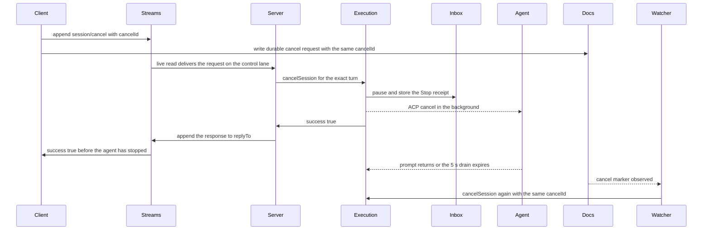
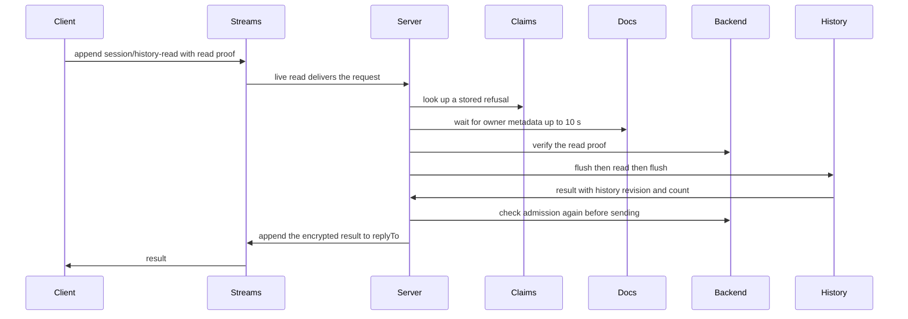
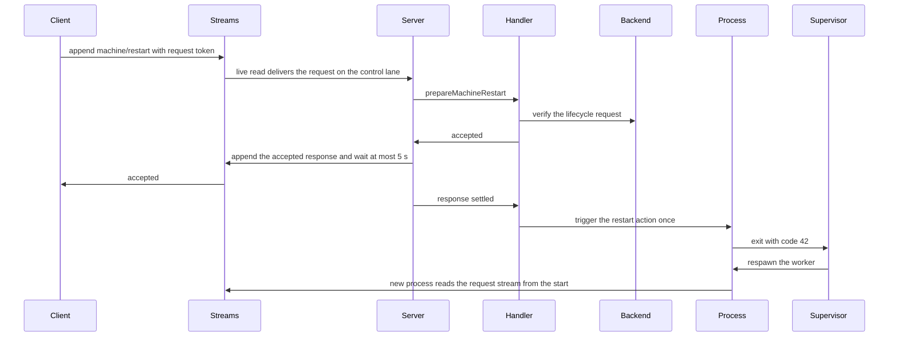

# Method reference

This file inventories every remote procedure call (RPC) method that the Lody
daemon declares or serves over Loro Streams, reconciles what is declared against
what is registered, and traces the lifecycle of the methods that matter most for
a compatible client and daemon. It describes Lody at commit
`61bd9701a5ed6899a9f42787df682acfc3fd7d4b`. Shared rules for the envelope,
scheduling lanes, deadlines and deduplication are in [protocol.md](protocol.md).
Routes for encrypted workspaces are in [encrypted-rpc.md](encrypted-rpc.md).

Lody has three declared method namespaces, not one. **Impl**

- The **Streams set** is the enum `LoroStreamsRpcMethodSchema` with 52 names
  [E-M1](evidence.md#e-m1). The request union `LoroStreamsRpcRequestSchema` has
  one member per name [E-M2](evidence.md#e-m2).
- The **local-machine set** is `LocalMachineRpcRequestSchema` with 51 names
  [E-M3](evidence.md#e-m3). It serves same-machine inter-process communication
  (IPC) and is also the inner data transfer object (DTO) of the encrypted
  feature channel. Sixteen of its names have no Streams counterpart, and
  seventeen Streams names are absent from it.
- The **encrypted allowlist** is not an enum. It is two predicates over the
  local-machine set, `isE2eeFeatureMethod` [E-M4](evidence.md#e-m4) and
  `E2EE_READ_QUERY_METHODS` [E-M5](evidence.md#e-m5), plus one hard-coded
  dispatch method, `session/dispatch-turn` [E-M6](evidence.md#e-m6). The
  effective set has 31 names.

One server class plays two roles. The command-line interface (CLI) daemon
constructs a single `LoroStreamsMachineRpcServer` per workspace handler
[E-M8](evidence.md#e-m8). In an ordinary workspace that instance listens on the
Streams request stream. In a workspace with end-to-end encryption (E2EE) the
same class is never started as a listener; it is kept as an in-process query
server that only the encrypted read route can reach [E-M9](evidence.md#e-m9)
[E-M44](evidence.md#e-m44). **Impl**

## How to read this file

Every significant claim carries a basis tag, either at the end of the sentence
or in a table column named "Basis".

| Tag | Meaning |
| --- | --- |
| **Impl** | The code path was read at the cited lines. |
| **Test** | A test asserts the behaviour; the test title is named. No test was run for this document. |
| **Intent** | Stated only in prose, a specification or a code comment. |
| **Infer** | An inference from code that was read; not directly implemented or asserted as stated. |
| **Unknown** | Not determinable from the checkout. |

_Table 1: Basis tags used in this file._

Evidence links such as [E-M11](evidence.md#e-m11) point into
[evidence.md](evidence.md), which gives the file, line range and what the lines
establish. File names are abbreviated as follows.

| Abbreviation | Path in the Lody repository |
| --- | --- |
| `rpc.ts` | `packages/loro-streams-rpc/src/rpc.ts` |
| `srv` | `packages/loro-streams-rpc/src/machine-rpc-server.ts` |
| `srv.test` | `packages/loro-streams-rpc/tests/machine-rpc-server.test.ts` |
| `mh` | `apps/cli/src/lib/message-handler.ts` |
| `mr` | `apps/cli/src/lib/machine-runtime.ts` |
| `ses` | `apps/cli/src/session/session-execution-service.ts` |
| `watcher` | `apps/cli/src/session/session-dispatch-watcher.ts` |
| `lmr` | `packages/shared/src/local-machine-rpc.ts` |
| `facade` | `packages/components/src/providers/workspace-machine-rpc-facade.ts` |
| `facade.test` | `packages/components/tests/workspace-machine-rpc-facade.test.ts` |
| `cwr` | `packages/components/src/providers/create-workspace-runtime.ts` |
| `roost.test` | `apps/cli/tests/roost-session-backend-contract.test.ts` |
| `watcher.test` | `apps/cli/tests/session-dispatch-watcher.test.ts` |

_Table 2: Abbreviations for source file names._

Request schemas named `Loro…RpcRequestSchema` are defined in `rpc.ts`. Result
schemas are imported from `packages/shared` and applied by the client in
`parseRpcSuccessResult` [E-M80](evidence.md#e-m80); the wire `result` field
itself is untyped. This file names schema symbols and does not reproduce them.

## Reconciliation

### Reconciliation table

One row per wire method across all three sets. Columns:

- **Streams**: declared in `LoroStreamsRpcMethodSchema`
  [E-M1](evidence.md#e-m1).
- **Helper**: public method on `LoroStreamsMachineRpcClient`.
- **Ordinary**: registered for an ordinary workspace over Streams.
- **Encrypted**: reachable in an encrypted workspace. The Streams and Iroh
  listeners build the same receivers over the same callbacks, so one column
  covers both [E-M45](evidence.md#e-m45). "read" is the read-query route,
  "feature" is the journalled feature route, and "dispatch" is the dedicated
  dispatch receiver. See [encrypted-rpc.md](encrypted-rpc.md).
- **Lane**: scheduling lane on the ordinary server; see [scheduling and
  backpressure](protocol.md#scheduling-and-backpressure)
  [E-M26](evidence.md#e-m26) [E-M27](evidence.md#e-m27)
  [E-M29](evidence.md#e-m29).
- **Callers**: non-test callers in the repository. "web/desktop" means
  `packages/components`, which the web application and the Electron renderer
  share; "CLI" means `apps/cli` acting as a caller of another machine; "mobile"
  means the iOS and Android cloud runtime.

All rows are **Impl** for the declaration, registration and lane columns. The
caller column is **Impl** for the call sites found by search and **Infer** for
the claim that no other caller exists.

| Method | Streams | Helper | Ordinary | Encrypted | Lane | Callers |
| --- | --- | --- | --- | --- | --- | --- |
| `machine/status` | yes | `requestMachineStatus` | yes | read | control | web/desktop, CLI |
| `machine/preview-control` | yes | `requestPreviewControl` | yes | no | control | web/desktop, mobile |
| `machine/automation-control` | yes | `requestAutomationControlHandshake` | conditional | no | control | web/desktop |
| `session/automation-control` | yes | `requestSessionAutomationControl` | conditional | no | ordinary | web/desktop |
| `ios-simulator/control` | yes | `requestIosSimulatorControl` | yes | no | ordinary | web/desktop |
| `android-emulator/control` | yes | `requestAndroidEmulatorControl` | yes | no | ordinary | web/desktop |
| `machine/ping` | yes | `requestMachinePing` | yes | read | control | web/desktop |
| `machine/restart` | yes | `requestMachineRestart` | yes | no | control | web/desktop |
| `machine/upgrade` | yes | `requestMachineUpgrade` | yes | no | control | web/desktop |
| `machine/provider-rate-limits-refresh` | yes | `requestMachineProviderRateLimitsRefresh` | yes | no | ordinary | web/desktop, mobile |
| `machine/acp-capabilities-refresh` | yes | `requestMachineAcpCapabilitiesRefresh` | yes | no | ordinary | web/desktop, mobile |
| `machine/acp-capabilities-refresh-cancel` | yes | private only | yes, no reply | no | control | client library only |
| `machine/acp-authenticate` | yes | `requestMachineAcpAuthenticate` | yes | no | ordinary for `start`, control otherwise | web/desktop, mobile |
| `machine/acp-binary-status` | yes | `requestMachineAcpBinaryStatus` | yes | read | ordinary | web/desktop, mobile |
| `machine/acp-binary-install` | yes | `requestMachineAcpBinaryInstall` | yes | no | ordinary | web/desktop, mobile |
| `machine/memory` | yes | `requestMemoryProvider` | yes | no | ordinary | web/desktop, mobile |
| `machine/pi-extensions` | yes | `requestMachinePiExtensions` | yes | no | ordinary | web/desktop, mobile |
| `machine/bug-report` | yes | `requestMachineBugReport` | yes | no | ordinary | web/desktop |
| `code-collab/open-text` | yes | `requestCodeCollabOpenText` | yes | read | ordinary | web/desktop |
| `code-collab/refresh-text` | yes | `requestCodeCollabRefreshText` | yes | read | ordinary | web/desktop |
| `code-collab/save-text` | yes | `requestCodeCollabSaveText` | yes | feature | ordinary | web/desktop |
| `code-collab/open-diff-manifest` | yes | `requestCodeCollabOpenDiffManifest` | yes | feature | ordinary | web/desktop |
| `code-collab/read-blob` | yes | `requestCodeCollabReadBlob` | yes | feature | ordinary | web/desktop |
| `code-collab/open-current-diff` | yes | `requestCodeCollabOpenCurrentDiff` | yes | feature | ordinary | web/desktop, mobile |
| `code-collab/open-all-changes-diff` | yes | `requestCodeCollabOpenAllChangesDiff` | yes | feature | ordinary | web/desktop, mobile |
| `code-collab/open-turn-diff` | yes | `requestCodeCollabOpenTurnDiff` | yes | feature | ordinary | web/desktop, mobile |
| `code-collab/init-directory` | yes | `requestCodeCollabInitDirectory` | yes | feature | ordinary | web/desktop |
| `code-collab/lsp-definition` | yes | `requestCodeCollabLspDefinition` | yes | read | ordinary | web/desktop |
| `code-collab/lsp-references` | yes | `requestCodeCollabLspReferences` | yes | read | ordinary | web/desktop |
| `code-collab/get-file-index` | no | none | no | feature | not applicable | web/desktop over local IPC only |
| `file/preview` | yes | `requestFilePreview` | yes | read | ordinary | web/desktop, mobile |
| `file/download-chunk` | yes | `requestFileDownloadChunk` | yes | read | ordinary | web/desktop |
| `file/list-dir` | yes | `requestSessionDirectoryList` | yes | no | ordinary | mobile |
| `file/resolve-local` | no | none | no | no | not applicable | local IPC only |
| `session/cancel` | yes | `requestSessionCancel` | yes | no | control | web/desktop, CLI, mobile |
| `session/live-status` | yes | `requestSessionLiveStatus` | yes | read | control | CLI |
| `session/withdraw-input` | yes | `requestSessionWithdrawInput` | yes | no | control | CLI |
| `session/steer` | yes | `requestSessionSteer` | yes | no | control | web/desktop, CLI, mobile |
| `session/goal` | yes | `requestSessionGoal` | yes | no | control | web/desktop |
| `session/terminate` | yes | `requestSessionTerminate` | yes | no | control | web/desktop |
| `session/fork` | yes | `requestSessionFork` | yes | feature | ordinary | web/desktop, mobile |
| `session/edit-and-resend` | yes | `requestSessionEditAndResend` | yes | feature | ordinary | web/desktop, mobile |
| `session/dispatch-turn` | yes | `requestSessionDispatchTurn` | yes | dispatch | control | web/desktop, CLI, mobile |
| `session/prepare` | yes | none | yes, retired | no | control | none |
| `session/prepare-cancel` | yes | none | yes, retired | no | control | none |
| `session/history-read` | yes | `requestSessionHistoryRead` | yes | read | ordinary | web/desktop, CLI, mobile |
| `session/history-watch` | yes | via `requestSessionHistoryRead` | yes | carried as `session/history-read` | watch | web/desktop, mobile |
| `session/history-write` | yes | `requestSessionHistoryWrite` | yes | no | history write | web/desktop, CLI, mobile |
| `session/preview-create` | yes | `requestSessionPreviewCreate` | yes | feature | ordinary | web/desktop, mobile |
| `session/preview-revoke` | yes | `requestSessionPreviewRevoke` | yes | feature | ordinary | web/desktop, mobile |
| `session/preview-status` | yes | `requestSessionPreviewStatus` | yes | feature | ordinary | web/desktop |
| `session/preview-endpoint-acquire`, `session/preview-endpoint-release` | no | none | no | no | not applicable | web/desktop over local IPC only |
| `project/probe-local-member` | yes | `requestProjectProbeLocalMember` | yes | no | ordinary | web/desktop |
| `local-project/git-state` | yes | `requestLocalProjectGitState` | yes | no | ordinary | web/desktop, CLI, mobile |
| `local-project/control` | yes | `requestLocalProjectControl` | yes | no | ordinary | web/desktop, mobile |
| `machine/acp-interaction` | no | none | no | feature | not applicable | web/desktop |
| `sorbet/credentials-list`, `sorbet/credentials-logout` | no | none | no | feature | not applicable | web/desktop |
| `sorbet/providers-list`, `sorbet/providers-create`, `sorbet/providers-delete` | no | none | no | feature | not applicable | web/desktop |
| `ios-simulator/agent-control`, `android-emulator/agent-control`, `mcp/list-tools`, `mcp/authentication`, `session/call-tool`, `session/get-active-invocation-context` | no | none | no | no | not applicable | local IPC only |

_Table 3: Every method, reconciled across declaration, helper, registration,
lane, and callers._

Notes on the table:

- `machine/acp-authenticate` is scheduled on the control lane when
  `params.action` is `cancel`, `submit-code` or `submit-input`, and on the
  ordinary lane for `start` [E-M28](evidence.md#e-m28). **Impl**
- `session/history-watch` has no helper of its own. `requestSessionHistoryRead`
  selects it when the query kind is `watchChanges` [E-M78](evidence.md#e-m78).
  In an encrypted workspace the wire name is `session/history-read` and the
  server rewrites it internally [E-M89](evidence.md#e-m89). **Impl**
- "conditional" means the handler is wired only when the daemon is configured
  with remote automation [E-M24](evidence.md#e-m24). **Impl**
- There is no Iroh route for ordinary workspaces. **Impl**, on the basis that
  only the encrypted workspace wiring builds the Iroh listener
  [E-M45](evidence.md#e-m45).

### Gaps in each direction

**Declared in the Streams schema but not registered, or retired.**

- No Streams method lacks a `case` in the server dispatch switch; the switch
  covers all 52 names and has no `default` branch, because the schema parse
  already excludes other names [E-M11](evidence.md#e-m11). **Impl**
- `machine/automation-control` and `session/automation-control` are registered
  only when remote automation is configured [E-M24](evidence.md#e-m24). **Impl**
- `file/list-dir` is omitted from the server instance that serves an encrypted
  workspace [E-M25](evidence.md#e-m25). That instance is reachable only through
  read queries, which do not include `file/list-dir`, so the omission has no
  remote effect. **Infer**
- `session/prepare` and `session/prepare-cancel` are retired. The handlers
  answer fixed results without doing work [E-M48](evidence.md#e-m48), no public
  client helper exists [E-M49](evidence.md#e-m49), and no sender was found in
  the repository. **Impl** for the handler; **Intent** for the retirement
  rationale [E-L88](evidence.md#e-l88).
- For encrypted workspaces, 28 of the 52 Streams names have no route: the 27
  marked "no" in the Encrypted column, and `session/history-watch` as a wire
  name. A protected client refuses them before using any transport, by throwing
  `e2ee_rpc_unavailable` [E-M41](evidence.md#e-m41); the facade refuses history
  writes with `e2ee_history_write_unavailable` [E-M82](evidence.md#e-m82).
  **Impl**

**Registered without a Streams schema.** These are reachable remotely only over
the encrypted channel, and their schemas live in `lmr`:
`machine/acp-interaction` [E-M75](evidence.md#e-m75), the five `sorbet/*`
methods [E-M73](evidence.md#e-m73), and `code-collab/get-file-index`, which the
`code-collab/` prefix of the feature predicate admits [E-M4](evidence.md#e-m4).
**Impl**

**Client helper without a caller.** Every public helper has at least one caller
in the repository. Three have no caller in `packages/components`:
`requestSessionLiveStatus` is called only by the CLI [E-M83](evidence.md#e-m83),
`requestSessionWithdrawInput` only by the CLI Model Context Protocol (MCP)
server [E-M84](evidence.md#e-m84), and `requestSessionDirectoryList` only by the
mobile runtime [E-M85](evidence.md#e-m85). **Impl** for the call sites;
**Infer** for the absence of others.

**Handler without a caller.** `session/prepare` and `session/prepare-cancel`
have handlers and no sender. `code-collab/get-file-index` is routable over the
encrypted channel, but its only caller uses local IPC and refuses non-local
machines [E-M47](evidence.md#e-m47). **Infer**

**Declared method without a public helper.** The preparation pair, and
`machine/acp-capabilities-refresh-cancel`, which a private helper appends
without waiting [E-M50](evidence.md#e-m50). **Impl**

### Answers for unknown and unregistered methods

An **unknown method name** on the ordinary Streams server receives no reply. The
request fails the discriminated-union parse, the server logs `ignored invalid
RPC request` and returns [E-M11](evidence.md#e-m11). The caller observes only
its own timeout. No Lody test asserting this was found; a probe against the
real server confirmed it ([conformance](conformance.md#executed-probes),
P-6). **Impl**, **Probe**

Other requests that never reach a handler are also silent: a request for another
machine or workspace, and a request whose `expiresAt` has passed
[E-M12](evidence.md#e-m12). A request with the wrong `rpcVersion` is answered
with the error `rpc_version_mismatch` [E-M12](evidence.md#e-m12). **Impl**;
**Test** "returns rpc_version_mismatch when request version is unsupported"
[E-M91](evidence.md#e-m91).

A **declared method whose handler dependency is absent** is answered in one of
five ways, depending on the method. The server takes its handlers as optional
dependencies, so these variants exist for embedders and tests that omit them.

| Variant | Methods | Basis |
| --- | --- | --- |
| Error `method_unavailable` [E-M13](evidence.md#e-m13) | `machine/preview-control`, `machine/ping`, `machine/restart`, `machine/upgrade`, `machine/acp-authenticate`, `machine/acp-binary-status`, `machine/acp-binary-install`, `machine/pi-extensions`, `machine/bug-report`, every `session/*` control method including `session/prepare` and `session/prepare-cancel`, `session/fork`, `session/edit-and-resend`, the three history methods and the eleven `code-collab/*` methods (after envelope decryption and the owner check), the three `session/preview-*` methods, `project/probe-local-member`, `local-project/git-state`, `local-project/control` | **Impl** [E-M14](evidence.md#e-m14) [E-M23](evidence.md#e-m23) |
| Thrown error, answered as `internal_error` | `machine/automation-control`, `session/automation-control`, `machine/provider-rate-limits-refresh`, `ios-simulator/control`, `android-emulator/control` | **Impl** [E-M15](evidence.md#e-m15) [E-M16](evidence.md#e-m16) [E-M20](evidence.md#e-m20) [E-M22](evidence.md#e-m22) |
| In-band result, no RPC error | `machine/memory` (status `error`, "Memory providers are unavailable"); `file/download-chunk` and `file/list-dir` (`unsupported_protocol`); `file/preview` (`transient_io`) | **Impl** [E-M17](evidence.md#e-m17) [E-M18](evidence.md#e-m18) [E-M19](evidence.md#e-m19) |
| Cannot be absent (required dependency) | `machine/status`, `machine/acp-capabilities-refresh` | **Impl** |
| No reply by design | `machine/acp-capabilities-refresh-cancel` | **Impl** [E-M21](evidence.md#e-m21) |

_Table 4: Answers given for unknown and unregistered methods._

With the CLI's actual wiring, every optional handler is supplied except the two
automation handlers and, in the encrypted server instance, the directory listing
handler [E-M24](evidence.md#e-m24) [E-M25](evidence.md#e-m25). Consequently, on
a daemon built from this commit:

- `method_unavailable` and the in-band variants are not reachable through normal
  wiring (the `file/list-dir` variant is not reachable remotely). **Infer**
- `internal_error` is reachable for the two automation methods when remote
  automation is not configured. **Infer**
- the no-reply behaviour of `machine/acp-capabilities-refresh-cancel` always
  applies. **Impl**

On the encrypted channel a disallowed or unknown method produces no reply frame:
the receiver fails with `e2ee_feature_method` and the failure is only logged
[E-M46](evidence.md#e-m46); the dispatch receiver rejects any method other than
`session/dispatch-turn` with `e2ee_rpc_method` [E-M6](evidence.md#e-m6).
**Impl**

## Shared rules

This section summarizes rules that apply to every method. The authoritative
statements are in [protocol.md](protocol.md).

### Registration conditions

- **Workspace mode.** The server is constructed only when the daemon has a
  Streams token port or the workspace is encrypted [E-M7](evidence.md#e-m7).
  Without either, no method is registered and the daemon logs "Streams RPC
  disabled" [E-M9](evidence.md#e-m9). **Impl**
- **Ordinary workspace.** The instance is started as a Streams listener from
  `activateRemoteServices`, so methods are live only after the remote bridge is
  attached [E-M10](evidence.md#e-m10). See [transport](protocol.md#transport).
  **Impl**
- **Encrypted workspace.** The instance has no stream client and is never
  started. The encrypted read route calls it in-process and refuses any method
  outside the read list [E-M44](evidence.md#e-m44). Other encrypted methods are
  routed by `handleEncryptedFeatureRpc` to dedicated handlers or to the
  local-machine dispatcher [E-M42](evidence.md#e-m42)
  [E-M95](evidence.md#e-m95). Local dispatch in an encrypted workspace refuses
  `session/dispatch-turn` and the iOS simulator methods
  [E-M43](evidence.md#e-m43). **Impl**
- **Target binding.** A request is processed only if its `machineId` and
  `workspaceId` equal the server's [E-M12](evidence.md#e-m12). **Impl**
- **Version.** `rpcVersion` must equal `1`; there is no per-connection
  negotiation [E-M12](evidence.md#e-m12) [E-M40](evidence.md#e-m40). **Impl**

### Capability gating

The daemon publishes a map of capability keys to integer versions in the machine
document metadata field `protocolCapabilities` [E-M37](evidence.md#e-m37)
[E-M38](evidence.md#e-m38). Clients read it from there and treat a missing map
or key as unsupported [E-M39](evidence.md#e-m39). The server never consults
capabilities. It parses requests strictly, so a client that sends an optional
field to a daemon that does not know it has its request dropped without a reply
[E-M11](evidence.md#e-m11). Capability checks are therefore client-side only.
**Impl**

| Capability key (version) | Gates | Advertised | Checked |
| --- | --- | --- | --- |
| `sessionHistory` (4) | `session/history-read`, `-watch`, `-write` | base map [E-M37](evidence.md#e-m37) | `facade` [E-M53](evidence.md#e-m53) |
| `sessionHistoryIncremental` (1), `sessionHistoryWatch` (1), `sessionHistoryInspection` (2), `sessionHistoryPatches` (1) | history query variants; `session/history-watch` needs watch and incremental | base map | `cwr` [E-M54](evidence.md#e-m54); helpers [E-M87](evidence.md#e-m87) |
| `sessionInputDispatch` (1) | `session/dispatch-turn` for Roost-backed sends | base map | helpers [E-M87](evidence.md#e-m87) |
| `sessionInputAcceptance` (1) | `accept_input` and `accept_input_and_dispatch` on `session/history-write` | base map | helpers [E-M87](evidence.md#e-m87) |
| `operationInbox` (advertised as 2) | `inputOrigin` on `session/dispatch-turn` (any version); `cancelId` and `pauseInbox` on `session/cancel` (version 2) | base map | `facade` [E-M52](evidence.md#e-m52) |
| `subagentCancellation` (1) | `subagentTaskId` on `session/cancel` | base map | `facade` [E-M51](evidence.md#e-m51) |
| `sessionInputWithdraw` (1) | `session/withdraw-input` | base map | caller-side check not located (**Unknown**) |
| `sessionLiveActivity` (1) | `includeActivity` on `session/live-status` | base map | not located in `packages/components` (**Unknown**) |
| `machineDiskStatus` (1) | `includeDisk` on `machine/status` | base map | not located (**Unknown**) |
| `managedDaemonUpdates` (1) | `includeDaemonUpdate` on `machine/status`; `machine/upgrade` | base map | settings user interface |
| `machineIdentityRestore` (1) | `restoreMachineId` on `machine/restart` | base map | settings user interface |
| `previewControl` (1) | `machine/preview-control` and proof-carrying preview methods | base map | `facade` |
| `iosSimulator` (1), `androidEmulator` (1) | `ios-simulator/control`, `android-emulator/control` | base map | `facade` |
| `remoteAutomationControl` (1) | `machine/automation-control`, `session/automation-control` | only when remote automation is configured [E-M38](evidence.md#e-m38) | `facade` |
| `fileDownload` (1), `localAttachmentDownload` (1) | `file/download-chunk` and its `attachment` field | base map | `facade` |
| `sessionDirectoryListing` (1) | `file/list-dir` | base map | mobile runtime [E-M85](evidence.md#e-m85) |
| `markdownFileLinks` (1) | link resolution on `file/preview` | base map | `facade` |
| `codeCollabDiffBlobs` (1), `codeCollabAllChangesScope` (1) | `code-collab/open-diff-manifest`, `read-blob`; `scope` on `open-all-changes-diff` | base map | `facade` |
| `acpProtocolAuthentication` (2), `acpAuthenticationInteractions` (2), `acpAuthenticationMethodSelection` (1) | `machine/acp-authenticate` and its `methodId` field | base map | user interface and helpers |
| `acpCapabilityRefreshCache` (1), `acpModelOptionsRead` (1) | `force`, `readModelOptions` on `machine/acp-capabilities-refresh` | base map | `cwr` |
| `providerRateLimitsRefresh` (1) | `machine/provider-rate-limits-refresh` | base map | `cwr` |
| `piExtensions` (1) | `machine/pi-extensions` | host-dependent | `facade` |
| `memoryProviders` (1) | `machine/memory` | base map | `facade` |
| `bugReportClientLog` (1) | `clientLog` on `machine/bug-report` | base map | `facade` |
| `e2eeAcpInteraction` (1), `e2eeSessionFork` (1), `e2eeSessionEditAndResend` (1) | encrypted `machine/acp-interaction`, `session/fork`, `session/edit-and-resend` | encrypted workspaces only [E-M38](evidence.md#e-m38) | `facade`, `cwr` |
| `sorbetCredentials`, `sorbetProviders` (1); `sorbetCredentialsRemote`, `sorbetProvidersRemote` (1) | `sorbet/*` over local IPC; over the encrypted channel | handler present; remote keys also need encryption [E-M38](evidence.md#e-m38) | `facade` |
| machine metadata `supportsLocalProjectHistoryRpc` (boolean) | history sub-types of `local-project/control` | when the Streams server exists | project history client |

_Table 5: Capability keys, the methods each gates, and where each is advertised
and checked._

Rows without an evidence link in the "Checked" column rest on the investigation
notes and were not re-read for this file; treat the check location as **Infer**.

### Authorization model

See [authority](protocol.md#authority) for the full statement. In summary:

- The server itself checks only the target (`machineId`, `workspaceId`), the
  expiry and the version [E-M12](evidence.md#e-m12). The request envelope has no
  authenticated sender [E-M32](evidence.md#e-m32). **Impl**
- Identities in parameters (`userId`, `requesterUserId`, `requestedByUserId`,
  `reporterUserId`) are caller-supplied strings. The package guidance states
  that workspace RPC cannot authenticate a claimed requester identity
  [E-M86](evidence.md#e-m86). **Intent** Whether the Streams gateway binds an
  identity to an appended request is **Unknown**.
- Where a handler does check access, it uses one primitive.
  `verifyMachineAccess` allows the daemon owner directly and otherwise asks the
  backend; the outcome is `allowed`, `denied` or `indeterminate`
  [E-M35](evidence.md#e-m35). `verifySessionMachineAccess` adds the session's
  local project [E-M36](evidence.md#e-m36). **Impl**
- Owner-scoped methods wrap parameters and results in an owner-session content
  envelope [E-M33](evidence.md#e-m33). The server compares the envelope's owner
  session with the resolved owner and answers `permission_denied` on mismatch;
  the check is skipped when no resolver is injected [E-M34](evidence.md#e-m34).
  **Impl**; **Test** "rejects Code Collab requests when the envelope owner does
  not match the business session owner" [E-M93](evidence.md#e-m93). The envelope
  binds a request to an owner session. It is not a caller credential. **Infer**
- Proof-carrying methods (history, previews, device control, lifecycle, bug
  report) forward a caller-supplied token to a backend or to a local authority.
  What the backend enforces is **Unknown**.

Methods with no identity check visible in the server, the wiring or the
first-level handler: `machine/status`, `machine/ping`,
`machine/preview-control`, `session/live-status`, `session/cancel`,
`session/terminate`, `session/prepare`, `session/prepare-cancel`,
`session/dispatch-turn` (at receipt; access is checked later, at dispatch),
`machine/acp-capabilities-refresh` and its cancel, `machine/acp-authenticate`,
`machine/acp-binary-status`, `machine/acp-binary-install`,
`machine/provider-rate-limits-refresh`, `machine/memory`,
`machine/pi-extensions`, and the `code-collab/*` and `file/*` methods beyond the
owner-session binding. "None visible" is **Impl** for the code that was read and
is not proof that no deeper check exists.

### Default timeouts

The client's `timeoutMs` is used twice: as the caller's inactivity deadline,
re-armed by progress envelopes, and as the wire window `expiresAt - sentAt`
[E-M40](evidence.md#e-m40). The daemon is not told when a caller gives up. See
[deadlines and cancellation](protocol.md#deadlines-and-cancellation). All values
are library defaults in `rpc.ts`. **Impl**

| Method | Default (ms) | Note |
| --- | --- | --- |
| `machine/status`, `machine/ping`, `machine/restart` | 30 000 | |
| `machine/upgrade` | 30 000; 720 000 with `upgrade` options | [E-M76](evidence.md#e-m76) |
| `machine/preview-control`, `machine/automation-control` | 15 000 | |
| `session/automation-control` | 30 000 | |
| `machine/provider-rate-limits-refresh` | 60 000 | fixed, not overridable |
| `machine/acp-capabilities-refresh` | 120 000 | web/desktop passes a larger backstop |
| `machine/acp-capabilities-refresh-cancel` | window 30 000 | the client does not wait [E-M50](evidence.md#e-m50) |
| `machine/acp-authenticate`, `machine/acp-binary-install` | 300 000 | inactivity; progress re-arms it |
| `machine/acp-binary-status` | 30 000 | |
| `machine/memory` | 60 000 | fixed |
| `machine/pi-extensions` | none | caller must pass one; web/desktop passes 180 000 |
| `machine/bug-report` | 120 000 | |
| `session/cancel` | 2 000 | [E-M77](evidence.md#e-m77); web/desktop passes 30 000 for a subagent cancel |
| `session/steer` | 5 000 | [E-M77](evidence.md#e-m77) |
| `session/live-status`, `session/withdraw-input`, `session/goal` | 10 000 | |
| `session/dispatch-turn` | 15 000 | [E-M77](evidence.md#e-m77); kept short to bound replay [E-L23](evidence.md#e-l23) |
| `session/terminate` | 30 000 | |
| `session/fork`, `session/edit-and-resend` | 120 000 | web/desktop passes 15 000 for a fork to a new worktree |
| `session/history-read` | 30 000 | [E-M78](evidence.md#e-m78) |
| `session/history-watch` | 45 000 | [E-M78](evidence.md#e-m78); the web facade passes 30 000 |
| `session/history-write` | 30 000 | [E-M79](evidence.md#e-m79) |
| `code-collab/*` (eleven) | 30 000 each | |
| `file/preview`, `file/download-chunk`, `file/list-dir` | 30 000 | download is fixed |
| `session/preview-create` | 480 000 | `DEFAULT_PREVIEW_CREATE_TIMEOUT_MS` |
| `session/preview-status` | 15 000 | |
| `session/preview-revoke` | 30 000 | |
| `ios-simulator/control`, `android-emulator/control` | 15 000 | |
| `project/probe-local-member`, `local-project/git-state` | 30 000 | |
| `local-project/control` | 120 000 | |

_Table 6: Default timeouts by method._

## Method families

### Defaults for every entry

The family tables state only what differs from these defaults. **Impl** unless
tagged.

- **Request ID.** A fresh universally unique identifier (UUID) per call. Only
  `session/history-write` lets the caller choose it [E-M79](evidence.md#e-m79).
- **Cancellation.** None. A handler that has started runs to completion and its
  response is appended even after `expiresAt`. Only history methods re-check
  expiry after starting, and only `machine/acp-capabilities-refresh` has a
  cancel request [E-M63](evidence.md#e-m63).
- **Duplicates.** The server has no deduplication for non-history methods. Each
  delivery of the same unexpired request runs the handler and appends a response
  [E-M31](evidence.md#e-m31). Idempotency, where it exists, is the handler's.
  See [duplicates and deduplication](protocol.md#duplicates-and-deduplication).
- **Retry.** The client library never re-appends a request. A caller-level retry
  is a new request with a new ID.
- **Persistence and restart.** The server keeps no record of handled requests.
  Its read offset starts at `-1` in process memory [E-L1](evidence.md#e-l1), and
  the package documentation states that the request stream can replay unexpired
  requests after a server restart [E-L66](evidence.md#e-l66). A replayed request
  therefore runs its handler again. **Infer** for the replay itself; **Intent**
  for the documentation.
- **Lane and timeout.** As in the reconciliation and default-timeout tables.
- **Schemas.** Each outer request schema (`Loro…RpcRequestSchema`) named in
  the family tables is a member of the request union
  [E-M2](evidence.md#e-m2), which does not cover inner payload schemas. Each
  result schema is the one the client applies to that method after the
  envelope [E-M80](evidence.md#e-m80). The server parses the inner payload
  schemas after decrypting the owner envelope: for the Code Collab and file
  methods [E-M96](evidence.md#e-m96), for the history methods
  [E-M98](evidence.md#e-m98), and for `session/automation-control`
  [E-M15](evidence.md#e-m15). The encrypted-only schemas are cited in their
  own table.
- **Response loss.** A response append is attempted up to three times and is not
  retained for later delivery [E-L2](evidence.md#e-l2). A side effect can
  therefore stand without the caller seeing the response. **Infer**

In the tables, "handler" gives the server dependency name and the implementation
it is wired to in `mh`.

### Machine status, ping and lifecycle

| Method | Request schema | Result schema | Handler | Authorization | Result means |
| --- | --- | --- | --- | --- | --- |
| `machine/status` | `LoroMachineStatusRpcRequestSchema` | `MachineStatusResponseSchema` | `getMachineStatus` → `readMachineStatus` → `ses` [E-L39](evidence.md#e-l39) [E-L40](evidence.md#e-l40) | none visible | A snapshot of resources, optional disk data, the lifecycle capability and, in ordinary workspaces, managed-update state |
| `machine/ping` | `LoroMachinePingRpcRequestSchema` | `MachinePingResponseSchema` | `pingMachine` → `ses` [E-L38](evidence.md#e-l38) | none | The request loop read the request, a control slot ran and the response append succeeded |
| `machine/restart` | `LoroMachineRestartRpcRequestSchema` | `MachineRestartResponseSchema` | `restartMachine` → `prepareMachineRestart` [E-L74](evidence.md#e-l74) | capability, then backend verification of `requesterUserId` and `requestToken` [E-L76](evidence.md#e-l76) | `accepted` records intent to exit after the acknowledgement attempt; it does not prove a restart |
| `machine/upgrade` | `LoroMachineUpgradeRpcRequestSchema` | `MachineUpgradeResponseSchema` | `upgradeMachine` → `prepareMachineUpgrade` [E-L75](evidence.md#e-l75) | machine owner only, capability, backend verification [E-L76](evidence.md#e-l76) | `accepted` records a persisted managed operation and intent to switch; it does not prove an upgrade |
| `machine/bug-report` | `LoroMachineBugReportRpcRequestSchema` | `MachineBugReportResponseSchema` | `submitBugReport` → cloud bug report port [E-M65](evidence.md#e-m65) | `reporterUserId` and `requestToken` forwarded to the cloud port; verification there is **Unknown** | The report was submitted, or `success: false` |

_Table 7: Machine status, ping, and lifecycle methods._

Details and exceptions:

- `machine/ping` answers `success: true` with message `pong`
  [E-L38](evidence.md#e-l38). **Impl**; **Test** "handles machine ping RPC
  requests and appends pong" [E-L89](evidence.md#e-l89). The web/desktop latency
  check treats any other answer as a failure. **Impl**
- `machine/status` omits managed-update state in an encrypted workspace
  [E-L40](evidence.md#e-l40). A failure to collect resources yields `success:
  false` with the lifecycle capability still present [E-L39](evidence.md#e-l39).
  **Impl**; **Test** "handles machine status RPC requests and appends a success
  response" (`srv.test:1620`).
- `machine/restart` and `machine/upgrade` are always wired. The handler answers
  `unsupported_launch_mode` unless the daemon runs in daemon launch mode in an
  unencrypted workspace; upgrade also needs a managed install and a platform
  other than Windows [E-M66](evidence.md#e-m66). **Impl**
- `machine/bug-report` answers `success: false` with "Bug reporting is
  unavailable on this platform." when the cloud port is absent
  [E-M65](evidence.md#e-m65). **Impl**; **Test** "forwards the reporter client
  log of a bug report to the daemon" (`srv.test:1034`).

### ACP management

These methods manage Agent Client Protocol (ACP) binaries, capabilities and
authentication. They do not carry ACP session traffic. **Impl**

| Method | Request schema | Result schema (progress) | Handler | Authorization | Exceptions to the defaults |
| --- | --- | --- | --- | --- | --- |
| `machine/acp-capabilities-refresh` | `LoroMachineAcpCapabilitiesRefreshRpcRequestSchema` | `MachineAcpCapabilitiesRefreshResponseSchema` (`MachineAcpBinaryProgressMessageSchema`) | `refreshMachineAcpCapabilities` → `ses` | none visible | Abortable by request ID; an abort observed before a progress or final append starts suppresses that append, but an append already started may still be stored [E-M63](evidence.md#e-m63) |
| `machine/acp-capabilities-refresh-cancel` | `LoroMachineAcpCapabilitiesRefreshCancelRpcRequestSchema` | none | server-internal controller map | none | Never answered [E-M21](evidence.md#e-m21); `params.requestId` is the RPC `id` of the refresh |
| `machine/acp-authenticate` | `LoroMachineAcpAuthenticateRpcRequestSchema` | `MachineAcpAuthenticateResponseSchema` (`MachineAcpAuthenticationProgressMessageSchema`) | `authenticateMachineAcp` → `ses` | none visible beyond the secret envelope | Secret recipient is held in memory only [E-M64](evidence.md#e-m64) |
| `machine/acp-binary-status` | `LoroMachineAcpBinaryStatusRpcRequestSchema` | `MachineAcpBinaryStatusResponseSchema` | `getMachineAcpBinaryStatus` → `ses` | none visible | Encrypted read query |
| `machine/acp-binary-install` | `LoroMachineAcpBinaryInstallRpcRequestSchema` | `MachineAcpBinaryInstallResponseSchema` (`MachineAcpBinaryProgressMessageSchema`) | `installMachineAcpBinary` → `ses` | none visible | Progress envelopes precede the final result |
| `machine/provider-rate-limits-refresh` | `LoroMachineProviderRateLimitsRefreshRpcRequestSchema` | `MachineProviderRateLimitsRefreshResponseSchema` | `refreshMachineProviderRateLimits` → `ses` | none visible | none |
| `machine/pi-extensions` | `LoroMachinePiExtensionsRpcRequestSchema` | `MachinePiExtensionsResponseSchema` | `listMachinePiExtensions` → `ses` | none visible | Capability advertised only on a supported host |
| `machine/memory` | `LoroMemoryProviderRpcRequestSchema` | `MemoryProviderResponseSchema` | `memoryProvider` → `handleMemoryProviderRequest` | none visible | none |

_Table 8: Agent Client Protocol (ACP) management methods._

Details and exceptions:

- **Progress.** Progress messages are ordinary result envelopes with the
  request's `id` and `method`; the result `type` distinguishes them from the
  final result. See [request lifecycle and
  acknowledgements](protocol.md#request-lifecycle-and-acknowledgements).
  **Impl**; **Test** "appends ACP binary progress before the final refresh
  response" (`srv.test:3324`).
- **Refresh cancellation.** The client appends the cancel request on abort, on
  its own timeout and when the client stops, without waiting for an answer
  [E-M50](evidence.md#e-m50). The server aborts the controller stored under the
  original request ID [E-M21](evidence.md#e-m21). **Impl**; **Test** "aborts
  capability work and suppresses progress after an exact cancel request"
  [E-M94](evidence.md#e-m94). No test asserting the absence of a reply to the
  cancel itself was found.
- **Authentication secrets.** At `start` the server creates a secret recipient
  and publishes its public key in progress messages. `submit-code` and
  `submit-input` carry envelopes that only that recipient can open
  [E-M64](evidence.md#e-m64). The recipient map is in memory, so a submit after
  a daemon restart fails with a thrown error that the caller sees as
  `internal_error`. **Impl**; **Test** "decrypts auth code input on the target
  machine without waiting for the active login" (`srv.test:1272`).
- **Encrypted workspaces.** Refresh and authentication are carried by
  `machine/acp-interaction` instead; see [Encrypted-only
  methods](#encrypted-only-methods).
- **Unknowns.** How each handler behaves when the same request is replayed after
  restart was not traced. **Unknown**

### Session control

| Method | Request schema | Result schema | Handler | Authorization | Result means |
| --- | --- | --- | --- | --- | --- |
| `session/dispatch-turn` | `LoroSessionDispatchTurnRpcRequestSchema` | `SessionDispatchTurnResponseSchema` | `dispatchSessionTurn` → `watcher.offerRpcTurn` [E-L4](evidence.md#e-l4) [E-L5](evidence.md#e-l5) | none at receipt; machine access at dispatch [E-L11](evidence.md#e-l11) | Delivered to this daemon process; not authorized, not executed |
| `session/cancel` | `LoroSessionCancelRpcRequestSchema` | `SessionCancelResponseSchema` | `cancelSession` → `ses.cancelSession` [E-M55](evidence.md#e-m55) | none; the request has no user identity [E-L24](evidence.md#e-l24) | The stop was applied to daemon state for that exact turn, or the turn was not current |
| `session/steer` | `LoroSessionSteerRpcRequestSchema` | `SessionSteerResponseSchema` | `steerSession` → `steerSessionWithAccessCheck` [E-M57](evidence.md#e-m57) | `verifySessionMachineAccess(sessionId, userId)` at receipt | A synchronous verdict in `disposition` |
| `session/goal` | `LoroSessionGoalRpcRequestSchema` | `SessionGoalResponseSchema` | `controlSessionGoal` → `controlSessionGoalWithAccessCheck` [E-M57](evidence.md#e-m57) | `verifySessionMachineAccess(sessionId, userId)` | The goal action was applied or refused |
| `session/terminate` | `LoroSessionTerminateRpcRequestSchema` | `SessionTerminateResponseSchema` | `terminateSession` → `terminateAcpSession` [E-M56](evidence.md#e-m56) | none; the request carries only `sessionId` [E-L24](evidence.md#e-l24) | The ACP session runtime was terminated or was not found; both are `success: true` |
| `session/withdraw-input` | `LoroSessionWithdrawInputRpcRequestSchema` | `SessionWithdrawInputResponseSchema` | `withdrawSessionInput` → `withdrawQueuedInput` [E-M59](evidence.md#e-m59) [E-M58](evidence.md#e-m58) | `verifySessionMachineAccess(sessionId, userId)`, then author check | Best-effort withdrawal of a queued agent-authored input |
| `session/live-status` | `LoroSessionLiveStatusRpcRequestSchema` | `SessionLiveStatusResponseSchema` | `getSessionLiveStatus` → `readSessionLiveStatus` [E-M60](evidence.md#e-m60) | none visible | The daemon's in-process view of the session at `observedAtMs` |
| `session/fork` | `LoroSessionForkRpcRequestSchema` | `SessionForkResponseSchema` | `forkSession` → `forkSessionWithAccessCheck` [E-M61](evidence.md#e-m61) | `verifySessionMachineAccess(sourceSessionId, requestedByUserId)`; denial is the in-band code `MACHINE_ACCESS_DENIED` | The fork completed, needs confirmation, or failed with an in-band error code |
| `session/edit-and-resend` | `LoroSessionEditAndResendRpcRequestSchema` | `SessionEditAndResendResponseSchema` | `editAndResendSession` → `editAndResendSessionWithAccessCheck` [E-M61](evidence.md#e-m61) | `verifySessionMachineAccess(sessionId, requestedByUserId)` | The turn was replaced and re-dispatched, or an in-band error |
| `session/prepare`, `session/prepare-cancel` | `LoroSessionPrepareRpcRequestSchema`, `LoroSessionPrepareCancelRpcRequestSchema` | `SessionPrepareResponseSchema`, `SessionPrepareCancelResponseSchema` | `declineSessionPreparation`, `declineSessionPreparationCancel` [E-M48](evidence.md#e-m48) | none | Nothing; fixed answers |

_Table 9: Session control methods._

Details and exceptions (dispatch-turn, cancel, steer, terminate and the
preparation pair are traced under [Detailed lifecycles](#detailed-lifecycles)):

- **`session/goal`.** Access failure is reported in-band. Goal turns are
  committed with the requester's resolved identity [E-M57](evidence.md#e-m57).
  Not registered for encrypted workspaces. Behaviour under duplicate delivery
  was not traced. **Impl** for the access check; **Unknown** for duplicates.
- **`session/withdraw-input`.** The turn's author must be an agent whose session
  equals `requesterSessionId`, otherwise the outcome is `not_owner`. A repeat
  returns `already_withdrawn`, and an input that has started returns
  `already_started` [E-M58](evidence.md#e-m58). The outcome set is `withdrawn`,
  `already_withdrawn`, `already_started`, `not_found`, `not_owner`, `error`. A
  dispatch already under way may still run the input. The withdrawal is written
  through the session history backend, so it persists. **Impl** No server-level
  test was found.
- **`session/live-status`.** Combines the active-presence controller, the
  execution snapshot and pending-dispatch state [E-M60](evidence.md#e-m60). The
  package guidance says it must not infer liveness from durable session status
  [E-L41](evidence.md#e-l41). **Impl**, **Intent**; **Test** "dispatches live
  session status requests" (`srv.test:1689`). It reads in-process state only, so
  nothing persists and a restart resets what it reports. **Infer**
- **`session/fork`.** In an encrypted workspace the route is the journalled
  feature channel: the requester must equal the verified signer, and an unshared
  machine is refused explicitly with `e2ee_machine_not_shared`
  [E-M42](evidence.md#e-m42) [E-M62](evidence.md#e-m62). A fork operation store
  with startup recovery exists, but its replay semantics were not traced.
  **Impl** for the checks; **Unknown** for recovery. **Test** "forwards
  side-panel placement when dispatching a session fork" (`srv.test:1212`);
  "forks an encrypted session through the protected feature channel, never
  ordinary RPC" (`facade.test:1388`).
- **`session/fork` retry.** The web/desktop caller retries a worktree fork once,
  with the same payload and a new request ID, when the result's error code is
  `INTERNAL_ERROR`. No other automatic retry of a session control method was
  found. **Impl** (from the investigation notes; not re-read).
- **`session/edit-and-resend`.** The server normalizes `inputConfig` and answers
  `internal_error` when it cannot. In an encrypted workspace the route is
  owner-only [E-M42](evidence.md#e-m42). **Impl**; **Test** "edits and resends
  an encrypted message through the protected feature channel, never ordinary
  RPC" (`facade.test:1515`).
- **Encrypted workspaces.** Cancel, steer, goal, terminate and withdraw-input
  have no encrypted route. How they reach a remote encrypted machine, other than
  the same-machine bridge, is **Unknown**.

### History

All three methods are owner-scoped: parameters and results travel in the
owner-session content envelope [E-M33](evidence.md#e-m33). They require a
Roost-backed session owned by the target machine. The sequence of checks is
described under [History read, watch and write](#history-read-watch-and-write).

| Method | Request schema | Inner payload schema | Result schema | Handler | Authorization |
| --- | --- | --- | --- | --- | --- |
| `session/history-read` | `LoroSessionHistoryReadRpcRequestSchema` | `SessionHistoryReadRpcPayloadSchema` | `SessionHistoryReadResponseSchema` | `readSessionHistory` → `readSessionHistoryForRpc` [E-L52](evidence.md#e-l52) | owner readiness, then `readProof` verified by the backend [E-L49](evidence.md#e-l49) [E-L50](evidence.md#e-l50) |
| `session/history-watch` | `LoroSessionHistoryWatchRpcRequestSchema` | same; `query.kind` must be `watchChanges` [E-M88](evidence.md#e-m88) | `SessionHistoryReadResponseSchema` | `waitForSessionHistoryChanges` [E-L51](evidence.md#e-l51), then the read handler | as read, re-admitted after the wait [E-L48](evidence.md#e-l48) |
| `session/history-write` | `LoroSessionHistoryWriteRpcRequestSchema` | `SessionHistoryWriteRpcPayloadSchema` | `SessionHistoryWriteResponseSchema` | `writeSessionHistory` → `writeSessionHistoryForRpc` [E-L59](evidence.md#e-l59) | owner readiness, then `writeProof` bound to the request ID and intent digest [E-L57](evidence.md#e-l57) |

_Table 10: History methods._

Exceptions to the defaults:

- **Deduplication.** Identical concurrent requests share one handler and one
  response; an ID reused with a different body is refused with
  `rpc_request_identity_mismatch` [E-M31](evidence.md#e-m31). **Impl**; **Test**
  "joins identical concurrent history requests and rejects request ID reuse
  before history" [E-L70](evidence.md#e-l70).
- **Durable refusals.** Precondition refusals and the write admission claim are
  stored in SQLite and replayed [E-L44](evidence.md#e-l44)
  [E-L46](evidence.md#e-l46). **Impl**
- **Expiry.** History methods re-check `expiresAt` after starting and may return
  without any response [E-L47](evidence.md#e-l47) [E-L56](evidence.md#e-l56).
  **Impl**
- **Capacity.** At most 128 parked watches on the server lane
  [E-M29](evidence.md#e-m29) and 128 waiters in the daemon
  [E-L51](evidence.md#e-l51); overflow is `rpc_request_capacity_exceeded`
  [E-M30](evidence.md#e-m30). **Impl**; **Test** "bounds checkpoint waits
  separately from reads, sends and controls" [E-L73](evidence.md#e-l73).
- **Failure levels.** Precondition and authorization failures are RPC errors.
  Storage and handler failures inside the read or write body are returned as a
  result with `success: false` [E-L59](evidence.md#e-l59). **Impl**
- **Encrypted workspaces.** `session/history-read` is a read query with
  exact-session authority; a `watchChanges` query is carried under the same name
  [E-M89](evidence.md#e-m89). `session/history-write` is not available
  [E-M82](evidence.md#e-m82). **Impl**; **Test** "negotiates the encrypted
  checkpoint watch method through the real Machine RPC client"
  (`srv.test:4240`).

### Code Collab

All eleven Streams methods are owner-scoped and run on the ordinary lane. The
request schema is `LoroCodeCollabV2…RpcRequestSchema` (or `LoroCodeCollab…` for
the two diff-blob methods); parameters are the content envelope and the inner
schema is applied after decryption. The handler dependency has the method's name
in camel case (`openCodeCollabText`, `saveCodeCollabText` and so on) and is
wired to the Code Collab service in
`apps/cli/src/lib/code-collab/code-collab-v2-service.ts`.

| Method | Inner request schema | Result schema | Notes |
| --- | --- | --- | --- |
| `code-collab/open-text` | `CodeCollabV2OpenTextRequestSchema` | `CodeCollabV2RpcResponseSchema` | Encrypted read query |
| `code-collab/refresh-text` | `CodeCollabV2RefreshTextRequestSchema` | `CodeCollabV2RpcResponseSchema` | Digest-conditional; encrypted read query |
| `code-collab/save-text` | `CodeCollabV2SaveTextRequestSchema` | `CodeCollabV2RpcResponseSchema` | Optimistic check on `baseDigest`; carries `requestedByUserId` |
| `code-collab/open-diff-manifest` | `CodeCollabOpenDiffManifestRequestSchema` | `CodeCollabOpenDiffManifestResponseSchema` | Capability `codeCollabDiffBlobs` |
| `code-collab/read-blob` | `CodeCollabReadBlobRequestSchema` | `CodeCollabReadBlobResponseSchema` | Capability `codeCollabDiffBlobs` |
| `code-collab/open-current-diff` | `CodeCollabV2OpenCurrentDiffRequestSchema` | `CodeCollabV2RpcResponseSchema` | |
| `code-collab/open-all-changes-diff` | `CodeCollabV2OpenAllChangesDiffRequestSchema` | `CodeCollabV2RpcResponseSchema` | `scope` needs `codeCollabAllChangesScope` |
| `code-collab/open-turn-diff` | `CodeCollabV2OpenTurnDiffRequestSchema` | `CodeCollabV2RpcResponseSchema` | |
| `code-collab/init-directory` | `CodeCollabV2InitDirectoryRequestSchema` | `CodeCollabV2RpcResponseSchema` | |
| `code-collab/lsp-definition`, `code-collab/lsp-references` | `CodeCollabV2LspRpcParamsSchema` | `CodeCollabV2RpcResponseSchema` | Language Server Protocol (LSP) lookups; the declared handler result type is `CodeCollabV2LspUnsupported` [E-M97](evidence.md#e-m97); encrypted read queries |

_Table 11: Code Collab methods._

Details and exceptions:

- **Authorization.** The owner-session check only [E-M34](evidence.md#e-m34); no
  requester identity is checked on the ordinary route. How the service uses
  `requestedByUserId` on `save-text` is **Unknown**. In an encrypted workspace,
  writes need a ledger role of `write`, refused client-side otherwise. **Impl**;
  **Test** "refuses Guest writes and legacy diff actions before signing, while
  reads stay available" (`facade.test:1905`).
- **Errors.** Handler errors keep their own Code Collab code, and the `data`
  field is encrypted to the owner session [E-M67](evidence.md#e-m67). **Impl**;
  **Test** "encrypts Code Collab error payload data by owner session"
  (`srv.test:2838`).
- **Effect.** Text reads return file content from the session workspace.
  `save-text` writes a file if `baseDigest` matches. Diff methods read from the
  daemon's diff store. A successful result means the daemon performed the read
  or write locally; it says nothing about other clients' views. **Impl** at the
  level of the handler contract; service internals were not traced.
- **Duplicates and restart.** No deduplication on the ordinary route. A replayed
  `save-text` runs again; whether the `baseDigest` check then refuses it was not
  traced. **Unknown**
- **Tests.** "decrypts Code Collab requests and encrypts Code Collab results by
  owner session" (`srv.test:2073`); "serves diff manifests and blobs inside the
  measured owner envelope (owner=%s)" (`srv.test:2160`).

### Files

| Method | Request schema | Inner request schema | Result schema | Handler | Exceptions to the defaults |
| --- | --- | --- | --- | --- | --- |
| `file/preview` | `LoroFilePreviewRpcRequestSchema` | `FilePreviewV3RequestSchema` | `FilePreviewV3ResponseSchema` | `previewFile` → file preview service | Encrypted read query |
| `file/download-chunk` | `LoroFileDownloadRpcRequestSchema` | `FileDownloadRequestSchema` | `FileDownloadResponseSchema` | `downloadFileChunk` → file preview service | An `attachment` reference for another machine is refused with `invalid_path`; encrypted read query |
| `file/list-dir` | `LoroFileListDirRpcRequestSchema` | `SessionDirectoryListRequestSchema` | `SessionDirectoryListResponseSchema` | `listSessionDirectory` → session directory listing | Ordinary workspaces only [E-M25](evidence.md#e-m25) |

_Table 12: File methods._

Details and exceptions:

- **Authorization.** The owner-session check only [E-M34](evidence.md#e-m34).
  **Impl**; **Test** "rejects a file/preview request whose envelope owner is not
  the session owner" (`srv.test:2474`).
- **Effect.** Each method is a read of the session's own workspace.
  `file/preview` is a plain read that, by stated intent, never activates Code
  Collab. **Intent**
- **Errors.** Failures map to File Preview error codes, with `transient_io` as
  the default, and always carry `data`. **Impl**
- **Duplicates and restart.** Reads have no side effects, so a replay answers
  again. **Infer**
- **Tests.** "serves file/preview through the owner-scoped encrypted envelope"
  (`srv.test:2398`); "authorizes and encrypts file download chunks (owner=%s)"
  (`srv.test:2261`); "authorizes and encrypts session folder listings
  (owner=%s)" (`srv.test:2329`).
- **Unknowns.** The chunk loop of the web/desktop download caller, and any retry
  inside it, was not read. **Unknown**

### Previews, automation and device control

| Method | Request schema | Result schema | Handler | Authorization |
| --- | --- | --- | --- | --- |
| `machine/preview-control` | `LoroMachinePreviewControlRpcRequestSchema` | `MachinePreviewControlResponseSchema` | `getPreviewControl` (inline) | none visible |
| `session/preview-create` | `LoroSessionPreviewCreateRpcRequestSchema` | `SessionPreviewCreateResponseSchema` | `createSessionPreview` → preview service | session initiator and operation-bound `proof` [E-M68](evidence.md#e-m68) |
| `session/preview-status` | `LoroSessionPreviewStatusRpcRequestSchema` | `SessionPreviewStatusResponseSchema` | `getSessionPreviewStatus` → preview service | as create; initiator re-checked in the service |
| `session/preview-revoke` | `LoroSessionPreviewRevokeRpcRequestSchema` | `SessionPreviewRevokeResponseSchema` | `revokeSessionPreview` → preview service | as create |
| `ios-simulator/control` | `LoroIosSimulatorRpcRequestSchema` | `IosSimulatorRemoteResponseSchema` | `controlIosSimulator` → iOS simulator service | operation-bound `proof`, then a service check that the session is live on this machine and the requester is its initiator |
| `android-emulator/control` | `LoroAndroidEmulatorRpcRequestSchema` | `AndroidEmulatorRemoteResponseSchema` | `controlAndroidEmulator` → device preview service | as iOS |
| `machine/automation-control` | `LoroMachineAutomationControlRpcRequestSchema` | `remoteAutomationHandshakeSchema` | `getAutomationControl` → remote automation handshake [E-M24](evidence.md#e-m24) | none visible |
| `session/automation-control` | `LoroSessionAutomationControlRpcRequestSchema` (inner `LoroSessionAutomationControlPayloadSchema`) | `remoteAutomationEncryptedResponseSchema` | `controlAutomation` → remote automation control [E-M24](evidence.md#e-m24) | owner envelope; owner session must equal `params.sessionId` [E-M15](evidence.md#e-m15); operation-bound proof by stated intent |

_Table 13: Preview, automation, and device control methods._

Details and exceptions:

- **`machine/preview-control`.** Returns the preview authority's runtime nonce,
  which callers use to build operation-bound proofs. **Impl**; **Test** "uses
  the dedicated handshake nonce for remote preview proof, without machine
  status" (`facade.test:388`).
- **Preview methods.** They create, observe, renew and revoke a session's
  preview tunnel. In an encrypted workspace the request has no `proof` field;
  the route is owner-only on the journalled feature channel
  [E-M42](evidence.md#e-m42). Note that `session/preview-status` is not in the
  encrypted read list, so it takes the feature route. **Impl**; **Test**
  "handles session preview create RPC requests" (`srv.test:3492`).
- **Device control.** The result's viewer address is returned as a secret
  envelope encrypted to the caller-supplied `responseKey`. **Impl**; **Test**
  "round trips typed simulator commands and isolates unavailable and denied
  controls" (`srv.test:3946`); "round trips Android commands and isolates
  unavailable and denied controls" (`srv.test:4569`).
- **Automation.** Both methods throw, and so answer `internal_error`, when
  remote automation is not configured [E-M15](evidence.md#e-m15). **Impl**;
  **Test** "routes scoped automation control through the owner envelope and
  rejects a different owner" (`srv.test:819`).
- **Lane isolation.** **Test** "keeps stop and steer responsive while automation
  proof verification is blocked" [E-M92](evidence.md#e-m92).
- **Unknowns.** Duplicate and restart behaviour of preview creation, the
  host-platform gate of the iOS simulator service, and what the preview control
  authority verifies were not traced. **Unknown**

### Projects

| Method | Request schema | Result schema | Handler | Authorization |
| --- | --- | --- | --- | --- |
| `project/probe-local-member` | `LoroProjectProbeLocalMemberRpcRequestSchema` | `ProjectProbeLocalMemberResultSchema` | `probeLocalProjectMember` → `probeProjectLocalMember` | machine access for `requestedByUserId` and the local project; denial is thrown and answered as `internal_error` [E-M69](evidence.md#e-m69) |
| `local-project/git-state` | `LoroLocalProjectGitStateRpcRequestSchema` | `LoroLocalProjectGitStateRpcResponseSchema` | `getLocalProjectGitState` → `getLocalProjectGitStateForRpc` | same primitive; failures are in-band: `access_check_failed`, `access_denied`, `local_project_not_found`, `git_state_failed` [E-M70](evidence.md#e-m70) |
| `local-project/control` | `LoroLocalProjectControlRpcRequestSchema` | `LocalProjectControlResponseSchema` | `dispatchLocalProjectControl` → `dispatchLocalProjectControlViaRpc` [E-M71](evidence.md#e-m71) | depends on the sub-type |

_Table 14: Project methods._

Details and exceptions:

- **`local-project/control` is a multiplexer.** `params.request` is a union on
  `type` with 24 sub-types such as `local-project/add`,
  `local-project/list-files` and `local-project/sync-history`
  [E-M72](evidence.md#e-m72). The sub-types are an inner dispatch surface, not
  wire methods, and are not inventoried here. Routing sends an owner-only group,
  a file group and a global-skills group to their own dispatchers, and the rest
  through a root-authorization step [E-M71](evidence.md#e-m71). **Impl** The
  owner checks inside the owner-only dispatcher were not traced. **Unknown**
- **Client error mapping.** For `project/probe-local-member` the package
  documentation says the helper returns `null` on failure, but an error envelope
  is converted by the client into a failure object shaped like a preview-revoke
  response. **Impl** versus **Intent** (from the investigation notes; not
  re-read).
- **Tests.** "returns the project member probe through the request reply stream"
  (`srv.test:3583`); "handles local project git state RPC requests"
  (`srv.test:3636`); "handles local project control RPC requests and appends a
  success response" (`srv.test:2920`).
- **Unknowns.** Idempotency of mutating sub-types (`add`, `delete`,
  `checkout-branch`, history import) under duplicate delivery was not traced.
  **Unknown**

### Encrypted-only methods

These methods have no Streams schema and are not reachable on the ordinary
Streams server. Their request shapes are in `lmr`, and they travel as feature
requests on the encrypted channel described in
[encrypted-rpc.md](encrypted-rpc.md). They are also served over same-machine
IPC, except where noted.

| Method | Schema (`lmr`) | Handler | Registration conditions | Authorization |
| --- | --- | --- | --- | --- |
| `machine/acp-interaction` | `E2eeAcpInteractionParamsSchema`, `E2eeAcpInteractionResultSchema` [E-M75](evidence.md#e-m75) | `handleEncryptedAcpInteraction` [E-M74](evidence.md#e-m74) | encrypted workspace; not served over plain local IPC | owned-execution authority that is current and revocable |
| `sorbet/credentials-list`, `sorbet/credentials-logout` | members of `LocalMachineRpcRequestSchema` [E-M3](evidence.md#e-m3) | local dispatcher [E-M95](evidence.md#e-m95) | a credentials handler, a feature context, and a built-in Sorbet agent configuration on this machine [E-M73](evidence.md#e-m73) | owned-execution authority |
| `sorbet/providers-list`, `sorbet/providers-create`, `sorbet/providers-delete` | members of `LocalMachineRpcRequestSchema` | local dispatcher | a credentials handler and a built-in Sorbet agent configuration on this machine [E-M73](evidence.md#e-m73) | owned-execution authority |
| `code-collab/get-file-index` | member of `LocalMachineRpcRequestSchema` | local dispatcher | admitted by the `code-collab/` prefix [E-M4](evidence.md#e-m4) | owned-execution authority |

_Table 15: Methods that exist only in encrypted workspaces._

Details:

- **`machine/acp-interaction`** replaces refresh and authentication for
  encrypted workspaces. It is a polled state machine with the steps `start`,
  `activate`, `poll`, `submit` and `cancel`, and the states `running`,
  `completed`, `cancelled` and `expired` [E-M75](evidence.md#e-m75). It is
  journalled as a write. **Impl**
- **Sorbet methods** manage the Sorbet agent's credential and provider store.
  Any failure collapses to one generic error message. **Impl**
- **Journalling.** Feature requests other than reads are journalled: a replay of
  a completed request returns the stored response, and an interrupted one
  returns `e2ee_outcome_uncertain` and is never re-executed. **Impl** (from the
  investigation notes; the journal is described in
  [encrypted-rpc.md](encrypted-rpc.md)).
- Other local-only names in `lmr` (`file/resolve-local`
  [E-M81](evidence.md#e-m81), the preview endpoint pair, the agent-control pair,
  the MCP pair, `session/call-tool` and `session/get-active-invocation-context`)
  are neither Streams methods nor on the encrypted allowlist, and are out of
  scope.

## Detailed lifecycles

Each subsection lists ordered milestones, states what the response proves, and
gives deadlines, duplicate handling, crash windows and restart behaviour.
Milestones common to every ordinary request are in [request lifecycle and
acknowledgements](protocol.md#request-lifecycle-and-acknowledgements): the
client appends the request, the server's live read delivers it, the lane admits
it, and the target, expiry and version checks run [E-M12](evidence.md#e-m12).
Daemon receipt is not observable to the caller; the first observable milestone
is the method response or a progress envelope. **Impl**

### Turn dispatch

Three producers can ask the daemon to run a user turn. All converge on one
consumer, the dispatch watcher's per-session check followed by
`dispatchPreparedSessionTurn` [E-L10](evidence.md#e-l10). **Impl**

| Producer | Carrier | Durable |
| --- | --- | --- |
| Session metadata activation (`latestUserMsgId`) plus a history row | document synchronization | yes |
| `session/history-write` with operation `accept_input_and_dispatch` | Machine RPC to owner history, then activation and a local wake | yes |
| `session/dispatch-turn` | Machine RPC to an in-memory stash, then a wake | no |

_Table 16: Producers of a turn dispatch, the carrier each uses, and whether it
is durable._

No response to a dispatch-like method proves that the agent started. **Impl**

#### The `session/dispatch-turn` accelerator

Milestones, in order:

1. **Receipt.** Control lane. The server normalizes `inputConfig` and answers
   `internal_error` if it cannot [E-L3](evidence.md#e-l3).
2. **Ownership and terminal guards.** `offerRpcTurn` reads session metadata. An
   archived session or one owned by another machine yields `not-owned`; a turn
   already handled yields `already-terminal`; the active turn yields
   `duplicate`. Missing metadata is accepted [E-L5](evidence.md#e-l5).
3. **First durable effect, human origin only.** When `inputOrigin` is `human` in
   an ordinary workspace, a human input row is written to the Operation Inbox
   SQLite store [E-L5](evidence.md#e-l5) [E-L7](evidence.md#e-l7).
4. **Stash.** Only when the guards in step 2 pass: the turn is stored in
   process memory, keyed by `userTurnId`, for ten minutes
   [E-L5](evidence.md#e-l5) [E-L6](evidence.md#e-l6).
5. **Wake.** Only after a stash: a session check is requested and not
   awaited. The request can coalesce with a queued check that has not started
   [E-L5](evidence.md#e-l5) [E-L91](evidence.md#e-l91).
6. **Response.** `accepted` is true for the dispositions `accepted`, `duplicate`
   and `already-terminal` [E-L4](evidence.md#e-l4).

- **What the response proves.** Every response with `accepted: true` proves
  that the payload reached this daemon process and passed the ownership guard
  as of that read. Only the disposition `accepted`, and `duplicate` when the
  turn was already in the stash, also prove that the daemon stashed the turn
  and requested a session check before answering. Neither proves that the
  turn is still stashed or a check still pending when the caller reads the
  response: the check may already have run and consumed the stash, or joined a
  check that was already queued [E-L91](evidence.md#e-l91). `already-terminal`
  means the turn was already handled,
  and `duplicate` for the turn that is currently running returns before the
  stash; neither stashes the payload nor queues a check, and the caller cannot
  tell the two `duplicate` cases apart. No disposition proves authorization,
  Inbox admission or agent start. **Impl** [E-L4](evidence.md#e-l4)
  [E-L5](evidence.md#e-l5) The session documentation says the acknowledgement
  "means delivered, not authorized or executed" [E-L8](evidence.md#e-l8), and
  the handler contract requires acknowledging before executing
  [E-L9](evidence.md#e-l9). **Intent**
- **Deadline.** 15 000 ms by default [E-M77](evidence.md#e-m77). The value is
  kept short to bound replay after a restart [E-L23](evidence.md#e-l23).
  **Intent**
- **Duplicates.** The key is `userTurnId`. A second offer while the first is
  stashed answers `duplicate`. A second offer with the same `userTurnId` and
  different content overwrites the stash entry without comparing content.
  **Impl** The handler comment requires the method to stay idempotent by
  `userTurnId` [E-L23](evidence.md#e-l23). **Intent**
- **Tests.** "dispatches a stashed RPC turn before its history entry syncs"
  (`watcher.test:441`); "drops expired RPC stashes without touching session
  presence" (`watcher.test:810`).

| Crash point | Outcome | Basis |
| --- | --- | --- |
| Before the stash | Nothing durable except possibly the Inbox human input row. A replay within the window offers the turn again; otherwise the turn runs only if the document path arrives. | **Impl**, **Infer** |
| After the stash, before the execution claim | The stash is lost. The caller may already hold `accepted: true`, although nothing durable about the turn exists on the daemon from this request. | **Impl** |
| After the Inbox execution claim | Startup retires the input as failed; later attempts fail the turn. See [The dispatcher and the execution claim](#the-dispatcher-and-the-execution-claim). | **Impl** |
| After the response append | No daemon-side effect. | **Impl** |

_Table 17: Crash points in the `session/dispatch-turn` accelerator._

**Restart.** The stash does not survive. The session document is the durable
source: the watcher comment says that RPC loss falls back to the document
sources [E-L10](evidence.md#e-l10). **Intent**

#### The `accept_input` and `accept_input_and_dispatch` write operations

Both are operations of `session/history-write` [E-L62](evidence.md#e-l62). The
request passes the history-write preconditions first; see [History read, watch
and write](#history-read-watch-and-write). Milestones, in order:

1. **Receipt.** History-write lane; in-flight sharing by request ID
   [E-M31](evidence.md#e-m31).
2. **Refusal lookup.** A stored refusal for this request ID is replayed
   [E-L42](evidence.md#e-l42).
3. **Owner readiness.** Envelope decryption, then a wait of up to 10 s for owner
   metadata [E-L43](evidence.md#e-l43).
4. **Authorization.** The backend verifies `writeProof` against the request ID
   and intent digest [E-L55](evidence.md#e-l55) [E-L57](evidence.md#e-l57)
   [E-L58](evidence.md#e-l58).
5. **Durable retention of the admission claim.** A
   `session_history_write_already_claimed` row is stored before the write runs
   [E-L56](evidence.md#e-l56).
6. **Human receipt.** For the combined operation, `humanInputReceipts[inputId]`
   is recorded in the session control document; a different `userId` for the
   same input is refused with `input_identity_conflict`
   [E-L60](evidence.md#e-l60). This precedes the history commit.
7. **Acceptance commit.** If no prior receipt exists, the input is accepted into
   owner history through the writer queue [E-L60](evidence.md#e-l60).
8. **Activation, combined operation only.** If the input is the latest awaiting
   user input and the session is not archived, handled or marked missing,
   `latestUserMsgId` is published in document metadata
   [E-L60](evidence.md#e-l60) [E-L61](evidence.md#e-l61).
9. **Wake, combined operation only.** The dispatch watcher is asked to check the
   session, without awaiting it [E-L59](evidence.md#e-l59).
10. **Flush and response.** Local writes are flushed and the response carries
    the receipt, `historyRevision` and `historyCount`
    [E-L59](evidence.md#e-l59).
11. **Later, asynchronously.** Machine access, the Inbox execution claim, the
    `processing` status and the ACP prompt; see the next subsection.

For screen readers: the following sequence diagram shows a client appending a
`session/history-write` request, which the server receives by live read. The
server looks up a stored refusal, waits up to ten seconds for owner metadata,
verifies the write proof and intent digest with the backend, and stores the
admission claim. It then records the human input receipt, accepts the input if
there is no prior receipt, publishes the activation, enqueues a session check
without awaiting it, flushes local writes, and appends the result, which the
client receives as an accepted receipt with a turn identifier. Afterwards the
watcher verifies machine access for the turn's user, claims the turn in the
Inbox, and sends the ACP prompt to the agent.

_Figure 1: A history write that accepts input and dispatches a turn._

**What the response proves.**

- For `accept_input`: the owner holds an immutable receipt for this input ID
  and, if `active` is true, a readable history row. No activation is published
  and no dispatcher is woken. **Impl**
- For `accept_input_and_dispatch`: additionally, the human receipt was recorded,
  the activation pointer was published if the guards allowed it, and the local
  dispatcher was asked to check the session. **Impl**; **Test** "returns the
  combined RPC receipt after owner activation while dispatch execution is still
  blocked" [E-L67](evidence.md#e-l67).
- Neither proves that access was granted, that the Inbox admitted the input,
  that a turn was registered or that the agent was prompted. **Impl** The
  session documentation says the host wakes its dispatcher "without awaiting
  execution" [E-L64](evidence.md#e-l64). **Intent**
- The atomicity of the receipt with the history row is inside the external Roost
  SDK, which is not in the checkout. It is documented and partly tested, not
  code-verified. **Intent**, **Unknown** at SDK level.

**The `inputAcceptance` query.** A lost response is resolved by a
`session/history-read` with query kind `inputAcceptance`, which looks up the
owner receipt for the entry [E-L53](evidence.md#e-l53)
[E-L54](evidence.md#e-l54). The answer is `accepted` with `turnId` and `active`,
or `unobserved`. `unobserved` means unknown, not "not accepted"; the
documentation says that delivering the identical input again is safe
[E-L65](evidence.md#e-l65). **Impl** for the lookup; **Intent** for the safety
statement.

**Deadline.** 30 000 ms [E-M79](evidence.md#e-m79). The client renews its
response read once, 2 000 ms after the append, without re-appending the request
[E-L63](evidence.md#e-l63). **Impl**

**Duplicates.** The keys are independent of one another.

| Key | Scope | Same key, different content | Basis |
| --- | --- | --- | --- |
| RPC request `id` | in-flight sharing and the durable claim | `rpc_request_identity_mismatch` | **Impl** [E-M31](evidence.md#e-m31) [E-L44](evidence.md#e-l44) |
| Intent digest over request ID, operation and payload | binds the write proof | refused by the backend as `session_history_write_denied` | **Infer**; backend not readable [E-L58](evidence.md#e-l58) |
| Input ID (the user turn ID) | owner history receipt | documented as immutable; the SDK's error is not visible | **Intent** [E-L65](evidence.md#e-l65), **Unknown** |
| `humanInputReceipts[inputId].userId` | session control document | `input_identity_conflict` | **Impl** [E-L60](evidence.md#e-l60) |

_Table 18: Deduplication keys for the write operations, and the effect of
reusing one with different content._

A replay of the same request ID is refused by the claim and never runs the write
again. A retry must use a new request ID, and hence a new proof, with the same
input ID and content. Convergence comes from the input receipt, not from the
request ID [E-L65](evidence.md#e-l65). **Impl**, **Intent**; **Test** "recovers
a committed input after activation failed without appending it again"
[E-L68](evidence.md#e-l68).

Crash windows for `accept_input_and_dispatch`:

| Crash point | State left | Replay or restart | Basis |
| --- | --- | --- | --- |
| Before the claim | nothing | A replayed unexpired request runs normally. | **Impl** |
| After the claim, before the acceptance commit | claim row, perhaps the human receipt | The same request ID answers `session_history_write_already_claimed`. The lookup answers `unobserved`. The sender must repeat the same input under a new request ID. | **Impl**, **Infer** |
| After the commit, before activation | receipt and pending row, no pointer | The request ID is claimed. Startup indexing is by metadata, so nothing notices the row by itself. A repeat of the combined operation appends nothing and publishes the activation. | **Infer**; **Test** [E-L68](evidence.md#e-l68) covers an activation failure, not a process crash |
| After activation, before the execution claim | receipt, row and pointer | The startup scan sees a pending activation and dispatches through the normal path [E-L22](evidence.md#e-l22). The response may never have been sent; the lookup answers `accepted`. | **Impl**, **Infer** |
| After agent start, before the response | Inbox slot held | Startup retires the input as failed and does not retry it. The sender sees a timeout; the lookup answers `accepted`. The agent may have partly run. | **Impl**, **Infer** |
| After the response append | none | A replayed request ID answers `session_history_write_already_claimed`. | **Impl** |

_Table 19: Crash points for `accept_input_and_dispatch`._

Whether the human receipt and the activation pointer are durable at the instant
of a crash depends on the document persistence layer, which was not traced.
**Unknown**

#### The dispatcher and the execution claim

The asynchronous half is the same for all three producers. Milestones, in order:

1. **Turn selection.** The per-session check finds the next dispatchable turn
   from history, queue promotion or the stash, and re-reads metadata after any
   wait [E-L10](evidence.md#e-l10).
2. **Authorization.** Machine access for the turn's user is decided immediately
   before dispatch: a local policy may deny, allow with a background backend
   re-check, or defer to the backend verdict [E-L11](evidence.md#e-l11).
   Execution awaits the verdict before any agent work. A denial fails the turn;
   an indeterminate verdict leaves the turn pending and retries
   [E-L12](evidence.md#e-l12).
3. **In-process guard.** Admission reserves a machine turn and refuses a second
   visible turn for a session that already has a runtime
   [E-L13](evidence.md#e-l13).
4. **Execution claim.** The Operation Inbox opens an execution in one immediate
   SQLite transaction that requires the session's active slot to be empty and
   the input neither cancelled nor finished [E-L14](evidence.md#e-l14).
5. **Processing marker.** History status `processing` and the
   `processingUserMsgId` pointer are written [E-L15](evidence.md#e-l15).
6. **First agent side effect.** The ACP `prompt` call
   [E-L16](evidence.md#e-l16).

Permission is therefore evaluated when the turn is about to start, not when the
RPC arrived, and it is evaluated again for each later dispatch attempt.
**Impl**; **Test** "marks a pending turn failed when backend machine access
denies it" (`watcher.test:1636`); "does not fail or retire a pending turn when
access verification is indeterminate" (`watcher.test:1999`).

The execution claim is not atomic with the `processingUserMsgId` write, the
history status write or the ACP prompt. **Impl** In an ordinary workspace the
claim is the combination of the in-process runtime registration, the Inbox slot
and the `processingUserMsgId` pointer. The journal key
`agent-start:<userTurnId>` exists only for encrypted workspaces. **Impl** The
conditions under which the Inbox is absent in an ordinary workspace were not
traced. **Unknown**

**Restart.** At startup the Inbox finishes every execution that was active when
the process exited, records a failed release and logs that the result is unknown
and not retried [E-L17](evidence.md#e-l17). A later dispatch of that input is
refused by the claim; the turn is retired with the message that Lody "does not
replay messages automatically" [E-L18](evidence.md#e-l18)
[E-L90](evidence.md#e-l90). **Impl**; **Test** "two SQLite connections preserve
one claim, and unknown never becomes resubmittable after reopen"
(`apps/cli/src/orchestration/inbox/inbox.test.ts:330`).

**Contradiction: crashed `processing` turns.** The sources disagree, and this
document does not choose between them.

- A comment in the watcher says: "Ordinary crash-mid-turn recovery re-dispatches
  processingUserMsgId and reuses the same assistant entry."
  [E-L19](evidence.md#e-l19) The session documentation says that a `processing`
  input "still owes its crash-recovery run on the same entry"
  [E-L20](evidence.md#e-l20). **Intent**
- The Inbox refuses replay: an input whose execution was open at exit is
  finished at startup and is never admitted again [E-L17](evidence.md#e-l17)
  [E-L18](evidence.md#e-l18). **Impl** The same documentation records, as an
  observed cause of a defect, that "a restart's recovery dispatch was rejected
  by Inbox admission before its prompt" [E-L21](evidence.md#e-l21). **Intent**

Reading both, the dispatch attempt still happens after a restart, because
`processingUserMsgId` keeps the session watched and the turn selectable
[E-L22](evidence.md#e-l22); where an Inbox execution had been opened for the
input, admission refuses it and the turn is failed, not run again. A turn that
crashed before the Inbox claim remains runnable. **Infer** Neither "always
replayed" nor "never replayed" is supported without that qualification.

### Cancel

`session/cancel` carries `sessionId`, `turnId`, and optionally `cancelId`,
`pauseInbox` and `subagentTaskId`. It carries no user identity
[E-L24](evidence.md#e-l24). **Impl**

Milestones, in order:

1. **Receipt.** Control lane.
2. **Authorization.** None. The handler chain runs no access check
   [E-M55](evidence.md#e-m55).
3. **Scoped branch.** With `subagentTaskId`, only the subagent is cancelled; the
   request fails if the parent turn is not active [E-L25](evidence.md#e-l25).
4. **Exact-turn match.** The handler compares `turnId` with the current turn. A
   stale or unknown turn is not interrupted: the handler may pause the Inbox,
   close a dead assistant entry or ignore the request, and answers `success:
   true` [E-L25](evidence.md#e-l25).
5. **Durable Stop receipt.** For a current turn, the Inbox is paused under
   `cancelId`. A repeated `cancelId` does not pause again; the same ID with a
   different execution or user is a conflict [E-L29](evidence.md#e-l29). If the
   pause cannot be saved, the turn is still cancelled and the response is
   `success: false` [E-L25](evidence.md#e-l25).
6. **First side effect.** If the prompt has not started, the owner fibre is
   interrupted. If the prompt is in flight, the ACP `cancel` call is issued in
   the background [E-L26](evidence.md#e-l26).
7. **Response.** `success: true` is returned immediately, before the agent has
   stopped.
8. **Later, asynchronously.** The prompt returns and the turn is finalized, or
   the 5 s drain budget expires and the session is terminated before reuse
   [E-L27](evidence.md#e-l27) [E-L28](evidence.md#e-l28).

A durable path runs in parallel. The client also writes a cancel request to the
session documents; the watcher observes it on a separate chain and calls the
same `cancelSession` [E-L30](evidence.md#e-l30). The documentation says that RPC
and document cancel share one cancel ID, so a late fallback cannot pause fresh
input again [E-L31](evidence.md#e-l31). **Impl**, **Intent** The web/desktop
caller treats the RPC as fire-and-forget and the document request as
authoritative. **Impl** (from the investigation notes).

For screen readers: the following sequence diagram shows a client appending a
`session/cancel` request and, separately, writing a durable cancel request with
the same cancel identifier to the session document. The server receives the
request on the control lane and asks the execution service to cancel the exact
turn. The execution service pauses the Inbox, stores the Stop receipt, sends an
ACP cancel to the agent in the background, and reports success, which the server
appends and the client receives before the agent has stopped. Later the agent's
prompt returns or a five-second drain expires. The watcher then observes the
cancel marker in the document and calls the execution service again with the
same identifier.

_Figure 2: A cancel delivered both by RPC and through the session document._

- **What the response proves.** `success: true` proves that the stop was
  recorded or applied to daemon state for that exact turn, or that the turn was
  not current. It does not prove that the agent has stopped, nor that a turn
  existed. Stop failures after the response (a rejected provider cancel, drain
  expiry, termination failure) are reported as durable notices in history, not
  through the RPC. **Impl**, **Intent**
- **Deadline.** 2 000 ms [E-M77](evidence.md#e-m77). The handler does not
  consult the deadline.
- **Duplicates.** A repeated Stop on a turn that is already draining answers
  `success: true` without a second cancel signal [E-L25](evidence.md#e-l25). A
  replay is harmless because of the exact-turn match and the Stop receipt.
  **Impl**; **Test** "ignores a cancel request for a stale turn id"
  (`apps/cli/tests/session-execution-service.test.ts:10691`); "duplicate Stop
  delivery cannot pause a fresh input, but a new Stop can"
  (`inbox.test.ts:977`).

| Crash point | Outcome | Basis |
| --- | --- | --- |
| Before the handler runs | No effect from the RPC. The document cancel request, if written, is processed after restart. | **Infer** |
| After the Stop receipt, before the ACP cancel | The receipt persists. The interrupted execution is retired as failed at startup. | **Impl**, **Infer** |
| After the ACP cancel, before the response | The agent process ends with the daemon. The caller sees a timeout; the document path converges. | **Infer** |

_Table 20: Crash points for cancel._

**Restart.** The in-memory record of seen cancel markers is lost, so an
unprocessed marker causes `cancelSession` to run again; the exact-turn match and
the Stop receipt make that converge. **Infer**; **Test** "waits for Stop control
data, deduplicates it after reopen, and honors a new Stop on the same turn"
(`watcher.test:3315`).

Pending input that has not started is preserved in history, but an Inbox pause
marks unfinished inputs as cancelled for execution. **Impl**, **Intent**

### Steer

`session/steer` injects input into a running turn. It is synchronous: the
verdict is in the response, and nothing is queued for later.

Milestones, in order:

1. **Receipt.** Control lane; the server normalizes `inputConfig`.
2. **Authorization.** `verifySessionMachineAccess(sessionId, userId)` at
   receipt. A verdict other than `allowed` answers `disposition: error` in-band
   [E-M57](evidence.md#e-m57).
3. **Guards.** Per-session serialization, then: no runtime yields
   `no-active-turn`; a different current turn yields `stale-turn`; a prompt that
   is not in flight yields `no-active-turn` [E-L33](evidence.md#e-l33).
4. **Durable retention.** A steer operation record keyed `steer:<userTurnId>` is
   written as prepared and not submitted, then as submitted with unknown
   delivery, before the provider call [E-L36](evidence.md#e-l36).
5. **First side effect.** The ACP `steerPrompt` call, reached only after a final
   ownership check with no suspension point before it
   [E-L35](evidence.md#e-l35).
6. **Response.** `applied` with a `disposition` from `applied`, `busy`,
   `no-active-turn`, `stale-turn`, `unsupported`, `promotion-failed`,
   `delivery-unknown` or `error`.

- **What the response proves.** `applied: true` proves that the provider
  confirmed the steer for the expected turn. `delivery-unknown` proves only that
  a submission was attempted. A refusal may promote the input to an ordinary
  turn or leave it for recovery, depending on the disposition. **Impl**
- **Deadline.** 5 000 ms [E-M77](evidence.md#e-m77). The handler does not check
  the request deadline while waiting. **Impl**
- **Duplicates.** The key is `userTurnId`. An existing record that is past the
  prepared phase is never submitted to the provider again: an applied record
  answers applied, a not-applied record is refused, and anything else is refused
  as `delivery-unknown` [E-L34](evidence.md#e-l34). A record for a different
  expected turn is refused as a reused operation ID. **Impl** A draft
  specification says that only a not-applied outcome may return the input to
  ordinary dispatch [E-L37](evidence.md#e-l37). **Intent**; **Test** "recovers
  provider-confirmed steer delivery without degrading it to unknown"
  (`apps/cli/tests/session-execution-service.test.ts:2400`).

| Crash point | Outcome | Basis |
| --- | --- | --- |
| Before the record is written | No effect. A replay within 5 s runs the guards again, which fail because no turn is active after a restart. | **Infer** |
| After the record is marked submitted, before the provider answers | The record stays at unknown delivery. A replay is refused as `delivery-unknown`. The input is not dispatched automatically. | **Impl**, **Intent** |
| After the provider confirms | The record is applied. A replay answers applied without a second provider call. | **Impl** |

_Table 21: Crash points for steer._

**Restart.** The documentation says that after restart an abandoned applied
processing record becomes cancelled and is never an ordinary replay. **Intent**

### Terminate

`session/terminate` ends the ACP session runtime for a session. It is not
turn-scoped, takes no turn ID and writes no history [E-M56](evidence.md#e-m56)
[E-L24](evidence.md#e-l24). **Impl**

Milestones, in order:

1. **Receipt.** Control lane.
2. **Authorization.** None.
3. **Effect.** The session manager aborts a pending create, joins a termination
   already in flight, terminates a resident session, or waits a bounded time for
   a starting session and then detaches while continuing to reap it
   [E-L32](evidence.md#e-l32).
4. **Response.** The manager returns `terminated` or `not-found`; both map to
   `success: true`.

- **What the response proves.** The daemon no longer holds, or never held, a
  live ACP runtime for that session at the time of the answer. It does not say
  which of the two. **Impl**
- **Deadline.** 30 000 ms. **Duplicates.** Idempotent, since `not-found` is a
  success. **Crash and restart.** The ACP processes do not outlive the daemon in
  any way that this method tracks, and nothing is persisted, so a replay after
  restart answers `success: true`. **Infer** **Test.** "dispatches session
  terminate on the control lane" (`srv.test:1156`).

### Ping, status and live status

These three methods read state and change nothing.

| Method | Checks | What the response proves | Basis |
| --- | --- | --- | --- |
| `machine/ping` | none | The daemon's request loop read the request, a control-lane slot ran, and the response append succeeded. Nothing about sessions or agents. | **Impl** [E-L38](evidence.md#e-l38) |
| `machine/status` | none | A point-in-time snapshot. With `includeDaemonUpdate`, it is also the result query for an upgrade; see [Restart and upgrade](#restart-and-upgrade). | **Impl** [E-L39](evidence.md#e-l39) [E-L40](evidence.md#e-l40) |
| `session/live-status` | none visible | The in-process view of one session: presence, execution snapshot and pending dispatch, at `observedAtMs`. | **Impl** [E-M60](evidence.md#e-m60) |

_Table 22: Ping, status, and live status, and what each response proves._

- **Relation to presence.** Ping and status call nothing in the presence
  subsystem, and live status reads the presence controller without renewing it.
  Presence renewal travels on the document plane, not Machine RPC. **Impl** for
  the first two statements; **Intent** for the third. See [liveness
  mechanisms](protocol.md#liveness-mechanisms).
- **Deadlines.** 30 000 ms for ping and status, 10 000 ms for live status.
- **Duplicates and restart.** Nothing is persisted. A replay after restart
  answers again from fresh state. **Infer**
- **Crash windows.** None of consequence, since there is no side effect; a crash
  before the response leaves the caller with a timeout. **Infer**
- **Managed-update phase.** In `machine/status`, the update phase is reported as
  `unconfirmed` when a recorded applied or rolled-back phase disagrees with the
  running version, and a failure to read update diagnostics does not fail the
  status. **Impl** (from the investigation notes).

### History read, watch and write

#### Preconditions shared by all three methods

In order:

1. **Receipt and sharing.** Identical concurrent requests share one task; a
   reused ID with a different body is refused [E-M31](evidence.md#e-m31).
2. **Refusal lookup.** A stored refusal for this request ID is replayed as the
   same error. A failed lookup answers
   `session_history_request_state_unavailable`; a write with no store injected
   answers the same code [E-L42](evidence.md#e-l42). This fails closed.
3. **Envelope.** Decrypt and parse. A method name that disagrees with the query
   kind answers `invalid_request` [E-M88](evidence.md#e-m88).
4. **Owner readiness.** The server waits up to 10 s for session metadata to show
   that this machine owns a Roost-backed session. The refusals are
   `session_unavailable`, `session_owner_mismatch`, `session_identity_mismatch`,
   `session_backend_mismatch` and, on timeout, `session_metadata_pending`
   [E-L43](evidence.md#e-l43).
5. **Expiry check.** If the request has expired or the server is stopping, the
   handler returns without a response.

Refusals from step 4 are persisted before the reply, keyed by workspace, machine
and request ID with a fingerprint of the whole request, and the first stored
refusal wins until it expires [E-L44](evidence.md#e-l44)
[E-L45](evidence.md#e-l45) [E-L46](evidence.md#e-l46). If the refusal cannot be
saved, the caller receives `session_history_request_state_unavailable` instead.
**Impl**; **Test** "fails closed when history refusal persistence is %s"
(`srv.test:267`); "keeps a history precondition refusal terminal when an
unexpired request is replayed after restart" [E-L71](evidence.md#e-l71);
"retains rejected RPC identity across SQLite reopen, isolates targets, and
removes expired refusals" [E-L69](evidence.md#e-l69).

A consequence for callers: a request ID that was refused for a precondition
stays refused, even if the precondition later holds. A new request ID is needed.
**Test** [E-L71](evidence.md#e-l71).

#### Read and watch

Milestones after the preconditions:

1. **Authorization.** `readProof` is verified by the backend through the cloud
   access port, using the daemon's token and a target resolved from session
   metadata [E-L49](evidence.md#e-l49) [E-L50](evidence.md#e-l50). Refusal
   answers `session_history_read_denied` [E-L47](evidence.md#e-l47).
2. **Watch only: wait.** The handler waits for changes after the checkpoint, for
   at most the lesser of `waitMs` and the time to `expiresAt` less one second.
   It then re-checks expiry and admission, rewrites the query to `readChanges`
   and acquires an ordinary permit [E-L48](evidence.md#e-l48).
3. **Read.** The handler flushes local writes and compares the publication
   before and after the read, retrying up to four times when they differ
   [E-L52](evidence.md#e-l52).
4. **Re-admission.** Admission is called again after the read and before each
   send attempt [E-L47](evidence.md#e-l47).
5. **Response.** The result is encrypted to the owner session and appended.

For screen readers: the following sequence diagram shows a client appending a
`session/history-read` request that carries a read proof. The server receives
it, looks up a stored refusal, waits up to ten seconds for owner metadata, and
verifies the proof with the backend. It flushes, reads, and flushes the history,
which returns a result with the history revision and count. The server checks
admission again before sending, appends the encrypted result to the reply
stream, and the client receives it.

_Figure 3: A history read, from request to encrypted result._

- **What the response proves.** A coherent owner-local observation at the
  returned `historyRevision` and `historyCount`. It does not prove that any
  other replica has the same content, and it says nothing about execution.
  **Impl**
- **Deadlines.** 30 000 ms for a read and 45 000 ms for a watch
  [E-M78](evidence.md#e-m78); `waitMs` is at most 15 000. Expiry during the
  handler has two outcomes. The inline checks return without any response. The
  check inside the send hook throws `history_read_expired`, which the generic
  catch answers as `internal_error` unless the server is stopping
  [E-L47](evidence.md#e-l47). No test asserting the second outcome was found, so
  treat it as **Impl** that is not confirmed as a contract.
- **Authorization is re-evaluated.** Because admission runs before the
  operation, after a watch wait, before and after the read, and before each
  send, a revocation during the handler suppresses the reply. **Impl**; **Test**
  "admits a session-only read proof without lending it to another session or
  write; revocation rechecks" [E-L72](evidence.md#e-l72).
- **Duplicates.** In-flight sharing only. A completed read leaves no record, so
  a later duplicate reads and answers again. **Impl**
- **Crash and restart.** Reads change nothing except possibly a persisted
  precondition refusal. A replay after restart runs the read again if the
  request is unexpired and not refused. **Impl**

| Crash point | Outcome | Basis |
| --- | --- | --- |
| During the readiness wait | No refusal stored. A replay starts again. | **Infer** |
| After a refusal is stored | The replay answers the stored refusal. | **Test** [E-L71](evidence.md#e-l71) |
| After the read, before the append | No effect. A replay reads again. | **Infer** |

_Table 23: Crash points for history read and watch._

#### Write

Milestones after the preconditions:

1. **Authorization.** The backend must return an unexpired proof for
   `writeProof`, bound to the request ID and the intent digest
   [E-L55](evidence.md#e-l55) [E-L57](evidence.md#e-l57)
   [E-L58](evidence.md#e-l58). Otherwise the answer is
   `session_history_write_denied`, which is not persisted as a refusal.
2. **Expiry check.** Silent return if expired.
3. **Durable admission claim.** A `session_history_write_already_claimed` row is
   stored, retained until the later of the request expiry and the proof expiry
   [E-L56](evidence.md#e-l56). The code comment says: "An uncertain write
   outcome never permits executing that proof twice."
4. **Expiry check.** Stop, request expiry or proof expiry at this point returns
   without a response, with the claim already stored [E-L56](evidence.md#e-l56).
5. **Execution.** `writeSessionHistoryForRpc` runs the operation
   [E-L59](evidence.md#e-l59). The operations are `append`, `accept_input`,
   `accept_input_and_dispatch`, `replace`, `respond_permission`, `apply_action`,
   `replace_editable_tail`, `apply_import` and `copy_history`
   [E-L62](evidence.md#e-l62).
6. **Response.** Appended without a further expiry check.

- **What the response proves.** A success result proves that the owner applied
  the operation and flushed it locally, at the returned revision. For the two
  input operations, see [Turn dispatch](#turn-dispatch).
- **Guarantee per request ID.** At-most-once admission to the write handler,
  durable across restart until the claim expires. It is not a guarantee of
  single execution with a known outcome: a crash, a silent return at step 4, or
  a storage failure after step 3 leaves the claim with no write, and the outcome
  is then uncertain to the caller. A replay of that request ID answers
  `session_history_write_already_claimed`. A write that fails inside the owner
  returns `success: false` and the claim remains. **Impl** A server-level test
  that replays a claimed write was not found; the store-level behaviour is
  tested [E-L69](evidence.md#e-l69).

| Crash point | State left | Replay | Basis |
| --- | --- | --- | --- |
| Before the claim | nothing | Runs normally if unexpired and the proof still verifies. | **Impl** |
| After the claim, before the write | claim only | `session_history_write_already_claimed`; outcome uncertain to the caller, which cannot tell this row from the next. A new request ID is a new claim, so a retry under one can apply a non-idempotent operation twice. For input operations, `inputAcceptance` can report `accepted`, but `unobserved` does not show that the write did not occur; the documented recovery is to send the identical input again with the same input ID, a new request ID and a new proof, which relies on the Roost SDK's input receipt (Table 18; **Intent**, **Unknown** at SDK level). For other operations, retry only with evidence that the write did not occur or an established operation-specific idempotency contract. | **Impl**, **Infer** |
| After the write, before the append | claim and the write | Same error; the write stands. For input operations an `inputAcceptance` answer of `accepted` resolves the uncertainty; `unobserved` leaves it unresolved. | **Impl**, **Infer** |
| After the append | claim, write and response | Same error after an earlier success, with the same ID on the same reply stream. | **Infer** |

_Table 24: Crash points for history write._

### Restart and upgrade

`machine/restart` and `machine/upgrade` share one acknowledgement rule: the
response is attempted before the process exits, and an accepted operation
proceeds whether or not the response was delivered.

Milestones for `machine/restart`, in order:

1. **Receipt.** Control lane.
2. **Local checks.** Capability, no pending lifecycle action in this handler,
   and a process callback [E-L74](evidence.md#e-l74). Failures answer
   `unsupported_launch_mode`, `already_pending` or `error`, with `accepted:
   false`.
3. **Authorization.** The backend verifies `requesterUserId`, `requestId` and
   `requestToken` using the daemon's token, with a 15 s timeout
   [E-L76](evidence.md#e-l76). A plain restart is not restricted to the machine
   owner in daemon code; the backend decides. An identity restore additionally
   requires the owner and an idle daemon [E-L74](evidence.md#e-l74).
4. **Acceptance.** The pending action is recorded in memory. Nothing is
   persisted for a restart.
5. **Response before shutdown.** `settleMachineLifecycleResponse` appends the
   accepted response and waits at most 5 s for the append
   [E-L77](evidence.md#e-l77) [E-L78](evidence.md#e-l78).
6. **Callback.** Whether the append succeeded, failed or timed out, the settled
   callback fires once; it triggers the pending process action only for an
   accepted response [E-L78](evidence.md#e-l78) [E-L79](evidence.md#e-l79).
7. **Exit.** The process boundary's one-time guard runs, the daemon shuts down
   with exit code 42, and the supervisor respawns the worker
   [E-L80](evidence.md#e-l80) [E-L81](evidence.md#e-l81)
   [E-L82](evidence.md#e-l82).

`machine/upgrade` differs as follows [E-L75](evidence.md#e-l75):

- **Authorization.** Only the machine owner may upgrade, before the capability
  and backend checks.
- **Durable retention.** The managed operation is persisted by the supervisor
  before acceptance. The supervisor returns the in-flight preparation for the
  same ID and intent, rejects the same ID with a different intent, and rejects a
  replay of a finished operation with "This update operation already has a
  durable outcome; query it instead of replaying" [E-L82](evidence.md#e-l82).
- **Switch.** After the acknowledgement, the daemon waits for idle (unless the
  policy is immediate), re-verifies authorization, and only then exits. The
  switch may expire or be refused at re-verification, in which case the old
  daemon keeps running [E-L80](evidence.md#e-l80).

For screen readers: the following sequence diagram shows a client appending a
`machine/restart` request that carries a request token. The server receives it
on the control lane and asks the handler to prepare the restart; the handler
verifies the lifecycle request with the backend and accepts. The server appends
the accepted response, waits at most five seconds for it to be delivered, and
tells the handler the response has settled. The handler triggers the restart
once, the process exits with code 42, the supervisor respawns the worker, and
the new process reads the request stream from the start.

_Figure 4: An accepted restart, from request to the respawned worker._

- **What the response proves.** `accepted: true` proves that the capability was
  present, no lifecycle action was pending in that handler, backend verification
  passed at that moment, for an upgrade the managed operation was persisted, and
  the daemon intends to exit after the acknowledgement attempt. It does not
  prove that the process exited, restarted or upgraded. **Impl** The draft
  specification says that a client timeout "means the outcome is unconfirmed"
  [E-L84](evidence.md#e-l84). **Intent**
- **Tests.** "handles restart or identity restore %s before firing the lifecycle
  hook" asserts that the accepted response is already appended when the hook
  runs [E-L86](evidence.md#e-l86). The "machine %s ACK delivery" group asserts,
  for restart and upgrade, that the callback fires once after success, failure
  or the 5 s deadline, that a late completion does not fire it again, that
  accepted cases produce no error envelope, and that rejected cases never fire
  it [E-L85](evidence.md#e-l85).
- **Deadlines.** The client default is 30 000 ms, or 720 000 ms for an upgrade
  with options [E-M76](evidence.md#e-m76). The 5 s acknowledgement budget bounds
  waiting; it does not cancel the underlying append. **Impl**
- **Completion.** For an upgrade, the outcome is read through `machine/status`
  with `includeDaemonUpdate` [E-L40](evidence.md#e-l40). For a restart, no
  result query was found. **Impl**, **Unknown**
- **Duplicates.** While an action is pending, any further request in the same
  handler answers `already_pending`. **Impl**

| Crash point | Restart | Upgrade | Basis |
| --- | --- | --- | --- |
| Before acceptance | No effect; a replay runs the checks again. | Same. | **Infer** |
| After acceptance, before the response append | The pending action is lost with the process. The supervisor's handling of an unplanned exit is outside this file. | The managed operation persists in the supervisor. | **Infer** |
| After the append, before exit | As above. | As above. | **Infer** |

_Table 25: Crash points for restart and upgrade._

- **Replay after restart.** The restart request stays in the request stream. A
  new process reads from the start of the retained stream
  [E-L1](evidence.md#e-l1) and, if the request is unexpired, runs
  `prepareMachineRestart` again with fresh in-memory guards. No local record of
  handled restart request IDs exists. Whether the daemon restarts again
  therefore depends on whether the backend accepts the same `requestId` and
  `requestToken` a second time, which is **Unknown** because the backend is not
  in the checkout. **Infer** for the replay path. For an upgrade, the
  supervisor's durable record rejects a finished operation, so a replay answers
  `accepted: false` [E-L82](evidence.md#e-l82). **Impl**, **Infer** No test of
  lifecycle replay after restart was found.
- **Local IPC differs.** The same-machine lifecycle path sends the response and
  then triggers the action, without the bounded race [E-L87](evidence.md#e-l87).
  **Impl**
- **Comparison with the draft specification.** `specs/machine-lifecycle-ack.md`
  is marked "Status: draft", and its first section is a proposal
  [E-L83](evidence.md#e-l83) [E-L84](evidence.md#e-l84).

| Specification statement | Code at this commit | Basis |
| --- | --- | --- |
| "An exact retry returns the same operation; reusing its ID with different inputs is rejected." | Upgrade: true in the supervisor, but the handler answers `already_pending` first while an action is pending. Restart: no operation identity. | **Impl** [E-L75](evidence.md#e-l75) [E-L82](evidence.md#e-l82) |
| "A new request while one is active returns its identity" | Answers `already_pending` with the new request's ID. | **Impl** [E-L74](evidence.md#e-l74) |
| "Serialize lifecycle operations across workspaces and process restarts." | A per-handler flag and a process-wide one-time flag, both in memory; durable serialization only for managed upgrade. | **Impl** [E-L80](evidence.md#e-l80) |
| "Lost responses are resolved by querying the same operation" | Upgrade: through `machine/status`. Restart: none found. | **Impl** [E-L40](evidence.md#e-l40) |
| "Recheck current authority before the switch." | Implemented for upgrade; restart has no check before exit. | **Impl** [E-L80](evidence.md#e-l80) |
| The five-second budget, and late completion not invoking the callback again | Matches. | **Impl** [E-L78](evidence.md#e-l78); **Test** [E-L85](evidence.md#e-l85) |
| "Rejected operations never trigger a lifecycle exit." | Matches. | **Impl** [E-L79](evidence.md#e-l79); **Test** [E-L85](evidence.md#e-l85) |
| "durable request-ID replay rejection" for managed updates; "ordinary restart does not acquire those update guarantees" | Matches: the supervisor rejects finished operations; restart has none. | **Impl** [E-L82](evidence.md#e-l82) |

_Table 26: Specification statements about restart and upgrade, compared with the
code at this commit._

### Prepare and prepare-cancel

Both methods are retired and kept for wire compatibility.

1. **Receipt.** Control lane.
2. **Authorization.** None.
3. **Effect.** None. No work, no persistence.
4. **Response.** `session/prepare` always answers `accepted: true` with
   disposition `duplicate`. `session/prepare-cancel` always answers `cancelled:
   false` with disposition `not-found` [E-M48](evidence.md#e-m48).

- **What the response proves.** Nothing beyond the fact that the daemon
  answered. **Impl** The session documentation gives the reason for answering
  instead of rejecting: a rejection would make an old client ask again
  [E-L88](evidence.md#e-l88). **Intent**
- **Deadlines, duplicates, crash and restart.** There is no helper and so no
  library default. Every delivery gets the same answer; there is no state to
  lose. **Impl**; **Test** "routes identifier-only session preparation requests
  on the control lane" [E-M90](evidence.md#e-m90).

The capability `preparedSessionInput` is still advertised; its relationship to
these methods is **Unknown**.

## Unknowns

- Whether the Streams gateway binds a caller identity to an appended request.
  The daemon treats identities in parameters as claims.
- What the backend endpoints enforce: machine access, history read and write
  proofs, lifecycle verification, bug report tokens and the preview control
  authority. In particular, whether lifecycle verification accepts the same
  `requestId` and `requestToken` twice, which decides whether a replayed restart
  restarts again.
- Roost SDK internals: atomicity of the input receipt with the history row, and
  the error for the same input ID with different content.
- Durability, at the instant of a crash, of document writes made inside the
  accept path (the human input receipt and the activation pointer).
- The conditions under which the Operation Inbox is absent in an ordinary
  workspace, which would change the restart behaviour of turns.
- How cancel, steer, goal, terminate and withdraw-input reach a remote machine
  in an encrypted workspace, if at all.
- Handler-level behaviour under duplicate delivery or replay after restart for
  the methods that were inventoried but not traced: ACP management,
  `session/goal`, `session/fork` recovery, Code Collab writes, preview creation,
  device control and the mutating sub-types of `local-project/control`.
- Whether a result query exists for a restart outcome (none was found), and how
  the advertised `preparedSessionInput` capability relates to the retired
  preparation methods.
- Caller-side capability checks for `sessionInputWithdraw`,
  `sessionLiveActivity` and `machineDiskStatus`.
- Test coverage gaps: no test was found for the silent drop of an unknown
  method, for the absence of a reply to the refresh cancel, for a server-level
  replay of a claimed history write, or for lifecycle replay after restart. Many
  cited tests were identified by title; no test was run.
- Vendored mobile copies of the shared schemas were not compared with
  `packages/shared`.
