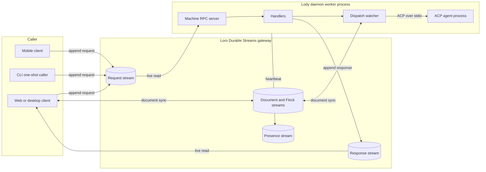
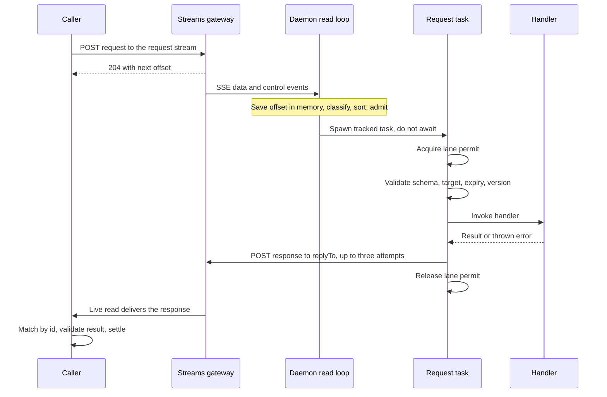
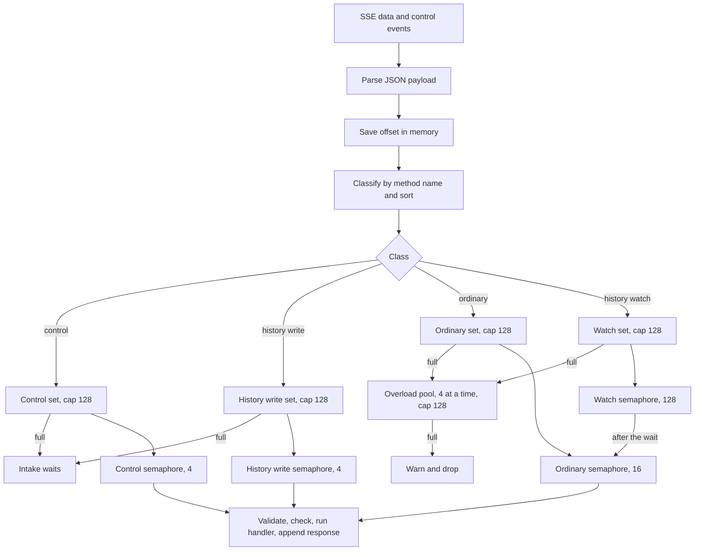

# Protocol

This document describes the ordinary (non-encrypted) Lody machine remote
procedure call (RPC) protocol as implemented at Lody commit `61bd9701a`: the
transport it rides on, its wire contract, the request lifecycle, authority,
deadlines, ordering, deduplication, crash recovery, scheduling and liveness.
Encrypted workspaces are covered in [encrypted RPC](encrypted-rpc.md);
per-method rules are in the [method reference](methods.md).

Every significant claim carries a basis tag and an evidence link. The tags are
**Impl** (the code path was read), **Test** (a named test asserts it),
**Intent** (prose, specification or comment only), **Infer** (inference from
the cited code) and **Unknown**. **Probe** marks behaviour observed by running
the real code in isolation; the probes are listed in
[conformance](conformance.md#executed-probes).

## Layers

Five layers are involved. They are easy to conflate because they share one
gateway, one token and, on the daemon, one event loop.

| Layer | Owner | What it provides | What it does not provide |
| ----- | ----- | ---------------- | ------------------------ |
| Loro Durable Streams | `@loro-dev/streams-client` 0.12.2 and the hosted gateway | Named append-only streams with create, append, read and live tail over HTTP | Request/response correlation, deduplication of RPC requests, authorization of RPC methods |
| Lody RPC | `@lody/loro-streams-rpc` (`rpc.ts`, `machine-rpc-server.ts`) | Stream naming, JSON envelopes, method schemas, client correlation, daemon dispatch lanes | Durable delivery, an acknowledgement of execution, sender authentication |
| Encrypted RPC | `e2ee-*.ts` in the same package, `apps/cli/src/lib/e2ee` | Signed and sealed frames, journals, membership checks | Anything for ordinary workspaces |
| Loro and Flock document synchronization | `loro-repo`, `@loro-dev/streams-crdt`, the daemon's watchers | Replicated session and machine state; durable commands as document rows | Synchronous replies |
| Agent Client Protocol (ACP) | The daemon and each hosted agent process, over the agent's standard input and output | Prompt, cancel and permission traffic between daemon and agent | Any presence on the RPC wire |

_Table 1: The five layers, what each provides, and what it does not._

A Streams client is therefore not an implementation of Lody RPC, and neither
is the Loro software development kit (SDK), an ACP SDK or Iroh. The daemon is
the only ACP client; no machine RPC schema carries an ACP message, and the
`machine/acp-*` methods manage agent binaries, capabilities and
authentication, not session traffic (**Impl**, **Infer**;
[E-D16](evidence.md#e-d16)).

For screen readers: the following flowchart shows three kinds of caller (a web
or desktop client, a one-shot command-line caller, and a mobile client)
appending requests to a request stream on the Loro Durable Streams gateway. The
daemon's machine RPC server reads that stream and passes requests to handlers,
which append responses to a response stream that the caller reads. Separately,
clients and the daemon's dispatch watcher synchronize documents through document
and Flock streams, the watcher drives the agent process over ACP, and the daemon
sends heartbeats to a presence stream.



_Figure 1: Callers, gateway streams, and daemon components involved in a machine
RPC._

## Transport

### Addressing and credentials

A stream is addressed as
`{gatewayBaseUrl}/ds/{bucket}/{streamId}`, with both path segments passed
through `encodeURIComponent`, so the colons in a stream identifier travel as
`%3A` (**Impl**, **Probe**; [E-T4](evidence.md#e-t4)).

| Value | Caller (web, desktop) | Daemon | Basis |
| ----- | --------------------- | ------ | ----- |
| Gateway base URL | `gatewayBaseUrl` from the token response, else build-time `VITE_LORO_STREAMS_BASE_URL`; no default host | `gatewayBaseUrl` from the token response only; no environment fallback | **Impl** [E-T5](evidence.md#e-t5), [E-T14](evidence.md#e-t14), [E-T12](evidence.md#e-t12) |
| Bucket | Constant `lody` for ordinary workspaces | Same | **Impl** [E-T6](evidence.md#e-t6) |
| Streams token | `POST {site}/api/loro-streams/token` with the user's session credential | Same endpoint with the CLI login token from `credentials.json` | **Impl** [E-T7](evidence.md#e-t7), [E-T8](evidence.md#e-t8), [E-T42](evidence.md#e-t42) |
| Workspace identity | The workspace of the runtime | One per-workspace runtime per listed workspace | **Impl** [E-T36](evidence.md#e-t36) |
| Machine identity | Argument when a machine client is created; the target is chosen from the machine document | `machine-id` file or `credentials.json` | **Impl** [E-T15](evidence.md#e-t15) |

_Table 2: Where the caller and the daemon obtain the gateway address and
credentials._

The token request body is `{ workspaceId, rejectedToken? }` and the response is
`{ token, expiresIn, gatewayBaseUrl?, shardHostSuffix? }`, with `expiresIn` in
seconds. The gateway address and shard topology are therefore delivered with
the token (**Impl**; [E-T7](evidence.md#e-t7)). The token is cached until 30
seconds before expiry and concurrent callers share one fetch (**Impl**;
[E-T9](evidence.md#e-t9), [E-T10](evidence.md#e-t10)). The issuing service is
not in the repository, so the token format, its scope and the gateway's
authorization rules are **Unknown**.

On the daemon one token provider per workspace serves document
synchronization, presence and machine RPC (**Impl**;
[E-D9](evidence.md#e-d9)).

The RPC adapter passes the upstream client an authentication callback that
ignores its argument. The upstream client retries a 401 or 403 exactly once
and passes the callback a context naming the rejected token; Lody drops that
context (**Impl**; [E-T41](evidence.md#e-t41), [E-U7](evidence.md#e-u7)). A
probe confirmed that the callback is invoked a second time with no arguments
(**Probe** P-3). Whether the cached token is then re-minted depends on the
token provider and was not observed end to end (**Unknown**).

### Stream names

| Stream | Identifier | Creator | Basis |
| ------ | ---------- | ------- | ----- |
| Request | `<workspaceId>:rpc:req:<machineId>` | Daemon, at start and again after a 404 on read | **Impl** [E-T1](evidence.md#e-t1), [E-T38](evidence.md#e-t38) |
| Response, shared | `<workspaceId>:rpc:res:<uuid>` | The reading client after a 404, or the daemon when a response append returns 404 | **Impl** [E-T2](evidence.md#e-t2), [E-T28](evidence.md#e-t28), [E-S12](evidence.md#e-s12) |
| Response, legacy | `<workspaceId>:rpc:res:<machineId>:<uuid>` | As above; the mobile client creates it before sending | **Impl** [E-T3](evidence.md#e-t3), [E-K7](evidence.md#e-k7) |

_Table 3: Stream names and which side creates each._

The shared form is used when one `LoroStreamsRpcResponseDispatcher` serves
every machine client of a workspace runtime, as the web and desktop clients
do. The legacy form is used when a `LoroStreamsMachineRpcClient` is built
without a dispatcher, as the command-line caller does (**Impl**;
[E-T36](evidence.md#e-t36), [E-T37](evidence.md#e-t37)). With the shared
client a response stream is never per request: every request from one
dispatcher carries the same `replyTo`.

The mobile client does not use the shared client. For every call it creates
a fresh response stream in the legacy form, with a TTL of at least 300
seconds, before appending the request, and reads it by long-poll from `-1`
until a response with its `id` arrives. It stamps `sentAt` and `expiresAt`
from the device clock, sends no cancel request, and does not validate the
response against a schema (**Impl**; [E-K7](evidence.md#e-k7)). Three caller
implementations therefore exist: shared dispatcher, one-shot legacy client
and mobile per-request reader.

The daemon does not detect or validate a naming scheme. It appends each
response to the request's `replyTo` verbatim, and creates that stream if the
append returns 404 (**Impl**; [E-S12](evidence.md#e-s12); **Test** "appends
responses to workspace-level replyTo streams for new clients"). A probe
confirmed that the request schema accepts any non-empty `replyTo` (**Probe**
P-1). Any writer to a request stream can therefore make the daemon create and
write an arbitrary stream in the bucket (**Infer**).

### Stream lifecycle

`ensureJsonStream` issues `PUT` with `Content-Type: application/json` and,
when a positive retention is given, `Stream-TTL` in whole seconds. Machine RPC
uses 86,400 seconds (**Impl**; [E-T16](evidence.md#e-t16),
[E-T18](evidence.md#e-t18), [E-U1](evidence.md#e-u1)). On `409` the adapter
issues `HEAD` and accepts the existing stream only if its content type is
exactly `application/json`, it is not closed, and its time to live (TTL)
either equals the requested value or is absent; the last case exists for
streams created before retention was introduced (**Impl**;
[E-T17](evidence.md#e-t17)).

Lody never closes or deletes an RPC stream. The adapter exposes only ensure,
append and live read, so cleanup is whatever the gateway does at TTL expiry
(**Impl**; [E-T27](evidence.md#e-t27)). Whether the production gateway counts
the TTL from creation or renews it on append is **Unknown**. The upstream
protocol text says "from creation", and the bundled development server
implements that: a stream created with a four-second TTL and appended to
after 2.5 seconds was gone after five (**Probe** P-10). If production does the
same, a request stream disappears 24 hours after the daemon created it, the
daemon's next read returns 404, and it recreates the stream (**Infer**;
[E-U9](evidence.md#e-u9)).

| Event | Caller behaviour | Daemon behaviour | Basis |
| ----- | ---------------- | ---------------- | ----- |
| Request stream missing on append | Result code `machine_rpc_unavailable`; no retry; the caller never creates this stream | Not applicable | **Impl** [E-C5](evidence.md#e-c5) |
| Stream missing on read (404) | Create the response stream, reset offset to `-1` | Create the request stream, reset offset to `-1` | **Impl** [E-T28](evidence.md#e-t28), [E-T29](evidence.md#e-t29) |
| Offset gone (410) | Reset offset to `-1`, re-read with no delay | Same | **Impl**, **Test** "resumes request streaming from the retained head after cursor expiration" |
| Stream closed | Reader sees end of stream and re-reads at once; writer gets 409 | Same | **Infer**; not tested |
| Response stream missing on append | Not applicable | Create it with 24-hour retention, append once more | **Impl** [E-S12](evidence.md#e-s12) |

_Table 4: Stream lifecycle events and how each side reacts._

### Append

`appendJson` issues `POST` with `Content-Type: application/json` and a body of
exactly one JSON object, the envelope. The only other header is
`Authorization: Bearer <token>` (**Impl**, **Probe** P-4;
[E-T19](evidence.md#e-t19)). No producer identity, sequence number or other
idempotency header is sent, so the transport cannot deduplicate a repeated
append (**Impl**; [E-U2](evidence.md#e-u2)).

The gateway's JSON mode flattens a top-level array body by one level into
several messages and rejects an empty array (**Intent**;
[E-U9](evidence.md#e-u9); **Probe** P-8 and P-10 on the development server,
where the daemon handled each element of an appended array as a separate
request). Lody never sends an array.

The upload deadline is `uploadTimeoutMs ?? connectTimeoutMs ?? 10_000`
milliseconds: 10 seconds in the browser and 30 seconds on the daemon, which
sets a 30-second connect timeout (**Impl**; [E-T20](evidence.md#e-t20),
[E-T11](evidence.md#e-t11)).

The upstream client retries an append only when a producer is supplied, so a
Lody request append is attempted once (**Impl**; [E-U2](evidence.md#e-u2)).
The daemon adds its own retry for responses only: up to three attempts with
200 and 400 millisecond pauses, for network errors and gateway status 500 and
above (**Impl**; [E-S12](evidence.md#e-s12)). Because nothing identifies the
append, a response whose first attempt was committed but not acknowledged is
appended twice (**Infer**).

No size limit is enforced on an ordinary append by Lody or by the upstream
client. The gateway's limit is not stated anywhere in the repository
(**Intent**; [E-W26](evidence.md#e-w26)); it is **Unknown**.

### Read and live tail

Lody has no separate catch-up read. `readJsonLive` calls the upstream `live`
operation once from the saved offset; that single iteration replays retained
messages and then tails (**Impl**; [E-T21](evidence.md#e-t21)).

Server-Sent Events (SSE) mode works as follows in the pinned client
(**Impl**; [E-U3](evidence.md#e-u3), [E-U8](evidence.md#e-u8),
[E-U11](evidence.md#e-u11)):

1. Because Lody constructs a new client for every call, each read begins with
   `HEAD` on the stream to learn its content type.
2. `GET {stream}?offset=<token>&live=sse` follows. Statuses 429, 502, 503 and
   504 are retried; other failures end the read.
3. Each `event: data` carries a JSON array of messages and is buffered. It is
   delivered only when the next `event: control` arrives.
4. The control event is a JSON object with a required `streamNextOffset`, an
   optional `streamCursor`, and optional `upToDate` and `streamClosed` flags.
   Every buffered payload is delivered with that control event's offset.
5. When the server closes the connection after a control event, the client
   reconnects silently from the last offset.

Long-poll mode issues
`GET {stream}?offset=<token>&live=long-poll&timeout=30`. A `204` must carry
`Stream-Next-Offset` and `Stream-Up-To-Date: true`; a `200` carries the
messages and `Stream-Next-Offset` (**Impl**; [E-U4](evidence.md#e-u4)).

Lody delivers one batch per data event. A payload that parses to an array
becomes that many messages; any other value becomes one message (**Impl**;
[E-T22](evidence.md#e-t22)). A payload that is not valid JSON fails the read
after the offset has already moved past it, so every message in that payload
is skipped (**Infer**; [E-T21](evidence.md#e-t21)).

Within one `live` call the upstream client reconnects with delays of 0, 0.5,
1, 2 and 4 seconds, each varied by 20 per cent, honours a server retry hint up
to 60 seconds, and gives up after five consecutive failures (**Impl**;
[E-U5](evidence.md#e-u5)). Lody's loops then add the behaviour in the
[lifecycle table](#stream-lifecycle) and otherwise wait a fixed one second
before reading again, without limit (**Impl**; [E-T28](evidence.md#e-t28),
[E-T29](evidence.md#e-t29)).

### Offsets and cursors

Offsets are opaque strings. Lody never parses, compares or orders them. The
only values it writes itself are the protocol sentinel `-1`, meaning the
earliest retained message, and, on the encrypted path only, the literal `0`
(**Impl**; [E-T30](evidence.md#e-t30), [E-T31](evidence.md#e-t31)). The
development server accepts `0` as the first position (**Probe** P-10);
whether the production gateway does is **Unknown**.

| Reader | Initial offset | Held in | Persisted |
| ------ | -------------- | ------- | --------- |
| Daemon request loop | `-1` | Memory | No |
| Client response dispatcher | `-1` | Memory | No |

_Table 5: Read offsets held by each reader._

The offset advances as soon as a batch is received, before the batch handler
runs (**Impl**; [E-T21](evidence.md#e-t21), [E-S1](evidence.md#e-s1)). Lody
stores the cursor from each control event but never sends it back: the
upstream `live` input has no cursor field (**Impl**;
[E-T21](evidence.md#e-t21)). The test titled "opens SSE live reads from the
requested offset and cursor" asserts that only the offset is passed.

The consequences are these:

- A daemon restart, a 404 and a 410 each make the daemon re-read the whole
  retained request stream. This is transport replay. The only filter is the
  envelope's `expiresAt` (**Impl**; [E-W12](evidence.md#e-w12)). A probe with
  a second server instance on the same stream ran the handler a second time
  for every unexpired request and appended a second response under each
  `id` (**Probe** P-9).
- A reconnect within one process resumes from the saved offset and replays
  nothing (**Test** "resumes long-poll from the offset the failed SSE reads had
  already reached").
- A new client runtime reads a new, random response stream from `-1`, so it
  sees a response that landed before its reader connected and nothing older
  (**Test** "replays the first response even when it lands before the live
  reader starts").

Transport replay is distinct from RPC redelivery, which does not exist: no
client re-appends a request under the same identifier
([duplicates](#duplicates-and-deduplication)). It is also distinct from
document reconstruction, in which the Loro repository rebuilds session state
from its own cursors, which the daemon does persist.

### Live-mode policy and idle watchdog

Only the browser's shared dispatcher uses `LoroStreamsLiveModePolicy`. It
requests the upstream `auto` mode, falls back to long-poll after three
consecutive failed or empty SSE reads or three response timeouts with no
response in between, and probes SSE again after five minutes (**Impl**;
[E-T32](evidence.md#e-t32), [E-T33](evidence.md#e-t33)). A build-time pin
disables all of this. The daemon and the command-line caller pass no policy
and read with static `sse`; they never fall back to long-poll (**Impl**;
[E-T29](evidence.md#e-t29)). The mobile client is long-poll only and does not
use this package ([methods](methods.md)).

When the browser has appended a `session/history-write` request whose
operation is `accept_input` or `accept_input_and_dispatch` and no response has
arrived after two seconds, it aborts and renews its response read once,
switching to long-poll. The request, its identifier and its deadline are
untouched, and nothing is re-appended (**Impl**; [E-T34](evidence.md#e-t34),
[E-T35](evidence.md#e-t35); **Test** "renews once for overlapping inputs and
retains both original requests").

Lody wraps each live read in an idle watchdog of 120 seconds that aborts the
read without a reason, so the read returns cleanly and the loop starts
another from the saved offset (**Impl**; [E-T23](evidence.md#e-t23),
[E-T24](evidence.md#e-t24)). The rationale recorded in the source and in the
internal map is that the streams client, at version 0.5.0, had no read
timeout (**Intent**; [E-N1](evidence.md#e-n1)). The pinned version 0.12.2 has
its own idle timer of at least 45 seconds, 60 seconds with the daemon's
settings, which reconnects by itself (**Impl**; [E-U6](evidence.md#e-u6)). The
Lody watchdog is therefore a backstop at this commit, and the prose is stale.

### Shards

The browser and the command-line caller route requests to shard hosts derived
from the token response: create and `HEAD` go to an `api-*` host, appends to a
`write-*` host and live reads to a `control-*` host. The host is chosen by a
32-bit FNV-1a hash of the stream identifier taken over UTF-16 code units
(**Impl**; [E-T25](evidence.md#e-t25)). The daemon passes no shard list and
talks to the gateway origin (**Impl**; [E-T11](evidence.md#e-t11)). The
protocol therefore relies on a message appended through one host being
readable through another; that guarantee belongs to the gateway and is
**Unknown** here.

## Wire contract

### Request envelope

One request is one JSON object appended to the request stream. It is
validated by `LoroStreamsRpcRequestSchema`, a discriminated union on `method`
with 52 members, each a strict object (**Impl**; [E-W1](evidence.md#e-w1),
[E-W2](evidence.md#e-w2)).

| Field | Type | Required | Validation | Meaning |
| ----- | ---- | -------- | ---------- | ------- |
| `jsonrpc` | string | Yes | Literal `"2.0"` | Marker only; see below |
| `id` | string | Yes | Trimmed, at least one character; no maximum, no format | Correlation identifier; `crypto.randomUUID()` in the shared client |
| `method` | string | Yes | One of the 52 declared names | Selects the member schema |
| `rpcVersion` | string | Yes | Trimmed, non-empty; compared with `"1"` after parsing | Protocol version |
| `machineId` | string | Yes | Trimmed, non-empty | Target machine |
| `workspaceId` | string | Yes | Trimmed, non-empty | Target workspace |
| `replyTo` | string | Yes | Trimmed, non-empty; no structural check | Stream identifier for the response |
| `sentAt` | number | Yes | Finite, zero or greater | Milliseconds since the Unix epoch; never read by the daemon |
| `expiresAt` | number | Yes | Finite, greater than zero | Absolute deadline in milliseconds since the Unix epoch |
| `params` | object | Yes | Strict per-method schema | Method input |

_Table 6: Fields of the request envelope._

The following rules were confirmed against the real validators (**Probe**
P-1):

- An unknown top-level key, an unknown `params` key, an unknown method, a
  missing `params` and `null` in any field are all rejected.
- Optional fields are expressed by omission. No envelope field accepts
  `null`.
- Fractional timestamps are accepted. The shared client rounds before sending
  (**Test** "rounds calibrated timestamps before appending RPC requests").
- The schema does not require `expiresAt` to follow `sentAt`.
- Strings are trimmed during parsing: an `id` of `"  padded  "` parses as
  `"padded"`.
- A JSON array is not a valid request. JSON-RPC batches are not part of the
  protocol.

The envelope carries no sender identity, trace context, capability field or
client version (**Impl**; [E-W1](evidence.md#e-w1)). Where a method needs a
requester, it is a caller-supplied field inside `params`, and the package's
own instructions say that workspace RPC cannot authenticate it (**Intent**;
[E-W31](evidence.md#e-w31)).

The format is JSON-RPC 2.0 in name only. Requests carry routing and deadline
fields, responses carry `method`, `rpcVersion` and `machineId`, error codes
are strings, and there are no notifications.

### Response envelope

Success and error share `LoroStreamsRpcResponseSchema`, a strict object
(**Impl**; [E-W4](evidence.md#e-w4)).

| Field | Type | Required | Validation | Meaning |
| ----- | ---- | -------- | ---------- | ------- |
| `jsonrpc` | string | Yes | Literal `"2.0"` | Marker |
| `id` | string | Yes | Trimmed, non-empty | The request's `id` |
| `method` | string | Yes | One of the 52 declared names | The request's method; selects the client's result parser |
| `rpcVersion` | string | Yes | Trimmed, non-empty | The daemon's version; not compared by the client |
| `machineId` | string | Yes | Trimmed, non-empty | The responding machine; not compared by the client |
| `result` | any | One of | Unconstrained here; validated per method afterwards | Success payload |
| `error` | object | One of | `{ code, message, data? }`, strict | Failure |

_Table 7: Fields of the response envelope._

Exactly one of `result` and `error` must be present. A response with both,
with neither, with an extra key, with a numeric error code or with an unknown
method fails validation, and the client ignores it and keeps waiting
(**Probe** P-1; [E-C3](evidence.md#e-c3)). `result: null` passes the envelope
and then fails the per-method result schema, which the client reports as
`invalid_result` (**Probe** P-1, **Impl**; [E-W23](evidence.md#e-w23)).

The error object is `{ code: string, message: string, data?: any }`, strict,
with `code` and `message` non-empty after trimming (**Impl**;
[E-W5](evidence.md#e-w5)).

### Progress, overload and cancellation

There is no separate envelope for any of these.

- **Progress** is an ordinary success response, with the request's `id` and
  `method`, whose `result` has `type` equal to `machine/acp-binary-progress`
  or `machine/acp-authentication-progress`. The client recognizes it by the
  shape of `result` alone, renews its inactivity timer and keeps the request
  pending (**Impl**; [E-W9](evidence.md#e-w9)). Three methods emit progress:
  `machine/acp-capabilities-refresh`, `machine/acp-binary-install` and
  `machine/acp-authenticate`. Each chains its progress appends and awaits
  them before appending its final result, so progress responses precede the
  final result in emission order, and a failed progress append is discarded
  (**Impl**; [E-S29](evidence.md#e-s29)). **Test** "appends ACP binary
  progress before the final refresh response" covers the refresh method
  ([E-S30](evidence.md#e-s30)), and "emits ACP binary progress without
  resolving the refresh request early" covers the client side. When a handler
  throws, the error response is appended without awaiting pending progress
  appends, so its order relative to them is not ensured (**Infer** from
  [E-S29](evidence.md#e-s29), [E-W24](evidence.md#e-w24)).
- **Overload** is an ordinary error response with code
  `rpc_request_capacity_exceeded` and message "The machine request queue is
  full." (**Impl**; [E-W27](evidence.md#e-w27)).
- **Cancellation** exists for one method. The client appends a new request,
  `machine/acp-capabilities-refresh-cancel`, with its own `id`, a 30-second
  deadline and `params.requestId` naming the request to cancel. The daemon
  aborts the matching refresh and sends no response to the cancel request
  (**Impl**; [E-W10](evidence.md#e-w10), [E-W11](evidence.md#e-w11); **Test**
  "aborts capability work and suppresses progress after an exact cancel
  request"). No other method can be cancelled at the transport level.
  `session/cancel` is a business operation with its own response
  ([methods](methods.md)).

No general acknowledgement of receipt exists. Some results are
acknowledgements by design, such as the `session/dispatch-turn` result and the
accepted response to `machine/restart`; those are final results.

### Versions and capabilities

`rpcVersion` is the string `"1"`. The daemon compares it for equality after
the request has passed its schema, its target check and its expiry check, and
answers a mismatch with the error `rpc_version_mismatch` and the message
`Expected rpcVersion=<daemon>, got <caller>` (**Impl**, **Test** "returns
rpc_version_mismatch when request version is unsupported";
[E-W6](evidence.md#e-w6), [E-W12](evidence.md#e-w12)). This is the only
mismatch that produces a response.

| Condition | Daemon response | Caller observes | Basis |
| --------- | --------------- | --------------- | ----- |
| Unknown method, unknown key, invalid field | None; a warning is logged | Its own timeout | **Impl** [E-W12](evidence.md#e-w12), **Probe** P-6 |
| Wrong `machineId` or `workspaceId` | None; nothing is logged | Its own timeout | **Impl** [E-W12](evidence.md#e-w12), **Probe** P-6 |
| `expiresAt` at or before the daemon's clock | None; nothing is logged | Its own timeout | **Impl** [E-W12](evidence.md#e-w12), **Probe** P-6 |
| `rpcVersion` differs | Error `rpc_version_mismatch` | Method-shaped failure | **Impl**, **Test**, **Probe** P-7 |
| Declared method, optional handler absent | Error `method_unavailable` for most methods; four other variants exist, listed in [methods](methods.md). Omitting the required `machine/status` handler yields `internal_error` with the text of a JavaScript type error | Method-shaped failure | **Impl**, **Probe** P-7 |

_Table 8: Conditions on a request, the daemon's response to each, and what the
caller observes._

There is no `method_not_found` code. `unsupported_protocol` is a result code
inside the file preview and download results, not an envelope error.

Capabilities are not negotiated on the wire. The daemon writes its
`rpcVersion` and a `protocolCapabilities` map of name to positive integer
version into its machine record in the workspace document, and callers read
that record (**Impl**; [E-W13](evidence.md#e-w13),
[E-W14](evidence.md#e-w14)). Because the schemas are strict, a caller must
omit any gated field or method when the target does not advertise it: an
unexpected field makes the daemon drop the request without a reply
(**Intent**; [E-W28](evidence.md#e-w28)). The capability table is in the
[method reference](methods.md).

### Error codes

Only three codes are declared as the shared wire contract:
`rpc_version_mismatch`, `method_unavailable` and `internal_error` (**Impl**;
[E-W7](evidence.md#e-w7)). The schema accepts any non-empty string, and the
daemon emits many more.

| Code | Produced by | When | Basis |
| ---- | ----------- | ---- | ----- |
| `rpc_version_mismatch` | Daemon | Version differs | **Impl**, **Test** |
| `method_unavailable` | Daemon | Handler not wired | **Impl** |
| `internal_error` | Daemon | Any thrown error that is not a `LoroStreamsRpcHandlerError`; the message is the raw error text | **Impl** [E-W24](evidence.md#e-w24) |
| `rpc_request_capacity_exceeded` | Daemon | Ordinary or watch lane full | **Impl**, **Test** |
| `rpc_request_identity_mismatch` | Daemon | History request identifier reused with different content | **Impl**, **Test** |
| `invalid_request` | Daemon | History watch method and query kind disagree | **Impl** |
| `session_history_read_denied`, `session_history_write_denied` | Daemon | Proof refused or withdrawn | **Impl**, **Test** |
| `session_history_write_already_claimed` | Daemon | Replay of an admitted history write | **Impl** |
| `session_history_request_state_unavailable` | Daemon | Refusal store missing or failing | **Impl**, **Test** |
| `session_metadata_pending`, `session_owner_mismatch`, `session_unavailable`, `session_identity_mismatch`, `session_backend_mismatch` | Daemon | History preconditions | **Impl** |
| `permission_denied` and other Code Collab and file preview codes | Daemon | Owner mismatch and feature errors; `error.data` carries a typed object | **Impl**, **Test** |
| `invalid_result`, `response_timeout`, `request_failed`, `machine_rpc_unavailable` | Client only | Never on the wire | **Impl** [E-C5](evidence.md#e-c5) |

_Table 9: Error codes, which side produces each, and when._

Because `internal_error` carries raw error text, schema validation messages
and other internal strings can reach the caller (**Infer**;
[E-W24](evidence.md#e-w24)). The context attached to a
`LoroStreamsRpcHandlerError` is logged on the daemon and never serialized
(**Impl**; [E-W25](evidence.md#e-w25)).

Callers of the shared client never see the error envelope. The client turns
it into `null` or a method-shaped failure object, usually with a field of the
form `"<code>: <message>"` (**Impl**; [E-W21](evidence.md#e-w21)). History
methods also attach a client-only `rpcFailure` object with `source`
(`transport`, `remote` or `protocol`), `code`, `requestId` and `machineId`
(**Impl**; [E-W22](evidence.md#e-w22)). The codes that existing user
interfaces match are listed in [conformance](conformance.md).

### Owner-scoped content envelope

For `code-collab/*`, `file/preview`, `file/download-chunk`, `file/list-dir`,
`session/automation-control` and the three `session/history-*` methods, the
request `params` and the success `result` are not the business object but a
content envelope (**Impl**; [E-W15](evidence.md#e-w15),
[E-W16](evidence.md#e-w16)):

```json
{
  "type": "code-collab-v2-content-envelope",
  "keyVersion": 1,
  "algorithm": "AES-256-GCM",
  "ownerSessionId": "<session identifier>",
  "keyId": "ccv2:<24 hexadecimal characters>",
  "iv": "<base64url, 12 bytes>",
  "ciphertext": "<base64url>"
}
```

The authoritative definitions are `CodeCollabV2RpcContentEnvelopeSchema`,
`deriveCodeCollabV2ContentKeyBytes`, `deriveCodeCollabV2ContentKeyId` and the
`encryptCodeCollabV2RpcPayload` and `decryptCodeCollabV2RpcPayload` functions
(**Impl**; [E-W17](evidence.md#e-w17), [E-W18](evidence.md#e-w18)). In
summary:

- The key is the SHA-256 digest of two source constants and the
  `ownerSessionId`, joined by NUL bytes. The key identifier is derived the
  same way from a different constant.
- The cipher is AES-256-GCM through WebCrypto, with a random 12-byte nonce.
- The additional authenticated data is the UTF-8 text of a label, the
  `ownerSessionId`, the `keyId` and the `keyVersion`, joined by NUL bytes.
- The plaintext is the UTF-8 JSON of the business object. `iv` and
  `ciphertext` are base64url without padding.
- On errors only `error.data` is wrapped; `code` and `message` stay in clear.

The only input to the key that is not a source constant is the
`ownerSessionId`, which travels in clear in the same envelope. The envelope
therefore binds content to an owner session and keeps it out of plain view on
the stream, but it does not protect content from a party that can read the
stream and the source (**Infer**; [E-W17](evidence.md#e-w17)). The
authenticated data does not include the request identifier, method or
direction, so an envelope is not bound to one request. This mechanism is
separate from encrypted-workspace RPC.

A probe produced a deterministic value usable as a check: the key identifier
for the owner session `session-1` is `ccv2:efb61a27dce18cd331dd9f25`
(**Probe** P-2). The repository contains no fixed-ciphertext vector for this
envelope.

The daemon decrypts, then compares the envelope's owner with the owner it
resolves for the business session, and answers a mismatch with
`permission_denied` (**Impl**, **Test** "rejects Code Collab requests when the
envelope owner does not match the business session owner";
[E-S17](evidence.md#e-s17)).

### Secret field envelope

Individual secret fields use a second mechanism, defined by
`RpcSecretEnvelopeSchema` and `rpc-secret.ts`: an ephemeral P-256 key
agreement whose raw output is used as an AES-256-GCM key, with a context
string binding the workspace, machine and operation (**Impl**;
[E-W19](evidence.md#e-w19), [E-W20](evidence.md#e-w20)). It carries the
authorization code and form input of `machine/acp-authenticate` towards the
daemon, and viewer addresses of the simulator and automation controls towards
the caller.

### Interoperability traps

| Trap | Detail | Basis |
| ---- | ------ | ----- |
| Strict objects | Any unknown key makes the daemon drop a request silently, and makes a client ignore a response | **Probe** P-1 |
| Omission versus `null` | `null` is never accepted for an envelope field | **Probe** P-1 |
| Version type | `rpcVersion` is the string `"1"`; the number `1` is rejected | **Probe** P-1 |
| Timestamps | Milliseconds as JSON numbers, not ISO 8601 text; fractions are accepted | **Probe** P-1 |
| Clock | The daemon compares `expiresAt` with its server-calibrated clock; callers stamp from their own clock, which on mobile is the device clock | **Impl** [E-W12](evidence.md#e-w12) |
| String limits | Schema length limits count UTF-16 code units, not UTF-8 bytes | **Infer** |
| Shard hash | Computed over UTF-16 code units | **Impl** [E-T25](evidence.md#e-t25) |
| Offsets | Opaque strings; the development server uses 20-digit decimals, which exceed a signed 64-bit integer | **Impl** [E-U13](evidence.md#e-u13) |
| Batches | A stream payload that is an array is flattened by the reader; an RPC message must be an object | **Impl** [E-T22](evidence.md#e-t22) |
| Content type | `HEAD` content type is compared with `application/json` by exact equality | **Impl** [E-T17](evidence.md#e-t17) |
| Whitespace | Identifiers are trimmed on parse, and the trimmed value is used for correlation and for the history identity | **Probe** P-1 |
| Key order | The history identity is the JSON text of the parsed request, whose keys follow schema order, not arrival order | **Probe** P-1; [E-S7](evidence.md#e-s7) |
| Encodings | Content and secret envelopes use base64url without padding; key identifiers and digests use lower-case hexadecimal | **Impl** [E-W18](evidence.md#e-w18) |

_Table 10: Interoperability traps in the wire contract._

## Request lifecycle and acknowledgements

### Caller side

The shared client's `sendRequest` proceeds as follows (**Impl**;
[E-C1](evidence.md#e-c1), [E-C2](evidence.md#e-c2), [E-C6](evidence.md#e-c6)):

1. Start the response dispatcher if needed. It begins a live read of the
   response stream from offset `-1` without creating the stream first.
2. Choose the `id` and read the clock.
3. Register a pending entry keyed by `id` and arm its timer. The timer is
   armed before encryption and before the append.
4. Build the envelope with `sentAt` set to now and `expiresAt` set to now plus
   the timeout, encrypting `params` for owner-scoped methods. The request is
   not validated against the schema before it is sent.
5. Append once to the request stream.
6. Wait for whichever comes first: the response, the timer or an append
   failure.

Correlation is by `id` alone. A response whose `id` matches no pending entry
is ignored without a log, which covers duplicates, late responses and other
clients' responses. The client does not check the response's `method` or
`machineId` against the pending entry (**Impl**; [E-C3](evidence.md#e-c3)).

### Daemon side

For screen readers: the following sequence diagram shows a caller posting a
request to the request stream and the gateway confirming the append. The
daemon's read loop receives the event, saves the offset in memory, classifies
and admits the request, and spawns a task without awaiting it. The task acquires
a lane permit, validates the schema, target, expiry, and version, and invokes
the handler. It then posts the response to the reply stream, with up to three
attempts, and releases the permit. The caller's live read delivers the response,
which the caller matches by identifier, validates, and settles.



_Figure 2: A request's path through the daemon, from append to settled
response._

Each step is detailed in [scheduling](#scheduling-and-backpressure). The
validation order after the lane permit is acquired is: schema, then target
machine and workspace, then expiry, then version, then, for history methods
only, deduplication (**Impl**; [E-W12](evidence.md#e-w12)).

### Milestones

| Milestone | Owner | Evidence available to the caller | Persisted | Failure boundary |
| --------- | ----- | -------------------------------- | --------- | ---------------- |
| Local construction | Caller | None; a pending entry exists in memory | No | Lost if the caller stops |
| Transport append acknowledgement | Gateway | The append call returns | In the request stream, for the stream's retention | A timed-out append may still have been committed |
| Daemon receipt | Daemon read loop | None | Offset in memory only | Lost on restart; the stream replays |
| Durable retention by the daemon | Handler, method-specific | Only through the method's result | Varies; see [methods](methods.md) | Method-specific |
| Authorization | Handler, method-specific | Only through the method's result or error | Not persisted, except history refusals and claims | Method-specific |
| Execution claim | Handler, method-specific | Only through the method's result | History write claim; operation inbox; none for most methods | Method-specific |
| First business side effect | Handler | Not signalled | Method-specific | Not signalled |
| Progress response | Daemon | A progress response arrives | In the response stream | Failed progress appends are discarded |
| Terminal result | Daemon | The response arrives | In the response stream | Lost if both the result append and the fallback error append fail |
| Caller observation | Caller | The call settles | No | A caller that stopped never observes it |

_Table 11: Milestones of a request, their owners, and the evidence each gives
the caller._

### What an acknowledgement proves

- A successful append proves that the gateway stored the request. It proves
  nothing about the daemon. A failed or timed-out append proves nothing
  either: the request may be in the stream, which is why the client's result
  for history methods is marked as a transport failure with an outcome that
  may be unknown (**Impl**; [E-C5](evidence.md#e-c5); **Intent**
  [E-N8](evidence.md#e-n8)).
- A terminal response produced after a handler returns or throws proves that
  the handler finished, and that the daemon's append of the response was
  stored. A progress response is appended while the handler is still running
  and proves only that the handler had started and the append was stored
  (**Impl**; [E-S29](evidence.md#e-s29)). What the handler's return means
  differs by method. For the dispatch methods it means delivery
  or durable acceptance and never that an agent started
  ([methods](methods.md)).
- Some responses are produced before any handler runs, and prove only that
  the daemon read the request and stored the append: a version mismatch
  ([E-W12](evidence.md#e-w12)), an overload error
  ([E-W27](evidence.md#e-w27)), an identity mismatch or a stored refusal
  for a history method ([E-S7](evidence.md#e-s7),
  [E-S8](evidence.md#e-s8)), and an owner-session refusal for an
  owner-scoped method ([E-M34](evidence.md#e-m34)) (**Impl**).
- An overload error proves only that the daemon read the request while a lane
  was full. It says nothing about an earlier duplicate of the same request
  (**Intent**; [E-N7](evidence.md#e-n7)).
- The absence of a response proves nothing. Requests that fail validation,
  name another machine or have expired are dropped without a reply, and a
  response can be lost after the handler has run.

## Authority

### Stream access versus method invocation

Two different permissions are in play.

1. **Stream access** is granted by the Streams token. Whoever can append to
   `<workspaceId>:rpc:req:<machineId>` can submit a request, and whoever can
   read a response stream can read its responses. The scope of a token is set
   by the issuing service and is **Unknown**.
2. **Method invocation** is whatever the daemon checks after reading a
   request. The server itself checks only that the request names this
   workspace and machine, has not expired and uses version `"1"` (**Impl**;
   [E-W12](evidence.md#e-w12)). It has no sender identity to check.

Everything else is delegated to handlers, and differs by method
([methods](methods.md)). The forms that exist are:

| Form | Inputs | Timing | Used by |
| ---- | ------ | ------ | ------- |
| Owner-session binding | Envelope `ownerSessionId` against the resolved owner of the business session | After decryption, before the handler | Owner-scoped methods; skipped for Code Collab and file methods when no resolver is injected |
| History read proof | `readProof`, verified with the cloud | Before the wait or read, after the wait, before and after the read, and before each response append attempt | `session/history-read`, `session/history-watch` |
| History write proof | `writeProof`, request identifier, operation and payload, verified with the cloud; returns an expiry | Once, before the claim | `session/history-write` |
| Operation proofs | A proof bound to the operation, verified with the cloud | In the handler | Preview, simulator and automation controls |
| Requester token | `requesterUserId` and `requestToken`, verified with the cloud | In the handler; upgrade is checked again before the switch | `machine/restart`, `machine/upgrade`, `machine/bug-report` |
| Machine access | Requester, machine and project, checked locally for the owner and with the cloud for other members | At actual turn dispatch, not at request receipt | Turn dispatch |
| None visible | No identity in the parameters | Not applicable | `session/cancel`, `session/terminate`, `machine/ping`, `machine/status`, `session/live-status` and the ACP management methods |

_Table 12: Forms of authorization that exist, and when each is applied._

The owner-session and history checks are in the server
(**Impl**; [E-S15](evidence.md#e-s15), [E-S10](evidence.md#e-s10),
[E-S17](evidence.md#e-s17)); the others are in the daemon's handlers
(**Impl**; [E-D10](evidence.md#e-d10)).

### Permission changes and queued work

All server-side checks run after the lane permit is acquired, so they reflect
the state at execution time and not at arrival time. A request that waits in
a lane is checked when it leaves the queue (**Impl**;
[E-S6](evidence.md#e-s6)).

- History reads are checked again after the handler has run and before each
  append attempt, so a grant withdrawn during the read suppresses the result
  (**Test** "drops encrypted history when authority is withdrawn during
  %s").
- A history write is authorized once. After that only stop, request expiry
  and proof expiry are checked (**Impl**; [E-S10](evidence.md#e-s10)).
- A turn accepted by RPC is access-checked when the dispatch watcher is about
  to run it, and again on each retry (**Impl**; [E-D12](evidence.md#e-d12)).
- When a workspace is removed from the daemon's list, the daemon cancels
  active turns and re-checks pending ones, but it does not stop the RPC
  server for that workspace (**Impl**; [E-D13](evidence.md#e-d13)). What the
  server can still execute then depends on per-method cloud checks and on the
  token endpoint refusing the workspace (**Unknown**).
- A member's access is cached locally for up to one hour while the cloud is
  unreachable (**Impl**; [E-D11](evidence.md#e-d11)).

The daemon never branches on a workspace role such as owner, member or guest.
Role-dependent decisions are made by the cloud checks, which are not in the
repository (**Infer**).

## Deadlines and cancellation

These clocks are independent. None implies another.

| Clock | Owner | Value | Effect at expiry | Basis |
| ----- | ----- | ----- | ---------------- | ----- |
| Caller wait | Client pending timer | The method's timeout; renewed by each progress response | The call settles as `null`, or as `response_timeout` for history methods; nothing is sent to the daemon | **Impl** [E-C2](evidence.md#e-c2) |
| Request expiry | `expiresAt` in the envelope | Now plus the same timeout; absolute; not renewed | The daemon drops the request if it has not yet passed the expiry check | **Impl** [E-W12](evidence.md#e-w12) |
| Append deadline | Stream client | 10 seconds (browser), 30 seconds (daemon) per attempt | The append fails; it may still have been committed | **Impl** [E-T20](evidence.md#e-t20) |
| Queue residence | None | Unbounded | A queued request is tested against `expiresAt` when it obtains a permit | **Impl** [E-S6](evidence.md#e-s6) |
| Handler deadline | None | Unbounded | A handler that never settles holds its permit indefinitely | **Impl** (absence) |
| History watch wait | Daemon | At most 15 seconds, and at most `expiresAt` minus one second | The watch returns | **Impl** [E-S16](evidence.md#e-s16) |
| History readiness | Daemon handler | 10 seconds | Precondition refusal | **Intent** [E-N8](evidence.md#e-n8) |
| Lifecycle acknowledgement | Daemon | 5 seconds | The accepted operation proceeds without confirmation of delivery | **Impl**, **Test** [E-S13](evidence.md#e-s13) |
| Read idle watchdog | Stream client and Lody | 45 to 60 seconds upstream; 120 seconds in Lody | The read is renewed from the saved offset | **Impl** |
| Process shutdown | Daemon | 7 seconds | Forced exit | **Impl**, **Test** [E-D6](evidence.md#e-d6) |

_Table 13: The independent clocks that bound a request, and the effect when each
expires._

The points at which the daemon tests `expiresAt` are: on the overload path
before sending the capacity error; after the lane wait for every method; and,
for history methods only, after owner verification, after the watch wait,
before the read, before the response is sent, after write authorization and
after the write claim (**Impl**; [E-S10](evidence.md#e-s10),
[E-S15](evidence.md#e-s15), [E-S16](evidence.md#e-s16)). A non-history handler
that has started always attempts its response, however late.

A caller that times out has not stopped anything. The daemon learns of a
caller timeout only through `expiresAt`, and only if the request has not yet
been dispatched. The single exception is the capability refresh, for which the
client appends a cancel request on abort, on timeout and on stop
(**Impl**, **Test** "cancels the exact capability refresh after its response
timeout"; [E-W10](evidence.md#e-w10)).

For methods that emit progress, the caller's timer is an inactivity timer and
can outlast the request's absolute `expiresAt` (**Impl**, **Test** "measures
silence, so a reporting download cannot expire its own request").

Only three handler families receive an abort signal: the capability refresh,
history read and watch, and history owner resolution. Every other handler runs
to completion once started (**Impl**; [E-S22](evidence.md#e-s22)).

## Ordering

| Scope | Ordering that holds | Basis |
| ----- | ------------------- | ----- |
| Stream | The gateway orders appends; readers receive them in offset order | **Intent** [E-U9](evidence.md#e-u9) |
| Batch, on admission | Control requests first, then history writes, then ordinary requests, then history watches; arrival order within each class | **Impl** [E-S1](evidence.md#e-s1) |
| Across batches | A later batch is admitted after an earlier one | **Impl** [E-S1](evidence.md#e-s1) |
| Lane, on start | First in, first out through the lane's semaphore | **Impl** [E-S3](evidence.md#e-s3) |
| Lane, on completion | None; handlers in a lane run concurrently | **Impl** |
| Target machine | None beyond the above | **Impl** |
| Session | None in the server; two requests for one session can run concurrently | **Impl**; **Intent** [E-N9](evidence.md#e-n9) |
| Handler | Session mutations are serialized by their owning service, such as the session writer queue and the per-session dispatch check chain | **Intent** [E-N7](evidence.md#e-n7) |
| One request's responses | Progress responses in emission order, then the final response; a failed progress append leaves a gap | **Impl**, **Test** |
| Response reader | Responses for different requests interleave in completion order; the client matches by `id` | **Impl** [E-C3](evidence.md#e-c3) |

_Table 14: Ordering that holds at each scope._

Execution order can differ from arrival order in four ways: the priority sort
within a batch; concurrency within each lane; a history watch's follow-up read
queuing behind ordinary requests; and overload refusals being sent from a
separate pool.

## Duplicates and deduplication

No client re-appends a request under the same `id`. A caller that retries
calls again and obtains a new `id` (**Impl**; [E-C1](evidence.md#e-c1)).
Duplicates arise from transport replay after a restart, a 404 or a 410, and
from an append that timed out on the caller but was committed.

| Mechanism | Identity | Storage | Retention | Scope | Changed bytes under the same identity |
| --------- | -------- | ------- | --------- | ----- | ------------------------------------- |
| Transport producer idempotency | Not used | None | None | None | Not applicable |
| General request deduplication | Does not exist | None | None | None | Not detected |
| Request expiry | `expiresAt` | In the request | Until the deadline | Every method | Not applicable |
| History in-flight join | `id`; identity is the JSON text of the parsed request | Memory map | While the first task runs | One server instance, history methods | Error `rpc_request_identity_mismatch` to the newcomer's `replyTo` |
| History refusal and claim store | `(workspaceId, machineId, id)`; fingerprint is SHA-256 of the same JSON text | SQLite file `session-history-rpc-rejections.sqlite3` | Until the later of request expiry and the supplied retention; pruned on each save | One installation, history methods | Error `rpc_request_identity_mismatch` |
| Method-specific identities | Input identifier, user turn identifier, cancel identifier and others | Method-specific | Method-specific | Method-specific | See [methods](methods.md) |

_Table 15: Deduplication mechanisms, and their identity, storage, and scope._

(**Impl**; [E-S7](evidence.md#e-s7), [E-S8](evidence.md#e-s8),
[E-S9](evidence.md#e-s9), [E-S11](evidence.md#e-s11); **Test** "joins
identical concurrent history requests and rejects request ID reuse before
history".)

The history identity covers every envelope field, including `replyTo`, the
timestamps and the content envelope's nonce and ciphertext. Encrypting the
same business object again yields a different identity (**Impl**;
[E-S7](evidence.md#e-s7)).

The narrow guarantees are these:

- For every method outside the history family, a replayed request that has
  not expired is dispatched again and answered again. Whether the side effect
  repeats is decided by the handler ([methods](methods.md)).
- An identical history request that arrives while the first is running joins
  it, and no second response is appended.
- A history write is admitted at most once per request identifier until the
  later of the request's and the proof's expiry. The claim is saved before
  the write is attempted. This is at-most-once admission, not execution
  exactly once: a failure after the claim leaves the write unexecuted and the
  identifier unusable.
- A history refusal for one of six precondition codes is saved before the
  reply and returned again on replay, even if the precondition has since
  become true (**Test** "keeps a history precondition refusal terminal when an
  unexpired request is replayed after restart").
- A completed history read leaves no record. A replay reads again and answers
  again.

## Crash recovery

### State ownership

| State | Medium | Identity | Transaction boundary | Survives restart | Retention | Cleanup owner |
| ----- | ------ | -------- | -------------------- | ---------------- | --------- | ------------- |
| Request stream | Streams gateway | `<workspaceId>:rpc:req:<machineId>` | One append | Yes | 86,400 seconds requested at creation; renewal **Unknown** | Gateway |
| Response stream | Streams gateway | `<workspaceId>:rpc:res:…` | One append | Yes | As above | Gateway; never deleted by Lody |
| Daemon read offset | Memory | Server instance | Per batch, before handlers | No | Process | None |
| Lane sets and semaphores | Memory | Request task | None | No | Until the task settles | None; not awaited on stop |
| History in-flight map | Memory | `id` | None | No | While running | The task |
| History refusals and write claims | SQLite, synchronous, `FULL` | `(workspaceId, machineId, id)` and fingerprint | One immediate transaction; first writer wins | Yes | To expiry | Pruned on each save |
| Capability refresh controllers and secret-input recipients | Memory | `id`, authentication request identifier | None | No | While running | `stop()` |
| Turn stash from `session/dispatch-turn` | Memory | `(sessionId, userTurnId)` | None | No | 10 minutes | Dispatch watcher |
| Turn pointers and history | Loro session document, or Roost database for Roost sessions | Session and turn identifiers | Document commit or native edit | Yes | With the session | Session owner |
| Client pending entries and response offset | Memory | `id` | None | No | Until settled | Dispatcher |
| Streams token | Memory; browser also local storage | Endpoint, workspace, credential | Not applicable | Browser only | To expiry less 30 seconds | Token provider |

_Table 16: State involved in RPC, where it lives, and whether it survives a
restart._

(**Impl**; [E-S4](evidence.md#e-s4), [E-S11](evidence.md#e-s11),
[E-T30](evidence.md#e-t30); rows for the turn stash and turn pointers are
detailed in [methods](methods.md).)

### Crash windows on the daemon

| Crash point | Non-history methods | History read and watch | History write |
| ----------- | ------------------- | ---------------------- | ------------- |
| After the request was read, before its task started | Replayed after restart if unexpired; otherwise skipped without a reply | Same | Same; no claim exists, so it runs |
| During the handler, before a side effect | Replayed if unexpired | Replayed if unexpired; a saved refusal is returned again | A saved refusal is returned again; a crash between authorization and claim lets it run again |
| After the claim was saved, before the write | Not applicable | Not applicable | Replay is refused with `session_history_write_already_claimed` although the write never ran |
| After a side effect, before the response append | Replayed if unexpired: the handler runs a second time | Read again and answered | Replay refused; the outcome is uncertain to the caller |
| After the response append | Replayed again if unexpired: a second run and a second response | A second read and a second response | Replay refused: an error response follows the earlier success under the same `id` |

_Table 17: Daemon crash points and their outcome for each class of method._

(**Infer** from [E-T30](evidence.md#e-t30), [E-W12](evidence.md#e-w12),
[E-S10](evidence.md#e-s10). The last row of the first column was observed
directly: **Probe** P-9. The replay of a claimed write is not asserted by a
test at the server level.)

A reset to offset `-1` inside a running process, after a 404 or a 410,
produces the same replays while memory survives; then identical history
requests still in flight are joined.

### Crash and disconnect on the caller

A caller that stops resolves every pending request as `null` and sends
nothing to the daemon, apart from the capability refresh cancel. It does not
drain (**Impl**; [E-C4](evidence.md#e-c4)). The request stays in the stream
and can still be executed until `expiresAt`. A restarted caller uses a new
response stream and cannot observe the old response.

### Shutdown with work in flight

`stop()` on the server is synchronous. It marks the server stopped, aborts
capability refreshes and the read, and returns. It awaits nothing (**Impl**;
[E-S14](evidence.md#e-s14)). Then:

- Tasks waiting for a permit return without handling their request when they
  obtain one.
- Running history handlers observe the stop and return without a response.
- Other running handlers continue and still attempt to append their response.
- The daemon process exits within its 7-second cap regardless
  (**Impl**; [E-D6](evidence.md#e-d6)).

The server is stopped late in the daemon's shutdown, after the dispatch
watcher and execution service have stopped admitting work, so a request read
in that interval reaches handlers whose services are already stopped
(**Infer**; [E-S20](evidence.md#e-s20)). On the next start the stream is
replayed from `-1`, and anything unexpired is dispatched.

The accepted response to `machine/restart` and `machine/upgrade` is the
exception: the daemon attempts its delivery for at most five seconds before
starting the shutdown ([methods](methods.md);
[E-S13](evidence.md#e-s13)).

## Scheduling and backpressure

### Intake path

For screen readers: the following flowchart shows the daemon's intake path. Each
event from the stream is parsed, its offset is saved in memory, and it is
classified by method name and sorted into one of four sets, each capped at 128
tasks: control, history write, ordinary, and history watch. When the control or
history write set is full, intake waits. When the ordinary or watch set is full,
the request goes to an overload pool that runs four at a time and is capped at
128; when that is also full, the request is dropped with a warning. Each set
feeds a semaphore: four permits for control, four for history write, sixteen for
ordinary, and 128 for watch, which then also takes an ordinary permit. A task
holding a permit validates the request, runs the handler, and appends the
response.



_Figure 3: The daemon's intake path, admission sets, and lane semaphores._

1. The read loop parses the payload and calls the batch handler, which it
   awaits (**Impl**; [E-T21](evidence.md#e-t21)).
2. The batch handler saves the offset, classifies each item by looking only
   at `method` and, for `machine/acp-authenticate`, at `params.action`, and
   sorts the batch by class. No schema validation happens yet
   (**Impl**; [E-S1](evidence.md#e-s1), [E-S2](evidence.md#e-s2)).
3. Each item is admitted to its class's tracking set and a task is spawned.
   The loop does not await the task.
4. The task acquires its lane's permit, then validates and dispatches, and
   holds the permit until the response append, including retries, has
   finished (**Impl**; [E-S6](evidence.md#e-s6)).

### Limits

| Boundary | Limit | Counts | At the limit | Basis |
| -------- | ----- | ------ | ------------ | ----- |
| Control lane, running | 4 | Handlers | Tasks queue on the semaphore | **Impl** [E-S4](evidence.md#e-s4) |
| Control lane, admitted | 128 | Tasks | Intake waits | **Impl** [E-S1](evidence.md#e-s1) |
| History write lane, running | 4 | Handlers | Tasks queue | **Impl** |
| History write lane, admitted | 128 | Tasks | Intake waits | **Impl** |
| Ordinary lane, running | 16 | Handlers | Tasks queue | **Impl** |
| Ordinary lane, admitted | 128 | Tasks | Overload response | **Impl**, **Test** |
| History watch lane | 128 | Parked waits | Overload response | **Impl**, **Test** "bounds checkpoint waits separately from reads, sends and controls" |
| Overload pool, running | 4 | Appends | Tasks queue | **Impl** [E-S5](evidence.md#e-s5) |
| Overload pool, admitted | 128 | Tasks | Warning logged, request dropped | **Impl**; not tested |
| Request size | None | Bytes | Not applicable | **Impl** (absence) |
| Response size | None in the server | Bytes | A gateway rejection below status 500 is not retried | **Impl** [E-S12](evidence.md#e-s12) |
| Queue residence time | None | Time | Checked against `expiresAt` on leaving the queue | **Impl** |
| Handler run time | None | Time | Not applicable | **Impl** (absence) |
| Progress appends per request | None | Appends | Chained one after another | **Impl** |
| Refusal store rows | None | Rows | Expired rows pruned on each save | **Impl** [E-S11](evidence.md#e-s11) |

_Table 18: Scheduling limits, what each counts, and what happens at the limit._

The daemon passes no pool sizes, so these package defaults are the values in
production (**Impl**; [E-S18](evidence.md#e-s18)).

The control class contains `machine/status`, `machine/preview-control`,
`machine/automation-control`, `machine/ping`, `machine/restart`,
`machine/upgrade`, `machine/acp-capabilities-refresh-cancel`,
`session/cancel`, `session/live-status`, `session/withdraw-input`,
`session/steer`, `session/goal`, `session/terminate`, `session/dispatch-turn`,
`session/prepare` and `session/prepare-cancel`, together with
`machine/acp-authenticate` when its action is `cancel`, `submit-code` or
`submit-input` (**Impl**; [E-S2](evidence.md#e-s2)).

### Prioritization as implemented

Separate semaphores do not by themselves give priority. What the code does is
this:

- Within one batch, control requests are admitted first.
- The read loop does not wait for handlers, so a control request in a later
  batch is admitted while earlier ordinary handlers are still running
  (**Test** "keeps send and control replies independent of %i saturated
  history-read handlers across batches").
- A full ordinary or watch lane never delays intake. The excess request is
  refused through the overload pool.
- A full control or history write set does delay intake. When either holds
  128 tasks, the batch handler waits for one to settle, and because admission
  is sequential, every later item waits behind it: the rest of the batch and
  every following batch, including control requests (**Impl**;
  [E-S1](evidence.md#e-s1)). No test exercises this branch. A source comment
  and the package instructions say that intake never blocks; that holds only
  below this threshold (**Intent**; [E-N9](evidence.md#e-n9)).

So 128 pending history writes, of which four are running, stall control
intake until one of them settles. There is no fairness between sessions or
callers within a lane; the order is arrival order.

A history watch parks in its own lane without an ordinary permit and takes
one only for its follow-up read. Up to 128 watches can therefore queue on the
ordinary semaphore in addition to the 128 admitted ordinary tasks
(**Infer**; [E-S16](evidence.md#e-s16)).

No bounded queue in the server feeds an unbounded queue in the server. Beyond
it, the dispatch methods return after handing work to the session's dispatch
watcher, whose own bounds are described in [methods](methods.md).

### Work on shared paths

The daemon worker runs every workspace on one event loop (**Impl**;
[E-D1](evidence.md#e-d1)). The following is visible in the source. No
measurement of the RPC server exists in the repository, and none is claimed
here.

| Work | Where it runs | Basis |
| ---- | ------------- | ----- |
| JSON parse of each payload; classification and sort | Inline in the read loop | **Impl** [E-T22](evidence.md#e-t22), [E-S1](evidence.md#e-s1) |
| Schema validation over the 52-member union | In the task, same thread | **Impl** [E-W12](evidence.md#e-w12) |
| Logging of an invalid request with its issues and raw parameters; only some methods are redacted | In the task | **Impl** [E-S24](evidence.md#e-s24) |
| History identity: JSON text of the request, SHA-256 | In the task | **Impl** [E-S7](evidence.md#e-s7), [E-S11](evidence.md#e-s11) |
| Refusal store: a new synchronous SQLite connection per call, with a five-second busy timeout, once per history request and once per save | In the task; blocks the event loop while it runs | **Impl** [E-S11](evidence.md#e-s11) |
| Content envelope: JSON and base64url conversion inline; WebCrypto calls asynchronous | In the task | **Impl** [E-W18](evidence.md#e-w18) |
| Response serialization, repeated on each retry | In the task | **Impl** [E-T19](evidence.md#e-t19) |
| Code Collab scans and diffs; Roost history | Worker threads | **Intent** |
| Agent work | Child processes | **Impl** |

_Table 19: Work that runs on paths shared with other requests._

### Related incident notes

The repository's notes record several stalls of the daemon's event loop. They
concern code outside the RPC server, but they bear on it because RPC intake,
presence and document synchronization share that loop. Each figure below is
the note's own and carries the note's stated limits.

| Note | What it records | State at this commit |
| ---- | --------------- | -------------------- |
| Dispatch check coalescing ([E-N2](evidence.md#e-n2)) | The dispatch watcher drained hundreds of checks and blocked the loop for 20 to 42 seconds, stalling timers and the heartbeat | Coalescing and a yield are present |
| History writes scale with turn size ([E-N3](evidence.md#e-n3)) | History flushes took seconds on the main thread and missed the 120-second initial synchronization deadline; measured on a synthetic 28 MiB history | Described as fixed in the current documentation; source not re-read |
| Streams read-loop spin ([E-N4](evidence.md#e-n4)) | A SQLite lock wait blocked the main thread for about five seconds, then an SDK read loop spun and the daemon stopped answering | The pinned SDK versions are at or beyond the versions the note names as fixed; the note is still filed as proposed |
| One-shot status probe ([E-N5](evidence.md#e-n5)) | A `machine/status` timeout was misread as the machine being offline while presence showed it online | Presence, not RPC, now decides liveness |
| Presence channel budget ([E-N6](evidence.md#e-n6)) | A busy presence writer delayed the heartbeat past its TTL; never reproduced under instrumentation | Bounds on writers are present |

_Table 20: Related incident notes and their state at this commit._

## Liveness mechanisms

Four mechanisms are easily confused. They are separate.

| Mechanism | Owner | Interval and bound | Transport | Meaning |
| --------- | ----- | ------------------ | --------- | ------- |
| Connection keepalive | Gateway and stream client | Server heartbeat about every 15 seconds and close about every 60 seconds (**Intent**); client idle timer 45 to 60 seconds; Lody watchdog 120 seconds | The stream's own connection | The connection is alive |
| Presence renewal | Daemon presence owner | Heartbeat every 30 seconds; entries expire after 90 seconds | An ephemeral entry on the workspace's presence stream; not a document write and not an RPC | The machine is online, to readers |
| `machine/ping`, `machine/status` | RPC handlers | Caller timeout 30 seconds | Request and response streams | The daemon answered this request |
| Internal watchdogs | Daemon and supervisor | Event-loop lag check every second, warning at five seconds; supervisor probe every second with an 800-millisecond timeout | Local only | Diagnostics |

_Table 21: The four liveness mechanisms, and what each one means._

(**Impl**; [E-D2](evidence.md#e-d2), [E-D3](evidence.md#e-d3),
[E-D4](evidence.md#e-d4), [E-D5](evidence.md#e-d5),
[E-D8](evidence.md#e-d8).)

- `machine/ping` returns a constant and performs no input or output
  (**Impl**; [E-D4](evidence.md#e-d4)). It is in the control lane.
- Clients decide whether a machine is online from presence, not from RPC. A
  status timeout only makes a status display stale (**Intent**;
  [E-N5](evidence.md#e-n5)).
- The supervisor does not restart a worker that fails its probe. Three failed
  probes publish a "reconnecting" state; a restart happens only when the
  process exits (**Impl**; [E-D5](evidence.md#e-d5)).
- At shutdown the daemon writes no explicit offline marker that is known to
  reach readers; they most likely see the machine go offline when its
  presence entry expires (**Infer**).

The actual shared dependencies are these:

1. **One event loop.** RPC intake, handlers, the presence heartbeat, document
   synchronization callbacks and synchronous SQLite calls share the worker's
   main thread. Slow synchronous work in any of them delays the others
   (**Impl**; [E-D1](evidence.md#e-d1)).
2. **One token provider per workspace.** A slow token fetch delays RPC,
   presence and document synchronization together, and a 401 or 403 from the
   token endpoint is terminal for all three. The fatal-authentication handler
   shuts down the whole daemon, not one workspace (**Impl**;
   [E-D9](evidence.md#e-d9), [E-S21](evidence.md#e-s21)).
3. **Separate streams.** The request stream, the document streams and the
   presence stream are different streams, so a blocked response append does
   not occupy the presence queue (**Impl**). Connection pooling inside the
   daemon's HTTP client was not read (**Unknown**).
4. **A serial presence channel.** Presence updates for a workspace are sent
   one at a time, and a heartbeat's timestamp is set when it is created, not
   when it is sent, so a heartbeat delayed behind other presence writes can
   arrive already expired (**Intent**; [E-D14](evidence.md#e-d14)). RPC
   handlers do not write presence directly.

The server's fatal-authentication branch stops the request loop when a read
fails with `LoroStreamsTokenAuthError`. A probe with the real stream client
showed that when the token callback throws that error, the caller receives a
plain `Error` instead, so the branch is not reached by that route and the loop
retries every second (**Probe** P-3; [E-S21](evidence.md#e-s21)). The
daemon's fatal path is still reachable through the token provider's own
reporting, which this probe did not exercise.
