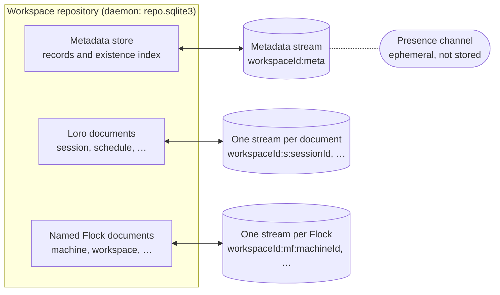

# Document catalogue

This page lists the Loro documents and related stores that a Lody workspace
holds, how each is named, and who creates and writes it. The session document,
which carries most of the weight, has [its own page](session-document.md).

## One repository per workspace

The daemon hosts one `LoroRepo` per workspace. It creates the repository over
a SQLite storage adapter and joins the workspace's metadata room at once
([E-D41](evidence.md#e-d41), [E-D43](evidence.md#e-d43)).

Every document has two separately stored parts
([E-D59](evidence.md#e-d59), [E-D73](evidence.md#e-d73),
[E-D70](evidence.md#e-d70)):

- **The document itself**, a `LoroDoc`. It is opened by room identifier and
  synchronized by joining that room. Opening one is expensive; see
  [persistence and synchronization](persistence-and-sync.md#joining-and-leaving-session-rooms).
- **Its metadata record**, a small set of plain values kept in the
  repository's metadata store, which replicates through the workspace
  metadata stream. Reading it does not open the document.

The metadata store also holds an existence index. A scan of keys under the
prefix `e` yields the room identifiers of every live document without
materializing any metadata values ([E-D81](evidence.md#e-d81)).
A record counts as deleted when its `exists`, `e`, or `deleted` flag says so
([E-D212](evidence.md#e-d212)).

This split shapes everything else. Lists, scans, and dispatch decisions read
metadata and the existence index; only the handful of sessions that need
work have their documents opened.

For screen readers: the following flowchart shows one workspace repository
on the daemon. It contains a metadata store, which holds metadata records and
the existence index and synchronizes through the workspace metadata stream.
It also contains Loro documents, each synchronized through its own stream,
and named Flock documents, each synchronized through its own stream. An
ephemeral presence channel sits beside the metadata stream and is not stored.

_Figure 1: The parts of a workspace repository and the streams that carry
them._

## Document kinds

A document's room identifier is also its document identifier. The cloud
stream identifier is derived from it by prefix
([E-D191](evidence.md#e-d191)), and the daemon's Streams
adapter uses that mapping for documents, the metadata stream identifier for
metadata, and the Flock document identifier unchanged for Flocks
([E-D99](evidence.md#e-d99)).

| Kind | Room identifier | Cloud stream identifier | Evidence |
| ---- | --------------- | ----------------------- | -------- |
| Session | `session-<sessionId>` | `<workspaceId>:s:<sessionId>` | [E-D188](evidence.md#e-d188) |
| Machine | `machine-<machineId>` | The room identifier | [E-D187](evidence.md#e-d187) |
| Agent configuration | `agent-<agentConfigId>` | The room identifier | [E-D187](evidence.md#e-d187) |
| Schedule | `schedule-<id>` | `<workspaceId>:schedule:<id>` | [E-D213](evidence.md#e-d213) |
| Preview comment | `preview-comment-<sessionId>` | Uses the segment `pc` | [E-D209](evidence.md#e-d209) |
| Prompt shortcut body | `shortcut-body:<documentId>` | The same string | [E-D210](evidence.md#e-d210) |
| Task (legacy) | `task-<taskId>` | `<workspaceId>:tk:<taskId>` | [E-D254](evidence.md#e-d254) |
| Session comment (legacy) | Prefix `session-comment-` | The room identifier | [E-D187](evidence.md#e-d187) |

_Table 1: Kinds of Loro document, with their room and stream identifiers._

The workspace metadata stream is `<workspaceId>:meta`
([E-D186](evidence.md#e-d186), [E-D190](evidence.md#e-d190)).

Notes on individual kinds:

- **Session.** The subject of most of this set. A room identifier counts as
  a session only if it has the `session-` prefix, a non-empty suffix, and
  not the `session-comment-` prefix ([E-D192](evidence.md#e-d192)).
  Session comment documents were removed, but their identifiers persist and
  must never be shown as sessions (**Intent**; [E-D189](evidence.md#e-d189)).
- **Machine.** Metadata only. The wrapper writes the metadata record and
  never opens a document ([E-D74](evidence.md#e-d74)). The
  daemon restores its own machine record if an existence event reports it
  deleted or missing ([E-D55](evidence.md#e-d55)).
- **Schedule.** One document per schedule, with a single `definition` map
  read through a schema mirror that tolerates unknown keys
  ([E-D214](evidence.md#e-d214),
  [E-D215](evidence.md#e-d215)). The list of schedules is a
  Flock, `<workspaceId>:sr`, not a Loro document
  ([E-D213](evidence.md#e-d213)).
- **Prompt shortcut body.** Root maps `revisions` and `contents`. Saves are
  whole immutable values with explicit parent revisions, so concurrent saves
  are both kept instead of one silently winning (**Intent**;
  [E-D211](evidence.md#e-d211)). Its identifier lies
  outside the `<workspaceId>:` namespace so that a workspace-wide Streams
  token cannot read private content (**Intent**;
  [E-D210](evidence.md#e-d210)).
- **Task.** The product surface is gone. The helpers remain so that account
  deletion and stream mapping can still find leftover rooms (**Intent**;
  [E-D254](evidence.md#e-d254)).
- **Agent configuration and preview comment.** These prefixes are handled by
  the stream mapping, but this study did not read their schemas or writers.

## Related Flock documents

These are Flock key-value documents, not Loro documents. They are listed
here because they share the repository and the transport.

| Flock | Identifier | Described in |
| ----- | ---------- | ------------ |
| Machine Flock | `<workspaceId>:mf:<machineId>` | [The Flock protocol](../flock-protocol/README.md) |
| Workspace catalogue | `<workspaceId>:wf:workspace` | [Persistence and synchronization](persistence-and-sync.md#the-workspace-catalogue) |
| Schedule registry | `<workspaceId>:sr` | Not covered |
| Code collaboration file index and signal | `<workspaceId>:fi:<masterSessionId>`, `<workspaceId>:fis:<masterSessionId>` | Not covered |

_Table 2: Flock documents that share the workspace repository._

Sources: [E-D255](evidence.md#e-d255),
[E-D213](evidence.md#e-d213),
[E-D178](evidence.md#e-d178).

## Session lifetime

**Creation.** A session comes into being as a metadata record. On the daemon,
`createSession` mints a UUID, builds the metadata with an `initializing`
status, and upserts it; no document is written
([E-D52](evidence.md#e-d52)). The document is opened lazily,
the first time something needs it ([E-D59](evidence.md#e-d59)).

Clients create sessions too. The renderer's writer interface has an
operation that authors a new session's metadata and first user turn as one
unit, against the renderer's own repository, which it uploads over its own
connection (**Intent**; [E-D177](evidence.md#e-d177),
[E-D177](evidence.md#e-d177)). The daemon expects
this: a failure to join a session's stream, typically because the web client
is still creating it, is retried with capped backoff (**Intent**;
[E-D61](evidence.md#e-d61)).

**History backend.** Session history normally lives in the Loro document. A
metadata field selects the backend, `'loro'` or `'roost'`, defaulting to
`'loro'`; with another backend the daemon composes only the control mirror
and no Loro history reader ([E-D227](evidence.md#e-d227),
[E-D58](evidence.md#e-d58)). This set describes the
Loro backend.

**Deletion.** Hard deletion calls `repo.deleteDoc` on the room, from the
session command and from the renderer's writer
([E-D8](evidence.md#e-d8),
[E-D176](evidence.md#e-d176)).
