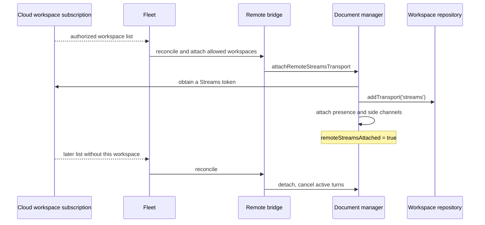
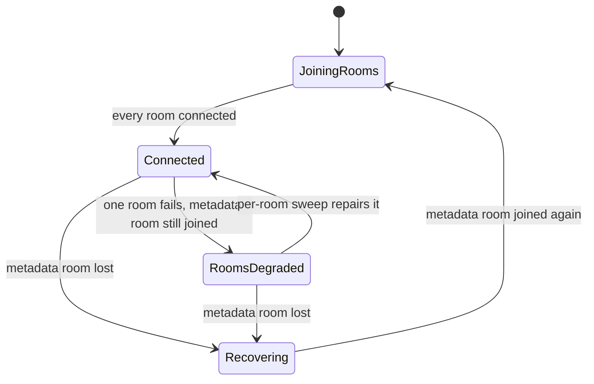

# Persistence and synchronization

This page describes where a workspace repository is stored, how the daemon
attaches it to the cloud, how session rooms are joined and released, and how
the daemon recovers when the connection drops. Cursors and checkpoints are
covered in depth for Flock in
[replication and persistence](../flock-protocol/replication.md); this page
states where Loro documents differ.

## Storage

| Replica | Store | Evidence |
| ------- | ----- | -------- |
| Daemon | `<data directory>/loro-repo/<workspaceId>/repo.sqlite3` | [E-D91](evidence.md#e-d91), [E-D92](evidence.md#e-d92) |
| Renderer | IndexedDB database `lody-loro-repo-db-<namespace>` | [E-D175](evidence.md#e-d175) |

_Table 1: Where each replica stores its workspace repository._

A write is accepted when it is a local commit. The daemon's flush is "a
local durability barrier, not a cloud-synchronization barrier": it awaits
the repository's flush and says nothing about upload
([E-D47](evidence.md#e-d47)).

## Attaching the cloud

The daemon creates its repository with no transport. Rooms stay detached
while it is offline, and the Streams token is fetched only when the remote
bridge attaches ([E-D42](evidence.md#e-d42)).

For screen readers: the following sequence diagram shows the daemon
attaching to the cloud. The cloud's workspace subscription delivers the list
of workspaces the credential may use. The fleet passes that list to the
remote bridge, which attaches each allowed workspace. The document manager
obtains a Streams token, registers the Streams transport with the
repository, attaches presence, and marks the transport attached. If a later
list omits a workspace, the bridge detaches that workspace and cancels its
active turns.

_Figure 1: How the daemon attaches a workspace to the cloud, and detaches it
on revocation._

- **When.** Attachment follows authorization. The fleet applies each
  workspace list by reconciling and then attaching the allowed runtimes, and
  a runtime attaches only if its workspace is in the latest authorized list
  ([E-D12](evidence.md#e-d12),
  [E-D116](evidence.md#e-d116)). A failed attach
  is retried from 5 seconds, doubling to 5 minutes
  ([E-D114](evidence.md#e-d114)).
- **How.** The manager registers the adapter with
  `repo.addTransport('streams', …)` and feeds the adapter's status into the
  recovery controller ([E-D45](evidence.md#e-d45)). The adapter is
  built with the workspace's metadata stream, the document and Flock stream
  mappings, an authorization callback, and replica-bound persistence
  ([E-D97](evidence.md#e-d97)).
- **One token per workspace.** Durable synchronization, presence, and
  machine RPC for one workspace borrow one token provider, which closes when
  its last borrower releases it (**Intent**;
  [E-D9](evidence.md#e-d9)).
- **Revocation.** A running workspace that is no longer in the allowed set
  has its transport detached, its remote backfill disabled, and its active
  turns cancelled ([E-D115](evidence.md#e-d115),
  [E-D111](evidence.md#e-d111)).
- **Outage.** A subscription error starts a 15-second grace timer. An
  explicit refusal then detaches every runtime; any other outage detaches
  plaintext workspaces and leaves encrypted ones attached. A valid list
  cancels the timer ([E-D11](evidence.md#e-d11),
  [E-D13](evidence.md#e-d13)).
- **Detached is healthy.** After a detach, the manager reports the transport
  as connected, because local-only operation is a healthy state
  ([E-D46](evidence.md#e-d46)).

## Joining and leaving session rooms

Opening a session document is not a cheap read. It joins the room and pulls
its stream at once, and the document stays joined in the manager's cache
until it is explicitly cleaned (**Intent**;
[E-D16](evidence.md#e-d16)).

| Operation | Behaviour | Evidence |
| --------- | --------- | -------- |
| `getOrCreateSessionDoc` | Returns the cached wrapper, shares an initialization already in flight, or opens and caches a new one | [E-D50](evidence.md#e-d50) |
| Room join on open | Started without being awaited; waits up to 8 seconds for the first synchronization and then continues "offline-first"; only a failed join is retried, up to 8 times from 1 to 30 seconds | [E-D60](evidence.md#e-d60) |
| `readSessionDocTransiently` | Reads a cached document in place; otherwise opens a temporary wrapper outside the cache, reads, and destroys it, keeping the room joined only until its first synchronization or 150 seconds | [E-D51](evidence.md#e-d51), [E-D40](evidence.md#e-d40) |
| `cleanSessionDoc` | Destroys the wrapper and removes the cache entry; concurrent cleanups are merged | [E-D56](evidence.md#e-d56) |
| Destroy | Releases the room before evicting the document, then disposes the reader and mirror; sets an active status to `idle` unless told to preserve it | [E-D72](evidence.md#e-d72) |

_Table 2: Operations that open and release session documents._

The rules that follow from the cost (**Intent**;
[E-D17](evidence.md#e-d17),
[E-D18](evidence.md#e-d18)):

- **Never open documents in a workspace-wide loop.** A long-lived workspace
  holds thousands of historical session rooms. Opening them all stalls
  start-up and floods the Streams service.
- **Filter first, through indexes that join nothing.** Scans read metadata
  records, the existence index, or a purpose-built local index, and open
  only the candidates, at most four at a time.
- **The cache has no reference counts.** Cleaning a document disposes every
  holder's subscriptions. A caller that cannot prove sole ownership leaves
  the document cached.
- **One place unloads.** A single manager method calls `repo.unloadDoc` and
  invalidates the local data plane's room; a test fails the build if another
  call site appears (**Intent**; [E-D48](evidence.md#e-d48)).

The dispatch watcher is the main consumer of these rules; see
[turn dispatch](turn-dispatch.md#finding-work-without-opening-documents).

A renderer on the same machine joins rooms through the daemon. For each such
room the daemon performs one cloud reconciliation and then drops its own
subscription, because keeping it would recreate the leak of historical rooms
(**Intent**; [E-D49](evidence.md#e-d49)).

## Stream cursors

Flock and metadata cursors are bound to the replica that loaded them, as the
Flock set describes. Loro document cursors are not: the repository keeps
them in a store separate from the document bytes
(**Intent**; [E-D93](evidence.md#e-d93)).

| Cursor | Scope | Evidence |
| ------ | ----- | -------- |
| Metadata and named Flocks | Replica-bound; restored in the same transaction as the data they cover | [E-D98](evidence.md#e-d98) |
| Loro documents, in the daemon | Durable rows shared in `repo.sqlite3` | [E-D14](evidence.md#e-d14) |
| Loro documents, in one-shot commands | In memory, for the life of the process | [E-D94](evidence.md#e-d94) |

_Table 3: Cursor scope by kind of resource and process._

The hazard is the one the Flock set calls a checkpoint ahead of the data. A
one-shot command opens the same database with its own in-memory copy. If it
resumed from the daemon's cursor, it would start past entries it never
loaded and miss them permanently. One-shot commands therefore keep their own
cursors and bootstrap. Every cursor save, of any kind, first awaits the
durability barrier of the resource it covers
([E-D100](evidence.md#e-d100)).

## Recovery

The recovery controller watches two things: the status of the metadata room
and the aggregate status of the transport. It derives one of four health
states ([E-D28](evidence.md#e-d28),
[E-D29](evidence.md#e-d29)).

For screen readers: the following state diagram shows four health states.
Joining rooms leads to connected once every room is connected. Connected
becomes rooms degraded when one room fails while the metadata room stays
joined, and returns when a sweep repairs that room. Connected or rooms
degraded becomes recovering when the metadata room is lost or the transport
disconnects without a joined metadata room. Recovering returns to joining
rooms when the metadata room is joined again.

_Figure 2: Health states of the Streams connection._

Health follows the metadata room. While it is joined, a failure elsewhere
means that one document or Flock room failed, not that the connection did
([E-D34](evidence.md#e-d34)).

### Two signals

Recovery raises two signals, and Lody's notes insist that they stay separate.

| Signal | Raised when | Cost to listeners | Rate limit | Evidence |
| ------ | ----------- | ----------------- | ---------- | -------- |
| `onStreamsOnline` | Every rising edge of health | Must be cheap and idempotent | None | [E-D35](evidence.md#e-d35), [E-D31](evidence.md#e-d31) |
| `onMetaRoomSynced` | The metadata room has caught up after a recovery | Listeners rescan the workspace index | One fan-out per 30 seconds, deferred and never dropped | [E-D39](evidence.md#e-d39), [E-D25](evidence.md#e-d25) |

_Table 4: The two recovery signals._

`onStreamsOnline` releases work that was parked while offline. In the
daemon, its listener retries dirty Machine Flock documents, which arm no
timer of their own ([E-D44](evidence.md#e-d44)). This is the
wake-up that the Flock [sync coordinator](../flock-protocol/sync-coordinator.md)
depends on.

`onMetaRoomSynced` is the expensive signal. It waits for the metadata room
to catch up, for up to 20 seconds, and fires at most once per connection
generation ([E-D38](evidence.md#e-d38)).
A fan-out after a real outage of the metadata room skips the 30-second
floor; a transport-only flap does not. It is deferred and not dropped
because the dispatch watcher's rescan is the only retry for a session whose
reconciliation failed (**Intent**; [E-D24](evidence.md#e-d24)).

Combining the two signals once turned a single stuck room into about 3,400
session reconciliations a minute (**Intent**; [E-D23](evidence.md#e-d23)).

### Reconnecting

| Situation | Response | Evidence |
| --------- | -------- | -------- |
| Unhealthy | A full reconnect, with exponential backoff from 1 to 30 seconds and 20% jitter | [E-D27](evidence.md#e-d27), [E-D36](evidence.md#e-d36) |
| Healthy, one room failed | A per-room sweep with its own backoff; never a transport-wide reconnect | [E-D33](evidence.md#e-d33) |
| Health that does not last 5 seconds | Counted as a failed recovery; the attempt counter grows instead of resetting | [E-D30](evidence.md#e-d30), [E-D26](evidence.md#e-d26) |
| Every 30 seconds | A watchdog offers a reconnect; while healthy it runs only the sweep | [E-D32](evidence.md#e-d32) |

_Table 5: How the recovery controller responds to each situation._

The sweep rejoins rooms whose binding reports `error`, four at a time
([E-D37](evidence.md#e-d37)).

### Room status

A room binding is recoverable only when its status is `disconnected` or
`error` ([E-D96](evidence.md#e-d96)).
`detached` means the transport is not attached to the room at all, which is
the normal state before attachment and after revocation. Reconnecting cannot
change it; only adding the transport can (**Intent**;
[E-D95](evidence.md#e-d95)).

## The workspace catalogue

The workspace catalogue is a Flock, `<workspaceId>:wf:workspace`, holding
rows for server definitions, agent roles, projects, and per-project
defaults ([E-D256](evidence.md#e-d256)).

The daemon keeps two things joined for the life of the process: the metadata
room and the workspace catalogue. Any other catalogue, such as another
machine's Flock, is joined for request-scoped reads and released after five
minutes without one ([E-D103](evidence.md#e-d103),
[E-D102](evidence.md#e-d102)).

A reader's baseline is the first completed catch-up on the Streams binding,
retried with backoff on error. Asking whether a catalogue is ready returns a
boolean within a timeout, and the timeout ends only that waiter
([E-D101](evidence.md#e-d101),
[E-D104](evidence.md#e-d104)).

Lody's stated durability rules for catalogue rows (**Intent**;
[E-D5](evidence.md#e-d5),
[E-D6](evidence.md#e-d6)):

- A row exists once its local write is durable. An upload delay is not a
  failed edit.
- Concurrent edits from two devices may overwrite one another. There is no
  compare-and-swap across devices.
- Private visibility on a role does not make the catalogue a secret store;
  the row is still in the workspace document.
