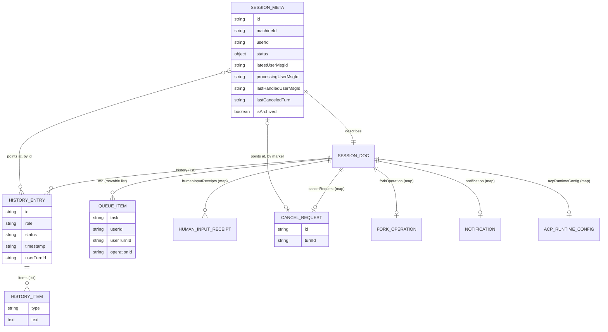

# The session document and its metadata

A session is stored in two places: a Loro document that holds the
conversation and its control state, and a metadata record that holds the
small, frequently read facts about it. This page gives the schema of both.
Who may write each part, and how concurrent writes merge, is on the
[writers and merge behaviour](writers-and-merge.md) page.

## Shape

For screen readers: the following entity-relationship diagram shows a
session metadata record that describes one session document. The document
contains an ordered list of history entries, each of which contains an
ordered list of items; a movable list of queued messages; a map of human
input receipts; and single maps for the latest cancel request, a fork
operation, a notification, preview state, an external history cursor, and
the agent runtime configuration. The metadata record points at history
entries by identifier and at the cancel request by marker.

_Figure 1: The session document's containers and the metadata record that
points into it._

## Document roots

The schema declares these root containers
([E-D243](evidence.md#e-d243)).

| Root | Loro type | Holds |
| ---- | --------- | ----- |
| `session` | Map | The session identifier |
| `history` | List of maps | The conversation: one entry per turn, in list order |
| `mq` | Movable list of maps | Messages queued behind a running turn |
| `humanInputReceipts` | Map of maps | "Explicit human-send outbox": one record per accepted human input |
| `cancelRequest` | Map | The latest stop request only: `id` and `turnId` |
| `forkOperation` | Map | Temporary state of an asynchronous fork; cleared on success |
| `notification` | Map | The terminal notification and its presentation |
| `preview` | Map | Preview candidate and connection |
| `externalHistoryCursor` | Map | Progress of imported external history |
| `acpRuntimeConfig` | Map | The shared agent runtime baseline: available commands and option values |

_Table 1: Root containers of the session document._

No tree container is declared. Root containers are permanent in Loro, so a
finished fork clears the fields of `forkOperation` and keeps the map
([E-D64](evidence.md#e-d64)).

### History entry

Each element of `history` is a map ([E-D225](evidence.md#e-d225)).

| Field | Type | Meaning |
| ----- | ---- | ------- |
| `id` | String | The entry's identifier; for a user entry, the user turn identifier |
| `role` | String | Who authored the entry, for example `user` |
| `timestamp`, `startedAt`, `endedAt` | String, numbers | When the entry was written, started, and ended |
| `status` | String, optional | Delivery and processing state of a user entry; see below |
| `items` | List of maps | The content: text, tool calls, and other typed items |
| `plan` | List of maps | Plan entries with `status`, `content`, and `priority` |
| `userTurnId`, `acpTurnId` | Strings, optional | Links to the user turn and the agent's turn |
| `inputConfig` | Map with a catch-all | The run configuration the turn was sent with |
| `queuedInput` | Boolean | The entry came from the queue |
| `e2eeIntent` | String | The signed intent, in encrypted workspaces |
| `cancellationReason` | String | `user_stop` or `machine_update` |
| `tokenUsage`, `modelInfo`, `author`, `fileDiff` | Plain values | Replaced whole on each write |
| `read` | Boolean, deprecated | Superseded by `status` |

_Table 2: Fields of a history entry._

A user entry's `status` is one of `prepared`, `pending`, `pending_apply`,
`delivery_unknown`, `seen`, `processing`, `handled`, `failed`, or `canceled`
([E-D221](evidence.md#e-d221)). An entry without a status falls
back to the deprecated flag: `read` true means `seen`, and false means
`pending` ([E-D223](evidence.md#e-d223)). An entry is
pending for dispatch while its status is `pending`, `seen`, or `processing`
([E-D224](evidence.md#e-d224)).

### History item

Each element of `items` is a map with a `type` and type-specific fields
([E-D219](evidence.md#e-d219)).

- **Text containers are reserved for streaming.** Only fields that grow
  while an agent streams are Loro text containers: an item's `text` and
  `markdown`, and a tool's `text` and `output`. Other strings are stored as
  plain values, and an existing string is neither migrated nor rewrapped
  (**Intent**; [E-D217](evidence.md#e-d217);
  [E-D218](evidence.md#e-d218)).
- **Unknown item types are accepted.** The validator checks the types it
  knows and accepts the rest, so an older client can read and edit around
  content written by a newer one ([E-D220](evidence.md#e-d220)).

### Queue item

Each element of `mq` is a map with `task`, `userId`, `timestamp`, the
project, and optional `userTurnId`, `operationId`, `isEditing`, and
`editingStartedAt` ([E-D241](evidence.md#e-d241)). The
list is movable so that items can be reordered without deleting and
reinserting them.

## Metadata record

`SessionMeta` is a set of plain values in the repository's metadata store,
not Loro containers ([E-D229](evidence.md#e-d229)). It is what
lists, scans, and the dispatch watcher read.

| Field | Meaning | Evidence |
| ----- | ------- | -------- |
| `id`, `machineId`, `userId`, `createdAt`, `cliType`, `agentType` | Identity, owning machine, and owner | [E-D229](evidence.md#e-d229) |
| `status` | `idle`, `running`, `requestPermission`, or `initializing`, with optional detail | [E-D216](evidence.md#e-d216) |
| `lastRunningSeen` | Time of the last transition into an active status; not refreshed periodically | [E-D230](evidence.md#e-d230) |
| `latestUserMsgId` | The latest user entry published for dispatch | [E-D234](evidence.md#e-d234) |
| `processingUserMsgId`, `lastHandledUserMsgId`, `lastFailedUserMsgId` | The turn being processed, the last one fully handled, and the last one that failed | [E-D237](evidence.md#e-d237) |
| `missingHistoryUserMsgIds` | Acknowledgements that a published turn's history never arrived | [E-D238](evidence.md#e-d238) |
| `settledActivationUserMsgId` | A published turn that was settled without being run | [E-D239](evidence.md#e-d239) |
| `lastCanceledTurn` | A marker pointing at the cancel request in the document | [E-D236](evidence.md#e-d236) |
| `steerTurnStatuses`, `steerOperationLedger`, `queuePromotionLedger` | Records keyed by identifier for steering and queue promotion | [E-D235](evidence.md#e-d235) |
| `pullRequests` | Associated pull requests, in machine-owned order | [E-D231](evidence.md#e-d231) |
| `pullRequestState` | Check and merge state per pull request, in single-letter codes | [E-D233](evidence.md#e-d233) |
| `prLifecycle:<url>` | One lifecycle register per pull request address | [E-D228](evidence.md#e-d228) |
| `historyBackend` | Where the history lives: `'loro'` or `'roost'` | [E-D227](evidence.md#e-d227) |
| `title`, `isArchived`, `isPinned`, `isTabClosed`, `lastModel` | Presentation and housekeeping | [E-D229](evidence.md#e-d229) |

_Table 3: Selected fields of the session metadata record._

### The pending-turn predicate

Whether a session has work waiting is decided from metadata alone
([E-D240](evidence.md#e-d240)). A turn is
pending when one of these holds, in order:

1. `processingUserMsgId` is a non-empty string.
2. `latestUserMsgId` is a non-empty string that differs from
   `lastHandledUserMsgId`.
3. A steering turn has status `pending`.

In each case a turn is excluded if it was acknowledged as having no history,
or if it equals `settledActivationUserMsgId`. The
[turn dispatch](turn-dispatch.md) page describes how the pointers move.

### Why metadata is kept small

Metadata is synchronized to every member's client as part of the workspace
metadata stream, so each field has a cost. Two rules follow from that:

- Pull request state uses single-letter codes to keep one entry under 50
  bytes (**Intent**; [E-D226](evidence.md#e-d226)).
- Liveness is never written to metadata on a timer. Timestamps are written
  only at status transitions, and whether a machine or session is active
  right now is carried by [presence](presence.md) (**Intent**;
  [E-D21](evidence.md#e-d21)).

## Machine metadata

The machine document's metadata record holds `id`, `name`, the owner, host
type, CLI version, operating system, the machine's session identifiers, and
protocol capabilities. Its `lastSeen` field is deprecated and no longer
written ([E-D244](evidence.md#e-d244)).
