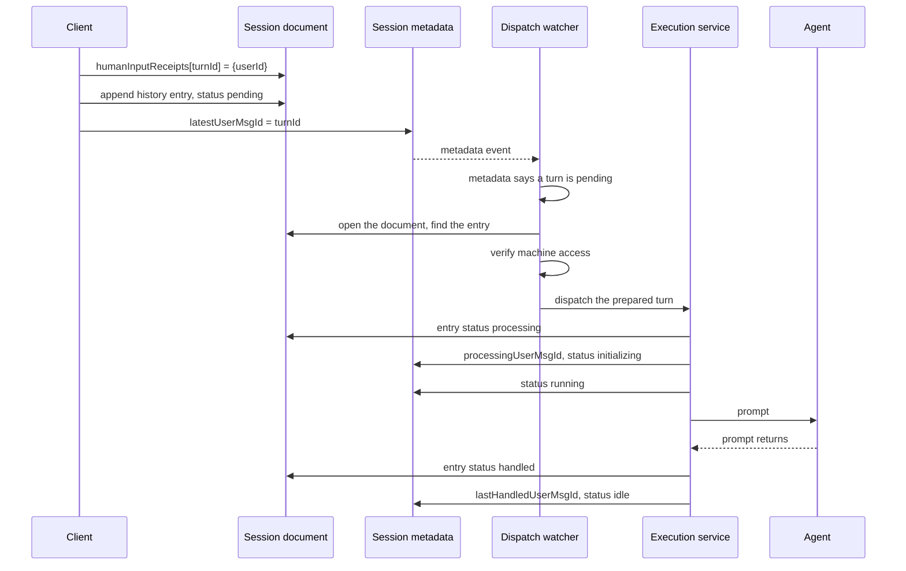
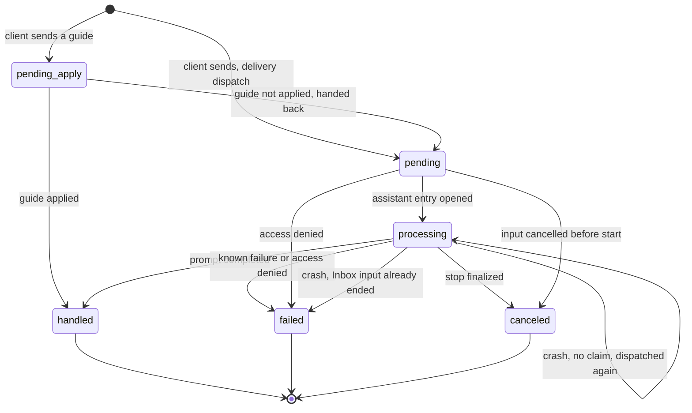
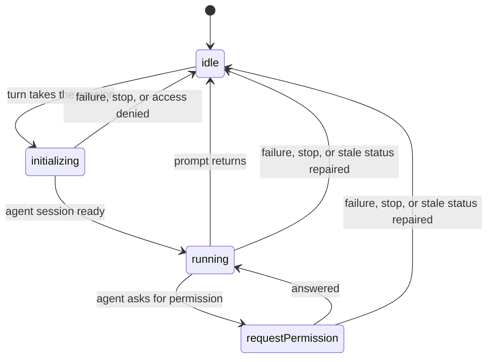

# Turn dispatch

This page follows a user's turn from a client to a running agent by the
_durable_ route: the client writes replicated state, and the owning daemon finds
it. The remote procedure call (RPC) that accelerates the same turn is described
in the [method reference](../lody-streams-rpc/methods.md#turn-dispatch); it is
only an accelerator, and the durable route is what lets the daemon find a turn
without it. Discovery is eventual only while something prompts the daemon to
look again: if a reconciliation throws, no retry is scheduled for that session,
and the turn waits for the next rescan or metadata event (see
[Recovery](#recovery)).

Turns arrive by being written into the session document. The older message
bus is deprecated (**Intent**; [E-D126](evidence.md#e-d126)).

## Making a turn durable

A client makes a turn durable and discoverable with three writes, in two
replicated stores. The owning daemon later derives a fourth, local record.

| Step | What | Where | Writer |
| ---- | ---- | ----- | ------ |
| 1 | Human input receipt | Session document, `humanInputReceipts[turnId]` | The sending client |
| 2 | History entry, `status: pending` | Session document, `history` | The sending client |
| 3 | Activation pointer | Session metadata, `latestUserMsgId` | The sending client, as a dispatch producer |
| 4 | Inbox input row | The daemon's local SQLite Inbox | The owning daemon, from the receipt |

_Table 1: The writes that make a turn durable, in order._

The renderer's send performs steps 1 to 3 in that order
([E-D174](evidence.md#e-d174)).

- **Receipt.** Idempotent for a given turn and user, and refused without an
  identity ([E-D172](evidence.md#e-d172)).
- **Entry.** A pending user entry defaults to `status: 'pending'`
  ([E-D252](evidence.md#e-d252)).
- **Pointer.** Written through a metadata upsert. It is skipped when the
  room is deleted or archived, when the pointer already names the turn, or
  when it names a turn that sits later in history
  ([E-D173](evidence.md#e-d173)).

History and pointer live in different stores on purpose: the pointer is in
workspace metadata so that the daemon can find the turn without opening the
session document (**Intent**; [E-D68](evidence.md#e-d68)).

For screen readers: the following sequence diagram shows a client writing a
human input receipt and a pending history entry to the session document,
and then the activation pointer to session metadata. The metadata change
reaches the owning daemon's dispatch watcher, which opens the session
document, finds the pending entry, verifies access, and hands the turn to
the execution service. The execution service marks the entry as processing,
sets the session status to initializing and then running, and prompts the
agent. When the prompt returns it marks the entry handled and sets the
status to idle.

_Figure 1: A turn on the durable route, from the client's writes to the
agent's reply._

## Finding work without opening documents

The dispatch watcher has three inputs ([E-D135](evidence.md#e-d135)):

- metadata events for session rooms;
- a rescan of the workspace, at start-up and on every `onMetaRoomSynced`
  [recovery signal](persistence-and-sync.md#two-signals);
- turns offered by the RPC accelerator.

A rescan lists rooms from the existence index only
([E-D139](evidence.md#e-d139)). For
each room the watcher reads the metadata record and nothing else. It opens
the document only when the session belongs to this machine, is not archived,
and needs attention ([E-D142](evidence.md#e-d142)).

A session needs attention when its metadata shows any of these
([E-D128](evidence.md#e-d128)):

- an active status;
- a pending turn, by the
  [pending-turn predicate](session-document.md#the-pending-turn-predicate);
- a steering record, or a queue promotion that is not finished;
- a queue change newer than the last queue check;
- a local signal: an unprocessed cancel marker, an offered RPC turn, or an
  access check being retried.

History is deliberately not used to find work. It is where a turn is
selected after activation, not an index to scan at start-up (**Intent**;
[E-D134](evidence.md#e-d134)).
A test asserts that a large idle workspace stays metadata-only during the
rescan (**Test** "keeps a large idle workspace metadata-only during
bootstrap"; [E-D167](evidence.md#e-d167)).

### Bounds

| Bound | Value | Evidence |
| ----- | ----- | -------- |
| Sessions reconciled at once | 4, shared by rescans and live metadata events | [E-D132](evidence.md#e-d132) |
| Slots a rescan may hold | 3, so that a live event can always take the fourth | [E-D141](evidence.md#e-d141) |
| Checks per session | One dispatch check and one cancel check at a time, on separate chains | [E-D138](evidence.md#e-d138) |
| Wait for a published turn's history | 5 minutes | [E-D147](evidence.md#e-d147) |

_Table 2: Bounds on the dispatch watcher._

A slot is held only while the watcher probes the room and its history, not
for the length of the agent's turn
([E-D143](evidence.md#e-d143)).

## From pending turn to prompt

For one session, a dispatch check proceeds as follows
([E-D144](evidence.md#e-d144)).

1. **Guard.** Stop if the session is not owned, is archived, or already has
   an active turn. If metadata shows an active status but no turn owns the
   session, reset the status to `idle` and continue
   ([E-D129](evidence.md#e-d129)).
2. **Find the turn.** Look in history, then promote a queued message, then
   take an offered RPC turn
   ([E-D150](evidence.md#e-d150)).
3. **Handle a pointer with no runnable entry.** If the entry it names is
   already terminal, retire the pointer by recording
   `settledActivationUserMsgId`; never rewrite `latestUserMsgId`
   ([E-D148](evidence.md#e-d148)).
   If the entry has not arrived, wait for history. After five minutes,
   record the turn in `missingHistoryUserMsgIds`, report a delivery failure,
   and unload the document
   ([E-D149](evidence.md#e-d149)).
4. **Verify access.** In an ordinary workspace, check that the turn's user
   may use this machine. A denial fails the turn. A check that could not be
   completed writes nothing and is retried in the background. Encrypted
   workspaces skip this step and rely on the start claim instead
   ([E-D145](evidence.md#e-d145)).
5. **Hand over.** Pass the turn to the execution service
   ([E-D146](evidence.md#e-d146)).
6. **Start.** The execution service opens the assistant entry, which marks
   the user entry `processing` and claims `processingUserMsgId`; sets the
   status to `initializing` and then `running`; and prompts the agent
   ([E-D157](evidence.md#e-d157),
   [E-D158](evidence.md#e-d158)).

An access check that throws is never treated as a denial. The retry uses a
10-second timeout per attempt and backs off from 2 seconds to 1 minute
([E-D127](evidence.md#e-d127); **Intent**
[E-D125](evidence.md#e-d125)).

## The life of a user turn

For screen readers: the following state diagram shows the status of a user
turn's history entry. A sent turn is pending; a guide is pending apply until
it is applied or handed back as pending. A pending turn becomes processing
when the daemon opens the assistant entry. A processing turn becomes handled
when the prompt completes, failed on a known failure or a denial of access,
and cancelled when a stop is finalized. A pending turn can also be cancelled
before it starts. After a crash, a processing turn is dispatched again,
failed, or settled as interrupted, depending on which claim is in force.

_Figure 2: States of a user turn's history entry._

Each transition has a matching change to the metadata pointers.

| Transition | Entry status | Metadata | Evidence |
| ---------- | ------------ | -------- | -------- |
| Sent | `pending` | `latestUserMsgId` set | [E-D174](evidence.md#e-d174) |
| Started | `processing` | `processingUserMsgId` set | [E-D159](evidence.md#e-d159) |
| Completed | `handled` | `lastHandledUserMsgId` set, `processingUserMsgId` cleared | [E-D161](evidence.md#e-d161) |
| Failed | `failed` | `lastHandledUserMsgId` and `lastFailedUserMsgId` set | [E-D162](evidence.md#e-d162) |
| Cancelled | `canceled` | `lastHandledUserMsgId` set | [E-D160](evidence.md#e-d160) |
| History never arrived | No entry | Added to `missingHistoryUserMsgIds` | [E-D149](evidence.md#e-d149) |
| Pointer stale, entry terminal | Unchanged | `settledActivationUserMsgId` set | [E-D148](evidence.md#e-d148) |

_Table 3: Transitions of a user turn and the metadata each one writes._

## Session status

`status` in session metadata is a coarser view of the same life. The shared
module that defines it holds constructors and predicates only; there is no
transition function, and the specification it points to is absent at this
commit ([E-D253](evidence.md#e-d253)). The
transitions below are reconstructed from the places that write it.

For screen readers: the following state diagram shows four session
statuses. Idle becomes initializing when a turn takes the session.
Initializing becomes running when the agent session is ready. Running
becomes request permission when the agent asks a question, and returns to
running when it is answered. Running becomes idle when the prompt returns.
Any active status becomes idle on failure, on a finalized stop, on a denial
of access, or when the daemon finds an active status that no turn owns.

_Figure 3: Session status transitions, reconstructed from the writers._

- **One write primitive.** Every durable status change goes through
  `setStatus`, which upserts metadata and stamps `lastRunningSeen` only when
  the new status is not `idle` ([E-D66](evidence.md#e-d66)).
- **The daemon owns the way out.** A client may write a status, but its
  writer refuses to move a session from `running` to `idle`
  ([E-D169](evidence.md#e-d169)).
- **Ownership is a convention.** `status` is a last-writer-wins metadata
  field with no compare-and-swap. Nothing in the store enforces who writes
  it (**Infer** from the two items above).
- **Stale status is repaired.** A dispatch check, a reconnect, and a
  document unload each reset an active status that no local turn holds
  ([E-D112](evidence.md#e-d112)).
- **Live status is not this field.** What a session is doing now is carried
  by [presence](presence.md) and by an RPC read, never by durable metadata
  (**Intent**; [E-D123](evidence.md#e-d123)).

## What stops a turn starting twice

Five mechanisms keep a turn from starting twice. Only two are durable, and
only one of those exists in an ordinary workspace.

| Mechanism | Store | Durable | Applies to |
| --------- | ----- | ------- | ---------- |
| One dispatch check per session | Memory | No | All workspaces |
| One registered turn per session | Memory | No | All workspaces |
| One presence lease per session | Memory | No | All workspaces |
| Inbox input and active execution | Local SQLite | Yes | Workspaces with an Inbox |
| `agent-start` claim | Local SQLite, `execution.sqlite` | Yes | Encrypted workspaces only |

_Table 4: Mechanisms that keep a turn from starting twice._

Sources: [E-D156](evidence.md#e-d156),
[E-D119](evidence.md#e-d119),
[E-D10](evidence.md#e-d10).

The Inbox begins an input with a conditional update, so that only one
execution can hold a session, and refuses an input that is cancelled or
finished. Releasing an execution marks its input finished. Withdrawing one,
which is what an unresolved access check does, leaves the input free to
begin again ([E-D120](evidence.md#e-d120),
[E-D121](evidence.md#e-d121)).

### After a crash

What happens to a turn that was running when the daemon stopped depends on
which durable mechanism was in force.

| Configuration | Durable evidence left | On restart | Result |
| ------------- | --------------------- | ---------- | ------ |
| No Inbox | Entry `processing`, `processingUserMsgId` | The entry is still dispatchable and is dispatched again | At least once |
| Inbox | An active execution row | The Inbox marks the input finished with a failed receipt; the turn is failed with a notice to send it again | At most once |
| Encrypted workspace | A start row left `started` | The row reads as uncertain; the turn is settled as interrupted | At most once |

_Table 5: What happens to an in-flight turn after a crash._

Sources: [E-D131](evidence.md#e-d131),
[E-D117](evidence.md#e-d117),
[E-D155](evidence.md#e-d155),
[E-D154](evidence.md#e-d154).

The first row is an inference from the dispatch rules and a source comment
that says ordinary crash recovery dispatches the processing turn again
(**Infer**; [E-D151](evidence.md#e-d151)).
This study did not establish whether every production daemon has an Inbox,
so it cannot say which row applies by default.

The encrypted case is the one that the
[RPC formal models](../lody-streams-rpc/formal-model.md#encrypteddispatch)
check: the start claim gives at most one start, and a crash after the claim
leaves a turn that never runs.

## Stopping a turn

A stop travels by two routes under one identifier.

1. The client mints a `cancelId`.
2. It sends the RPC `session/cancel` with that identifier, without waiting.
3. It writes `cancelRequest = { id, turnId }` to the session document.
4. It writes the marker `cancel-request:<cancelId>` to `lastCanceledTurn` in
   metadata.

Sources: [E-D170](evidence.md#e-d170),
[E-D245](evidence.md#e-d245).

The payload is in the document and only the marker is in metadata, so that
metadata stays small. The daemon acts on the durable route once the
document's request reproduces the marker, and both routes end in the same
cancel call ([E-D130](evidence.md#e-d130),
[E-D113](evidence.md#e-d113)).

Handling the same stop twice is prevented at three levels:

- **Durably.** The Inbox records a stop under the session and cancel
  identifier. A second arrival for the same execution has no further effect;
  a conflicting one is an error
  ([E-D118](evidence.md#e-d118)).
- **In memory.** Finalizing a cancelled turn returns at once if it has
  already been finalized
  ([E-D153](evidence.md#e-d153)).
- **By exact match.** A stop that names neither the prompting turn nor the
  current execution does not interrupt the live turn
  ([E-D163](evidence.md#e-d163)).

The watcher's memory of processed markers is cleared when it stops, so a
restart evaluates the durable marker again; the Inbox record makes that
harmless ([E-D136](evidence.md#e-d136)).
Cancel checks run on their own chain, so a stop is not queued behind a
dispatch that is still running (**Intent**;
[E-D133](evidence.md#e-d133)).

## Recovery

- **Rescans.** The watcher rescans at start-up, on every `onMetaRoomSynced`
  signal, and when access is rechecked
  ([E-D137](evidence.md#e-d137)).
- **No retry per session.** A reconciliation that throws is logged, and no
  retry is scheduled for that session. The next rescan, or the next metadata
  event for the session, covers it
  ([E-D140](evidence.md#e-d140)).
  This is why the expensive recovery signal is deferred and never dropped.
- **Late history for a finished turn.** If a turn's entry arrives after the
  turn ran, a completed assistant entry linked to it repairs the user entry
  to `handled` ([E-D152](evidence.md#e-d152)).
- **Graceful shutdown.** The daemon waits 6 seconds for active turns to
  release, then writes failed release receipts for the rest
  ([E-D164](evidence.md#e-d164)).

## Not established

- Whether every production daemon constructs an Inbox, and the order in
  which the Inbox and the watcher start.
- Which component writes the `seen` status.
- Queue promotion and its ledger, beyond their place in the order of
  sources.
- Activation for the `'roost'` history backend.
