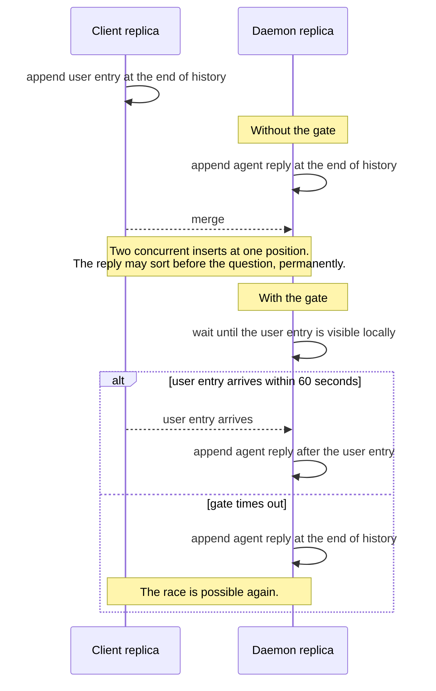

# Writers and merge behaviour

Loro merges concurrent edits automatically, and each container type merges
in its own way. This page describes which component may write which part of
a session, and the places where Lody depends on a particular merge outcome
or defends against one.

## The components

The daemon composes three things over each open session document, in one
place ([E-D57](evidence.md#e-d57)):

| Component | Reads | Writes | Evidence |
| --------- | ----- | ------ | -------- |
| Control mirror | Every root except `history` | Control roots, by setting whole state | [E-D248](evidence.md#e-d248) |
| `HistoryWriter` | The `history` list | The `history` list, and nothing else | [E-D181](evidence.md#e-d181) |
| `SessionData` | The `history` list, with change notification | Only by delegating to the writer | [E-D251](evidence.md#e-d251) |

_Table 1: The three components composed over an open session document._

The control mirror is a schema mirror whose `history` root is marked as
ignored. The mirror library applies every root it receives, including
ignored ones, so Lody wraps the document in a proxy that drops events for
ignored roots. The stated cost avoided is about 35 milliseconds of root
enumeration for a session of 2,000 turns (**Intent**;
[E-D246](evidence.md#e-d246), [E-D247](evidence.md#e-d247)).

The agent's own writes use a thin layer over the same writer: it sets a
field on a turn, marks a turn seen, opens an assistant turn, and applies a
batch of streamed changes ([E-D90](evidence.md#e-d90)).

The renderer composes the same pieces over its own replica
([E-D171](evidence.md#e-d171)).

### What "one writer" means

Lody's internal rule is that `HistoryWriter` is the only history writer
(**Intent**; [E-D249](evidence.md#e-d249),
[E-D15](evidence.md#e-d15)). This means
one writer _instance per open document per process_. It does not mean one
writing replica: the daemon and the renderer each construct their own writer
over their own copy, and their writes merge (**Infer** from
[E-D57](evidence.md#e-d57) and
[E-D171](evidence.md#e-d171)).

The rule exists so that the container layout of every history write is the
same. The writer produces exactly the layout the mirror library would, and
the streaming-specific layouts are safe only because nothing else writes
history (**Intent**; [E-D179](evidence.md#e-d179)).

One writer does not follow the rule. The iOS runtime appends a user turn by
calling the Loro containers directly ([E-D168](evidence.md#e-d168)).
Whether its layout matches the writer's in every field was not checked.

## Who writes what

| State | Writer | Path | Evidence |
| ----- | ------ | ---- | -------- |
| User entry in `history` | The client that sent the turn | That client's `HistoryWriter` | [E-D165](evidence.md#e-d165) |
| Agent output in `history` | The daemon that runs the turn | `session-agent-writes.ts` over the writer | [E-D90](evidence.md#e-d90) |
| Control roots: receipts, queue, fork, preview, notification, runtime configuration | The daemon, and clients for their own actions | The control mirror | [E-D62](evidence.md#e-d62) |
| `latestUserMsgId` | Dispatch producers only | Metadata upsert | [E-D124](evidence.md#e-d124) |
| `processingUserMsgId`, `lastHandledUserMsgId` | Turn execution only | Metadata upsert | [E-D124](evidence.md#e-d124) |
| `status` | The daemon | Metadata upsert | [E-D66](evidence.md#e-d66) |
| `pullRequests`, `pullRequestState` | The owning machine's pull request poller | Metadata upsert | [E-D232](evidence.md#e-d232) |

_Table 2: Which component writes each part of a session._

Two ordering rules sit on top of this table.

**Content before pointer.** The daemon's `appendUserTurn` writes the history
entry and only then publishes `latestUserMsgId`, so that the content lands
before the pointer that advertises it ([E-D69](evidence.md#e-d69)).

**Disjoint pointer slots.** Producers own `latestUserMsgId`; execution owns
`processingUserMsgId` and `lastHandledUserMsgId`. No start or terminal path
may read one slot, wait, and rewrite another (**Intent**;
[E-D124](evidence.md#e-d124)). The reason is that
metadata has no compare-and-swap, as the next section shows.

## Where merge behaviour matters

For screen readers: the following sequence diagram shows the race that the
turn history gate guards against. A client writes a user entry at the end of
the history list in its own replica. Before that entry reaches the daemon,
the daemon would write the agent's reply at the end of its own copy of the
list. Both insertions are at the same position and concurrent, so the merge
may order the reply before the question on every device. With the gate, the
daemon waits until the user entry is visible locally and then writes the
reply after it. If the entry has not arrived within 60 seconds, the gate
opens anyway, and the reply may again sort before the question.

_Figure 1: The concurrent list insertion that the turn history gate guards
against, within its 60-second bound._

| Concern | Merge behaviour | What Lody does | Evidence |
| ------- | --------------- | -------------- | -------- |
| Order of a reply against its question | Concurrent inserts at one list position are ordered by a tie-break that neither writer controls | List writes for a turn wait until the user entry is visible locally, for up to 60 seconds, after which the gate opens and misordering is possible again; map-keyed metadata and status writes are not gated | [E-D165](evidence.md#e-d165), [E-D166](evidence.md#e-d166) |
| The same turn inserted twice | A list keeps both rows | Lookups scan from the end and take the newest row; `updateCopies` keeps every copy in step; export keeps every row | [E-D182](evidence.md#e-d182), [E-D185](evidence.md#e-d185) |
| Reordering history | Lists have no atomic move | A whole-history write that would reorder rows is refused with `unsupported_reorder` | [E-D183](evidence.md#e-d183) |
| Reordering the queue | A movable list moves an element without duplicating it | The queue is a movable list keyed by container identifier | [E-D243](evidence.md#e-d243) |
| The same queue submission twice | A list would keep both | A push is de-duplicated by operation identifier, taken from `operationId` or derived from `userTurnId`, against rows already present locally; a push with neither is not de-duplicated. Under the same identifier, a row that differs in turn, user, task, session configuration, or project is an error; other fields, such as `e2eeIntent`, are not compared | [E-D71](evidence.md#e-d71) |
| A newer client adds a root | A strict mirror rejects the whole state, and the older client can never write again | Every mirror over a synchronized document ignores unknown properties | [E-D242](evidence.md#e-d242), [E-D248](evidence.md#e-d248) |
| Two halves of one value merging | Map fields merge independently | Values that must not be split are stored as one string or one plain value | [E-D222](evidence.md#e-d222) |
| A pointer rewritten from a stale read | Metadata has no compare-and-swap | A settled turn is recorded in its own field beside the producer's pointer | [E-D239](evidence.md#e-d239) |
| Many writers to one array | The whole array is one value; the last writer wins | Per-item state is spread across keys, one register per pull request | [E-D228](evidence.md#e-d228) |
| A stale runtime configuration patch | A later write wins regardless of cause | Patches are serialized, tied to the latest user turn, and versioned | [E-D65](evidence.md#e-d65) |
| Rolling back over a concurrent edit | The rollback would overwrite it | The rollback is refused with `stale_rollback` | [E-D184](evidence.md#e-d184) |

_Table 3: Places where Lody relies on, or defends against, a merge outcome._

Further rules that follow from the same concerns:

- **Validate, then write.** The writer builds its whole plan, parsing every
  new entry, before it changes the document and commits. Stored history is
  never rewritten through the write schema ([E-D183](evidence.md#e-d183);
  **Intent** [E-D180](evidence.md#e-d180)).
- **Author on the live document.** A submission is a local commit on the
  live document, and the transport uploads local events. Authoring on a fork
  and importing the export would skip the upload, copy the whole document,
  and add a permanent peer (**Intent**; [E-D250](evidence.md#e-d250)).
- **No atomicity across roots or documents.** History and the queue are
  different roots, so the queue promotion receipt in the session metadata's
  `queuePromotionLedger` is the recovery point between those writes; a
  notification is published best-effort across independently synchronized
  documents (**Intent**; [E-D63](evidence.md#e-d63),
  [E-D67](evidence.md#e-d67)).
- **No secrets in the shared runtime configuration.** The patch boundary
  removes every option identifier that looks sensitive, whatever an upstream
  caller already filtered, because the document reaches every collaborator
  (**Intent**; [E-D19](evidence.md#e-d19)).

## Forward compatibility

Lody's tests assert the unknown-key behaviour directly. They were read, not
run ([E-D257](evidence.md#e-d257)):

- "preserves the undeclared root key through a full-state update";
- "does not lose concurrent edits made by the newer peer";
- "keeps sending and editing around $kind history after $mode", for unknown
  and malformed item types, after a live import and after a snapshot reopen.

Adding a root or an item type is therefore compatible. Removing or
repurposing an existing root is still a breaking change (**Intent**;
[E-D242](evidence.md#e-d242)).
